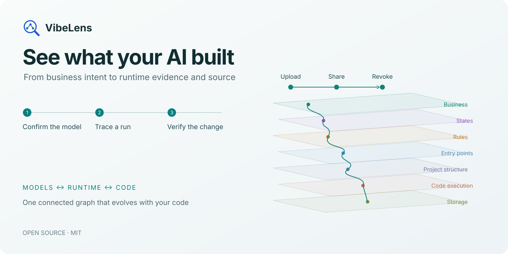
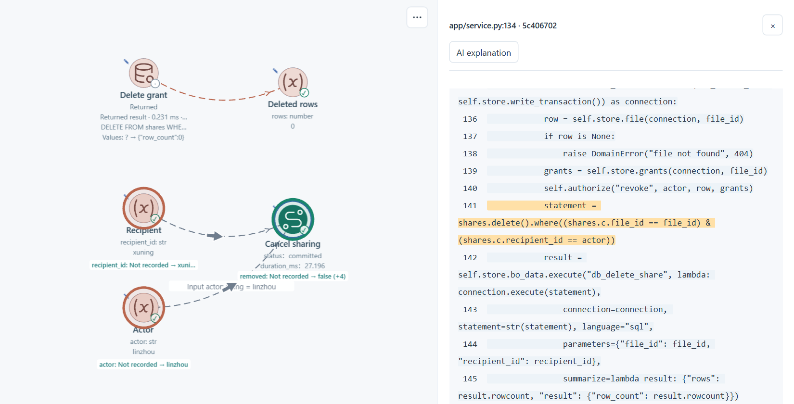
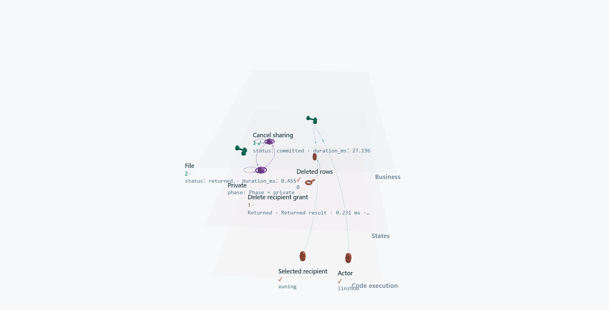

<p align="center"><a href="https://liblog.vip/VibeLens/"></a></p>

<p align="center">
<a href="README.zh-CN.md">中文</a> ·
<a href="https://liblog.vip/VibeLens/?lang=en">Explore VibeLens</a> ·
<a href="https://liblog.vip/VibeLens/demo.html?lang=en">Try the interactive story</a> ·
<a href="#get-started">Install</a>
</p>

<p align="center">
<a href="https://github.com/li-bruce/VibeLens/releases/latest"></a>
<a href="https://github.com/li-bruce/VibeLens/actions/workflows/check.yml"></a>
<a href="LICENSE"></a>
</p>

# Understand the program behind the screen

Your AI can build a working app quickly. Understanding its permissions, state changes and hidden dependencies takes a clearer view.

**VibeLens connects the model you confirm, the code your agent writes, and what actually happens when you run it.** Follow one operation from business intent to the value, function or query that explains its behavior.

## Confirm the model before the code

> “Use $vibelens for this project. Show me the business flow, states and rules so we can confirm how it should work.”

VibeLens turns the conversation into connected **business, state and rule graphs**. Clarify the important details, see the graph, then build. Choose **Drive** to develop from executable state declarations, or **Observe** to inspect your application's own logic.

## Follow the evidence to the source

Record an operation and replay its state and value changes. Keep the relevant chain in a custom view, expand a decision and its inputs, then open the highlighted source.

[](https://liblog.vip/VibeLens/demo.html?lang=en#drill)

Tell your coding agent what you found. VibeLens keeps the model, source mappings and checks alongside the change. Run it again and inspect the result.

[**Try the interactive walkthrough →**](https://liblog.vip/VibeLens/demo.html?lang=en)

## One graph, the detail you need

[](https://liblog.vip/VibeLens/?lang=en#explore)

| Start with a question | Follow it through the graph |
|---|---|
| What should happen? | Business actions, object states and shared rules |
| Where is it implemented? | Entry points → folders and files → functions and parameters |
| What changed at runtime? | Captured inputs, decisions, states, queries and effects |
| What matters in this iteration? | A saved custom view, focused recording and synchronized timeline |

Switch between **2D and 3D**, expand a region, filter relationships, and keep your layout and annotations as the code evolves. Live observation, recording and replay share the same graph.

## Get started

### Codex

Install the complete skill into your project:

```bash
npx skills add li-bruce/VibeLens --skill vibelens
```

Start a project conversation with:

```text
Use $vibelens for this project.
Show the business, state and rule graphs before we implement it.
```

### DeepSeek Harness

Install the packaged plugin from the [v0.13.0 release](https://github.com/li-bruce/VibeLens/releases/tag/v0.13.0):

```bash
dsh plugin --profile web add https://github.com/li-bruce/VibeLens/releases/download/v0.13.0/dsh-vibelens-0.13.0.tgz
```

Open that profile and start a conversation with `/vibelens` followed by your project idea. [Harness setup and tested compatibility](docs/deepseek-harness.md).

**Python · Node.js · React · Vue** — English and Chinese interface. Python 3.11+ runs the shared observer; application adapters stay native. [Installation, dependencies and versioned downloads](docs/usage.en.md).

## Built for inspection

The source is open. Reproducible examples and retained checks let you inspect the implementation as well as the interface.

[Architecture & source guide](docs/source-guide.en.md) · [Supported capabilities](docs/capabilities.md) · [Validation records](docs/review/harness-distribution-20261105/README.md) · [Release notes](docs/releases/v0.13.0.md) · [Distribution](docs/distribution.md)

[MIT](LICENSE) · [Third-party licenses](THIRD_PARTY_NOTICES.md)
