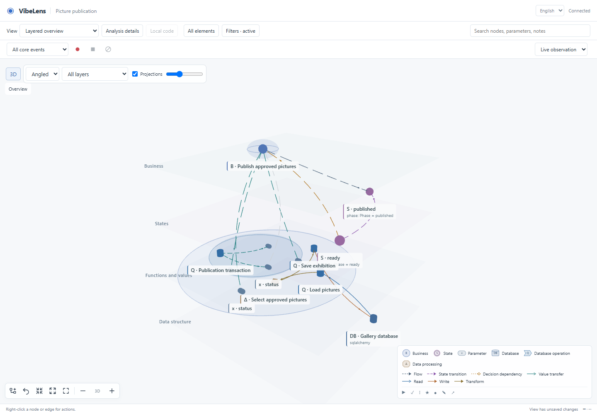
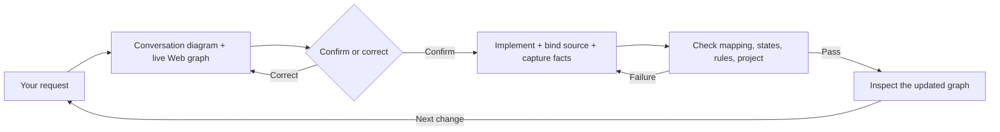
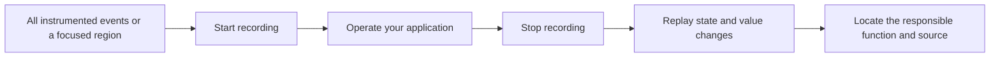

# VibeLens

**See what your coding agent built — and what the program actually does.**

Previously named Business Observer (`business-observer`). [Rename and migration](docs/rename-vibelens.md).

[中文](README.zh-CN.md) · [Product introduction](https://li-bruce.github.io/VibeLens/?lang=en) · [Interactive demo](https://li-bruce.github.io/VibeLens/demo.html?lang=en) · [Installation & usage](docs/usage.en.md) · [Source guide](docs/source-guide.en.md)

Vibe coding can produce a working screen while leaving its decisions, state changes, and internal dependencies difficult to inspect. `vibelens` keeps a developer-facing graph connected to the implementation: business flows, state machines, decision dependencies, important functions, parameters, and actual runtime evidence.


These are views of **one typed network** with shared nodes and typed relationships. Expand a region, follow a relation, or combine types to answer the question in front of you.

Use **3D** for a perspective view of connected semantic layers. Rotate the graph, expand a region across layers, follow its colored containment projections, or focus one layer. Spatial positions and the camera are saved with the project. [Interaction and source guide](skills/vibelens/references/spatial-graph.md).

<details>
<summary>See the spatial viewer</summary>



</details>

## Two development modes

The Skill asks you to choose when adopting it:

| | Drive | Observe |
|---|---|---|
| Business execution | A native executor reads the state declaration. | The application keeps its own logic. |
| What the graph shows | The declaration and actual execution. | The declaration mapped to actual application behavior. |
| Required in both | Source mapping, identifiable probes, actual values, synchronization, and verification. | The same requirements. |

Python supplies shared graph services, recording, validation, export, and the viewer. The application's Python or JavaScript adapter stays native and communicates through versioned JSON. Business execution must continue when the observer is unavailable.

The native Python/JS `bo.fsm/1` executors support a strictly validated **flat state-machine subset**. The complete Python examples additionally exercise concurrent activities, waiting, resources, joins, and recovery. Complex native engines need an explicit adapter.

## From conversation to a checked iteration



1. **Confirm intent.** See a small business graph directly in the conversation and receive its verified Web address. Necessary questions and counterexamples clarify your meaning; the Skill does not proactively add business rules or recommend features.
2. **Code with the graph attached.** Use your preferred architecture, framework, and coding Skills. The coding agent maintains declarations, source anchors, capture fields, and the graph during each batch. A source inventory independent of existing graph nodes catches new features, including login, notifications, queries, and frontend actions.
3. **Verify and repair.** Run scenarios defined from confirmed requirements and independent expectations. Missing mappings, stale source, invalid states, and wrong captured values block acceptance. Fix code and graph, then retest. Report **implementation mapping**, **state constraints**, **business rules**, and **project checks** separately.

Synchronization happens in the agent-managed development workflow. A Skill does not create a daemon that controls every editor. `scan/watch` reports changes; the coding agent must reconcile them before accepting the iteration.

## Inspect live behavior or record an operation



- Watch actual state and value updates on the running graph.
- Record a selected region, or record all **instrumented** events and filter afterwards. Capture scope and replay detail are separate.
- Replay before/after states, values, decisions, and effects. Animate transfers only when actual call or dependency evidence supports them.
- Expand typed regions, drag groups, pin nodes, search hidden details, rename display labels, and add notes or core markers.
- Keep layouts and custom views in `bo_stategraph/config/views/local.json`. Graph regeneration preserves personal annotations by stable ID.
- Preserve per-node/per-relation exclusions, type filters, and expanded groups across iterations. **All elements** clears exclusions while retaining positions and collapse choices. Recordings in the current list belong to the current code/graph version.
- Use built-in business, state-machine, function/parameter, authorization, concurrency/resource, data-dependency, observed-execution, waiting/failure, and shared-membership views. Combine node/edge/region types, depth, scope, and text into custom views.
- Export the complete modeled structure and retained evidence independently of what the current view hides. Hide or remove debug Web components without removing the state declaration or executor.

Viewing, reporting, polling, layout, and recording controls do not create business events. Missing capture stays unknown. A graph that faithfully exposes a business bug can pass mapping checks while failing business checks.

## Install and use

Install the **complete** Skill folder in your project:

```bash
git clone https://github.com/li-bruce/VibeLens.git
cd VibeLens
python tools/install_skill.py --project /path/to/your-project
```

The installer writes `.agents/skills/vibelens` and stops if that directory exists, preserving local changes. Open a new Codex conversation in the target project:

```text
Use $vibelens to build an image review gallery.
A person uploads an image. A reviewer decides whether it appears in the exhibition.
Show the first business graph in this conversation and give me its Web address.
Confirm unclear details before implementation, and keep the graph in sync while coding.
```

Answer the important business questions, choose drive or observe, and confirm the initial graph. The AI handles the intermediate artifacts and checks.

Alternatively, install with the Skills CLI:

```bash
npx skills add li-bruce/VibeLens --skill vibelens
```

You can also ask Codex's Skill installer to install from [the Skill directory](https://github.com/li-bruce/VibeLens/tree/main/skills/vibelens). Use `main` for current updates or `v0.7.2` for this fixed release. Existing `business-observer` installations have an explicit [migration command](docs/rename-vibelens.md). See the [release notes](docs/releases/v0.7.2.md), [independent application trial](docs/review/release-v0.7.0/README.md), and [implementation assessment](docs/assessment/2026-10-24/README.md).

English is the maintained source/documentation language. Conversation follows the user; the viewer offers English/Chinese and saves the preference in the project. Original answers and historical evidence retain their original language.

## Run locally

Shared services require Python 3.11–3.13. JS/TS/React/Vue analysis requires Node.js 20.19+ or 22.12+. The viewer needs a modern WebGL browser.

```bash
python -m venv .venv
# Windows: .venv\Scripts\Activate.ps1
# macOS/Linux: source .venv/bin/activate
python -m pip install -r examples/delivery/requirements.txt -r skills/vibelens/requirements.txt
python tools/setup_adapters.py
npm ci --prefix examples/multilanguage
python tools/multilanguage_demo.py --mode drive
```

The launcher prints the application and graph URLs. See [the multilingual example](examples/multilanguage/README.md) for both modes, [delivery](examples/delivery/README.md) for concurrent checks and resource waiting, and [team archive](examples/team-archive/README.md) for an earlier complete trial.

To open the illustrated introduction locally:

```bash
python -m http.server 8862 --bind 127.0.0.1
```

Visit [the introduction](http://127.0.0.1:8862/docs/site/) for a bilingual overview of the Skill. The separate [interactive demo](http://127.0.0.1:8862/docs/site/demo.html) walks through a sample conversation, graph exploration, recording, replay, and a requested change using local sample data.

To read or modify the implementation, start with the [source guide](docs/source-guide.en.md). It maps the modules and follows a coding iteration, a runtime event, and a graph interaction through the code. [Readability review](docs/review/readability-20261023/README.md) records the syntax comparison and regression results for this update.

## Architecture and boundaries

| Part | Responsibility |
|---|---|
| `skills/vibelens/SKILL.md` | Agent guidance, clarification, iteration, and acceptance |
| `scripts/bo_observer/graph/` | Graph projection, source relationships, focused extraction |
| `scripts/bo_observer/workflow/` | Source inventory, mapping and semantic verification |
| `scripts/bo_observer/observation/` | Bounded capture, recording, replay facts, retention |
| `scripts/bo_observer/data/` | Database catalogs, native data operations, graph projection and refresh |
| `scripts/bo_observer/web/` and `assets/stategraph-viewer/` | Shared API and interactive viewer |
| `scripts/bo_observer/adapters/` | Native Python/JS execution, probes, and source adapters |
| Target project's `bo_stategraph/` | Declarations, native execution, private view preferences |

[JSON protocols and language support](skills/vibelens/references/multilanguage.md) · [Source depth and database relationships](docs/source-data-and-language.md) · [Recording](skills/vibelens/references/recorded-analysis.md) · [Development checks](skills/vibelens/references/continuous-development.md)

The [development roadmap](docs/development/dev-roadmap.md) records implemented source and database views and the remaining API relationship work.

Current adapters inventory Python, JS/TS, React, and Vue source. **Local code** opens source relationships around a selected region; **Code structure** explores the indexed project. Files, classes, functions, parameters, imports, inheritance and call occurrences use stable identities and refresh after edits. Large displays show limits and explicit boundaries; CLI export retains the complete indexed structure. Unresolved dynamic calls stay unknown. [Source view and commands](skills/vibelens/references/code-structure.md).

**Database structure** and **Data operations** views connect tables, document collections, key patterns, graph labels, query targets, selected values, transformations, and transaction outcomes. SQLite, PostgreSQL, MongoDB, Redis and Neo4j have real-runtime checks; Python and Node.js share the same JSON protocol. The data watcher refreshes the graph after model/schema changes and retains personal view settings. [Run the database example](examples/database-observer/README.md) · [Support and boundaries](skills/vibelens/references/database-observation.md) · [Review evidence](docs/review/db-vis/README.md).

Automatic column lineage, typed API relationships, additional database adapters, incremental APIs and performance baselines remain extensions. The tool captures selected fields and supported relationships; it does not prove every possible execution or execute business commands through graph edits.

## Verify

```bash
python tools/verify.py
# With requirements-database.txt installed:
python tools/verify.py --database
```

Checks include strict declarations, source/graph drift, independent mapping evidence, actual state/value/effect scenarios, observer isolation, view relations, recording, localization, installation, and runnable core exports. Read [the current trial record](docs/review/english-gallery/README.md) for failures, fixes, retests, and limits. Historical evidence is retained unchanged.

## License

[MIT](LICENSE). PixiJS is MIT; ELK.js is EPL-2.0. No proprietary yFiles code is included. See [third-party notices](THIRD_PARTY_NOTICES.md).
