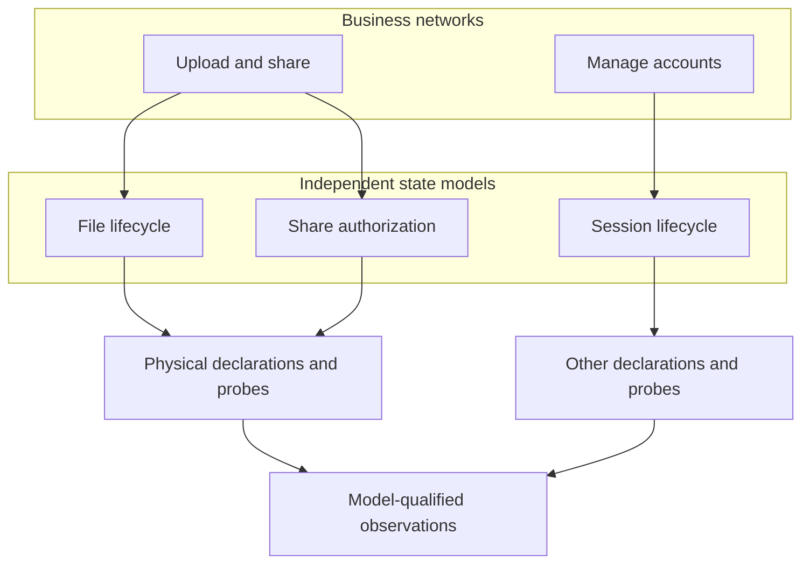

# Multiple model networks

Branch: `feat/model-networks`. Base: `476d2d93`.

The project graph is a collection of typed networks. A layer is a view category,
not an executable model or a requirement that everything be connected. Models
may be independent, share physical declarations, or have explicit cross-model
relations. Their local state names and instance names may overlap; identities
must retain their model namespace.

## Work sequence

- [x] Audit and document tool-only dependencies, native application adapters, and
      pinned download versus offline packaging. Preserve third-party licenses.
- [x] Add a shared network registry and multi-machine declarations, with strict
      validation and a lossless single-model compatibility path.
- [x] Bind all confirmed state models; preserve business networks, shared rules,
      object identities, guards, effects, and cross-model links.
- [x] Carry model identity through Python/JS probes, snapshots, validation,
      queries, recording, replay, and exports. Reject ambiguous ownership.
- [x] Expose multiple networks in every view using shared membership metadata;
      retain existing node IDs, positions, and independent components.
- [x] Update discovery and iteration guidance, source checks, and acceptance so
      no model disappears when a later feature is added or changed.
- [x] Exercise two independent machines, shared local names, an explicit
      cross-model dependency, invalid definitions, missing bindings, and a
      subsequent code/model iteration. Check real capture and Web presentation.
- [x] Run existing regressions, synchronize managed distribution copies, record
      failures/fixes/retests, and commit the completed branch.

## Invariants

The application owns execution and authoritative state. The installed observer
owns visualization and analysis. Drive and observe preserve this boundary.
Multiple-model support does not silently widen an executor's supported statechart
semantics. Unknown engines, invalid definitions, and missing bindings still fail.
Independent networks need no fabricated connecting edge or synthetic root action.
Runtime observations never substitute for independent business expectations.

## Implementation

`bo_models.py` defines model identity, machine selection and subnet membership.
The native executors, collector and validators consume this common contract.
The viewer's `model-networks.js` resolves the same identities for both renderers,
recordings and saved views. Network membership remains separate from lexical
containment, business decomposition and causal execution links.

The arrows illustrate declared mappings; independent capabilities need no
connecting business edge. Runtime relationships require actual evidence.
See [acceptance and retained failures](../review/model-networks-20261112/README.md).
