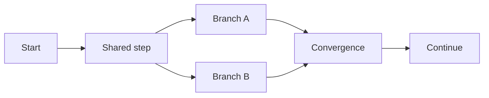

# Concept flow layout: assessment and feature proposal

Status: analysis and baseline diagnosis, 2026-11-05. Branch:
`feat/concept-flow-layout`, based on `main` at `e94d8974`.

The user wants recognizable business routes inside each conceptual plane, with
shared steps, branches and convergence arranged coherently. The requested first
step is research and analysis. This branch currently contains this assessment,
a reproducible diagnostic and its measurements. Product code, model semantics,
Skill instructions, installed copies and published assets remain unchanged.

## Finding

Use direction-aware layout for business, state and rule concerns, each with its
own ordering semantics. Retain type-oriented clustering for suitable structural
views. Reuse the bundled ELK.js engine and existing renderers; add a small semantic
layout adapter rather than another graph renderer.

Grouping nodes by visual type does not make a route readable. A route needs an
ordering relation, branch separation, aligned continuation, explicit feedback,
and stable placement after edits. Layout ranks are columns within one display
plane; they are unrelated to VibeLens's business/state/rule display planes.

## Current implementation and evidence

All paths below refer to the maintained Skill, not generated example copies.

| Location | Current behavior | Consequence |
| --- | --- | --- |
| [`layout.js:79`](../../../skills/vibelens/assets/stategraph-viewer/layout.js#L79) | New preferences select `cluster` | Conceptual views initially receive generic cluster placement |
| [`cluster-layout.js:14`](../../../skills/vibelens/assets/stategraph-viewer/cluster-layout.js#L14) | Cluster key is display layer plus glyph type | Most business actions share one cluster, regardless of route |
| [`layout.js:1142`](../../../skills/vibelens/assets/stategraph-viewer/layout.js#L1142) | ELK arranges coarse clusters; D3 arranges their members | Directed coarse layout does not impose a forward order inside a cluster |
| [`proximity-layout.js:34`](../../../skills/vibelens/assets/stategraph-viewer/proximity-layout.js#L34) | Neighbor lookup is symmetric; seeds form a serpentine grid | Adjacency is encouraged, but forward progression is not constrained |
| [`layout.js:1051`](../../../skills/vibelens/assets/stategraph-viewer/layout.js#L1051) | Expanded subtrees use circle packing and type neighborhoods | A contained business route can remain scattered even when outer groups are ordered |
| [`layout.js:938`](../../../skills/vibelens/assets/stategraph-viewer/layout.js#L938) | Existing `layered` mode sends flat boxes and all visible edge types to ELK | It supplies useful directional layout, but lacks per-concern ordering and compound treatment |
| [`spatial-layout.js:91`](../../../skills/vibelens/assets/stategraph-viewer/spatial-layout.js#L91) | Shared planar seeds retain their X/Z positions | A corrected shared planar result can serve both 2D and 3D |
| [`business.py`](../../../skills/vibelens/scripts/bo_observer/concepts/business.py) | Business networks have actors, trigger, outcome, typed edges and globally unique action IDs | Much of the grouping information already exists; another business model is unnecessary |

The grouping code retains all graph facts. Its layout-only coarsening also drops
edge types and multiple edges between the same roots. A future adapter must keep
the complete source edge IDs/types alongside its optimization graph, so geometry
never establishes a new semantic edge or runtime witness.

### Reproduced baseline

Run `node docs/assessment/2026-11-05-concept-flow-layout/probe-layout.mjs`.
The probe executes the bundled ELK.js 0.12.0 and the actual `calculateLayout`
function. It does not use a solver stub.

| Synthetic fixture | Flow edges | Current cluster: backward / nonadvancing | Existing layered: backward / nonadvancing |
| --- | ---: | ---: | ---: |
| Flat chain, 12 actions | 11 | 3 / 0 | 0 / 0 |
| Expanded network containing the same chain | 11 | 4 / 2 | 0 / 0 |
| Shared prefix, two branches, convergence | 8 | 4 / 0 | 0 / 0 |

These measurements establish a directional weakness, not the quality of a
replacement. Existing layered mode flattens the contained fixture; its zero
backward edges do not establish correct compound layout. No browser, actual
application recording, large-graph performance or new feature acceptance is
claimed. Inputs remain unchanged. Coordinates and option-registration checks are
retained in [layout-probe.json](layout-probe.json).

## Relevant methods

| Method | Useful property | Fit for this feature |
| --- | --- | --- |
| Sugiyama-style layered layout, using ELK Layered | Directional ranks, crossing reduction, node placement, ports and compound graphs | Preferred base; the repository already ships ELK.js |
| Swimlanes and constrained path alignment | Separate routes or responsibilities while retaining readable progression | Adopt the design principles; implement route bands and shared-node handling above ELK |
| Dagre | Client-side directed layout with configurable ranks and spacing | Useful smaller reference; replacing existing ELK would not remove our semantic adapter work |
| fCoSE | Compound force layout with fixed, alignment and relative-placement constraints | Candidate for nonsequential relationship networks; ordinary force attraction alone does not meet the route requirement |
| yFiles hierarchical layout | Incremental placement, lanes, relative ordering and bus routing | Interaction/design reference; its commercial library is not added as a dependency |

ELK documents the layout features above and operates separately from rendering.
Its implementation follows the layered graph-drawing method, including cycle
handling, rank assignment and crossing reduction. [ELK Layered](https://eclipse.dev/elk/reference/algorithms/org-eclipse-elk-layered.html),
[ELK.js](https://github.com/kieler/elkjs),
[ELK algorithm source](https://github.com/eclipse-elk/elk/blob/master/plugins/org.eclipse.elk.alg.layered/src/org/eclipse/elk/alg/layered/ElkLayered.java).

yWorks illustrates how incremental placement, lanes, ordering constraints and
shared edge segments support readable workflows. These are design references,
not a claim that ELK provides the same APIs or guarantees.
[Hierarchical layout examples](https://www.yworks.com/pages/layered-graph-layout.html).

Dagre explicitly targets client-side directed graphs. fCoSE documents fixed-node,
alignment and relative-placement constraints; those capabilities would still
require VibeLens-specific semantic inputs.
[Dagre configuration](https://github.com/dagrejs/dagre/wiki#configuring-the-layout),
[fCoSE](https://github.com/iVis-at-Bilkent/cytoscape.js-fcose).

ELK partition indices order groups along the flow direction. They are not
automatically sideways swimlanes, and one partition field does not describe a
node shared by several routes. Route bands require a separate adapter.
[ELK layout partition](https://eclipse.dev/elk/reference/options/org-eclipse-elk-partitioning-partition.html).
The probe checks which proposed options are registered in the bundled version;
registration does not prove their combined behavior or incremental quality.

## Give each conceptual plane an appropriate ordering

| Concern | Relations that determine order | Other information |
| --- | --- | --- |
| Business | Declared progression and event handoff, within confirmed business scope | Actors, objects, guards and implementation mappings remain contextual; sharing a guard is not progression |
| State | Declared source-state, transition and target-state structure, grouped by state subject/model | Events, guards and effects stay near their transition; loops remain loops; concurrent regions remain parallel |
| Rules | Fact and predicate dependencies through combinations to decision results | Shared predicates remain unique; dependencies do not assert temporal evaluation order or a branch actually taken |

For rules, the layout adapter may orient the *ranking constraint* from input to
consumer even when the stored edge means `consumer depends_on input`. Rendered
arrows retain the stored relation's direction and label. A ranking constraint is
not a reversed graph fact.

Avoid these conflations:

- A node with several outgoing edges is not automatically an XOR decision or an
  AND fork. Existing model conditions and activation semantics decide that.
- Shared predicates, authorization facts and resources are reusable dependencies;
  they do not become business sequence junctions merely because many steps use them.
- Matching names or matching source functions do not establish equal business
  meaning, object scope or parameter binding. Layout never merges such nodes.
- Database row order, source line order and timestamps alone do not establish
  causality. Static call order is also insufficient for asynchronous handoff.

The following is a geometry illustration only. The model supplies the actual
meaning of each branch and convergence.

## Proposed layout pipeline

1. **Select a typed ordering graph.** Read the full graph and current view.
   Separate order, containment, context, cross-plane mappings and projected paths.
   Preserve their original identities and provenance. Conceptual snapshots and
   bindings remain the authority for what the graph means.
2. **Identify routes and shared sections.** Reuse confirmed business networks,
   state subjects and rule decisions. Use known entry/exit references and bounded
   graph traversals to find shared prefixes, divergence and convergence. Avoid
   enumerating all possible paths. A cycle is condensed only inside the layout
   computation and expanded back into the displayed graph.
3. **Place each plane with its own constraints.** Give the principal progression
   a consistent left-to-right direction. Prefer aligned continuation and separate
   branch bands; place a real shared step once at a convergence/divergence point.
   A node may belong to several route selections while retaining one graph ID.
   Use lanes for independent flows only when shared membership can be represented
   honestly; shared dependencies can occupy a common area beside those lanes.
4. **Lay out expanded content recursively.** Apply the same concern-specific
   method inside expanded conceptual containers. Compute the outer footprint from
   the resulting contents, then arrange the surrounding graph. Keep existing
   smooth region styling and boundary attachments. A single global `layered`
   switch does not solve this recursive requirement.
5. **Route and label edges.** Prefer forward connections, separate branch ports
   geometrically, and give retries/backward transitions an outside return route.
   Fan-out bus segments can group compatible links while preserving individual
   edge IDs, conditions, selection and replay. Geometric branch points create no
   business node and imply no synchronization. Reuse the existing routing module.
6. **Apply incrementally.** Preserve stable IDs, exact pins, manual edits and saved
   custom-view choices. New nodes are placed near their relevant predecessors and
   successors; affected local regions can move before untouched ones. Detect
   impossible pin/order combinations and report the conflict. The layout must not
   silently rewrite the model or discard a pin to make the drawing look better.
7. **Share geometry with both renderers.** Use one planar layout for 2D and the
   corresponding 3D plane; layer height is separate. Give same-plane progression
   priority and use cross-plane connections as a soft alignment consideration.
   Adding a visible physical layer must not pull the business route into a knot.

The objective is a preference order: preserve identity/semantics and pins first,
then containment and nonoverlap, then forward progression and readable branches,
then crossings, bends, total length and movement. Conflicting requirements must
be observable. A dense cyclic graph cannot make every edge forward and crossing-free.

Runtime events highlight the existing route. Starting a recording or advancing
a step must not relayout the diagram. Repeated visits retain their event/span
identities in Timeline and replay; a repeated visit does not duplicate the static
concept node. Observed execution can supply an optional focused selection, but
one recording cannot redefine all allowed business paths.

## Modeling guidance and optional annotations

Most inputs already exist: business network membership, typed relations, state
model ownership, initial states, transitions, policy dependencies, bindings and
confirmed source references. The agent should derive layout inputs from those
records first. A layout improvement must not introduce another long questionnaire.

Ask only when the answer changes meaning, for example:

- Does this action automatically trigger the next one, or may someone perform it later?
- Can both branches run, or is one selected by a condition?
- Does continuation wait for every branch or a particular result?

If the answer is already confirmed, reuse it. For implementation details, inspect
the coding work and source bindings. For incomplete facts, display an unresolved
relationship rather than inventing a sequence to obtain a smoother drawing.

Two categories must remain separate:

| Annotation | Authority and validation |
| --- | --- |
| Branch conditions, concurrency, completion requirements, state identity | Part of the existing semantic model; meaningful changes require the established scoped confirmation and tests |
| Route emphasis, preferred direction, lane order, label placement | Presentation hints referring to existing IDs; checked for valid references, without changing execution or confirmation meaning |

A candidate presentation artifact can describe `route_refs`, `node_refs`,
`edge_refs`, `preferred_path`, `direction`, `lane_order` and an optional
`emphasis`. Its schema and project path are to be designed before implementation;
the names here are proposals, not supported protocol fields. Shared-node
membership is many-to-many, never encoded as an additional containment parent.

There is a concrete integration risk: `concepts/business.py` currently copies
unrecognized node properties into semantic meaning. Appending arbitrary layout
tags to business nodes would therefore affect confirmation snapshots. Define an
explicit presentation boundary and tests rather than adding ad hoc fields.
Personal positions remain in existing view preferences. Hint validity should be
bound to the referenced model revision, while a wording change alone must not
move nodes or change their IDs.

During each coding iteration, recall confirmed scope and current route hints;
rescan affected implementation; refresh bindings and changed concepts; validate
hint references; update affected geometry; and run mapping and layout checks.
Source evidence can expose a missing or contradictory relation, but the layout
solver cannot repair it by inventing an edge. Such a discrepancy belongs in the
existing implementation/mapping review.

## Implementation boundaries and sequence

Proposed modules are small adapters around the existing pipeline:

- `concept-flow-input.js`: typed ordering, memberships and provenance.
- `concept-flow-layout.js`: per-concern ELK inputs, local geometry and conflicts.
- `concept-layout-hints`: versioned presentation validation and iteration handling.
- Existing `layout.js`, containment, routing and spatial modules: integration.

These are proposed responsibilities, not files created in this analysis. Start
with business routes and shared steps, then state/decision layouts, recursive
expansion, incremental preservation and 2D/3D/replay integration. Keep this feature
on its branch until the targeted acceptance below is complete. No changes to the
native state engine, observer execution authority or raw recording protocol are
needed for the initial layout feature.

## Acceptance required before claiming the issue is resolved

| Case | Required evidence |
| --- | --- |
| Simple chain, fork, join and shared prefix/suffix | Forward layout for feasible acyclic order constraints, distinct branches, one canonical shared node |
| Shared guard versus real fork | Different visual roles; no invented flow edge or AND/XOR meaning |
| Cycles, retries and cancellation | Original direction/condition preserved; return routes remain individually selectable |
| Several state objects and concurrent activities | Per-object boundaries and declared transitions retained; no false serial ordering |
| Rule DAG with parameterized reuse | Dependencies and binding differences retained; no invented temporal evaluation order |
| Expanded nested regions | Child route remains readable, enclosure follows actual contents, boundary routing is correct |
| Hidden planes, cross-plane mapping and focused custom views | Existing path evidence and identity preserved, with no missing original edges |
| Drag, pin, collapse, filtering and source iteration | Saved coordinates/preferences retained; bounded local movement and explicit conflicts |
| Live/recorded execution and Timeline | Same node/edge/event IDs, correct route activation, no layout motion per step |
| 2D/3D | Shared planar coordinates and route ordering, accurate picking and edge endpoints |
| Scale | Fixed fixtures and hardware; compare same-plane crossings, path bends, overlaps, bounding area, movement and latency |

Count crossings after routing, excluding real shared endpoints and deliberate
bus segments. Measure direction only on declared ordering edges; mapping and
context edges do not count as flow violations. Keep labels and visible node/edge
counts comparable across algorithms so an improvement cannot come from silently
omitting difficult relationships.

Use a range of concept-sized graphs plus the existing 1,000-node/4,000-edge and
4,000-node/16,000-edge rendering fixtures for integration. Record worker solve
time, browser response and stale-result cancellation separately. Browser captures
and real flow tracing remain necessary; the headless probe is only a baseline.
