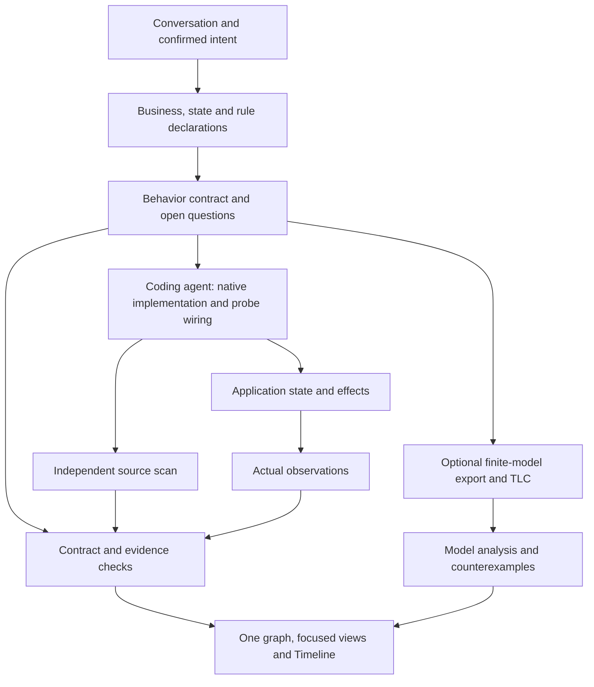

# Behavior contracts and guided verification

[中文审阅](README.zh-CN.md) · [Current implementation](audit.md) ·
[Protocol proposal](protocol.md) · [Implementation plan](implementation.md) ·
[Acceptance](acceptance.md) · [AI development guide](agent-guide.md)

**Status: proposed development baseline, not an implemented capability.**
Prepared on 2026-11-17 from `main` at `106fddb3`, on `feat/behavior-contracts`.
This delivery establishes the branch, source audit, design and implementation
instructions. Runtime, Skill behavior, public pages and release versions are unchanged.

## Outcome

Help a developer describe the intended behavior, keep that description connected
to the evolving implementation, and inspect which requirements have actual
evidence. Add optional analysis of a precisely defined finite model.

The existing business, state and rule networks remain peer models. The application
owns execution and state. VibeLens owns observation, graph projection and checks.
Drive and observe remain independent development choices.

## Five discussions carried into this plan

| Input | User's question | Required design response |
|---|---|---|
| D1 | Can fixed rules, bounded state, explicit operations and a modeled environment describe all possible behavior? | Declare the scope and state space; separate expressibility, faithful implementation and exhaustive exploration. |
| D2 | Which requirements belong in user dialogue, generated code and VibeLens's own contracts? | Give every obligation an owner, enforcement location, evidence requirement and capability boundary. |
| D3 | Which questions are for the human, the coding agent, or later iteration? | Route unresolved issues by meaning, evidence, stage and affected scope; reuse answered questions. |
| D4 | Can product/architect/developer roles change question depth? | Keep knowledge, decision authority and preferred participation separate; use an optional lightweight profile. |
| D5 | Can TLA+ supply useful methods? | Adopt initial conditions, actions, properties, assumptions and refinement mappings; optionally export a supported subset to TLC. |

## Requirements and delivery traceability

| ID | Requirement | Phase | Acceptance |
|---|---|---|---|
| BC-01 | Explicit system scope, domains, instances, environment and build identity | P1, P3 | A04–A06, A10 |
| BC-02 | Separate actual application limits, analysis bounds and abstraction | P1, P6 | A05, A06, A20 |
| BC-03 | Multiple business/state/rule networks with explicit interactions | P1, P3 | A07–A10 |
| BC-04 | Question ownership, authority, timing, evidence and invalidation | P2 | A01–A03, A17 |
| BC-05 | Recalled obligations and automatic reconciliation in each coding batch | P4 | A14–A17 |
| BC-06 | Strict versioned JSON and one canonical owner for every definition | P1 | A04, A23 |
| BC-07 | Source, probe and state/action correspondence across languages | P3, P4 | A11–A16, A27 |
| BC-08 | Separate intent, mapping, capture, business, model and project reports | P4 | A18–A21 |
| BC-09 | Optional finite analysis and source-linked counterexamples | P6 | A19–A22 |
| BC-10 | Readable, isolated modules and minimal application coupling | P0–P7 | A12, A24, A27 |
| BC-11 | Progressive graph inspection, truthful replay and preserved views | P5 | A21, A25 |
| BC-12 | Evidence-backed, concise English/Chinese product story | P7 | A26, A28 |

## Three levels of coverage

These are verification capabilities, not replacements for drive/observe.

| Capability | Mandatory work | What its result can establish |
|---|---|---|
| Implementation observation | Independent owned-source inventory, declared feature mappings, required probes and existing gates | Fidelity and coverage of the configured implementation and exercised observations |
| Behavior contracts | Explicit initial conditions, actions, properties, interactions and implementation bindings for the selected scope | Definition consistency and evidence that selected behaviors match their contracts |
| Finite verification, optional | Supported expressions, complete finite configuration, explicit environment and completed analysis | The selected properties hold in the exact explored model/configuration |

Adopting VibeLens continues to require its existing mapping and observation work.
New projects declare applicable behavior contracts; unsupported or unresolved
parts are visible gaps. Legacy projects retain their existing strict acceptance
until an explicit migration adopts the new obligations. A gap in optional formal
analysis does not disable ordinary observation. Once a required check is adopted,
an agent cannot remove it to make a candidate pass.

"Complete" must carry a scope and dimension. Never collapse source coverage,
probe coverage, modeled behavior and explored states into one percentage.
A valid finite definition can still be too large to exhaust within a budget.

## Architecture

The diagram shows information and development flow. There is no control path from
the model checker to production state changes. All application effects remain
native. Model traces and runtime recordings have separate provenance and storage.

## Completeness that can be improved

1. **Description:** every relevant object, state variable, trigger, external
   outcome and interaction has a definition or an explicit unresolved boundary.
2. **Implementation mapping:** inventory starts from owned source, not existing
   nodes. New handlers, early returns, callbacks and state writes cannot disappear
   merely because the graph did not mention them.
3. **Observation:** configured entry/exit, state, rule, queue and completion facts
   have actual witnesses; gaps are reported with their owners and builds.
4. **Behavior checks:** properties have independent expectations and applicable
   sequence/concurrency cases. An accurately observed bug remains a business failure.
5. **Formal analysis:** supported model, finite domains, assumptions, tool version,
   completion and translation scope are recorded. Runtime evidence is not upgraded
   to exhaustive proof.

The system cannot certify that it inferred every unstated user intention. It can
show the confirmed scope and expose missing definitions, implementation mappings
and observations within that scope.

## Delivery order

| Phase | Deliverable | Dependency |
|---|---|---|
| P0 | Baseline fixtures, source map and compatibility tests | None |
| P1 | Versioned contracts, references, semantic validation and migration | P0 |
| P2 | Question routing, participation preferences and concise recall | P1 |
| P3 | Native bindings, cross-model interactions and actual witnesses | P1 |
| P4 | Batch reconciliation, invalidation and separate verification results | P2, P3 |
| P5 | Graph/Timeline inspection of contracts, boundaries and evidence | P4 |
| P6 | Optional TLC adapter, finite-case checks and counterexample import | P4; P5 for presentation |
| P7 | Independent dialogue trials, cleanup, product copy and release evidence | P0–P6 |

P1–P5 form the core improvement. P6 has an explicit supported subset and must not
delay or weaken the core gates. If delivered separately, release notes and public
copy identify exactly which phases are included.

## Out of scope

- A second production state engine in the observer or the model checker.
- Automatic complete extraction of arbitrary Python/JavaScript semantics.
- Imposed business policies, universal finite limits or inferred human approval.
- A new mandatory user-facing modeling language or ontology taxonomy.
- Mobile adaptation of the debugging viewer.
- Rewriting historical dialogue, runtime evidence or accepted requirements.

The detailed instructions and completion criteria are in the linked documents.
Start implementation with [the AI guide](agent-guide.md), not a disconnected
prompt or a new parallel graph definition.
