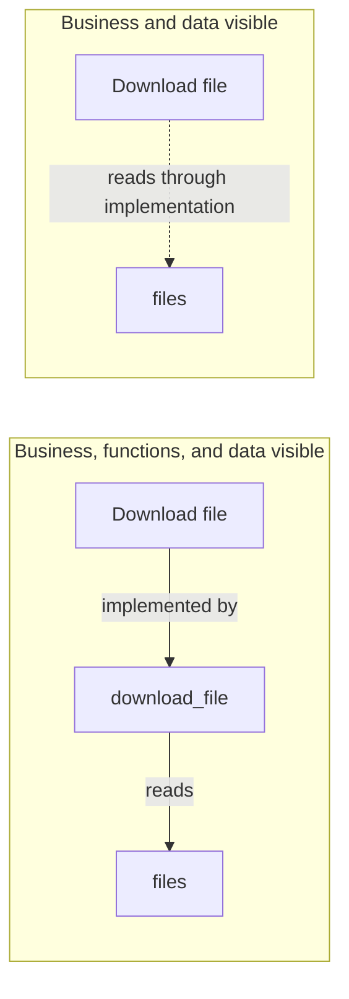
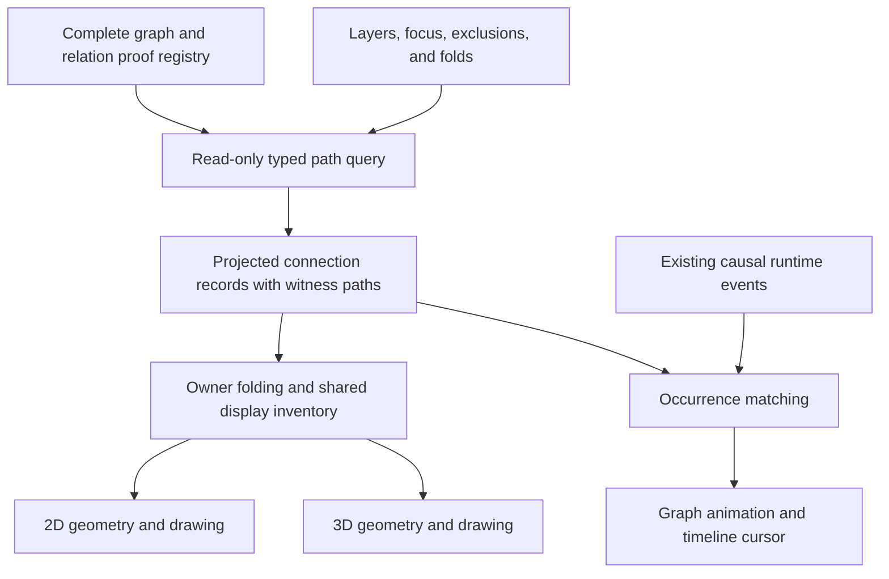

# Dynamic connections across visible layers

Status: proposed design; not implemented or performance-validated.

Date: 2026-11-03. Branch: `feat/dynamic-layer-projection`.
Inspected baseline: `f066ec4d709db1902c4e0ecb2eb37f511a12dc64`.

## Purpose

Keep meaningful connections visible when the user hides intermediate layers. A business action connected to a function that reads a table should remain connected to that table in a business-and-data view. Showing the function layer again should reveal the original steps.

This example does not restrict the feature to those layers. Users can choose any subset of layers, including a single layer or several nonadjacent layers. A path may pass through multiple hidden layers, move against the visual layer order, or leave and return to the same visible layer. The algorithm uses visibility and typed graph relationships; it must not hard-code business/function/data combinations or require a new rule for every selected layer pair.

The complete graph keeps declarations, source relationships, and runtime evidence under their existing IDs. A view adds derived connections with references to the paths they represent. The source state machine, execution engines, and independent observer retain their current roles.



The lower-detail connection means that a represented implementation reads the table. It does not assert that the business node is a physical database caller or that a particular download executed.

## Current implementation

| Component | Verified behavior | Work needed |
| --- | --- | --- |
| `graph-inventory.js:graphInventory` | Assembles all layers with original endpoints; includes generated fields, machine projections, and shared references. | Supply the projection with the complete inventory and canonical reference resolution. |
| `graph-core.js:layoutGraph` | Keeps `all` and `rawEdges`; folds endpoints to visible owners and groups members by endpoints, relation type, and origin. | Separate semantic path projection from geometric folding; retain path evidence when grouping. |
| `graph-layers.js:layerSlice` | Removes boxes outside visible layers and edges with a removed endpoint. | Replace endpoint-only slicing with a visibility plan plus path projection. |
| `layout.js:presentationGraph` | Applies explicit element/type filters to existing compound edges. | Distinguish abstraction from exclusion before traversing paths. |
| `viewer.js:updatePresentation` | Calls layer slicing and then presentation filtering. | Consume one shared projected inventory in both renderers. |
| `bo_observer/graph/relations` | Validates canonical registrations, exact duplicate definitions, and declared summary compositions with bounded proofs. | Reuse portable relation definitions and proof conventions; add a separate read-only projection query. |

Existing group folding represents original edges at visible enclosing nodes. This is a different operation from connecting endpoints across a hidden intermediate path. The current viewer does not implement that path operation.

## Established methods and their fit

| Method | What it contributes | Fit for VibeLens |
| --- | --- | --- |
| Typed path queries / regular path queries | Match sequences, alternatives, inverses, and repetition of named relations. | Specify which hidden paths may produce which view connections. [W3C SPARQL property paths](https://www.w3.org/TR/sparql11-query/#propertypaths). |
| Metapath projection in heterogeneous graphs | Build an endpoint graph when a specified sequence of edge types connects the endpoints. | Closest algorithmic match to business → function → data becoming business → data. [DGL metapath reachable graph](https://www.dgl.ai/dgl_docs/generated/dgl.metapath_reachable_graph.html). |
| Master graph / view graph | Keep a complete graph and a synchronized visible graph, with reverse mappings to original items. | Preserve IDs and evidence when changing the display. [yFiles folding view](https://docs.yworks.com/yfiles-html/api/IFoldingView/). |
| Unified compound-graph complexity management | Coordinate filter/unfilter, hide/show, and collapse/expand while retaining complete and visible graph representations. | Useful for coherent visibility and containment behavior across interaction sequences. [CMGM](https://github.com/iVis-at-Bilkent/cmgm), [Cytoscape integration](https://github.com/iVis-at-Bilkent/cytoscape.js-complexity-management). |
| Transitive reduction | Remove redundant reachability edges in a DAG. | Related to the earlier redundancy question, but insufficient for typed cyclic graphs or view-dependent path connections. [NetworkX reference](https://networkx.org/documentation/stable/reference/algorithms/generated/networkx.algorithms.dag.transitive_reduction.html). |

The recommended design combines typed path projection with a complete/visible graph separation. These are design inferences from the sources, not capabilities provided by one ready-made VibeLens-compatible library.

CMGM and its Cytoscape integration are MIT-licensed candidates for a focused evaluation. The older [expand/collapse extension](https://github.com/iVis-at-Bilkent/cytoscape.js-expand-collapse) documents meta-edges but explicitly states that it is no longer maintained. yFiles is a commercial reference for view architecture. DGL demonstrates the path projection operation; a graph-learning dependency is unnecessary for the initial implementation. No dependency is added by this proposal.

## Relationship to construction-time decisions

| Concern | Construction-time relation insertion | View-time path projection |
| --- | --- | --- |
| Trigger | A declaration or source graph changes. | Visible layers, focus, folds, exclusions, or graph revision change. |
| Question | Is an authored claim duplicated or fully represented under the registered rules? | Which valid paths should connect the currently visible endpoints? |
| Output | Canonical admission decisions and retained proof records. | Derived display connections and their witness references. |
| Persistence | Complete registrations, rules, decisions, and original IDs. | Saved view settings; optional derived-view export tied to a graph revision. |
| Mutation | Explicit validated transaction. | Read-only query over the complete graph and proof registry. |

For example, a declared business-to-table summary may be represented by business-to-function-to-table at construction time. Hiding the function layer can produce a view connection for that same path. It must not reinsert the summary as a new canonical claim or invoke `RelationIndex.insert` on every visibility change.

## Connection semantics

1. **Keep original direct relations.** Direct calls, transfers, state transitions, and branches retain their own identities and evidence. An independently witnessed A → C edge remains present even when A → B → C also exists.
2. **Traverse typed paths.** Use actual validated relation selectors and direction. Layer order and similar labels cannot establish connectivity. The general structural projection accepts eligible paths across arbitrary layers and retains their ordered relation types. A named composition such as `implemented_by / calls* / reads -> reads_via_implementation` improves the label when applicable; separate `writes` from `reads`. Composition rules describe relation meaning, not allowed layer combinations.
3. **Stop at the next visible node.** For a derived connection from visible `u` to visible `v`, every internal node on its witness path must be hidden by abstraction. If B is visible in A → B → C, retain the steps rather than adding an extra projected A → C shortcut. An independent original A → C remains visible.
4. **Separate folding from hiding layers.** Resolve membership references to their canonical identities, query original paths, and then map endpoints to visible enclosing regions. Every displayed region connection retains the actual endpoint IDs. A hidden layer's enclosing region may still need a projection on a visible descendant's layer.
5. **Respect explicit exclusions.** A hidden layer compresses details. An explicitly excluded node, edge, or relation family cuts traversal by default. A user must deliberately opt into an alternative policy that permits traversal through excluded elements. Apply exclusions before path queries.
6. **Preserve meaning when combining paths.** Match result relation, direction, scope, revision, endpoint bindings, and conditions. Keep incompatible conditions or different operations separate. Unknown context cannot prove semantic equivalence. A purely structural connection may state only that a path exists and retain its conditions; it cannot acquire a stronger meaning such as authorization or data lineage.
7. **Preserve joins and alternatives.** An AND gate, resource constraint, negative rule, or mutually exclusive branch may need a visible gate/boundary marker or an explicit compound predicate. Pairwise reachability alone cannot preserve its meaning. A structural path retains these constraints without claiming that it enables an action. Unsupported semantic compositions remain structural, or use an inspectable boundary where the constraints cannot be faithfully compressed.
8. **Handle cycles without flattening their meaning.** Query states include the node and path-rule position. Bound traversal and witness expansion; report incomplete results. A cycle does not make every edge redundant or authorize recursion in a rule that does not declare it.

The identifiers in the example pattern are illustrative. Implementation must bind them to actual validated graph selectors rather than accepting display labels as relation definitions.

### Two kinds of derived connection

- A **structural path connection** says that registered relationships connect the endpoints through hidden details. Its inspectable path remains the explanation. It makes no claim that all steps executed or that the relation types compose into a domain rule.
- A **semantic summary connection** uses an explicit composition rule to describe the resulting meaning, such as reading a table through an implementation. Existing canonical summary rules are reusable when their preconditions match.

General structural projection is the baseline for every layer combination. Use existing validated composition rules for additional semantic labels; a missing named composition does not remove an otherwise valid structural path. At each visible endpoint, split the path into the segments that the current view needs. Each segment can retain a structural label even when no domain-specific composition names that segment.

Avoid drawing a full transitive closure over all visible nodes. The first-visible boundary, explicit exclusions, path constraints, and bounded grouping control density. Traversing an edge backwards requires an explicitly supported inverse step; hiding its layer does not reverse its direction.

Examples independent of specific layer names:

| Visible selection | Complete path | View result |
| --- | --- | --- |
| Layers L1 and L4 | A(L1) → B(L2) → C(L3) → D(L4) | A ⇢ D, with B/C retained as witnesses. |
| Layers L1, L3, and L4 | The same path | A ⇢ C and the original C → D. |
| Layer L1 only | A(L1) → B(L2) → E(L1) | A ⇢ E within the visible layer. |
| Layers L4 and L2 | P(L4) → Q(L3) → R(L2) | P ⇢ R; screen height does not change direction. |
| No layers | Any path | Empty view; no derived connections. |
| All layers | Any path | Original connections, subject to existing folds and exclusions. |

## Runtime observation and timeline

View changes and runtime changes are separate inputs. A layer selection can change the projection while the complete graph is unchanged. New events can change which projected paths have observed activity while the structural projection remains unchanged.

The projection needs two related records:

- A definition path: original node/edge IDs, relation pattern, source/model revision, and conditions.
- An occurrence witness: actual event/span IDs, business execution association, causal links, timestamps, and the definition path segments to which they bind.

Static mappings bind business concepts to implementations; they do not execute as calls. A runtime highlight requires the relevant execution binding and observed physical segments. Shared object IDs, membership, similar timestamps, or separate observations of each node cannot prove one end-to-end execution.

Use existing trace parentage and explicit causal dependencies. Asynchronous work may cross traces through recorded links; matching trace IDs alone is insufficient. [OpenTelemetry Span Links](https://opentelemetry.io/docs/concepts/signals/traces/#span-links) support explicit causal association across traces. Use the existing ingestion and business association model rather than adding a second observation engine.

Graph animation and timeline must consume the same occurrence witnesses. A projected connection may carry several observed occurrences; preserve their individual IDs, ordering, branches, and intervals. Selecting it reveals the represented steps. Hidden operations retain their recorded intervals. Existing node lifecycle definitions determine activation and completion; no synthetic success, completion, or business lifetime is inferred from simple reachability.

## Proposed module boundary



The Python graph subsystem owns portable rule validation, canonical proof expansion, revision checks, and exportable projection contracts. A separate read-only projection module can expose the query independently of a renderer.

The browser uses one visibility planner and one projection adapter before geometry is calculated. For the initial implementation, the current complete inventory can be queried in a Web Worker to keep interactive layer changes responsive. If a Python query is used for larger inventories, it must implement the same contract and pass the same fixture suite. Choose one initial execution location; avoid maintaining two independent semantic engines.

Suggested responsibilities for later implementation:

| Module responsibility | Owns | Does not own |
| --- | --- | --- |
| Visibility planning | Rendered endpoints, abstracted intermediates, excluded elements, canonical reference mapping. | Path meaning or runtime causality. |
| Typed projection query | Allowed paths, first-visible boundaries, grouping keys, proof references, completion limits. | Layout positions or mutation of business/state definitions. |
| Runtime projection | Match observed occurrences to definition paths using existing causal evidence. | New collection/probes or guessed execution. |
| Geometry/render adapters | Region anchors, routing, labels, selection, and path reveal. | Separate 2D/3D reachability algorithms. |

### Proposed display record

The following JSON is a design example, not an accepted schema or implemented API:

```json
{
  "id": "view-path:<deterministic-key>",
  "from": "business.download",
  "to": "data.files",
  "derived": true,
  "relation": "reads_via_implementation",
  "pattern_id": "business-read",
  "graph_revision": "<content-revision>",
  "path_refs": ["<witness-record-id>"],
  "context_key": "<validated-context>",
  "evidence_kind": "source",
  "search_complete": true,
  "witnesses_complete": true
}
```

A witness record contains ordered original node/edge IDs, direction for any explicitly allowed inverse step, hidden layers, context, and derivation rule. Occurrences are separate records keyed to real events. Display connection IDs derive from canonical endpoint IDs, result meaning, and context, independent of names and coordinates. Exported view settings preserve exclusions by these keys across code iterations where they still apply; evidence references are refreshed against the new graph revision.

Complete search does not imply every possible path was enumerated. Keep `search_complete` separate from `witnesses_complete`. Return an exact witness count only if computed; otherwise return a lower bound or leave it unknown. Cyclic walks can have infinitely many variants, so never label a bounded witness sample as the total number of paths.

## Interaction and presentation

- Keep the current layer controls. Recompute projected connections after layer/focus/fold changes and after graph updates.
- Retain solid physical direct relations. Use a distinct dashed pattern for derived connections, with a short useful label such as “reads via 2 functions.” One uniform style token is shared by 2D, 3D, and legends.
- Selecting a projected connection highlights the visible endpoints and offers its actual hidden path. Revealing that path restores the intermediate nodes without resetting the personal layout.
- Keep read/write, direction, conditions, and different execution branches distinguishable. Aggregate equivalent witnesses into one visual connection where appropriate.
- Show dense endpoint groups through a summary connector or on-demand expansion. A bounded query reports an incomplete result rather than suggesting disconnected endpoints are proven unrelated.
- Layer changes affect display. Recording continues under the existing collection scope; the display query does not silently change the recording policy.

## Performance approach

Index adjacency by canonical node, typed selector, and graph revision. Execute a bounded visible-frontier search with path-pattern state; stop at visible intermediates. Cache structural results by graph revision, semantic rules, layers, focus, folds, and exclusion policy. Invalidate graph-dependent proofs when their source changes.

Avoid enumerating all paths or performing a full transitive closure on every frame. In a graph with many hidden shared nodes, the number of reachable visible pairs can itself become quadratic. Budgets, bounded witness samples, and visual grouping remain necessary even with a fast traversal. Cache runtime matching separately; a new event need not rebuild the structural path query. Pointer dragging changes geometry without repeating semantic reachability unless visibility or ownership changes.

Actual latency, memory, and result-size limits must be measured on representative small and large VibeLens inventories before selecting defaults. No performance guarantee is established by this analysis.

## Acceptance plan for implementation

| Area | Required cases |
| --- | --- |
| Arbitrary selections | Property tests over all 512 subsets of the current nine layers, including the empty set; single-layer endpoints joined through hidden layers; multiple and nonadjacent hidden layers; unrelated and isolated nodes. |
| Visible boundaries | Stop at visible B in A → B → C; retain an independently registered direct A → C; support reordered layers without changing meaning. |
| Types and direction | Reads versus writes; inverse only when declared; unknown composition retains an eligible structural path; invalid semantic compositions are not promoted; physical calls never relabeled as direct business calls. |
| Context and rules | Different bindings/conditions/revisions; missing context; denied/negative rules; AND joins, alternatives, and resource constraints. |
| Cycles and multiplicity | Recursion, self-relations, several witness paths, shared membership references, and bounded incomplete search. |
| User controls | Explicit node/edge/type exclusions; layer abstraction; focus boundaries; expand/collapse; manual layout and renamed labels. |
| Canonical consistency | Canonical IDs unchanged; duplicate aliases resolve; represented summaries expand to retained witnesses; no view mutation enters the execution model. |
| Runtime | Static-only path; partially observed path; complete causal witness; concurrent users; repeated calls; asynchronous Span Links; missing causal evidence. |
| Animation/timeline | Same occurrence highlighted in graph and timeline; original intervals preserved; branches and parallel runs do not merge. |
| Iteration | Add/remove/update a source edge, mapping, condition, or relation rule; invalidate stale witnesses and keep unrelated view settings. |
| Renderer agreement | Same visible node IDs and projected connection records in 2D and 3D; geometry may differ. |
| Scale | Increasing nodes, edges, fan-out, shared hidden hubs, and cycles; measure query/update/frame latency and memory; test cancellation and stale worker responses. |

Implementation order: agree on relation patterns and visibility semantics; build and test the read-only query; integrate one shared display inventory; connect existing runtime occurrence evidence; then run real browser interaction, iteration, and scale tests. Keep all existing validation gates.

## Work completed in this branch

- Created the feature branch from the inspected clean baseline.
- Inspected layer slicing, inventory, folding, presentation filtering, and canonical relation insertion.
- Researched the primary sources above and recorded this proposal and acceptance plan.
- No rendering, collection, state-machine, protocol, or dependency behavior has changed in this research turn.
