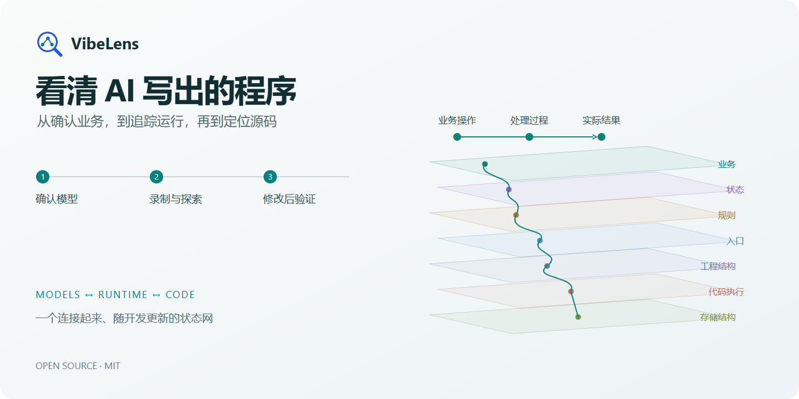
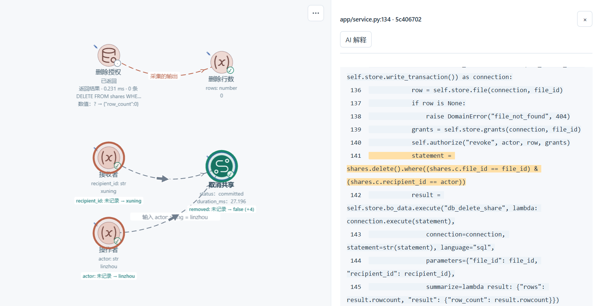
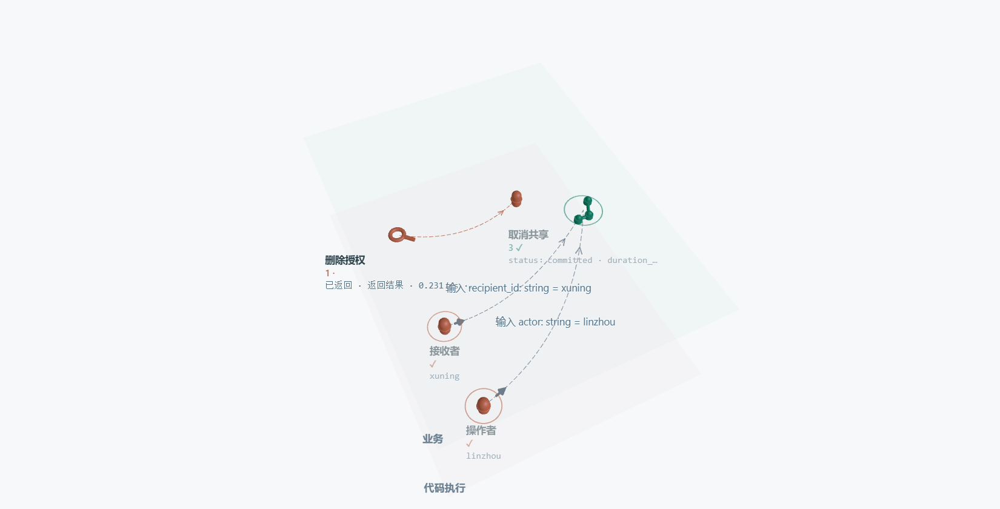

[产品网站](https://liblog.vip/VibeLens/?lang=zh-CN) · [交互演示](https://liblog.vip/VibeLens/demo.html?lang=zh-CN) · [GitHub](https://github.com/li-bruce/VibeLens)

# 界面能用了，内部逻辑看清了吗

AI 可以很快写出一个应用。权限在哪里判断，状态为什么改变，一次操作经过了哪些函数，这些细节仍然需要开发者掌握。

**VibeLens 把你确认的模型、AI 写出的代码和程序的实际运行连接在一张图上。** 沿着一次业务操作，找到解释它的参数、函数和查询。

## 先看懂模型，再开始开发

> “使用 $vibelens 梳理这个项目。先画出业务流、状态和规则，让我确认它应该怎样运行。”

VibeLens 通过对话构建相互关联的**业务网、状态网和规则网**。确认关键细节、看清图，再进入开发。选择 **Drive**，基于可执行的状态声明开发；选择 **Observe**，观察项目自身的逻辑。

不同业务流、不同对象的状态机可以各自建模。既能单独查看一项能力，也能沿着图看清它与其他能力的衔接。多个模型引用同一个函数时，可以追溯到同一处源码。

## 沿着运行，找到问题所在

录下操作，回放状态和数值的变化。在自定义视图中保留相关链路，展开判定和输入参数，再打开高亮的源码。

[](https://liblog.vip/VibeLens/demo.html?lang=zh-CN#drill)

把发现的问题告诉 coding agent。修改过程中，VibeLens 同步维护模型、源码映射和检查。再次运行，查看修改后的实际结果。

[**体验交互演示 →**](https://liblog.vip/VibeLens/demo.html?lang=zh-CN)

## 同一张图，按需深入

[](https://liblog.vip/VibeLens/?lang=zh-CN#explore)

| 你想了解什么 | 沿着图去看 |
|---|---|
| 程序应该怎样运行 | 业务动作、对象状态、共享规则 |
| 具体在哪里实现 | 入口 → 目录与文件 → 函数与参数 |
| 这次运行改变了什么 | 采集到的输入、判定、状态、查询和实际效果 |
| 这轮修改需要关注哪里 | 保存的自定义视图、局部录制和同步时间轴 |

切换 **2D / 3D**，逐层展开，筛选节点与关系。代码迭代后，继续沿用你的布局和批注。实时观察、录制与回放都围绕同一张图展开。

## 开始使用

### Codex

将完整 Skill 安装到项目：

```bash
npx skills add li-bruce/VibeLens --skill vibelens
```

**v0.15.0** 的 SkillHub 安装包约 **0.91 MB**。首次使用时下载查看器资源，后续直接复用；离线环境可使用 GitHub 上的[完整安装包](https://github.com/li-bruce/VibeLens/releases/download/v0.15.0/vibelens-offline-v0.15.0.zip)。

在项目对话中输入：

```text
使用 $vibelens 梳理这个项目。
实现前，先让我确认业务网、状态网和规则网。
```

### DeepSeek Harness

安装 [v0.15.0 中的插件包](https://github.com/li-bruce/VibeLens/releases/tag/v0.15.0)：

```bash
dsh plugin --profile web add https://github.com/li-bruce/VibeLens/releases/download/v0.15.0/dsh-vibelens-0.15.0.tgz
```

打开该 profile，在对话中以 `/vibelens` 开头描述项目。[Harness 安装与已测试兼容范围](https://github.com/li-bruce/VibeLens/blob/main/docs/deepseek-harness.md)。

**Python · Node.js · React · Vue**，界面支持中英文切换。共享观察器使用 Python 3.11+，项目沿用原生语言。[安装、依赖与固定版本下载](https://github.com/li-bruce/VibeLens/blob/main/docs/usage.zh-CN.md)。

## 从界面到源码，都可以查看

完整源码、可运行示例和保留的检查材料，帮助你了解工具本身的实现与验证情况。

[源码结构](https://github.com/li-bruce/VibeLens/blob/main/docs/source-guide.zh-CN.md) · [功能支持](https://github.com/li-bruce/VibeLens/blob/main/docs/capabilities.md) · [验收记录](https://github.com/li-bruce/VibeLens/blob/main/docs/review/release-v0.15.0/README.md) · [更新说明](https://github.com/li-bruce/VibeLens/blob/main/docs/releases/v0.15.0.md) · [发布渠道](https://github.com/li-bruce/VibeLens/blob/main/docs/distribution.md)

[MIT 开源协议](https://github.com/li-bruce/VibeLens/blob/main/LICENSE) · [第三方许可](https://github.com/li-bruce/VibeLens/blob/main/THIRD_PARTY_NOTICES.md)
