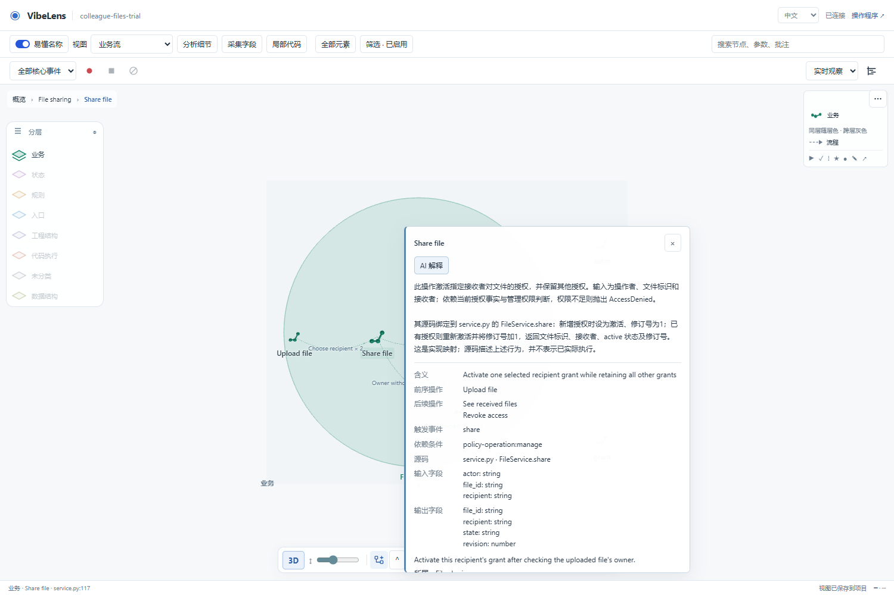
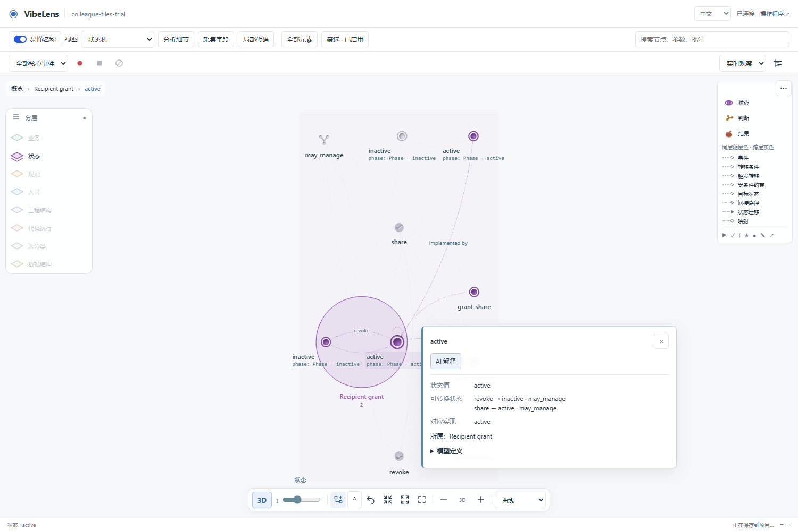

# Concept networks and in-panel explanations

Branch: `feat/concept-flow-layout`. Review date: 2026-11-06.

## User-facing changes

- Business, state and rule concepts retain their own meanings and typed relations, including when a physical declaration has the same ID.
- Concept names follow the current layer. Source-name mode and all original declaration/event identities remain available.
- Node details show declared transitions, conditions, dependencies and implementation references. The AI explanation appears in this same panel in both renderers.

## Findings and corrections

| Finding | Correction | Regression evidence |
| --- | --- | --- |
| A native node could overwrite a different conceptual role with the same ID | Separate the view occurrence; retain the original `concept_id` and exact native target | Conflicting action/variable IDs, parent/root/edge rewrites, unchanged native model |
| Generic variable/state names could override conceptual meaning | Per-concept names take priority; native names remain separate | Business, state, rule and physical names tested together |
| A collection of contained nodes could look like a complete network | Report typed behavioral relations, connected components and unconnected concepts | Containment-only negative case; shared rule-input positive case |
| Details exposed raw definitions without a readable transition summary | Show state/event/guard, rule inputs and business neighbors; retain expandable original definitions | Real 2D/3D node details and source checks |
| Native call edges could be listed as the next business operation | Filter by the business plane and confirmed conceptual edge origin | Native helper-call negative case and real browser check |
| The user had to leave the graph to ask for an explanation | Add a bounded background provider service and in-panel answer | Real local Codex provider and browser-to-service checks |
| A delayed answer could describe an obsolete selection/build | Pin requests to the node, language and graph revision; discard stale results | Selection/build changes, retirement, retry and expiration tests |
| Hierarchical state and abstract-group details needed different treatment | Include inherited transitions; suppress absent values on model/event/effect groups | Hierarchical transition and group-caption regressions |

Connected components are review information. Independent business journeys can legitimately remain separate. The implementation does not fabricate a sequence from similar names or turn a shared function into semantic equivalence.

## Ownership and protocols

The project keeps its native state engine, business effects, rule implementation and observation bindings. The installed observer owns conceptual projection, source lookup, layout, recording and explanation jobs. No AI dependency was added to application functions.

`POST /api/explanations` accepts only a node ID, graph revision and language. The server selects definitions, adjacent typed relationships and at most three existing source bindings. It excludes the runtime event stream. The response is display text with checked evidence IDs; it has no graph-edit or business-command operation.

The default adapter uses an installed, logged-in Codex CLI in an ephemeral read-only run. An explicitly configured compatible HTTP provider is also supported. Provider errors are reduced to a safe UI message. Explanation work is excluded from business capture.

Shape, identity and revision checks establish the provenance of an answer, not the correctness of every generated sentence. The readable definition and source remain available for inspection.

Implementation entrypoints:

- [Concept occurrences](../../../skills/vibelens/scripts/bo_observer/concepts/occurrences.py)
- [Network review](../../../skills/vibelens/scripts/bo_observer/concepts/network_review.py)
- [Evidence packets](../../../skills/vibelens/scripts/bo_observer/explanations/context.py)
- [Provider adapters](../../../skills/vibelens/scripts/bo_observer/explanations/providers.py)
- [Background jobs](../../../skills/vibelens/scripts/bo_observer/explanations/service.py)
- [Readable definitions](../../../skills/vibelens/assets/stategraph-viewer/node-facts.js)
- [Explanation UI](../../../skills/vibelens/assets/stategraph-viewer/node-explanation.js)
- [Skill guidance](../../../skills/vibelens/references/node-meaning.md)

## Validation record

Final acceptance passed against frozen source. The [failure and correction record](failures/README.md) retains the intermediate results.

| Check | Result | Evidence |
| --- | --- | --- |
| Default repository verification | Passed, including source/model synchronization, installation, core-package isolation and both accepted examples | [Complete output](artifacts/full-verify.log) |
| Concept projection and network regressions | 8 tests passed | Complete output above; `tests/test_concept_projection.py` |
| Explanation protocol and job lifecycle | 9 tests passed | Complete output above; `tests/test_node_explanations.py` |
| Node names, readable definitions and stale UI responses | Passed | Complete output above; `tools/test_node_meaning.mjs` |
| Maintained-source checks | Passed for 179 Python modules and 118 JavaScript modules | [Source report](artifacts/source-check.json) |
| Full concept-browser regression | 7 checks passed: three networks, definitions, 2D/3D, camera interaction, focused recording and business Timeline | [Browser report](artifacts/browser.json) |
| Real in-panel AI explanation | Passed with the installed Codex provider; answer visible in the panel; zero additional business events | [Node-details report](artifacts/node-details.json) |
| Managed example refresh, verification and acceptance | Both examples passed without changing their business source, state machines or independent expectations | [Coordinator output](artifacts/acceptance-coordinator.log) and [example logs](examples/) |
| Clean staged Git export | Both exported examples passed with frozen approvals; no regeneration or reapproval | [Export report](artifacts/release-export.json) |

The default verification suite was run unchanged. Optional external database-container suites were not rerun for this change; the browser fixture uses its real local application and SQLite storage.

The browser fixture replays a previously recorded synthetic file-sharing dialogue through normal acceptance. It is a repeatable integration test, not a newly conducted user conversation. No browser response or AI answer is substituted in the real-provider check.

## Try it

Open the local graph, right-click a node, choose **Details**, and select **AI explanation**. The answer appears beneath the node heading. The same panel also lists definitions and source references, including supported transitions for a state node. Both 2D and 3D use this behavior.

The local observer uses an installed, logged-in Codex CLI by default. See [Node meaning and provider configuration](../../../skills/vibelens/references/node-meaning.md) for compatible HTTP providers and configuration. Static Pages does not run the local inference service.

Additional captures: [business network](artifacts/business-network.png), [state network](artifacts/state-network.png), [rule network](artifacts/rule-network.png), [2D state details](artifacts/state-detail-2d.png), [focused recording](artifacts/focused-recording.png), and [business Timeline](artifacts/business-timeline.png).
