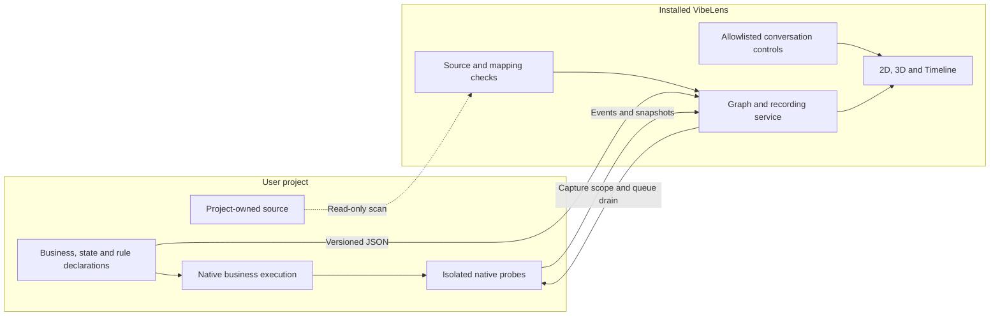
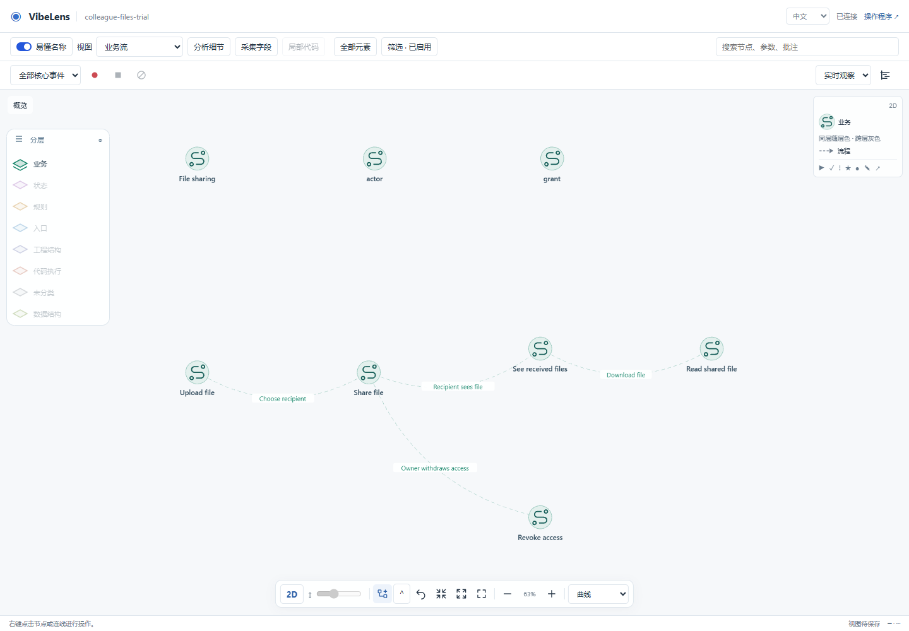
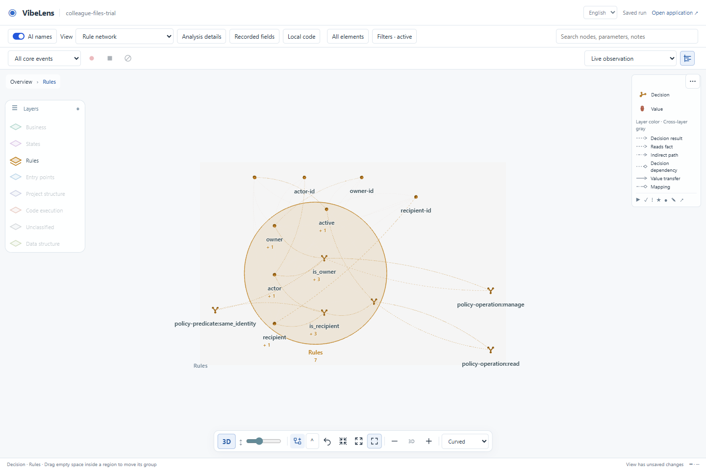

# Integration boundaries and conceptual flow layout

Branch: `feat/concept-flow-layout`. Review date: 2026-11-06.

## Scope and ownership

The application retains its business/state/rule definitions, native executor,
selected observation wiring and independent tests. VibeLens owns source analysis,
projection, recording, viewer layout and its command validation. Business effects
remain local; the observer exchanges versioned JSON with native adapters.

| Area reviewed | Existing foundation / gap | Implemented change |
|---|---|---|
| Native execution | Independent state module and JSON declarations already existed; instructions still favored copying the full observer | `bo_integrate.py` installs six native Python files or two JS modules. Analysis and Web run from the installed Skill with `--root PROJECT` |
| Recording across processes | In-process callbacks could flush and scope capture; other hosts had to implement the bridge | Supplied Python/JS clients register to `bo-capture-control/v1`. Only `scope` and `flush` commands are supported; every producer must acknowledge |
| Framework ownership | Managed hashes detected ordinary edits; application-local hash changes could obscure the original dependency | Native receipts are also checked against installed canonical bytes. Legacy managed upgrades add canonical source maps. Corruption enters recall, inventory, inspection and acceptance |
| Business source inventory | Framework copies could be classified as application implementation | Canonical verified copies are excluded from business coverage; integrity remains checked independently |
| Iteration continuity | Source and tool fingerprints already invalidated old checks | Framework receipts and integrity results also participate in candidate identity. Removing a managed receipt is detected against the prior baseline |
| Agent controls | View/replay operations already used an allowlist and project/chat scope | Integrity is checked before controls; generic host namespaces require an actual chat ID. Commands have no source-edit or business-call operation |
| Traversal | Some framework/architecture walks filtered dependencies after descending | Installation, fingerprints, package parity and architecture inventory prune dependency/cache directories before traversal |
| Conceptual geometry | Type/source clustering mixed the direction of business and decision chains | ELK ranks typed conceptual relations within each plane and expanded region; other source/type clustering remains available |
| Modeling hints | No validated route membership for layout | Optional `discovery.presentation.routes` names existing connected paths with source references. Shared nodes keep one identity; labels cannot create edges or change confirmed meaning |

Primary implementation entrypoints:

- [Native integration](../../../skills/vibelens/scripts/bo_observer/delivery/integration.py)
- [Capture bridge](../../../skills/vibelens/scripts/bo_observer/observation/capture_bridge.py)
- [Workflow inventory](../../../skills/vibelens/scripts/bo_observer/workflow/bo_sync.py)
- [Scoped controls](../../../skills/vibelens/scripts/bo_observer/control/cli.py)
- [Conceptual geometry](../../../skills/vibelens/assets/stategraph-viewer/concept-flow-layout.js)
- [Route validation](../../../skills/vibelens/scripts/bo_observer/concepts/presentation.py)
- [Agent integration instructions](../../../skills/vibelens/references/integration-boundary.md)

The review covered the maintained Skill, native Python/JS adapters, HTTP service,
source/model maintenance, control routing, viewer geometry and shipped managed
copies. Optional database/policy/OTel adapters retain their existing package and
explicit integration boundaries; this change does not claim all optional drivers
are contained in the minimum eight files or replace their protocols.

## Layout behavior

Business handoffs, state transitions and rule dependencies supply different
ordering constraints. Cross-layer mappings do not establish business order.
Rules read left to right from inputs toward decisions; this is dependency order,
not a claim about actual short-circuit evaluation. Real loops retain return edges.

The existing bundled [ELK Layered algorithm](https://eclipse.dev/elk/reference/algorithms/org-eclipse-elk-layered.html)
provides rank assignment and crossing reduction. [Model-order preferences](https://eclipse.dev/elk/reference/options/org-eclipse-elk-layered-considerModelOrder-strategy.html)
use optional route membership as a stable tie-break. No additional rendering
library or remote AI service is required.

Expanded conceptual regions use their full footprints. Multiple concept planes
move as whole layouts to avoid scrambling the internal ranks. Both renderers use
the same planar seed geometry. Ordinary refresh preserves saved coordinates;
newly opened regions place new children, while Arrange explicitly reflows a view.
Exact pins take priority over directional aesthetics. Existing external endpoints
are not silently rearranged merely because a region opens.

## Evidence and limits

The default repository gate passed with exit code 0. Native dependency and capture
tests, real 2D/3D browser checks, source checks and both clean Git exports passed.
The multi-language suite exercised 18 cases across drive/observe and observation
on/off/fault modes. See [validation.json](validation.json) for the result index and
[coupling-verify-final.log](coupling-verify-final.log) for the complete gate output.
The optional external database service suite was not rerun; its adapters are
unchanged by this work.

- `layout-regression.json`: real bundled ELK tests for chains, nested regions,
  shared fork/join, rule dependencies, cycles, three simultaneous concept planes,
  pins, shared XY/XZ and 960 nodes / 880 edges. The measured layout time is one
  local run, not an FPS claim or a general large-graph guarantee.
- `concept-browser/`: real accepted file-sharing project, 34 conceptual nodes,
  14 implementation mappings, independent API requests, focused recordings,
  lifecycle intervals and 2D/3D interaction. This is a scripted replay of an
  existing independent trial, not a new human conversation.
- `flow-browser-final/result.json`: keyboard expansion/movement, pinning,
  Arrange, collapse/reopen and reload in both renderers. Twelve internal rule
  dependencies advance in each mode; no application-write endpoint was called.
- `edge-browser/`: real Pixi drawing and Three.js instance colors for same-layer
  and cross-layer lines and animated arrows, using immutable recorded events.
- `source-check.json`: maintained source scope, syntax, lint and formatting.
- `native-boundary.log`: eight dependency-boundary checks, including isolated
  Python and JavaScript waiting/resume execution without the observer package.
- `capture-bridge.log`: seven real HTTP/client checks covering scoped capture,
  all-producer acknowledgements, queue draining, interruption, invalid commands
  and exclusion of observer control traffic.
- `multilanguage-acceptance.json`: actual native Python/JavaScript and compiled
  React/Vue handler evidence, including the independent state/effect assertions.
- `examples/`: preserved baseline hashes, unchanged native business contracts,
  actual inspect/verify/accept results and installed/canonical entrypoint parity.
- `clean-export.json`: both examples passed from the staged Git export using
  their frozen approvals, without regenerating or accepting changed source.
- `failures.json`: failed checks, diagnosis, fixes and retest references.

Archived command text and test summaries use UTF-8 with normalized line endings.
Test messages and exit results are retained. Frozen baselines and viewer
recordings keep their bytes.

Checks cannot sandbox an AI host with unrestricted filesystem access. Stronger
enforcement requires the installed Skill to be read-only to the coding agent.
The host supplies the actual chat identity/message; VibeLens validates the scope
and operation but cannot authenticate a host that fabricates those inputs.
Host namespace tests exercise the shared command contract; they are not live
end-to-end trials in every AI product.

Legacy installations remain managed rather than being destructively migrated.
Old receipts without a source map gain canonical comparison on their next
explicit upgrade. Native monitoring remains optional at runtime; unavailable or
disconnected capture is reported as a gap, never a successful recording.
All producers register before recording; changing a build restarts/rebinds its
producer. Dynamic producer removal/replacement during a recording is not added.

## Branch cleanup

The before/after inventories and original commit IDs are retained in the branch
JSON files. Removed 26 merged local branches and 15 merged remote branches.
Three clean worktrees were detached at their existing commits; their files were
preserved. `feature/graph-context-for-ai` retains an unmerged commit and remains
alongside `main`, `dev`, and this feature branch.

This work is delivered on the feature branch. Main, release tags and Pages are
not part of this publication.
