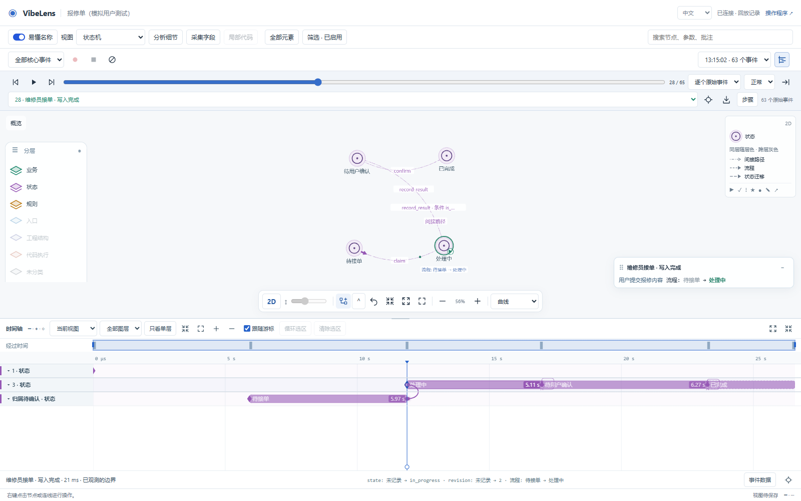
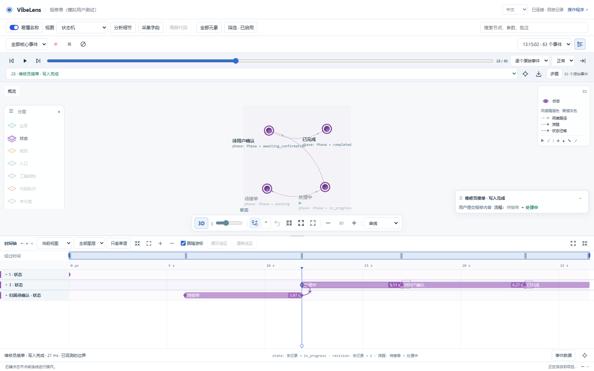
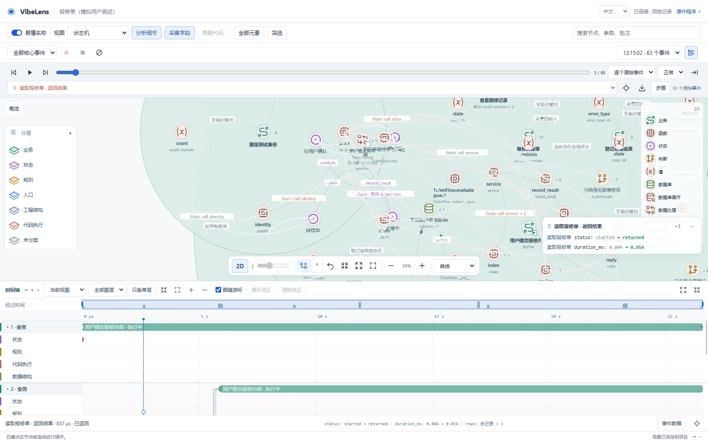
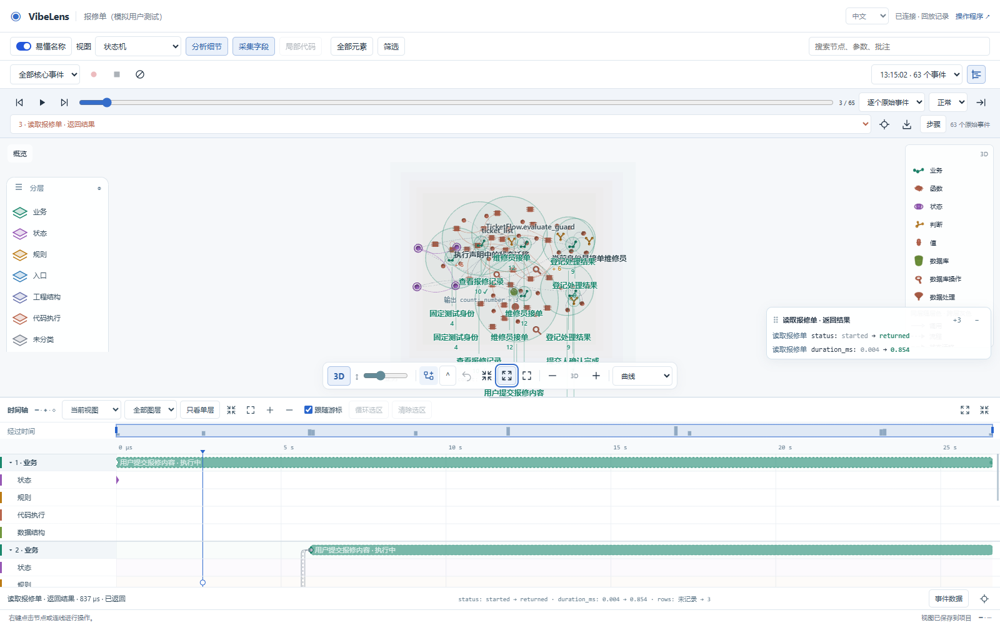

# Layer colors for lines and moving arrows

Implemented on `feat/concept-flow-layout`, following analysis commit `9218c1e7`.

| Connection | Color | Meaning |
|---|---|---|
| Endpoints on the same displayed layer | That layer's palette color | Line pattern follows the relationship type |
| Endpoints on different layers | Gray, `#6f7d8d` | Dashes retain the relationship type |
| Moving arrow | Its rendered line's color | Direction and timing follow recorded evidence |

[edge-color.js](../../../skills/vibelens/assets/stategraph-viewer/edge-color.js) is the shared color rule for the graph and Timeline. Folded relations use their displayed endpoints while keeping original members and IDs. Projection guides stay gray even when both endpoints represent the same owner on different planes. Focus still fades unrelated edges.

The 2D animation reads the rendered path's color, avoiding an edge-list search on every frame. The 3D renderer supplies the same base color to its batched line buffer and moving-arrow instances. Relationship patterns and factual diagnostics remain separate from hue. The English and Chinese legends describe this in one short line.

## Validation

- **2,688 combinations passed:** eight display layers, 42 relation types, raw model nodes and renderer boxes. Additional cases cover folded/indirect links, conceptual and captured-field styles, missing endpoints, repeated owner IDs, state-valued parameters, reversed direction and unchanged identities.
- **Actual recording replay passed:** nine state-view edges and 70 expanded-view edges in both 2D and 3D. The browser checks Pixi arrow fill calls, Three.js line/arrow color buffers and accessible edge metadata. State transfer is purple; a witnessed database read is gray. No business writes or browser errors occurred; the recording stayed unchanged.
- **11 targeted regressions passed:** edge colors, layered view, hidden-layer projection, transfer geometry, viewer semantics, implementation planes, Timeline, lifecycles, execution groups, view persistence and localization.
- **Source checks passed:** syntax, Ruff, ESLint, Black and Prettier across 166 Python and 114 JavaScript modules. The new Python browser test also passes Ruff.
- **Managed copies passed:** `tools/sync_runtime.py` updated the three shipped viewer copies and their manifests; `tools/check_package.py` confirmed package parity and 182 runtime modules. The local Pages viewer was rebuilt from 106 canonical assets.

[Browser measurements](browser-result.json) · [Source check summary](source-check.json) · [Test setup corrections](attempts.json)









## Reproduce

```powershell
node tools/test_edge_colors.mjs
python tools/test_edge_colors_browser.py --browser "C:/Program Files/Google/Chrome/Application/chrome.exe" --out .validation/edge-colors
python tools/check_source.py --format
python tools/check_package.py
```

Source-check dependencies are pinned in `tools/formatting/requirements.txt` and `tools/formatting/package-lock.json`. The browser test needs Python Playwright and Chromium or the explicit Chrome executable above.

This acceptance covers connection colors and preserved relationship semantics. Directed conceptual-flow layout remains the separately recorded [layout proposal](../../assessment/2026-11-05-concept-flow-layout/README.md). The feature branch and local Pages build have not been published by this change.
