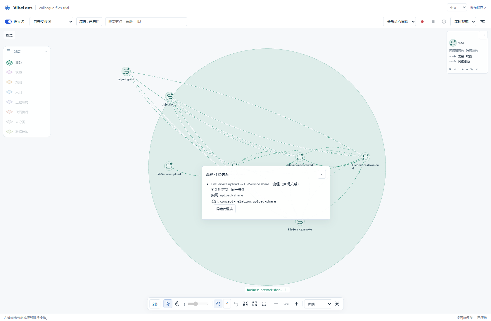
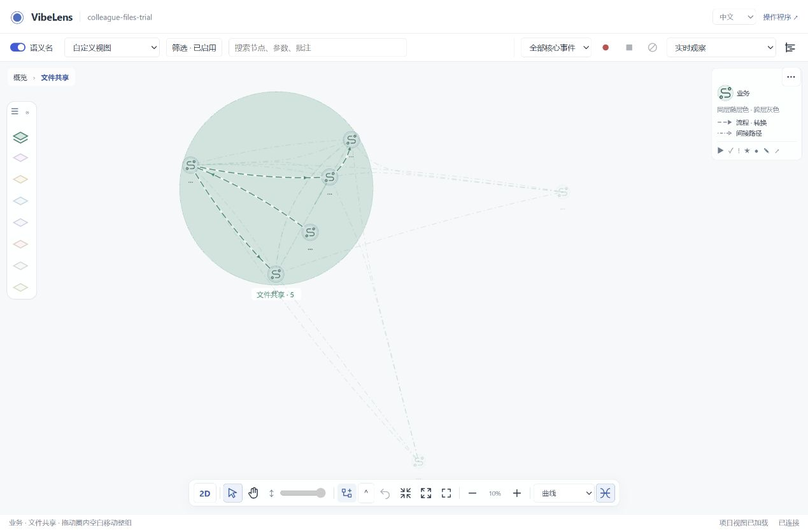

# Shared expansion and relation identity repair

Branch: `feat/concept-flow-layout`. Starting commit: `51c972ff`.
Test date: 2026-11-06. Reproduction: the saved file-sharing view on port 53689.

The repair applies to the common graph inventory, layer projection, containment
and interaction modules. Business, state, rules, entry points, project structure,
code execution and storage use these modules in both rendering modes.

## Causes and changes

| Reported behavior | Cause | Shared repair |
| --- | --- | --- |
| Opening Upload changes peer business connections | Calls from other actions to a shared `FileService.connect` function were folded onto its Upload display parent before layer filtering. | Check each original relation's endpoints against the displayed layers before drawing a direct folded edge. Hidden-layer paths remain explicit indirect relations with their original path evidence. |
| Opening and closing moves the surrounding region | Expansion repacked existing unpinned neighbors. Collapse also replaced the owner's saved position with the fitted circle center. | Preserve all known coordinates during expansion. Collapse changes visibility only. Explicit group dragging still moves the owner and its saved descendants. |
| Identical relations appear as ×2 | A bound conceptual declaration and its native model declaration were counted twice after their colliding IDs were namespaced. | Reconcile only server-declared occurrence pairs with identical semantic fields. Draw one relation and retain both definition IDs and provenance in its details. |
| Some expansion badges describe hidden children | Renderers and accessible controls counted the full hierarchy rather than the displayed descendants. | Share `displayChildren()` across 2D, 3D and node controls, including visible descendants under hidden intermediate layers. |
| A 3D ring title does not collapse its region | Label dragging transfers pointer capture to the canvas; the final double-click targets their common host. | Handle the gesture on the common host with its actual pointer hit. Disable this handler in 2D and remove it when the renderer is disposed. |
| A nearby 3D label captures another node's click | The DOM caption can overlap that node's projected body. | Prioritize the physical glyph under the pointer before falling back to the caption owner. |
| Source nodes change during a view-switch check | The initial inventory precedes the asynchronous source slice. A stale request could also initialize a newly selected view. | Reject obsolete selection/focus results and expose source/frame readiness for deterministic browser checks. |
| Enter on an edge expands the previously selected node | The viewport keyboard shortcut intercepted the edge button's activation. | Resolve the focused edge first and open its relation details. |
| Box-only graph inputs fail during layer filtering | The existing minimal-input regression does not include runtime inventory indexes. | Build the declaration lookup from its boxes and let the common child lookup read that same input. Missing hidden endpoints are never guessed. |

The initial saved-view reproduction had 29 displayed edges with Upload closed and
26 open. After the repair the same ten-step sequence keeps 24 displayed edges;
its four business-flow connections each contain one logical member.
[Before](before/reproduction.json) and [after](after/reproduction.json) preserve
the exact nodes, edge members, positions and region measurements.

## Meaning of relation counts

`×N` counts distinct relations or distinct hidden-path witnesses grouped into one
display line. It does not count executions. Expanding endpoints can separate
those members onto their actual children.

The new reconciliation requires the server's `relation_occurrences` mapping and
a bound concept projection. Endpoint or label similarity alone never qualifies.
Conditions, scope, call sites, arguments and unknown fields all participate in
comparison. AST calls, distinct IDs and differing semantics remain separate.
Both original IDs still work for selection, hiding and trace lookup.

This supersedes the earlier viewer-readability report's interpretation of these
four duplicated concept/native pairs. It does not alter the source model,
business sequence, capture declarations or recorded events.

## Verification

| Check | Evidence |
| --- | --- |
| All seven populated layers in 2D and 3D | [14 passing browser cases](browser/summary.json); [exact coordinates and relation members](browser/expansion-checks.json) |
| Real fixture rebuilt through acceptance before browser testing | [Acceptance output](browser/acceptance.stdout); [browser output](browser/browser.stdout) |
| Repeated expansion and dragging | Each case opens/closes a node, drags it, repeats the cycle twice and compares saved positions and original relation members. Camera invariance is checked when opening; Fit is an explicit test action before locating a region title. |
| Bound relation details | Both modes show one logical Upload → Share relation and both original definition IDs. The original declarations remain unchanged. |
| Existing interaction suite | [31 checks, 23 actual captured events](interactions/result.json), including selection, dragging, view persistence, panning and replay |
| Existing readability suite | [20 checks](readability/result.json), including all seven layers, fit, names, curve bundling and wheel zoom over labels |
| Source quality | [Ruff, ESLint, Black and Prettier report](source-quality.json): 182 Python modules and 126 JavaScript modules |
| Additional viewer regressions | [22 JavaScript suites](remaining-js.json), including layer controls, routing, Timeline, view persistence and the product demo |
| Managed examples | [Delivery and team-archive checks](examples/); original business source, machine, intent, acceptance, mapping and whitebox expectations are preserved |
| Complete default repository gate | [Result](full-gate.json), [full output](full-gate.log): exit 0 in 455.02 seconds; installation, source/mapping, runtime, multilingual adapters and both observer-free exports passed |
| Delivery integrity | [Package parity](package-parity.log), [staged byte parity](git-byte-parity.json) and [documentation links](document-links.log) |

`tools/test_expansion_relations.mjs` covers semantic identity counterexamples,
original-ID lookup, hidden-path witnesses, saved coordinates and renderer parity.
It is part of `tools/verify.py`. The real all-layer browser suite is registered
in the repository CI workflow and runs against a freshly accepted fixture.

The fixture has no unclassified nodes. Tests use installed Chrome with software
WebGL and real Flask/SQLite operations. This is a regression run using preserved
dialogue source, not a new human conversation or a GPU performance benchmark.
The default gate retains one existing host-dependent skip: Windows file symlink
creation is unavailable. Its directory-junction installation tests passed. The
optional database-vendor suite was not run for this viewer-only repair.

## Failures and retests

The [failed runs](failures/) are retained. Early passes on the business layer did
not establish correctness elsewhere: wider checks found collapse-anchor drift in
code/storage, 3D label double-click failures and source-loading races.

The test harness was also corrected to wait for actual source/render readiness
and to compare rendered nodes. Hidden, filtered-out inventory nodes do not have
3D coordinates. These corrections preserve all position and edge assertions for
visible nodes. The fresh fixture then exposed the overlapping-label and keyboard
edge-activation bugs; both were repaired before the final 14-case pass.

The complete gate also exposed a box-only graph input that lacked runtime
indexes. The fallback was repaired and the unchanged minimal-input regression
passed. An isolated 3D badge test supplied no renderer graph; its fixture now
provides the shared graph input. The unknown-metadata assertion is retained,
with additional checks for one visible child and zero visible children.
The final fresh 14-case browser run includes these compatibility changes.

The first full-gate attempt was blocked by the Windows sandbox when an existing
installation test created a directory junction. Its original output is retained;
the same test passed outside that sandbox without reducing its checks.

Only the final accepted export is included for each shipped example. Earlier
intermediate exports remain in the local validation archive; their check logs
are retained here, alongside all failed browser and full-gate attempts.

The user's custom layer/filter selection and manual positions were retained.
The live page was refreshed, its business region opened, and Fit used to inspect
the result. Independent browser runs used separate project copies.

