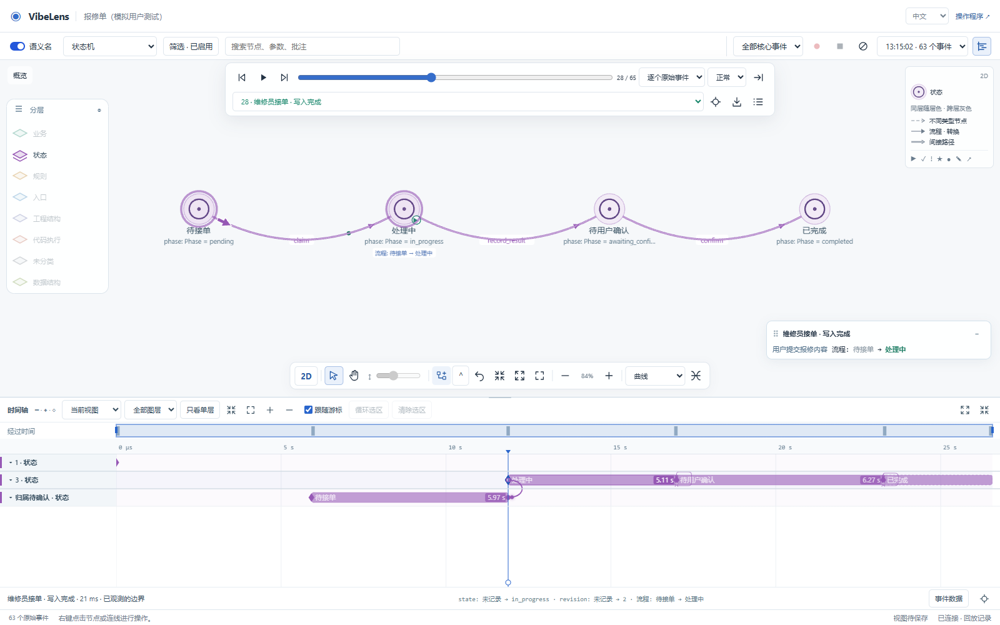
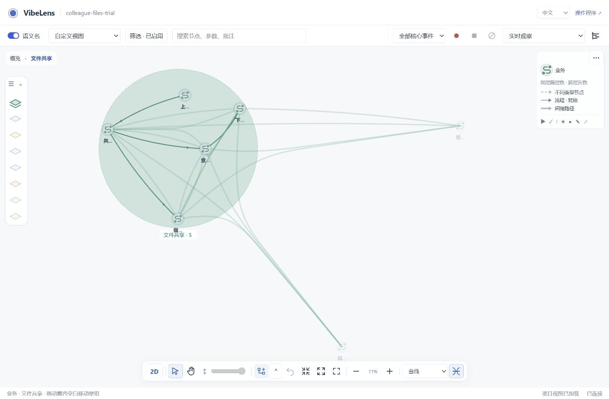

# Connections by node type

The graph now compares the **visible endpoint icon types**, independently of
their layers. This follows the user's clarification from layer membership to
node type. Stable node/relation IDs, source mappings, runtime events and saved
layouts are unchanged.

| Encoding | Meaning |
| --- | --- |
| Solid shaft | Endpoints have the same displayed node type |
| Dashed shaft | Endpoints have different displayed node types |
| Layer hue | Both endpoints belong to the same displayed layer |
| Neutral gray | Endpoints belong to different displayed layers |
| Single line, open arrow | Call or value transfer |
| Single line, filled arrow | Flow or state transition |
| Bordered line, diamond | Condition or constraint |
| Double line, open arrow | Mapping or reference |
| Thin single line, no head | Containment |
| Double line, bar | Join or resource relationship |
| Bordered line, open arrow | Indirect path with retained witnesses |

Type pairing adds dashes to the family profile. A state value and a state node
can share a plane while remaining different types. Two value nodes on different
planes retain solid strokes and use the cross-layer color. Projection guides
remain dashed. Solidity is a visual category, not evidence of execution.

## Implementation

- `relation-appearance.js` resolves endpoint types and relationship families.
- `relation-strokes.js` owns profile proportions and bounded parallel rails for
  2D and SVG legends. Double lines leave a transparent gap; bordered lines have
  a lighter center in the same hue.
- `spatial-line-material.js` applies screen-space profiles through one instanced
  wide-line buffer. Arrowheads keep their own shapes. The bundled library is
  unchanged; shader anchors are checked explicitly.
- The accessible edge controls expose the same profile and endpoint types.
  Actual replay arrows still use their rendered route and layer hue.
- The English/Chinese source guides and Skill references describe this contract.

## Verification

| Check | Result and evidence |
| --- | --- |
| Node-type and layer combinations | 2,688 combinations in `tools/test_edge_colors.mjs`; original IDs preserved |
| Related graph regressions | [10 passing JavaScript suites](targeted-checks.json), including folding, hidden-path projection, routing endpoints and spatial planes |
| Stroke geometry and shaders | `tools/test_relation_strokes.mjs` checks type/layer independence, seven family signatures, transparent parallel rails, bounded joins and the actual bundled Three.js shader |
| Buffer construction | 1,000 and 20,000 edges use one line batch and one filled-arrow batch; per-segment profile counts equal geometry counts |
| All populated layers | [14 browser cases](all-layers/expansion-checks.json): seven layers in both 2D and 3D, with type-based stroke checks after opening, dragging and repeated folding |
| Recorded runtime | [Real recording replay](recording/result.json): actual Pixi arrow draws, Three.js line/profile buffers, moving arrows, expanded views and bilingual legend; no event or model writes |
| General interactions | [31 checks and 23 actual captured events](interactions/result.json), including view persistence, panning, selection and replay |
| Source quality | [Ruff, ESLint, Black and Prettier](source-quality.json): 182 Python modules and 128 maintained JavaScript modules |
| Shipped examples | [Delivery and team-archive continuation checks](examples/), preserving original application source, state machine, intent, acceptance, mapping and whitebox requirements |
| Package consistency | [199 copied runtime modules and viewer assets match](package-parity.log); [document-link checks](document-links.log) passed |
| Committed bytes | [88 staged Skill/example files match the tested bytes](git-byte-parity.json) |

The browser cases use installed Chrome with software WebGL and an accepted
Flask/SQLite fixture. The buffer test measures CPU geometry construction, not
hardware-GPU frame rate. The existing dialogue fixture was replayed; this is not
a new user conversation. Validation targets this viewer change and package
consistency; it does not repeat database-vendor integration testing.

## Failed checks and corrections

Failures are retained under [failures](failures/):

1. The old recording test tried to click the removed `#show-all` toolbar button.
   It now uses the same canvas layer control as the user.
2. The Pixi test probe reused the last polygon when the same graphics object
   drew a node pulse. It mistook a node's hue for an extra moving-arrow hue.
   The probe now consumes only the immediately preceding polygon. Color
   assertions remain exact.
3. A browser test waited for coordinates, then read a later frame after those
   coordinates were invalidated. It now takes the coordinates from the same
   ready frame and waits for source loading. All interaction assertions remain.

The corrected recording and interaction tests passed. No application or runtime
event data was modified to make those checks pass.

