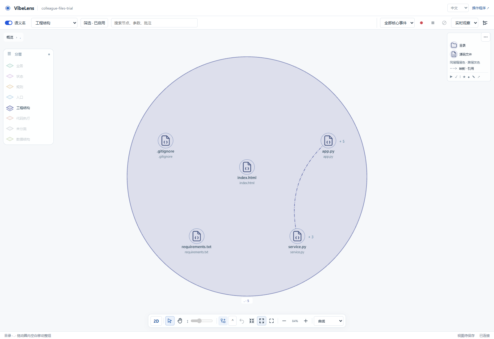
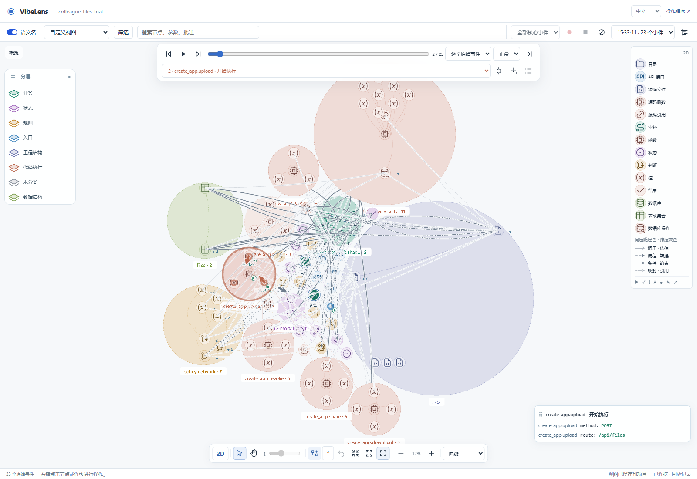

# Viewer interaction repair

Baseline: `9145ccd7`, branch `feat/concept-flow-layout`. Desktop viewer only.

## Initial findings

| Area | Finding | Intended correction |
| --- | --- | --- |
| Expansion | The shared toggle explicitly calls focus after opening | Preserve camera; focus remains a separate action |
| Views | All-elements and layer controls can alter a named preset in place | Immutable presets, a custom draft, complete saved-view state |
| Source scope | Physical tree inventory includes observer-owned configuration | A display inventory scoped to application source; independent coverage checks remain unchanged |
| Relations | Many relationship families share a dashed legend glyph and repeat type text on the graph | Shared visual grammar, grouped legend, meaningful detail captions |
| Labels | Authored strings and English fallback bypass the requested locale | Resolve the active locale consistently and retain source identity as fallback |

## Information-density review

| Dimension | Assessment | Change |
| --- | --- | --- |
| Cognitive load | Major issue: independent controls combine without a visible state model | One preset/custom selection model and paired layer controls |
| Content priority | Major issue: diagnostics and advanced toggles displace the graph | Compact tool row and footer diagnostics |
| Scanning | Major issue: a long list of identical relationship symbols offers little guidance | A short visual legend with distinct stroke families |
| Progressive disclosure | Minor issue: advanced switches are always present | Contextual code commands and filter-panel options |

## Completed repairs

| Problem | Cause and repair |
| --- | --- |
| Expanded directories retained an unconnected center icon | Containment detection depended on scanner origin; folded child links could also be mistaken for self relations. One `containment-semantics.js` contract now serves every layer and both renderers. The region replaces its owner; a center glyph remains only for an actual internal relation involving that owner. |
| Expand moved the camera | The toggle explicitly called focus. Expansion now preserves the camera; Fit and focus remain separate tools. |
| A collapsed rule group overlapped another node in 3D | Its hidden owner kept an obsolete anchor while the visible region moved. Folding now restores the owner at the region's actual center in both renderers, retaining real self glyphs and saved descendant positions. |
| Source views included observer support | `code_graph/display_scope.py` selects application source from declared ownership. Independent coverage checks retain their original inventory. Native business state executors and explicitly owned source overrides stay visible. |
| Presets appeared empty or disagreed with the ruler | Manual selection rewrote presets; hidden file parents concealed functions; ruler refresh preceded the visibility update. Presets are now templates, manual edits create a custom draft, and hidden ancestors expand for projection only. |
| A fresh Code view placed functions off-screen | Hidden planes still participated in arrangement. Layout now uses selected visible contents, retaining hidden identities and saved relative positions. |
| Labels mixed interface languages | Semantic labels select the active locale. Missing translations retain source names. IDs, bindings, notes and facts remain unchanged. Skill guidance requests concise locale-specific label maps. |
| Relations looked alike | Seven shared stroke/head families distinguish calls, flow, conditions, references, containment, synchronization and indirect paths. Layer hue is independent of relationship meaning. Captions show authored detail or observed payloads. |
| Navigation and group movement were difficult | Select, Pan and 3D Orbit tools share one selection set. Space temporarily pans. Rectangle selection, Shift selection, group dragging and Delete retain stable identities. Graph labels cannot become browser text selections. |
| Playback was difficult to see | Animation could read routes before drawing finished; concept-bound owners were not consistently found. Playback waits for current routes, then draws arrows and layer-colored response rings using actual dependencies. Timestamps alone never create a transfer. |
| Controls displaced the graph | One compact toolbar, floating replay controls and footer diagnostics. All-elements moves to the ruler. Advanced details, capture fields and local-code options remain in Filters. |

## Shared implementation

- `containment-semantics.js`: containment and genuine self relations.
- `view-selection.js`: templates, custom drafts, optional source loading and visible layout scope.
- `graph-selection.js`: rectangle selection and subtree movement.
- `relation-appearance.js`: shared legend, 2D and 3D stroke/head vocabulary.
- `playback-appearance.js`: visible responders derived from observations.
- `code_graph/display_scope.py`: application source projection, separate from verification policy.

The business model, state authority, stable IDs, source bindings and observation protocol remain unchanged. Shipped examples receive synchronized copies.

## Verification

- Shared unit matrix: seven populated layers and four scanner origins; containment, real internal links, filtered links and deduplicated movement.
- Every built-in preset retains its template. Custom visibility, empty custom selections and legacy layer IDs are checked separately.
- The final fresh-project browser run passes 33 checks, covering seven populated planes in both renderers, actual HTTP upload/share operations and 23 recorded events. No graph or observation response is stubbed. Pointer gestures cover expansion, camera stability, pan, rectangle selection, group movement and saved views. See [final results](browser/final/result.json).
- Locale tests retain identity while choosing only the requested language. Old projects without a translation use source names; the viewer does not invent translations during rendering.
- Existing control regressions retain keyboard actions, notes, pinning, recording load failures, clear guards and zero events from observer-only operations. The final repeat also passed; see [control results](browser/legacy-final/result.json). The obsolete 390px mobile assertion is replaced with a 1280px desktop overflow/menu check, matching the requested scope.
- Both examples preserve their earlier immutable baseline and business expectations, then run inspect, verify, accept and installed check. See [delivery contracts](examples/delivery-protected-contracts.json) and [archive contracts](examples/team-archive-protected-contracts.json).

The complete default repository gate passed. See [acceptance summary](acceptance-summary.json) and [full log](full-verify.log). Syntax, lint and formatting passed for 180 Python modules and 123 JavaScript modules; see [source checks](source-check.json).

One existing host-dependent check was skipped: `test_filesystem_links_are_not_recursively_expanded`, because Windows denied creating its file symlink. Directory-junction checks ran with desktop permissions. The optional database-adapter matrix (`--database`) was not requested for this viewer change.

Packaging also preserves the accepted raw-byte fingerprint of the new source-scope module across Git checkout. Maintained source whitespace checks remain enabled; archived command output keeps its original endings. The [staged-byte comparison](git-byte-parity.json) and [distribution retest](distribution-check.log) passed.

After the complete gate, one final HTML/CSS adjustment moved routing progress into the footer. The [33 browser checks](browser/footer/result.json) and both managed example acceptance workflows were repeated for that adjustment; their logs use the `-footer` suffix.

## Preserved failures and retests

| Attempt | Failure | Resolution |
| --- | --- | --- |
| Source projection | Pruned paths were assumed to be strings; the inventory returns objects | Read each entry's `path`; retain deliberately empty application directories. |
| Fresh browser | Code expansion clicked outside the viewport | Stop allocating layout space to hidden planes; repeat from a fresh project. |
| Existing controls | Blank clicks did not clear conversation focus | Distinguish a click from a selection rectangle; preserve ordinary edge click handling. |
| First example checks | Framework changed while checks were running | Strict acceptance rejected the candidate. Freeze code and repeat using the preserved baseline. |
| Sandbox installation | Windows junction creation denied | Run the unchanged gate with normal desktop permissions. |
| Ownership regression | Explicitly owned source under reserved directories disappeared | Honor existing source-scope overrides instead of blanket directory exclusions. |
| Extra browser setup | Windows socket allocation returned `WinError 10048` | Preserve the failure and run network-heavy acceptance sequentially. |
| Additional 3D plane matrix | A folded rule owner shared another node's old coordinates | Fold at the visible region center through the shared containment helper; repeat all seven planes in both renderers. |
| Fresh browser pointer setup | The test read coordinates before the throttled accessibility geometry was ready | Wait for finite published screen coordinates, then dispatch the same real pointer gesture; retain all expansion and camera assertions. |
| Existing visual grammar check | A signature parameter declaration was asserted to use the same stroke as actual value transfer | Verify its containment family, dotted stroke and absent arrowhead explicitly; actual calls and transfers retain their original solid-line assertions. |

Evidence is retained in `failures/`, `examples/` and `browser/`.

## Inspect the result

Select a preset, then change layers in the left ruler. The selector becomes **Custom view**; save it in **Filters**. Use **Select** to draw a rectangle and move the group, **Pan** to move the camera, or **Orbit** in 3D. Double-click expands without changing the viewpoint.

Full-inventory screenshots intentionally stress filtering and replay with a dense graph. Browser rendering used desktop Chrome with software WebGL; this is not a native-GPU performance baseline.
