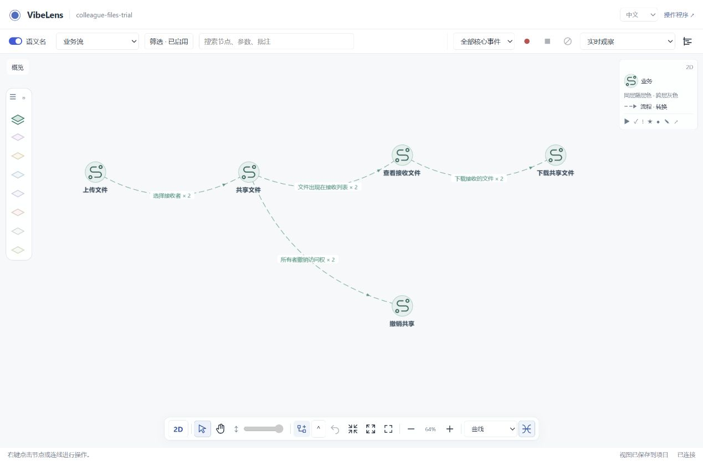

# Viewer readability and navigation repair

Branch: `feat/concept-flow-layout`. Starting commit: `0abb8a7c`.
Test date: 2026-11-06. The current synthetic file-sharing preview is the reproduction target.

## Findings and changes

| Reported problem | Cause | Change |
| --- | --- | --- |
| Chinese UI, English semantic names | The viewer selected a locale but the project supplied no complete locale-specific naming artifact. Native capture fields were also lost when a conceptual node with an empty capture reused its ID. | Add a separate, layer-aware naming artifact and maintain it through inventory, apply and check commands. Native capture declarations retain precedence. |
| Wheel zoom stops over 3D labels | DOM labels received the wheel event outside the canvas control's listener. | Forward label wheel input to the same zoom operation, normalize wheel units and remove the listener on disposal. |
| Curves have no bundling control | Existing bus routing did not provide a curved bundle mode. | Add a persistent curve-bundling toggle and shared worker geometry for 2D/3D. |
| Business view shows disconnected roots | The preset retained collapsed business-network containers and object definitions, obscuring their action nodes and authored flow. | Select business actions in the flow preset. Preserve all definitions in inventory and the broader behavior view. |
| Rules cannot fit the 2D canvas | A fixed minimum scale of 0.12 could exceed the scale required by the actual graph. Fit also ignored side controls. | Derive fit and zoom-out limits from visible geometry and reserve the side-control space. Expand 3D fit distance and clipping limits when needed. |
| Connections are hard to see or cover icons | Low edge opacity and cross-group draw order; 3D connections and bodies shared a depth pass. | Increase line contrast, draw 2D bodies after connections, and render 3D bodies in a separate depth pass. Direction markers sit along the route; endpoints still reach icon centers. |

The file-sharing example has five actions and four logical flow connections. Its eight
original edge assertions include conceptual and native declarations for the same endpoint
pairs. The viewer groups these with a count; this repair neither adds a business sequence
nor silently deletes an assertion.

## Semantic names and iteration

`bo_names.py inventory` describes concepts, source entries, parameters, storage and authored
relation details using stable IDs. The coding assistant writes concise English and Chinese
labels for the meaning of each layer. `apply` validates and installs
`bo_stategraph/config/semantic-names.json`; `check` verifies completeness and freshness.

The conversation supplies the initial UI locale. An explicit URL or saved language choice
still takes precedence. Semantic names are a presentation overlay: source names, declarations,
event identities, personal notes and layouts remain intact. The business action, state and
rule that refer to one physical value can each carry a different semantic label.

The Skill now requires name generation before sharing the graph and maintenance after
affected coding batches. Ordinary scans flag missing/stale entries, and iteration verification
reports naming checks separately from mapping and business checks.
[Mutation evidence](name-maintenance.json) shows a missing parameter label and a stale concept
basis blocking the current naming status, followed by restoration. Structural checks do not
judge translation quality. Legacy projects without a naming artifact remain readable and
need explicit migration; earlier recording contexts remain frozen.

## Curve geometry

The routing worker uses the existing vendored D3
[curveBundle](https://d3js.org/d3-shape/curve#curveBundle). Only compatible relationship types,
layer pairs, directions and hierarchy/spatial groups share control points. Each edge keeps
its own ID and exact endpoints. Current obstacles are checked before accepting a bundle;
an obstructed bundle falls back to ordinary routing. Node moves, expansion and layer edits
invalidate the same route geometry used by both renderers and playback.

The synthetic computation test processed 10,000 compatible curves in the time recorded in
[geometry-tests.json](geometry-tests.json). This measures bundle computation, not end-to-end
GPU frame rate or a universal graph-size limit.

## Verification

| Check | Result and evidence |
| --- | --- |
| Naming and workflow units | Six tests pass: separate conceptual names, stable source identity, generated fields, invalid documents, freshness and source-free design. [Log](python-tests.log) |
| Geometry and naming JS checks | Seven layer scales, wheel units, English/Chinese identity, compatible/incompatible bundles, obstacle fallback and 10,000 curves pass. [Result](geometry-tests.json) |
| Readability in installed Chrome | 20 checks pass; zero browser errors. Every visible node is checked in seven populated layers; fit, locale switching, saved bundling and wheel-over-label interactions pass. [Result](browser/result.json) |
| Existing interaction regression | 31 checks pass; zero browser errors. Presets, expand/collapse, unchanged camera, source exclusion, custom-view persistence, selection, group drag, 2D/3D panning and playback of 23 actual captured events pass. [Result](interactions/result.json), [recording](interactions/real-recording.json) |
| Maintained source quality | Ruff, ESLint, Black and Prettier pass for 182 Python modules and 125 JavaScript modules. [Report](source-quality.json) |
| Managed delivery and team-archive examples | Build, inspect, verify, accept and installed check results are in [examples](examples/). Original business source, machine, intent, acceptance and whitebox expectations are preserved. |
| Complete repository gate | `tools/verify.py` exits 0, including installation, live HTTP observation, model checks and both observer-free package smoke tests. One existing Windows file-symlink test is skipped because the host disallows creating it. [Summary](full-gate.json), [complete log](full-gate.log) |

Layer screenshots and exact displayed labels are retained under [screenshots](screenshots/)
and [labels](labels/). The fixture populates business, state, rules, API, project, code and
storage; it has no unclassified layer content. Runtime arrow movement is shown by the
paired [2D frames](interactions/transfer-2d-a.png) / [next frame](interactions/transfer-2d-b.png)
and [3D frames](interactions/transfer-3d-a.png) / [next frame](interactions/transfer-3d-b.png).

The complete gate uses its default scope. Optional live database-vendor suites were not
rerun for these viewer/naming changes. The real browser fixture uses SQLite. Documentation
links also pass after assembling this report: [log](document-links.log).

## Failures retained and repaired

1. Inspecting every code label exposed 25 untranslated fields after an earlier browser pass.
   The conceptual/native merge order was wrong. Preserve native capture ownership and
   check every displayed node, rather than one translated label per layer.
   [Before](failures/untranslated-fields.json), [after](labels/code.json).
2. The initial flow test counted four assertions, but the fixture contains eight assertions
   for four endpoint pairs. Test the displayed flow and retain both assertion identities.
   [Failure](failures/assertion-count.log).
3. A 3D expansion test clicked screen coordinates from the camera position before Fit had
   settled. Expose the read-only geometry readiness state and wait for the actual camera
   geometry; keep the original expansion assertion. [Failure](failures/stale-camera-coordinates.log).
4. Edge-label wheel testing initially waited for a label before selecting a related node.
   Select its owner first, as required by the UI, then exercise native wheel input.
   [Failure](failures/edge-label-prerequisite.log).
5. Managed example verification rejected an old code index after new framework modules were
   installed. Rebuild the scoped source index before verification. A subsequent premature
   accept was also rejected; neither failure was waived.
   [Index rejection](examples/delivery-verify-final.log),
   [accept rejection](examples/delivery-accept-final.log).
6. The first complete gate expected object definitions inside the action-only business-flow
   preset. Update that expectation and add an explicit broader behavior-view assertion that
   retains every original concept and relation; also verify that flow filtering preserves
   the original inventory. [Failure](failures/full-gate-flow-preset.log).

The repairs are in shared inventory, routing, viewport and renderer modules. There are no
per-layer wheel, fit or edge-order implementations, and no changes to application permission
logic or state-machine execution authority.
