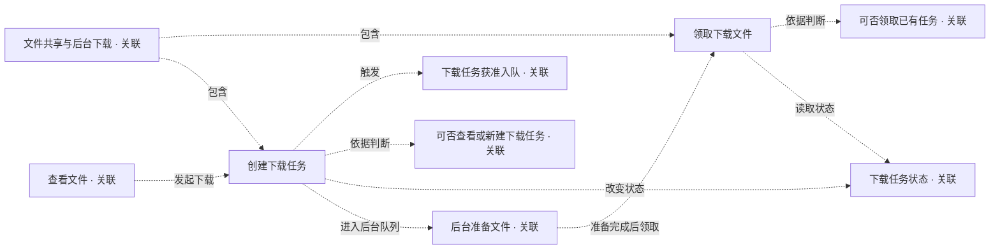

# Node observe initial design trial

Trial prompts and follow-ups delivered by the coordinating AI are scripted-user records. They are not independent human usability evidence.

Local paths are normalized as listed in dialogue.json. Original trial answers and checks are archived separately.

## 01 · user · 2026-11-19T13:13:38.110Z

# AGENTS.md instructions

<INSTRUCTIONS>
## ARIS: explicit opt-in for each chat

ARIS is disabled by default in every chat, including chats sharing the same project. Its optional pack is `C:/Users/Lvi_P/.codex/optional-skills/aris`.

Only when the user explicitly asks to use or enable ARIS in the current chat, or explicitly invokes a named ARIS skill, read `C:/Users/Lvi_P/.codex/optional-skills/aris/ON_DEMAND.md` and the required skill files. Installing, updating, configuring, or asking about ARIS does not activate its research workflows. Do not infer activation from a research or paper-writing task, project files, another chat, or this instruction.

Activation applies only to the current chat and authorized task. Do not propagate it to other chats, save a shared activation flag, or copy/link ARIS into automatic skill-discovery directories. If the user disables ARIS, stop using it in that chat. Keep the pack unchanged during research tasks and use process-local helper paths instead of persistent environment settings.
</INSTRUCTIONS>
<environment_context>
  <cwd>C:\Users\Lvi_P\Documents\Work\CF\平台软著</cwd>
  <shell>powershell</shell>
  <current_date>2026-11-19</current_date>
  <timezone>Asia/Singapore</timezone>
  <filesystem><workspace_roots><root>C:\Users\Lvi_P\Documents\Work\CF\平台软著</root></workspace_roots><permission_profile type="managed"><file_system type="restricted"><entry access="read"><special>:root</special></entry><entry access="write"><path>C:\Users\Lvi_P\Documents\Work\CF\平台软著</path></entry><entry access="write"><special>:slash_tmp</special></entry><entry access="write"><special>:tmpdir</special></entry><entry access="write"><path>C:\Users\Lvi_P\.codex\visualizations\2026\11\19\01a1f3f0-d26b-75b2-a7fb-4c6b09325b23</path></entry><entry access="read"><path>C:\Users\Lvi_P\Documents\Work\CF\平台软著\.git</path></entry><entry access="read"><path>C:\Users\Lvi_P\Documents\Work\CF\平台软著\.agents</path></entry><entry access="read"><path>C:\Users\Lvi_P\Documents\Work\CF\平台软著\.codex</path></entry><entry access="read"><path>C:\Users\Lvi_P\Documents\Work\CF\平台软著\.aws</path></entry></file_system></permission_profile></filesystem>
</environment_context>

## 02 · scripted-user · 2026-11-19T13:13:38.175Z

请使用这份 VibeLens Skill：C:/Users/Lvi_P/Documents/Work/CF/平台软著/SoftwareStatusObserverSkill/.validation/p7-trials/node-skills/vibelens/SKILL.md。项目放在 C:/Users/Lvi_P/Documents/Work/CF/平台软著/SoftwareStatusObserverSkill/WORKSPACE，其他工程保持原样。

我想用 Node.js 做一个小团队文件共享应用：可以上传文件、分享给同事、撤销共享，下载在后台排队执行。还要有一个独立的公告板。我平时写代码，希望借助图看清权限判断和后台任务实际怎样运行。先把需求理清楚，有疑问就问我。用中文交流，源码和注释用英文。

## 03 · assistant · 2026-11-19T13:13:41.235Z

我会先阅读你指定的 VibeLens Skill 和试验目录说明，梳理文件共享、后台下载与独立公告板的业务边界，再集中确认影响设计的疑问。

## 04 · assistant · 2026-11-19T13:14:33.134Z

已开始按指定的 VibeLens Skill 梳理需求。目标目录目前为空；我会分别保留“文件共享”和“公告板”两个业务入口。当前最需要明确的是权限边界，以及“后台下载”究竟交付什么；这些会直接决定后续图里的判断节点和任务状态。

## 05 · assistant-question · 2026-11-19T13:14:36.341Z

{"questions":[{"title":"VibeLens 的运行方式选哪一种？observe：应用自己执行逻辑，图观察真实运行；drive：状态声明驱动应用执行。两者都维护图和运行监控。","options":["observe：应用逻辑执行，图负责观察","drive：由状态声明驱动执行"]},{"title":"文件权限怎样定？是否仅上传者可以分享和撤销；被分享同事只能查看、下载；其他同事完全看不到文件？请确认或说明不同规则。"},{"title":"“下载在后台排队执行”具体指哪种交付方式？","options":["创建任务，后台准备文件，完成后用户领取","后台直接将文件传到用户指定的位置"]}]}

## 06 · scripted-user · 2026-11-19T13:15:49.020Z

选 observe，业务逻辑继续用应用自己的代码。
文件就按这个范围：上传者能分享和撤销，接收同事能查看和下载，其他同事看不到。
下载是创建一个任务，后台准备好后，我再在页面上领取，不用传到外部位置。

## 07 · assistant · 2026-11-19T13:16:11.153Z

已记录：使用 observe；上传者管理共享，接收人查看和下载，其他同事不可见；下载任务在后台准备文件，完成后在页面领取。接下来会把“撤销共享对已有任务的影响”单独画出来，公告板继续保持独立。

## 08 · assistant · 2026-11-19T13:18:29.854Z

业务草图已保存，文件共享、共享权限状态和下载任务各自保留独立身份。还有一个需要确认的细节：撤销后，已经创建的下载任务是否仍可领取。图目前只表达设计，尚无后台任务的实际运行证据。

## 09 · assistant-question · 2026-11-19T13:19:20.622Z

{"questions":[{"title":"撤销某位同事的共享后，他已经排队、正在准备，或已准备好但尚未领取的下载应怎样处理？是否需要在后台开始和页面领取时重新检查权限并拒绝，还是已创建的任务仍可继续领取？"},{"title":"独立公告板的权限怎么定：谁可以查看、发布、编辑和删除公告？"},{"title":"存储选择：建议先用 SQLite，文件内容放本地目录，数据库保存文件、共享权限、任务和公告记录；部署简单。若已有多人共享数据库，可选 PostgreSQL。你选哪一种？","options":["SQLite，先做单机运行版本","PostgreSQL，使用独立数据库服务"]}]}

## 10 · scripted-user · 2026-11-19T13:20:33.256Z

SQLite 单机版就够了，文件放本地目录。
下载任务只要提交时已经获准，就让这一单继续准备和领取，哪怕后来撤销了共享；撤销以后不能再创建新的下载任务。
公告板只有登录同事能看。指定的公告编辑员可以发布公告、修改和删除自己的公告；这个角色不代表能管理别人的文件。

## 11 · assistant · 2026-11-19T13:20:52.953Z

已记录这个关键规则：下载任务沿用提交时的授权，撤销共享只阻止新建任务，不影响已有任务继续准备和领取。公告编辑员只能管理自己的公告，这个角色不增加文件权限。存储采用 SQLite 和本地文件目录。

## 12 · assistant-question · 2026-11-19T13:23:29.208Z

{"questions":[{"title":"登录和公告编辑员如何确定？这个版本可以先用 3 个预置演示账号，其中 1 个为公告编辑员；也可以做真实登录及账号管理。","options":["先用预置演示账号，指定一个公告编辑员","需要真实登录和账号管理"]}]}

## 13 · scripted-user · 2026-11-19T13:24:04.385Z

先用三个预置账号，一个公告编辑员，另外两个普通同事。不过登录要真的校验密码并建立会话，不能只是点名字就切换身份。暂时不做注册和账号管理页面。

## 14 · assistant · 2026-11-19T13:25:13.882Z

账号方案已明确：3 个预置账号，其中 1 个公告编辑员；登录必须校验密码并建立会话，暂不提供注册和账号管理页面。我会在图中区分“当前文件访问权限”和“已有下载任务的提交授权”，让撤销后的行为一眼可见。

## 15 · assistant · 2026-11-19T13:28:38.896Z

需求模型和中英文图名称检查已通过。设计图服务已启动，但当前终端访问本机端口超时；我正在核实服务的运行位置，确保给出的图页链接能实际打开。

## 16 · assistant · 2026-11-19T13:30:27.778Z

我会使用 computer-use Skill 核对本机浏览器中的中文图页。本轮仍停留在需求和模型确认阶段。

## 17 · assistant · 2026-11-19T13:35:30.837Z

设计图已在本机浏览器中打开：[查看中文需求图](http://127.0.0.1:8867/graph)。下面是同一模型中的下载流程；新建任务检查当前文件权限，领取已有任务依据提交时保存的授权。

图页标为“设计声明 · 尚未实现”，当前没有运行记录。

## 18 · assistant-question · 2026-11-19T13:35:31.922Z

{"questions":[{"title":"最后确认文件访问的两个细节：上传者是否也可以查看、下载自己的文件；“查看文件”只需看到文件名、大小、上传者等信息，还是需要内容预览？"}]}

## 19 · scripted-user · 2026-11-19T13:37:03.631Z

试用协调说明：先保留当前需求与设计草图，暂不进入应用实现，也不要修改安装的 Skill。主仓库检查发现了初始图显示过密、对话图没有读取语义名称的通用问题，将先修复并回归。请保存已收到的回答与待确认问题，报告当前草图状态后停在这里；这条协调消息不构成业务确认。

## 20 · assistant · 2026-11-19T13:37:28.191Z

收到。我会保存现有回答、草图和两个待确认细节，然后停在设计阶段。这条协调消息只记录为暂停实现的指令，不作为业务确认；通用图显示问题留给主仓库处理。

## 21 · user · 2026-11-19T13:40:03.747Z

<send_user_message_question_reply>
[{"questionItemId":"[\"request_user_input_async\",\"call_4f5fb8b9d54046e8bc3a515fa0d5919a\",0]","question":"VibeLens 的运行方式选哪一种？observe：应用自己执行逻辑，图观察真实运行；drive：状态声明驱动应用执行。两者都维护图和运行监控。","answer":"drive：由状态声明驱动执行"},{"questionItemId":"[\"request_user_input_async\",\"call_4f5fb8b9d54046e8bc3a515fa0d5919a\",1]","question":"文件权限怎样定？是否仅上传者可以分享和撤销；被分享同事只能查看、下载；其他同事完全看不到文件？请确认或说明不同规则。","answer":"确认"},{"questionItemId":"[\"request_user_input_async\",\"call_4f5fb8b9d54046e8bc3a515fa0d5919a\",2]","question":"“下载在后台排队执行”具体指哪种交付方式？","answer":"创建任务，后台准备文件，完成后用户领取"},{"questionItemId":"[\"request_user_input_async\",\"call_26bc709e44db488dae5957f3eda64ae9\",0]","question":"撤销某位同事的共享后，他已经排队、正在准备，或已准备好但尚未领取的下载应怎样处理？是否需要在后台开始和页面领取时重新检查权限并拒绝，还是已创建的任务仍可继续领取？","answer":"是"},{"questionItemId":"[\"request_user_input_async\",\"call_26bc709e44db488dae5957f3eda64ae9\",2]","question":"存储选择：建议先用 SQLite，文件内容放本地目录，数据库保存文件、共享权限、任务和公告记录；部署简单。若已有多人共享数据库，可选 PostgreSQL。你选哪一种？","answer":"SQLite，先做单机运行版本"},{"questionItemId":"[\"request_user_input_async\",\"call_bead4c7517df4d34b53d24dac5618448\",0]","question":"登录和公告编辑员如何确定？这个版本可以先用 3 个预置演示账号，其中 1 个为公告编辑员；也可以做真实登录及账号管理。","answer":"先用预置演示账号，指定一个公告编辑员"}]
</send_user_message_question_reply>

## 22 · assistant · 2026-11-19T13:40:45.387Z

收到补答。我会把模式从 observe 更新为 drive，同时保留“停在设计阶段”的协调要求。撤销问题的“是”不足以区分题中的两种处理方式，我会保留原文并标为待澄清，不据此覆盖此前“已有任务继续准备和领取”的明确答复。

## 23 · assistant · 2026-11-19T13:41:59.080Z

已停在设计阶段，最新模式已记录为 **drive**，尚未开始应用实现。

回答、草图及状态已保存到交接记录 (`C:/Users/Lvi_P/Documents/Work/CF/平台软著/SoftwareStatusObserverSkill/WORKSPACE/review/handoff.md`)。草图结构检查通过；完整业务确认、展示登记和运行验证尚未完成。图过密与语义名称问题保留待主仓库处理。

仍待明确：

- 撤销问题中“是”的具体含义。
- 上传者能否查看、下载自己的文件。
- “查看”是否包含内容预览。

协调消息未计作业务确认。[当前设计图](http://127.0.0.1:8867/graph)

<oai-mem-citation>
<citation_entries>
MEMORY.md:465-478|note=[preserved design-first confirmation and isolated evidence records]
</citation_entries>
<rollout_ids>
01a1a757-9d29-7500-966c-db0e29a7651b
</rollout_ids>
</oai-mem-citation>

## 24 · scripted-user · 2026-11-19T13:44:13.735Z

测试模式已在主对话重新确认：Node 用 observe，Python 用 drive，保留两种模式的完整试用。

撤销规则仍按之前说清楚的那一种：已获准提交的下载任务可以继续准备和领取，撤销只阻止新建任务。上传者当然也能查看、下载自己的文件；查看页面先列文件名、大小和上传者，不做内容预览。

先保存这些回答，继续停在设计阶段，等通用修复完成后再继续。

## 25 · assistant · 2026-11-19T13:44:17.533Z

我会把本 Node 试用更新为 observe，保存已明确的撤销规则、自有文件访问权限和仅查看文件信息的范围，并继续停在设计阶段。Python 试用保持原样。

## 26 · assistant · 2026-11-19T13:46:38.758Z

已保存到需求与交接记录 (`C:/Users/Lvi_P/Documents/Work/CF/平台软著/SoftwareStatusObserverSkill/WORKSPACE/review/handoff.md`)：

- Node 使用 **observe**；Python 的 **drive** 作为并行试用安排保留。
- 撤销仅阻止新任务，已有获准任务继续准备和领取。
- 上传者可查看、下载自己的文件。
- 查看仅列文件名、大小和上传者，不做内容预览。

此前待确认项均已解决，记录校验通过。继续停在设计阶段，等待通用修复；未开始应用实现，未修改安装 Skill 或其他工程。

<oai-mem-citation>
<citation_entries>
MEMORY.md:737-739|note=[preserved isolated design-stage hold]
</citation_entries>
<rollout_ids>
01a1a511-0990-7ab0-b24b-3bdfb96b7b0b
</rollout_ids>
</oai-mem-citation>
