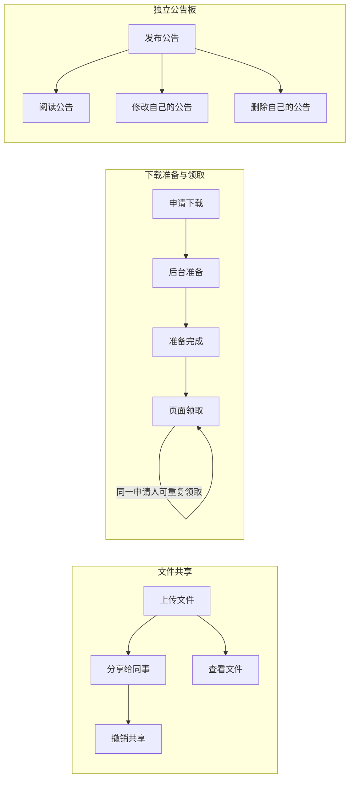
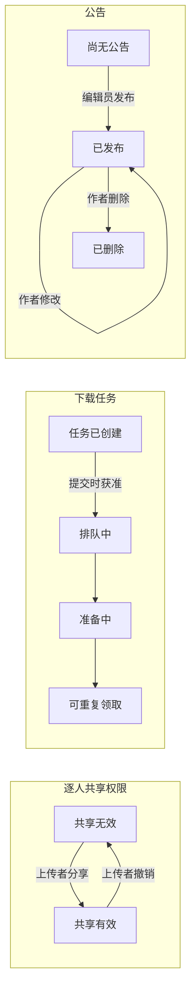
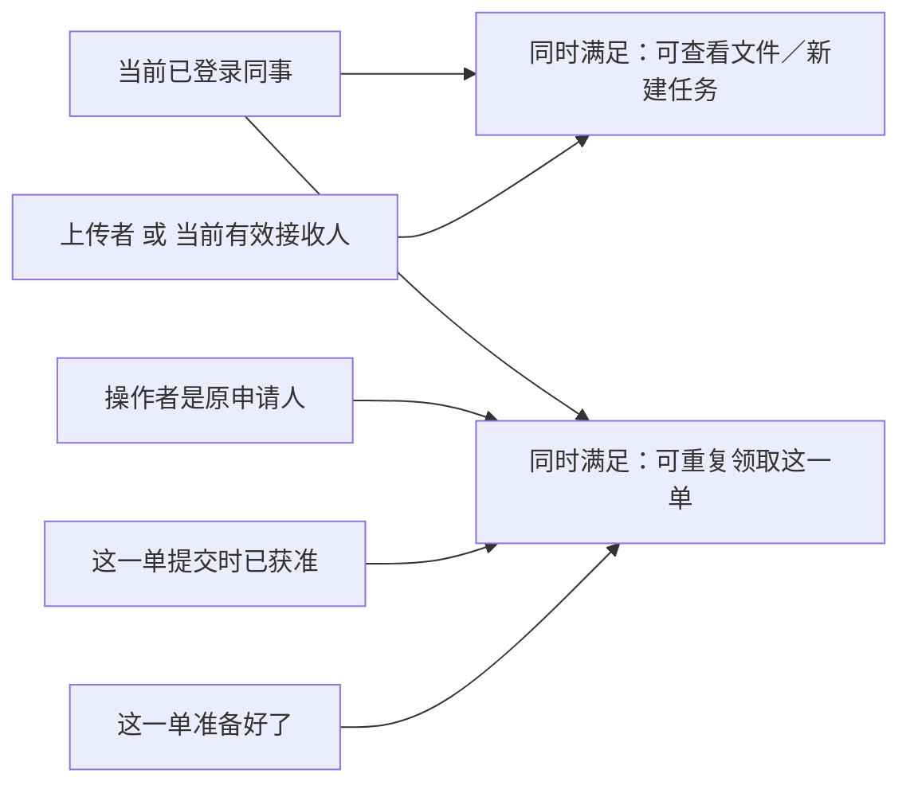

# P7 node retest - in progress, initial native acceptance remains open

Trial prompts and follow-ups delivered by the coordinating AI are scripted-user records. They are not independent human usability evidence.

Local paths are normalized as listed in dialogue.json. Original trial answers and checks are archived separately.

## 01 · user · 2026-11-19T13:54:06.332Z

# AGENTS.md instructions

<INSTRUCTIONS>
## ARIS: explicit opt-in for each chat

ARIS is disabled by default in every chat, including chats sharing the same project. Its optional pack is `C:/Users/Lvi_P/.codex/optional-skills/aris`.

Only when the user explicitly asks to use or enable ARIS in the current chat, or explicitly invokes a named ARIS skill, read `C:/Users/Lvi_P/.codex/optional-skills/aris/ON_DEMAND.md` and the required skill files. Installing, updating, configuring, or asking about ARIS does not activate its research workflows. Do not infer activation from a research or paper-writing task, project files, another chat, or this instruction.

Activation applies only to the current chat and authorized task. Do not propagate it to other chats, save a shared activation flag, or copy/link ARIS into automatic skill-discovery directories. If the user disables ARIS, stop using it in that chat. Keep the pack unchanged during research tasks and use process-local helper paths instead of persistent environment settings.
</INSTRUCTIONS>
<environment_context>
  <cwd>C:\Users\Lvi_P\Documents\Work\CF\平台软著</cwd>
  <shell>powershell</shell>
  <current_date>2026-11-19</current_date>
  <timezone>Asia/Singapore</timezone>
  <filesystem><workspace_roots><root>C:\Users\Lvi_P\Documents\Work\CF\平台软著</root></workspace_roots><permission_profile type="managed"><file_system type="restricted"><entry access="read"><special>:root</special></entry><entry access="write"><path>C:\Users\Lvi_P\Documents\Work\CF\平台软著</path></entry><entry access="write"><special>:slash_tmp</special></entry><entry access="write"><special>:tmpdir</special></entry><entry access="write"><path>C:\Users\Lvi_P\.codex\visualizations\2026\11\19\01a1f415-e2a9-7171-86f8-ec87707ead07</path></entry><entry access="read"><path>C:\Users\Lvi_P\Documents\Work\CF\平台软著\.git</path></entry><entry access="read"><path>C:\Users\Lvi_P\Documents\Work\CF\平台软著\.agents</path></entry><entry access="read"><path>C:\Users\Lvi_P\Documents\Work\CF\平台软著\.codex</path></entry><entry access="read"><path>C:\Users\Lvi_P\Documents\Work\CF\平台软著\.aws</path></entry></file_system></permission_profile></filesystem>
</environment_context>

## 02 · scripted-user · 2026-11-19T13:54:06.394Z

请使用这份 VibeLens Skill：REPOSITORY/.validation/p7-trials/node-retest-skills/vibelens/SKILL.md。项目放在 REPOSITORY/.validation/p7-trials/node-retest-app，其他工程保持原样。

我想用 Node.js 做一个小团队文件共享应用：上传文件，分享给同事，也能撤销共享；下载可以排队准备，准备好后在页面领取。另外有一个独立的公告板。我是开发者，希望看清权限和后台任务的实际运行。应用沿用自身的业务逻辑，VibeLens 用 observe 模式。我希望先确认业务、状态和规则图，再开始实现。不清楚的地方先问我。用中文交流，源码和注释用英文。

本机工具环境：运行外部 Skill 的 Python 脚本可使用 REPOSITORY/.venv/Scripts/python.exe，相关 Python 依赖已安装。应用依赖仍在自己的项目中定义。

## 03 · assistant · 2026-11-19T13:54:09.762Z

我先阅读指定的 VibeLens Skill 和相关约定，梳理业务、状态与规则图；需要你决定的地方会先列出来，确认后再开始实现。

## 04 · assistant · 2026-11-19T13:55:03.500Z

已确认沿用应用自身逻辑，VibeLens 使用 observe 模式。图中会分别表达文件共享、下载准备任务和独立公告板，并标出尚未确定的权限与撤销规则。当前先整理设计，不编写应用功能。

## 05 · assistant-question · 2026-11-19T13:55:38.154Z

{"questions":[{"title":"文件权限是否按这个规则：上传者指定具体同事；只有上传者可以分享或撤销；接收人只能查看、申请下载，不能继续转分享？","options":["按这个规则","接收人也可以继续转分享"]},{"title":"同事申请下载后、领取前，共享被撤销时应怎样处理？","options":["领取时重新检查权限，无权限就拒绝","已获准的下载任务仍可领取"]},{"title":"独立公告板的权限是什么：谁可以发布、谁可以阅读？","options":["所有团队成员都能发布和阅读","只有管理员能发布，所有团队成员都能阅读"]}]}

## 06 · assistant · 2026-11-19T13:57:54.478Z

有个关键边界需要确认：下载任务“准备好了”和用户“仍有权领取”可能是两件事。我已把撤销后的领取规则列为待答问题；公告板也会保留独立入口。查看权限和后台任务时，图中会保留各自的对象身份。

## 07 · scripted-user · 2026-11-19T13:58:57.449Z

文件权限按这个规则。上传者自己和被指定的同事能查看、下载，其他同事看不到；接收人不能再转分享。

下载任务提交时已经获准，就让这一单继续准备并领取，后来撤销共享也不影响这一单。撤销以后不能再创建新的下载任务。

公告板只给登录同事看。指定一个公告编辑员可以发布、修改和删除自己的公告；这个角色不增加管理别人文件的权限。

## 08 · assistant · 2026-11-19T13:59:38.540Z

已记录你的规则：文件由上传者管理；下载任务在提交时获准后，这一单可继续准备和领取，撤销只阻止新建任务；公告编辑员只能管理自己的公告，角色不增加文件权限。

我会据此修改规则图，把提交下载时取得的授权和后续文件共享状态分开表达。

## 09 · assistant-question · 2026-11-19T13:59:41.623Z

{"questions":[{"title":"存储建议使用 SQLite 保存成员、文件元数据、共享关系、任务和公告，文件内容放项目本地目录，部署时无需另起数据库服务。你接受这个选择，还是使用 PostgreSQL 等已有数据库？","options":["使用 SQLite（推荐）","使用 PostgreSQL"]},{"title":"准备好的下载任务领取后，是否允许同一个申请人再次领取这一单？这会决定任务是否进入不可再次领取的终态。","options":["允许重复领取","每单只能领取一次"]}]}

## 10 · scripted-user · 2026-11-19T14:01:53.203Z

用 SQLite，文件就放在项目本地目录。准备好以后，同一个申请人可以重复领取这一单，不需要因为领取过一次就把它关掉。

## 11 · assistant · 2026-11-19T14:02:56.056Z

存储和领取规则也已确定：使用 SQLite 与项目本地文件目录；同一申请人可以重复领取准备好的任务，领取不会关闭任务。

接下来会展示合并后的业务、状态与规则图。当前仍是设计阶段，应用源码尚未开始编写。

## 12 · assistant · 2026-11-19T14:07:23.065Z

设计记录已通过结构校验，相关节点和关系的中英文名称也已检查通过。现在用 computer-use 检查图页能否打开；源码绑定和实际运行的验证要等图确认、应用实现后才能进行。

## 13 · assistant · 2026-11-19T14:08:48.515Z

图页的本机连接检查遇到超时，我正在处理这个项目的图服务访问问题。已确认的业务规则和原始答复都已保存在项目内，不影响设计记录。

## 14 · assistant · 2026-11-19T14:13:32.263Z

图页已能正常显示中文业务流，三个独立状态模型和规则网也已生成。设计中保留了关键区别：撤销共享会收回文件可见性并阻止新建下载任务；已获准的任务仍可由原申请人重复领取。

下面给你完整的设计概览，确认后才进入实现。

## 15 · assistant · 2026-11-19T14:14:21.054Z

设计已整理，**尚未开始实现**。使用 Node.js、SQLite、本地文件目录，VibeLens 采用 observe 模式。

[打开交互图](http://127.0.0.1:8926/graph)（已验证可访问，可切换业务流、状态机、规则网）。

业务流程如下，公告板保持独立：

三个对象分别维护状态：

权限的关键区别是：**新建任务检查当前文件权限；领取旧任务检查这一单的提交授权。**

其余规则为：

- 只有上传者能分享、撤销；接收人不能转分享，其他同事看不到文件。
- 撤销不影响已获准任务；领取后任务仍保持可领取。
- 登录同事可读公告；指定编辑员可发布、修改和删除自己的公告，该角色不增加文件权限。
- 应用负责权限判断和后台任务，VibeLens 观察实际结果。

完整设计记录 (`REPOSITORY/.validation/p7-trials/node-retest-app/review/design-review.md`)已保存。

请确认这份业务、状态和规则图是否准确；确认后我再开始实现。

<oai-mem-citation>
<citation_entries>
MEMORY.md:848-849|note=[design confirmation before implementation and original answer preservation]
</citation_entries>
<rollout_ids>
01a1a757-9d29-7500-966c-db0e29a7651b
</rollout_ids>
</oai-mem-citation>

## 16 · scripted-user · 2026-11-19T14:14:48.286Z

这份业务、状态和规则图是我想要的，尤其是旧下载任务仍能领取、公告权限和文件权限分开的部分。可以按这份设计开始实现。

登录做真实的用户名、密码登录和退出，先提供三个测试账号，其中一个有公告编辑员身份。暂时不用注册和账号管理页面。

## 17 · assistant · 2026-11-19T14:14:51.729Z

确认已收到。我会按已确认的图实现应用，加入真实的用户名、密码登录和退出，以及三个测试账号，并同步维护 VibeLens 的源码映射和运行证据。

## 18 · assistant · 2026-11-19T14:16:44.205Z

登录将使用真实会话，三个测试账号中只有一个带公告编辑员身份；不增加注册或账号管理页面。我会用 frontend-design 整理中文界面，并用 planning-with-files-zh 保存实施进度，方便后续检查和接续。

## 19 · assistant · 2026-11-19T14:19:51.313Z

原设计的确认已写入记录。登录补充按你的明确要求处理：凭据校验成功后建立会话，退出后该会话失效；密码和会话令牌不会进入观察数据。

文件权限仍取决于上传者或当前共享关系，公告编辑员身份只影响公告操作。

## 20 · assistant · 2026-11-19T14:24:14.725Z

核心业务代码已写入：文件可见性按当前共享关系判断，下载任务在提交事务中保存独立授权，公告操作单独检查编辑员身份和作者身份。接下来会连接页面和后台队列，再验证撤销后旧任务能否继续领取。

## 21 · assistant · 2026-11-19T14:32:26.164Z

第一轮真实 HTTP 和 SQLite 业务测试已通过，13 项断言组全部通过。已验证的路径包括：提交任务后撤销共享、继续准备并重复领取、拒绝撤销后新建任务，以及公告编辑员不能因此获得文件权限。

界面已写好；现在继续接入 VibeLens，并检查观察开启、关闭或失败时，应用结果是否一致。

## 22 · assistant · 2026-11-19T14:47:03.298Z

应用已在本机启动，真实登录、文件列表、下载进度和公告页面均已接上后端。观察侧正在补齐源码入口、参数和各对象状态的对应关系；这部分尚未通过完整验收，我会保留具体检查结果。

## 23 · assistant · 2026-11-19T15:10:45.777Z

观察模式的对照测试已完成：开启、关闭和传输故障三种情况下，业务结果一致。正常采集得到 402 个真实事件，采集错误和丢弃均为 0。

队列受限测试也保留了真实的丢弃记录，文件业务结果仍一致；这组记录会明确标为采集不完整。接下来检查这些事件是否与源码、状态和规则准确对应。

## 24 · assistant · 2026-11-19T15:25:11.224Z

核心业务的接口、文件落盘和权限场景已通过测试。我会继续完成 VibeLens 的实现绑定与运行验收，再验证页面操作，最后交付可直接使用的版本。

## 25 · assistant · 2026-11-19T15:26:20.896Z

目前的缺口主要在观察绑定和说明：状态、规则与原生数据读取需要逐项对应，部分已映射的回调也缺少源码说明。我会补齐这些内容，并重新检查观察器开启、关闭和传输失败时的业务结果是否一致。

## 26 · assistant · 2026-11-19T15:32:09.952Z

VibeLens 检查发现一条需要明确记录的验收项：已确认图中有“保存已授权任务”，但现有验收项没有明确覆盖它的提交完成边界。Skill (`REPOSITORY/.validation/p7-trials/node-retest-skills/vibelens/SKILL.md`) 要求：“For every declared transition effect, bind the actual operation and its completion witness”。我已整理好具体核对项 (`REPOSITORY/.validation/p7-trials/node-retest-app/review/admission-expectation-review.md`)，其余验收会继续进行。

## 27 · assistant-question · 2026-11-19T15:32:11.476Z

{"questions":[{"title":"请确认这条验收项是否符合原意：下载任务提交获准后，任务、原申请人和“提交时已授权”在同一事务中保存；提交成功后才返回任务已受理。","options":["符合原意，按此验收","需要调整这条验收项"]}]}

## 28 · scripted-user · 2026-11-19T15:34:25.273Z

符合我的意思。只有任务和原申请人、提交时已经获准的结果都保存好了，才告诉我“任务已受理”。不能页面说受理了，后来却找不到任务。下载规则仍按之前确认的：已受理的任务可以继续完成，撤销共享后新申请的任务要拒绝；原申请人可以重复领取已完成的结果。继续完成这一版，并保留真实运行和检查记录。

## 29 · assistant · 2026-11-19T15:34:42.291Z

已记录：只有任务、原申请人和提交时的授权结果都成功保存，才返回“任务已受理”。已受理任务继续完成、撤销后拒绝新申请、原申请人可重复领取，这三条保持原确认规则。我会继续完成这一版，并保留真实运行和检查记录。

## 30 · assistant · 2026-11-19T15:36:55.237Z

新补的原生读取核对已通过。最新场景中，观察开启、关闭、传输故障三种情况下的业务结果一致；正常观察没有丢弃事件，队列受限时的丢弃也如实记录。接下来会检查这些证据在 VibeLens 图中的对应关系，并验证真实页面操作。

## 31 · assistant · 2026-11-19T15:45:24.344Z

我已把“事务提交失败时不能返回已受理”加入失败场景验收。同时正在补齐 SQLite 数据结构、实际读写和提交／回滚的观察记录，保留原生业务与观察器的分工。

## 32 · assistant · 2026-11-19T15:56:21.966Z

四个独立状态模型的概念绑定和原生行为核对已通过，共覆盖 10 个状态转换。现在正在完成源码说明、参数映射和项目验收；随后会用三个测试账号操作页面，检查图中是否能记录并回放这些真实操作。

## 33 · scripted-user · 2026-11-19T16:03:21.964Z

我又做了一次独立检查：一个跨来源的登录请求实际返回了 403，但 VibeLens 没记录到这次返回；同一组里的 400 和 401 有记录。请把这种在进入业务处理函数前就被拒绝的请求也观察到，同时别把它画成已经执行过的登录业务。先保留当前源码、图和检查结果，再修复并重新检查真实响应、采集字段和请求生命周期。

试用环境更新：共享框架已先完成修复和全量回归，新的独立 Skill 安装位于 REPOSITORY/.validation/p7-trials/node-http-repair-skills/vibelens（对应主仓库特性分支 b0441540）。该安装的锁定 Node 依赖和图资源已准备好。请阅读这份 Skill 及相关 HTTP 接入说明，用它的受管更新流程继续当前项目；保留旧安装和先前失败证据，不要修改 Skill 本身或维护仓库。这属于观察接入修复，应用仍是 observe，文件共享、下载和公告板的既定业务规则保持当前确认内容。完成这一版的完整验收后，给出实际页面地址和证据位置。

## 34 · assistant · 2026-11-19T16:03:43.206Z

收到独立检查结果。我会先保存当前源码、图和检查记录，再阅读新安装的 VibeLens Skill，按受管流程更新接入。修复会让入口处被拒绝的 HTTP 请求留下完整返回记录，同时保留“登录业务未执行”的区别；既定业务规则保持不变。

## 35 · assistant · 2026-11-19T16:06:47.987Z

修复前的快照已保存。新 Skill 的图资源校验通过，但受管升级计划拒绝了现有项目的“两份适配器更新为三份”变更，错误是 `integration dependency set differs`。我会保留这份失败记录，并继续准备 HTTP 修复和复现检查。

## 36 · assistant-question · 2026-11-19T16:06:49.154Z

{"questions":[{"title":"新 Skill 的 bo_integrate plan 无法将本项目现有的两份受管 JS 适配器升级为包含 bo_http.mjs 的三份依赖，报错为“integration dependency set differs; retain and review the old receipt”。请提供支持这一升级的受管入口，或修正版 Skill 安装路径；我会继续完成应用侧 HTTP 修复和真实复现检查。"}]}

## 37 · scripted-user · 2026-11-19T16:21:02.466Z

Node 继续 observe，已经确认的业务规则保持不变。

受管升级入口已在 VibeLens 主工程修复，17 项迁移回归及源码、Skill 检查已通过；两个随包示例和完整回归仍在运行，本轮尚未最终验收。请改用这份新的独立安装：REPOSITORY/.validation/p7-trials/node-migration-repair-skills/vibelens。此前安装和失败快照保留。

从新安装调用 bo_integrate.py plan / apply / check，正常升级即可；入口会保留原 integration.json，不要手工修改受管文件或清单。随后完成 HTTP 边界接入与原生复现，核对来源拒绝、解析失败、未登录等实际响应的采集，保留业务未进入时没有虚构业务事件的情况。继续完成这一版的源码映射、原生运行和桌面浏览器验收，不添加新业务，也先不做下一轮语义修改。请保留失败、修复、复测和图的证据，并在完成后给出各项实际结果。

## 38 · assistant · 2026-11-19T16:21:25.790Z

已收到新的迁移修复安装。我会从它执行 `plan → apply → check`，保留旧清单和前两次失败证据，再复测 403、400、401 及请求中断场景，继续完成浏览器验收。业务规则和语义定义保持不变。

## 39 · assistant · 2026-11-19T16:24:16.885Z

受管迁移已完成，三份适配器的完整性检查通过。真实复测中，403、400、401 都各有一个 API 请求区间；403 和 400 没有触发登录业务事件，401 记录了实际进入并被拒绝的登录业务。中断上传也记录为 `completed: false`，采集队列和跟踪区间均已关闭。

## 40 · scripted-user · 2026-11-19T16:50:35.089Z

主工程这一轮修复已完成完整回归和干净 Git 导出检查，并已提交为 9ddd6661。父会话再次独立请求本应用，403、400、401 均采集到唯一对应的 API 返回，源码前后未改变。

后续检查请统一使用最终独立安装：REPOSITORY/.validation/p7-trials/node-migration-final-skills/vibelens。它比上一份补充了历史协议清单的兼容检查，当前项目使用的三份原生适配器字节保持一致；不要手工重写受管文件。请使用新提供者核对接入和剩余验收。

继续 observe，既定业务语义不变。先把这一版的映射、原生运行和桌面网页验收完成，保留对话、失败、修复、复测、录制及截图，再汇报结果；下一轮业务修改仍等这一版完成后再提出。

## 41 · assistant · 2026-11-19T16:51:50.823Z

后续检查会统一使用最终独立安装。我会核对三份适配器字节，并继续完成映射检查、三个观察模式下的真实网页操作、录制回放和截图留档。

## 42 · assistant · 2026-11-19T16:57:41.260Z

我继续完成这一版的验收，先确认最终 Skill 下的原生测试和模型检查，再完成三种运行模式的桌面网页、录制与回放验证。业务规则保持当前已确认的版本。

## 43 · assistant · 2026-11-19T16:59:07.749Z

最终 Skill 的源码说明、API 覆盖和中英文图名称检查已通过。HTTP 回归也已完成：来源校验提前返回 403 时，能够保留 API 返回记录，同时没有产生登录业务调用。接下来验证真实网页操作及其录制证据。

## 44 · assistant · 2026-11-19T17:03:04.785Z

启动联调发现一个项目接线问题：收集器配置使用 `build_id`，原生适配入口读取的是 `buildId`，导致实时事件被拒收。我会修正这个字段转换并重新生成、复测，再开始桌面录制。独立测试中，关闭或移除观察模块后的业务测试仍全部通过。

## 45 · assistant · 2026-11-19T17:07:33.474Z

字段接线和生成文件的排序问题已修复。当前原生三模式回归、存储失败反例、严格源码/API 检查、映射敏感性检查，以及移除观察模块后的独立业务测试均已通过。现在启动最终服务，继续网页与录制验收。

## 46 · assistant · 2026-11-19T17:10:26.492Z

真实网页已完成登录、提交任务并显示“可重复领取”。录制停止时发现 3 个状态值记录缺少对应快照，检查门禁因此仍未通过。我会保留这次失败录制，修正状态值记录与状态边界的接线，再用新版本重新录制。

## 47 · assistant · 2026-11-19T17:16:34.150Z

还定位到了浏览器回调缺失的原因：项目位于隐藏的 `.validation` 目录，观察脚本的绝对路径被 Express 静态文件规则拦截，实际返回了 404。已改为从明确的资源目录提供三个固定文件；应用业务逻辑和已安装 Skill 均未改动。

## 48 · assistant · 2026-11-19T17:23:36.265Z

状态快照已对齐，三类浏览器回调也都进入了真实录制。快速停止的一次试跑触发了队列未及时排空，系统保留了 `interrupted` 状态和缺口提示；这份失败证据已留存。接下来完成正常停止的录制，以及关闭、故障两种模式的网页对照。

## 49 · assistant · 2026-11-20T02:58:19.480Z

浏览器控制连接已过期，这次上传尚未确认完成。我会先恢复连接并核对页面、任务和录制的实际状态，再继续剩余验收。

## 50 · scripted-user · 2026-11-20T03:00:01.563Z

继续 Node observe 初版验收。浏览器连接已过期时，可以改用独立 Playwright 脚本操作真实本地页面、录制和截图；保留中断记录并核对真实数据，避免依赖旧浏览器会话。按照上一条消息使用最终独立安装，先完成这一版，再提出业务迭代。

## 51 · assistant · 2026-11-20T03:00:26.177Z

收到。后续改用独立 Playwright 浏览器完成真实页面操作、录制和截图，并保留已有中断记录。最终 Skill 和当前业务规则保持不变。

## 52 · assistant · 2026-11-20T03:02:14.555Z

我将使用 `webapp-testing` 技能，在全新的独立浏览器中完成三模式对照、上传共享与撤销、重复领取和公告操作，并把页面证据与 SQLite、文件哈希及原始录制逐项核对。

## 53 · assistant · 2026-11-20T03:09:15.057Z

独立浏览器已经正常运行。当前复测按服务真实返回的 `task_id` 定位每一单，保留同名文件的多次申请记录；这样重复领取和撤销后的证据能对应到原任务。

## 54 · scripted-user · 2026-11-20T03:11:26.646Z

已看到真实浏览器录制因 transport TimeoutError 被标为 interrupted。这份失败证据请完整保留，不要清掉 health 后直接把同一次录制算成功，也不要单纯放宽超时掩盖问题。请先定位实际哪个请求超时、当时 viewer 是否执行重扫描/阻塞以及采集客户端 timeout 配置。如果可归因于通用框架，请把精简复现路径和日志落在 review/runtime，告知我以便修复 canonical Skill；你继续不依赖该录制的原生业务检查。主仓库正在修复另一项通用问题：工程视图排除受管升级备份和已登记的定义 JSON，保留项目自身状态执行器、适配代码与全部覆盖检查；暂不切换你的已冻结候选包。

## 55 · assistant · 2026-11-20T03:12:23.369Z

已保留这次 `TimeoutError` 的原始录制和 health。它仍标记为 `interrupted`；后续试跑使用独立记录 ID，不会把这次失败改算成功，也不调整超时。候选包继续冻结。我会先定位超时请求与 viewer 当时的处理，再完成不依赖该录制的原生业务和网页检查。
