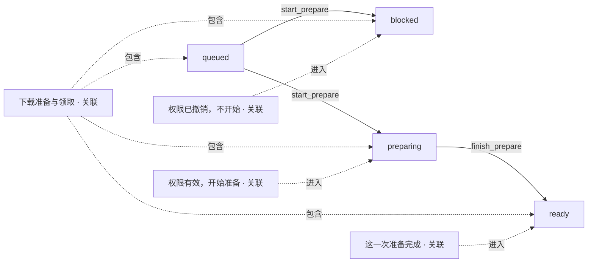
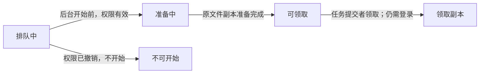

# Python drive initial design trial

Trial prompts and follow-ups delivered by the coordinating AI are scripted-user records. They are not independent human usability evidence.

Local paths are normalized as listed in dialogue.json. Original trial answers and checks are archived separately.

## 01 · user · 2026-11-19T13:13:26.883Z

# AGENTS.md instructions

<INSTRUCTIONS>
## ARIS: explicit opt-in for each chat

ARIS is disabled by default in every chat, including chats sharing the same project. Its optional pack is `C:/Users/Lvi_P/.codex/optional-skills/aris`.

Only when the user explicitly asks to use or enable ARIS in the current chat, or explicitly invokes a named ARIS skill, read `C:/Users/Lvi_P/.codex/optional-skills/aris/ON_DEMAND.md` and the required skill files. Installing, updating, configuring, or asking about ARIS does not activate its research workflows. Do not infer activation from a research or paper-writing task, project files, another chat, or this instruction.

Activation applies only to the current chat and authorized task. Do not propagate it to other chats, save a shared activation flag, or copy/link ARIS into automatic skill-discovery directories. If the user disables ARIS, stop using it in that chat. Keep the pack unchanged during research tasks and use process-local helper paths instead of persistent environment settings.
</INSTRUCTIONS>
<environment_context>
  <cwd>C:\Users\Lvi_P\Documents\Work\CF\平台软著</cwd>
  <shell>powershell</shell>
  <current_date>2026-11-19</current_date>
  <timezone>Asia/Singapore</timezone>
  <filesystem><workspace_roots><root>C:\Users\Lvi_P\Documents\Work\CF\平台软著</root></workspace_roots><permission_profile type="managed"><file_system type="restricted"><entry access="read"><special>:root</special></entry><entry access="write"><path>C:\Users\Lvi_P\Documents\Work\CF\平台软著</path></entry><entry access="write"><special>:slash_tmp</special></entry><entry access="write"><special>:tmpdir</special></entry><entry access="write"><path>C:\Users\Lvi_P\.codex\visualizations\2026\11\19\01a1f3f0-c382-7611-9787-bfc4ea6a3176</path></entry><entry access="read"><path>C:\Users\Lvi_P\Documents\Work\CF\平台软著\.git</path></entry><entry access="read"><path>C:\Users\Lvi_P\Documents\Work\CF\平台软著\.agents</path></entry><entry access="read"><path>C:\Users\Lvi_P\Documents\Work\CF\平台软著\.codex</path></entry><entry access="read"><path>C:\Users\Lvi_P\Documents\Work\CF\平台软著\.aws</path></entry></file_system></permission_profile></filesystem>
</environment_context>

## 02 · scripted-user · 2026-11-19T13:13:26.996Z

请使用这份 VibeLens Skill：C:/Users/Lvi_P/Documents/Work/CF/平台软著/SoftwareStatusObserverSkill/.validation/p7-trials/python-skills/vibelens/SKILL.md。项目放在 C:/Users/Lvi_P/Documents/Work/CF/平台软著/SoftwareStatusObserverSkill/WORKSPACE，其他工程保持原样。

我想用 Python 做一个小团队文件共享应用：上传文件，分享给同事，也能撤销共享；下载可以排队处理。另外有一个独立的公告板。我偏产品，希望先看懂业务、状态和权限之间的关系，再开始做页面和功能。不清楚的地方先问我。用中文交流，源码和注释用英文。

## 03 · assistant · 2026-11-19T13:13:29.992Z

我会先阅读这份 VibeLens Skill，梳理文件共享、下载队列和公告板的业务、状态与权限关系，再提出需要你确定的问题。确认业务范围后再开发页面和功能，所有项目改动限定在指定目录。

## 04 · assistant · 2026-11-19T13:14:29.019Z

目前可以分出三块：文件的上传、共享与撤销；下载任务的排队与处理；独立的公告板。权限会把前两块连接起来：例如同事的下载还在队列中时，共享被撤销，任务是否还能继续，需要你确定。我会在草图中保留这些待定点。

## 05 · assistant-question · 2026-11-19T13:16:51.997Z

{"questions":[{"title":"执行方式：你希望采用“状态图驱动执行”（drive：确认后的状态声明直接约束 Python 流程），还是“普通 Python 逻辑＋图上观察”（observe）？两种方式都会保留业务图和监测。","options":["状态图驱动执行（drive）","普通 Python 逻辑＋图上观察（observe）"]},{"title":"文件权限是否可以这样理解：只有上传者和被指定的同事可见、可下载；只有上传者能新增共享或撤销共享，被分享者不能继续转分享？","options":["是，按上述权限","不是，我来说明权限"]},{"title":"撤销某位同事的共享后，他已提交的下载任务应如何处理？这里区分“仍在排队”和“已经开始传输”。","options":["排队任务失效，已经开始的允许完成","排队和正在传输的都要停止","撤销前已提交的任务都允许完成"]}]}

## 06 · assistant · 2026-11-19T13:17:15.953Z

已发出第一轮三个问题：执行方式、文件权限，以及撤销对下载队列的影响。我会先保存业务草稿和待定点；你回答后，再展开对应的状态图与权限图。公告板会作为独立模块保留。

## 07 · assistant-question · 2026-11-19T13:18:18.138Z

{"questions":[{"title":"执行方式：你希望采用“状态图驱动执行”（drive：确认后的状态图直接控制程序允许做什么），还是“普通 Python 逻辑＋图上观察”（observe：代码控制业务，图展示实际状态和执行过程）？两种方式都保留业务图和监测。","options":["drive：状态图驱动执行","observe：Python 逻辑执行，图负责观察"]},{"title":"文件权限是否可以这样理解：只有上传者和被指定的同事可见、可下载；仅上传者可共享和撤销；被分享者不能继续转分享？","options":["是，按上述权限","不是，我来说明权限"]},{"title":"撤销共享时，这位同事的排队下载和已经开始传输的下载，应分别怎样处理？","options":["排队任务失效；已开始的允许完成","排队与进行中的都要停止","撤销前已提交的任务都允许完成"]}]}

## 08 · scripted-user · 2026-11-19T13:18:32.533Z

选状态图驱动执行。文件权限就按你说的，接收人不能再转分享。
下载这块，我想的是先排队准备文件，准备好后在页面领取。撤销时还没开始准备的任务，就别再开始；已经开始准备的这一次可以做完，也允许领取这份结果。这里的“开始”是后台开始准备，不是用户最后点击领取。

## 09 · assistant · 2026-11-19T13:19:01.680Z

明白，“开始”的边界是后台开始准备文件。任务若仍在排队，撤销后就不能开始；若已经开始准备，这一次可以做完，准备好的结果也仍可领取。

我会把“共享是否有效”和“这次任务是否已获准准备”分开记录，图上明确表现这个区别。执行方式采用 drive。

## 10 · assistant · 2026-11-19T13:23:56.066Z

已把你的回答记入需求记录，开始画“共享状态—准备任务状态—领取权限”的关联图。图中会明确区分：准备前读取当前共享权限，领取时依据这一次已经开始的任务。接下来还需要补齐独立公告板的操作与权限。

## 11 · assistant · 2026-11-19T13:29:23.497Z

草图已通过结构校验，包含“排队中、准备中、可领取、不可开始”这些任务状态。我正在核对动态图页面，重点检查撤销分支是否清楚；这目前仍是业务设计草稿，尚未实现应用功能。

## 12 · assistant · 2026-11-19T13:34:22.000Z

这张图聚焦下载任务：`queued` 是排队中，`preparing` 是准备中，`ready` 是可领取，`blocked` 是不可开始。后台尝试开始准备时检查当前权限；一旦进入准备中，之后撤销共享也允许这一次完成并领取。

[打开完整业务、状态与权限图](http://127.0.0.1:63300/graph)。页面与设计接口均已返回 HTTP 200；当前没有可用的浏览器控制连接，视觉效果尚未验收。

## 13 · assistant-question · 2026-11-19T13:34:23.259Z

{"questions":[{"title":"图中的撤销边界是否正确？另外，准备阶段只是生成一份供本次任务领取的原文件副本，还是还要压缩或做其他处理？","options":["边界正确；准备原文件副本","边界正确；还需要其他处理，我来说明","边界需要调整，我来说明"]},{"title":"独立公告板第一版由谁发布、谁可阅读？需要修改或撤下公告吗？"},{"title":"第一版先在本机使用几个预置同事账号，以 SQLite 保存记录、目录保存文件，是否合适？如果需要接入已有账号或数据库，请说明。","options":["合适，先用预置账号和 SQLite","需要现有账号或数据库，我来说明"]}]}

## 14 · scripted-user · 2026-11-19T13:35:37.125Z

下载这部分的撤销边界是对的，准备一份原文件副本就可以，不用压缩。图里这几个英文状态能用中文显示就更好理解了。

公告板只给登录同事看。指定一个公告编辑员，他可以发布、修改和删除自己的公告；这个角色不增加文件管理权限。

先用三个预置账号和 SQLite，一个公告编辑员、两个普通同事。登录仍要输入账号和密码，退出后就不能继续访问，不用做注册和账号管理页面。

## 15 · assistant · 2026-11-19T13:37:00.726Z

已确认：准备阶段生成原文件副本；一个公告编辑员、两个普通同事，使用账号和密码登录；公告编辑员只能管理自己的公告，这个角色不增加文件权限。退出后，文件、任务结果和公告接口都应拒绝继续访问。

对话里的状态图也改为中文，内部英文状态标识保留：

接下来先补齐公告和登录的独立模型，再实现页面与功能。

## 16 · scripted-user · 2026-11-19T13:37:04.861Z

试用协调说明：先保留当前需求与设计草图，暂不进入应用实现，也不要修改安装的 Skill。主仓库检查发现了初始图显示过密、对话图没有读取语义名称的通用问题，将先修复并回归。请保存已收到的回答与待确认问题，报告当前草图状态后停在这里；这条协调消息不构成业务确认。

## 17 · assistant · 2026-11-19T13:37:56.052Z

收到。我会保存刚收到的业务回答，并注明登录与公告板尚未展开到草图中，然后停在设计阶段。不进入应用实现，也不修改安装的 Skill。这条协调消息只记录为暂停安排，不作为业务确认。

## 18 · assistant · 2026-11-19T13:40:11.953Z

已停在业务设计阶段，未开发页面或功能，未修改 Skill 源码。

- 六个已提出的问题均已收到回答，已保存完整记录。
- 当前草图覆盖共享与下载准备；登录、退出和独立公告板的规则已保存，尚未展开建模。
- 草图结构检查通过；完整业务覆盖、实现和运行验证尚未进行。
- 协调消息已单独标记为暂停安排，不作为业务确认。

[查看保留草图](http://127.0.0.1:63300/graph) · 查看交接记录 (`C:/Users/Lvi_P/Documents/Work/CF/平台软著/SoftwareStatusObserverSkill/WORKSPACE/review/design-handoff.md`)

等待框架修复回归后的明确恢复指令。

<oai-mem-citation>
<citation_entries>
MEMORY.md:658-659|note=[design-first workflow and evidence preservation]
rollout_summaries/2026-10-28T15-48-26-1izP-file_sharing_policy_trial_vibelens_initial_implementation.md:23-25|note=[discovery record and question evidence conventions]
</citation_entries>
<rollout_ids>
01a18332-cb51-7471-83f8-990d88886b9d
</rollout_ids>
</oai-mem-citation>

## 19 · user · 2026-11-19T13:40:33.653Z

<send_user_message_question_reply>
[{"questionItemId":"[\"request_user_input_async\",\"call_bdecd43cc752427ab62c4a5b922a3855\",0]","question":"执行方式：你希望采用“状态图驱动执行”（drive：确认后的状态声明直接约束 Python 流程），还是“普通 Python 逻辑＋图上观察”（observe）？两种方式都会保留业务图和监测。","answer":"普通 Python 逻辑＋图上观察（observe）"},{"questionItemId":"[\"request_user_input_async\",\"call_bdecd43cc752427ab62c4a5b922a3855\",1]","question":"文件权限是否可以这样理解：只有上传者和被指定的同事可见、可下载；只有上传者能新增共享或撤销共享，被分享者不能继续转分享？","answer":"是，按上述权限"},{"questionItemId":"[\"request_user_input_async\",\"call_bdecd43cc752427ab62c4a5b922a3855\",2]","question":"撤销某位同事的共享后，他已提交的下载任务应如何处理？这里区分“仍在排队”和“已经开始传输”。","answer":"排队任务失效，已经开始的允许完成"},{"questionItemId":"[\"request_user_input_async\",\"call_1ad4fef88db04275a69438d71fecafc6\",0]","question":"执行方式：你希望采用“状态图驱动执行”（drive：确认后的状态图直接控制程序允许做什么），还是“普通 Python 逻辑＋图上观察”（observe：代码控制业务，图展示实际状态和执行过程）？两种方式都保留业务图和监测。","answer":"drive：状态图驱动执行"},{"questionItemId":"[\"request_user_input_async\",\"call_1ad4fef88db04275a69438d71fecafc6\",1]","question":"文件权限是否可以这样理解：只有上传者和被指定的同事可见、可下载；仅上传者可共享和撤销；被分享者不能继续转分享？","answer":"是，按上述权限"},{"questionItemId":"[\"request_user_input_async\",\"call_1ad4fef88db04275a69438d71fecafc6\",2]","question":"撤销共享时，这位同事的排队下载和已经开始传输的下载，应分别怎样处理？","answer":"排队任务失效；已开始的允许完成"},{"questionItemId":"[\"request_user_input_async\",\"call_2c23855f1eab4b0bbf2bb448cbb97c2b\",0]","question":"图中的撤销边界是否正确？另外，准备阶段只是生成一份供本次任务领取的原文件副本，还是还要压缩或做其他处理？","answer":"边界正确；准备原文件副本"},{"questionItemId":"[\"request_user_input_async\",\"call_2c23855f1eab4b0bbf2bb448cbb97c2b\",2]","question":"第一版先在本机使用几个预置同事账号，以 SQLite 保存记录、目录保存文件，是否合适？如果需要接入已有账号或数据库，请说明。","answer":"合适，先用预置账号和 SQLite"}]
</send_user_message_question_reply>

## 20 · assistant · 2026-11-19T13:40:44.021Z

收到补交的问答卡回复。我会核对其中的模式选择，保留先前明确的“后台开始准备”边界，并记录这次回复；项目继续暂停，不开始开发。

## 21 · assistant · 2026-11-19T13:42:02.835Z

这批回复同时包含 `observe` 和 `drive`。我会保留原文；当前项目仍采用 `drive`，依据是你前文的明确选择，以及这次与本轮问题编号对应的回复。较笼统的“已经开始”也不会覆盖此前确认的“后台开始准备”边界。

## 22 · assistant · 2026-11-19T13:43:58.951Z

补充回复已保存。当前项目仍采用 **drive**，同时保留批量回复中 `observe` 与 `drive` 的原始差异。

撤销边界仍以**后台开始准备**为准。项目继续暂停在设计阶段，等待明确恢复指令。查看更新后的交接记录 (`C:/Users/Lvi_P/Documents/Work/CF/平台软著/SoftwareStatusObserverSkill/WORKSPACE/review/design-handoff.md`)

<oai-mem-citation>
<citation_entries>
MEMORY.md:1039-1040|note=[preserve exact answers and design-first boundary]
</citation_entries>
<rollout_ids>
01a18332-cb51-7471-83f8-990d88886b9d
</rollout_ids>
</oai-mem-citation>
