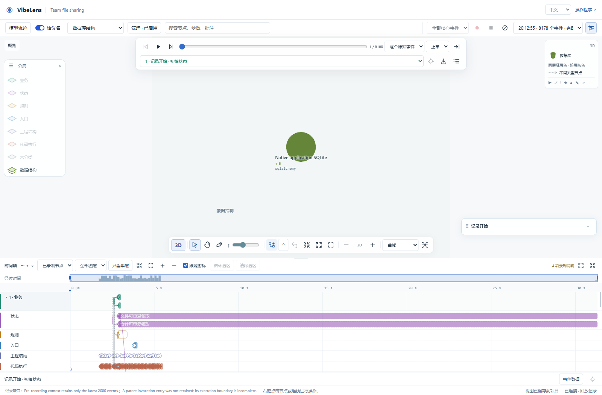

# P7 discovery round 27

This is a consolidated issue collection, not a repair or complete acceptance.
Provider commit: `df6bba9d`. P7 remains in progress. No framework code changed and
no new chat, business run or recording was started for the root desktop review.

The [issue inventory and next batch](../next-round.md) separates framework,
application, reviewer and environment findings. The [result index](results.json)
records actual outcomes. Original bytes and scripts are in
[discovery-evidence.zip](discovery-evidence.zip), with per-member hashes in
[archive-index.json](archive-index.json).

## Native recording finding

Node candidate `93dbc580b867cf4c57568e0ce858d4bfc9a27b8e6eb230c2def14a1705c4cdda`
uses build `150b7a8c49d72b8debd3022d464f516601b471bebd02bd7cc93590cd715c258b`.
The original real-browser attempt completed its seven business checks, including
on/off/fault comparison, account switching, sharing/revocation, repeat collection
and independent announcement operations.

| Recording | Interval events | Capture result |
|---|---:|---|
| `5e4c8036b5a4428aaba2266820113d94` | 2066 | Stopped, no gaps |
| `380df57764ce4038b1e20cd1c7ca7ad2` | 8178 | Stopped, pre-recording context incomplete |

The second record retains only the last 2000 of 2099 available earlier events.
Its 446 missing-parent references all belong to that context and identify the
same real `list_files/enter` at global sequence 67. Its own interval is contiguous
and has no missing-parent references. Producer settlement completes at 10317,
with pending/errors/drops/retries zero. The recorded gaps remain a failure.

The [identity inventory](model-recording-inventory.json) confirms matching
declared/bound state model IDs, states and initial states. The second record has
actual frames for `grant`, `download_task`, `announcement` and `session`. Frame
presence does not establish every transition's coverage or business correctness.

## Desktop findings on the retained record

Only the external observer ran. The incomplete record is used for rendering
diagnosis; it does not become accepted capture evidence.

| Check | Observed outcome |
|---|---|
| Readiness | Six locale/reload transitions pass |
| Layers | Seven presets in both 2D and 3D pass existing visibility/expansion assertions |
| Timeline | Nine checks pass: actual lifetimes, execution/layer rows, folding, causal links, shared cursor, zoom/pan, interval looping, depth and pause |
| Moving arrows | Actual replay arrows move in 2D and 3D |
| Bilingual names | Twelve locale/mode cases pass |
| Full source navigation | Pending: reviewer search matched both `prepare_download` and `guard_prepare_download` and incorrectly required a single result |
| Custom view/drag/annotation and native exclusion suite | Pending: its live-history prerequisite is absent in an observer-only session |

The timeline check finds 44 positive-duration business lifetimes and ten visible
causal routes. The original record's context gaps remain visible.

The layer checks test behavior rather than visual polish. Expanded screenshots
preserve the pre-expansion camera, so regions may extend beyond the frame. The
rule view is visibly dense; these screenshots are diagnostic material and are not
ready-made product scenes. Source search ambiguity is a reviewer failure, not
proof that the application exposes the wrong source.

## Preservation and remaining scope

The Node handoff preserves 31 older recordings, 211 original SQL rows, all 466
maintained provider files, 568 original capture fields and 230 original assertions.
The installed dependency count is separate from maintained provider files.
Root desktop discovery changes no declared source, database or original recording
bytes. Ordinary personal-view edits remain saved. Its owned observer is closed.

Two root startup failures are retained separately: missing process-local database
configuration, followed by a sandbox temporary-snapshot permission failure.
The configured host run supplies the desktop evidence above.

The context repair, pending native controls/source navigation, Python's current
provider acceptance, Node's source-only announcement refactor and product-scene
delivery remain open. The next round applies the consolidated batch before the
complete verification run. Historical failures and assertions remain unchanged.
