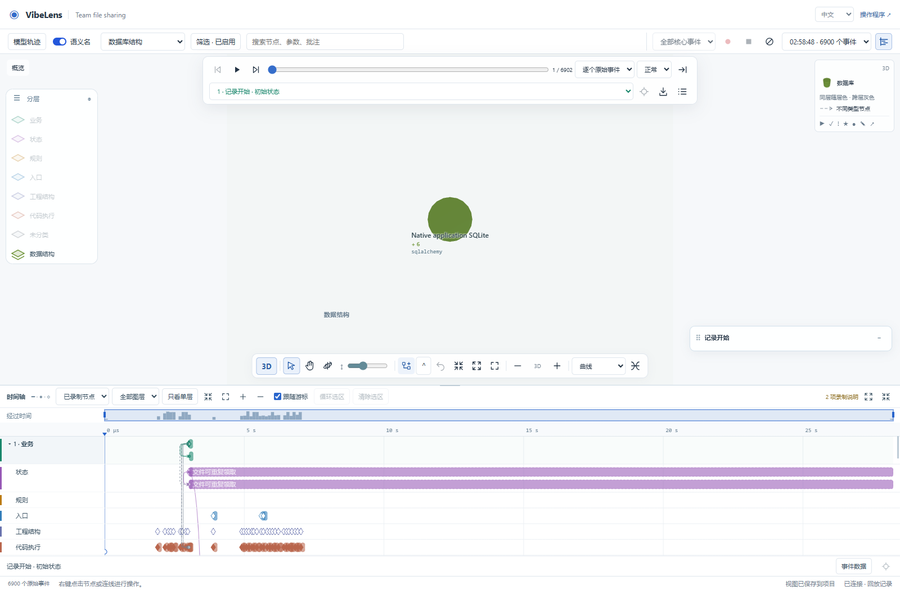
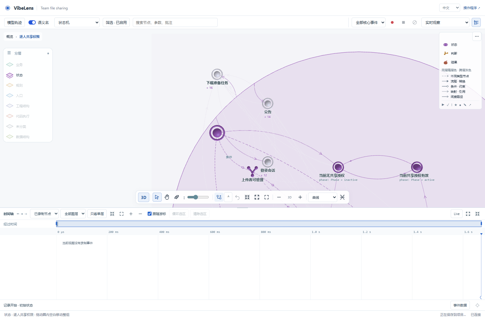

# Node observe — initial native acceptance

The initial application candidate is accepted after its complete native run,
recording, post-recording verification and independent desktop inspection.
P7 remains open for the semantic iterations, source refactors and final product
scenes. This receipt does not replace those later checks.

- Framework: `e44cb65fec7a9d98676a1184a9d4d2d2766d4b90`.
- Candidate: `a8f0eec865999f12ec6885078de42cab1a548a0d2a6d7976fc442fda0ead7e86`.
- Build: `729a1a2b2c73cd3f8b26161e6f87a96365f5c92096e4a98dc6b3702cdfb6cf3b`.
- Mode: Node observe, native SQL.js with explicit atomic file publication.
- Confirmed rule: authorization at admission permits an admitted download to
  finish after revocation; new requests are rejected. This is the valid initial
  policy, before the planned user-requested change.

## Evidence

| Check | Actual result |
|---|---|
| Normal recording stop | 1,720 and 6,900 events; no gaps; flushed; pending zero |
| Raw invocation closure | 396 and 1,271 closed calls in the two records |
| Complete verification | Original four commands passed; mapping, state rules, business, concepts and project checks passed |
| Native independence | Original observation on/off/fault cases retained; matching business outcomes |
| Desktop views | Seven configured views in 2D/3D, expansion, stable camera, custom filters, names, notes, pan and group drag passed |
| Timeline | Actual time axis; 1,398 lifecycles, including 46 business intervals with measured positive duration |
| Causal connectors | Visible same-layer and cross-layer geometry, including call, return, observation and transition types |
| Time selection | All 2,212 selected event IDs exactly match the dragged source-time interval |
| Graph replay | 2D/3D share event and transfer identities; visible arrow movement passed |
| Observer isolation | Live history remained at 858 events; no observer requests captured; six native tables unchanged |
| Acceptance | Canonical accept/check both returned current; services stopped with data and preferences unchanged |

The original first verification failed on 19 missing current-build browser
evidence items. The subsequent original browser workflow and full verification
supplied and checked that evidence; the failed result remains retained.

The native bridge now has an explicitly documented finite queue of 8,192 waiting
envelopes. Browser capacity remains 4,096; explicit tiny fault-test capacities
remain effective. All fields, workload, deadlines and persisted data were retained.
[Repair 22](../repair-22/README.md) preserves the earlier 4,096-capacity failures
and the source-index fixes. A larger queue does not establish unlimited capture.

One cumulative transport retry, one capture-control error and a browser resource
404 remain in the original diagnostics. The caught control-exchange exception was
not persisted by the client, so its cause is unresolved. The complete records and
ordinary stop receipts establish the capture result; they do not erase those logs.

## Review material

- [Results and original-record hashes](results.json).
- [Trial's final acceptance and shutdown receipt](original-acceptance-summary.json).
- [Independent desktop checks and exact runners](desktop-checks.zip),
  [member manifest](desktop-checks.json).
- [Original selected native checks and accept/check receipts](native-checks.zip),
  [member manifest](native-checks.json).
- [Pinned project source and model definitions](source-and-models.zip),
  [member manifest](source-and-models.json). This is a review snapshot, not a
  standalone installation package.

The larger raw recordings and native database archives remain in the local
trial. Their paths, sizes and hashes are recorded in `results.json`; they are not
duplicated into the public repository. Current personal preferences were saved
through the actual UI and frozen at revision 168 as the next iteration's baseline.
No old preferences were restored in this run.

