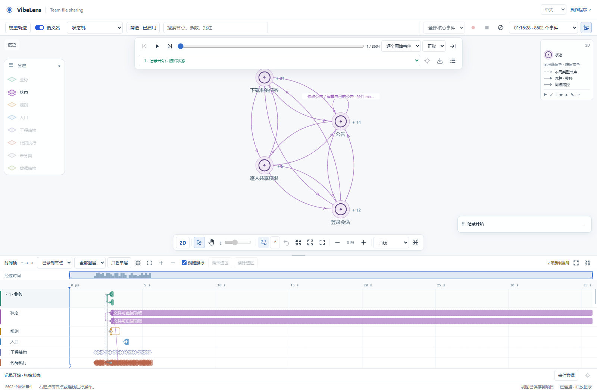

# Node semantic iteration — repair 27

The preparation-start permission change passed its original six verification
commands, two consecutive native recordings and the independent desktop review.
Canonical `change_sync.py accept/check` accepted candidate
`23029c5f522edebcaad3c23ee0cbab4397219dae31ced0eb2013813492388c1b` on the
immutable provider from `66efb5e24ae4b702bfa8f0515c90a3f2c2e637c4`.
See [results.json](results.json) for the separate results and remaining P7 work.

The initial request-time authorization policy was a confirmed requirement.
This iteration moves the permission check to the preparation-start transaction.
It does not retroactively label the initial implementation a business defect.

## Native behavior and recording

- Both records stopped without gaps: 2,178 events / 491 closed calls and 8,602
  events / 1,538 closed calls. Actual SQL images and downloaded bytes were
  independently checked. Registered state residence is distinct from physical
  invocation completion.
- The second record retains 2,000 recent context values plus the witnessed
  ancestry required to interpret them. The original failed record remains in
  [discovery round 27](../discovery-round-27/README.md).
- All 568 original capture fields retain their definitions. The complete current
  inventory is 666 fields, including 98 additions from the reviewed permission
  iteration. Repair 27 changed none of those declarations.
- The 33 previous recordings, protected application sources, original six
  commands, 180-second case limit and all 2,781 installed files were preserved.

## Independent desktop review

Seven groups of actual Chrome checks passed:

1. Six English/Chinese reloads reached usable graph controls.
2. Business, state, rule, entry, engineering structure, code and storage presets
   had matching 2D/3D identities. Expansion retained the camera.
3. Timeline used measured lifetimes, one execution/layer row, causal connectors,
   execution folding, depth/single-layer filters, zoom, pan and a shared replay cursor.
4. Recorded transition arrows moved in both renderers while keeping event identity.
5. Custom views, annotations, pins, group dragging, panning, edge styles and locale
   settings survived their tested interactions/reloads. Native table fingerprints
   were unchanged; no viewer requests appeared as business events.
6. Twelve bilingual name/mode cases and exact full-file source highlighting passed.
7. A pointer-selected interval matched exactly 4,427 original events. Clearing it
   restored the full point sequence.

The original broad Timeline drag landed in an idle interval and exercised the
nearest-event fallback. Its receipt is retained. The additional maintained range
check uses measured event times and requires multiple selected events; it does
not relabel the first result as nonempty-range coverage.

## Findings retained for the next batch

An auxiliary login check timed out without a login POST. A controlled delay of
the real initial session response reproduced an application race: the visible
form accepted typing, then initialization cleared the password. The original
failure's exact schedule was not recorded. Waiting for initialization allowed
real login/list operations and produced fresh live history, but is only reviewer
setup; the application race remains open for repair.

A strict preference comparison also recorded two new serialized defaults:
`routing: curve` and `bundling: false`. Source defaults and the retained values
establish unchanged effective settings and preservation of all prior entries.
Later root desktop actions intentionally saved new settings and annotations;
their resulting revision was frozen before canonical acceptance.

## Evidence files

- [Native archive index](native-evidence.json): original command results,
  recordings, capture/SQL/field audits and the login diagnosis.
- [Desktop archive index](desktop-evidence.json): actual results and screenshots,
  including the first range result and its additional nonempty check.
- [Source/model archive index](source-and-models.json): configured owned source,
  confirmed models and the accepted requirement change.
- [Acceptance archive index](root-acceptance.json): canonical accept/check outputs
  and the exact reviewed candidate/source/preferences.

Each archive lists member hashes. P7 remains in progress: Python maintenance,
Node source-only refactoring, the application startup repair, product scenes and
the consolidated A24–A34 review are still separate gates. No new chat was created.
