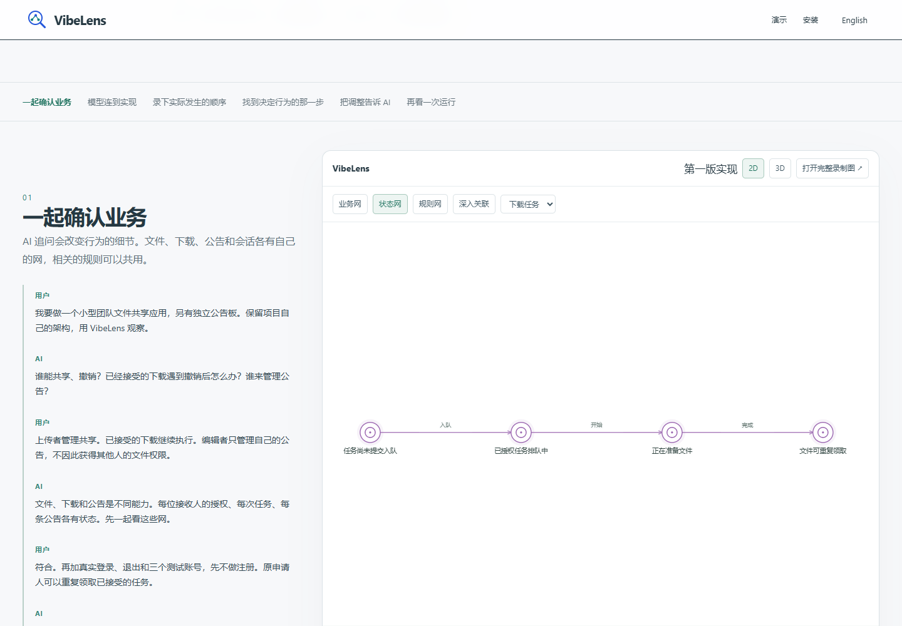
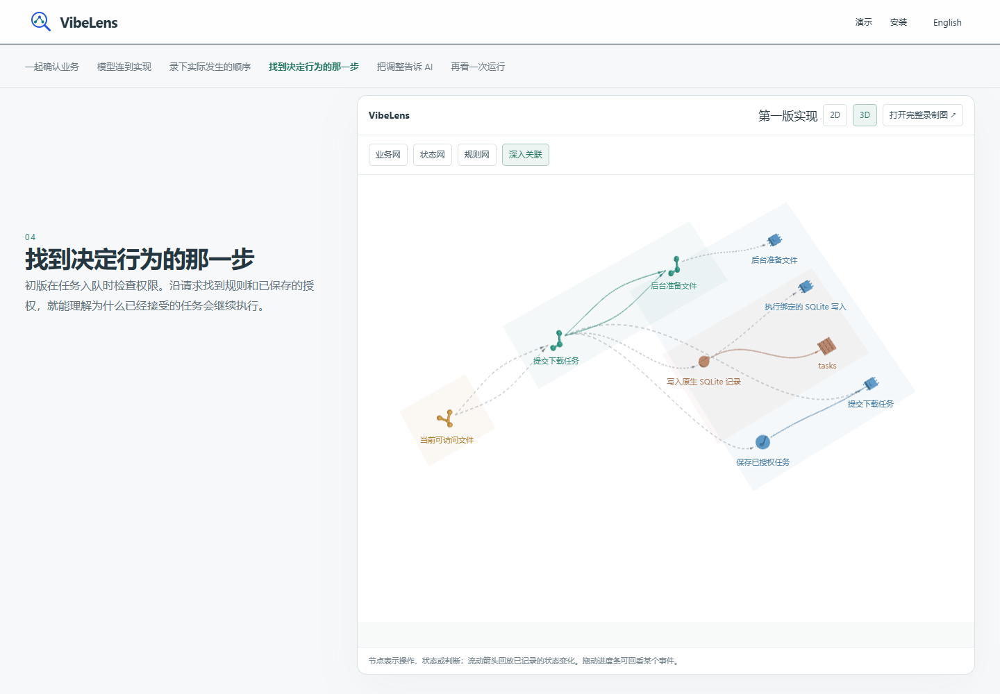
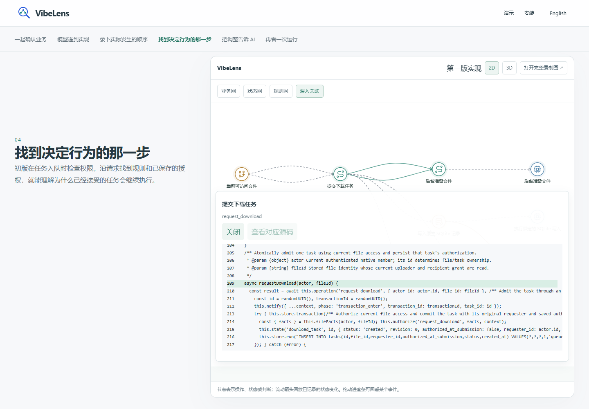

# P7 product walkthrough batch

The prepared multi-network walkthrough and the retained original product checks
passed one combined desktop browser batch. P7 remains in progress for the final
Node native/refactor acceptance and consolidated review. No public Pages deployment
or release was performed.

## What changed

The default walkthrough follows the actual Node observe trial: clarify the app,
review independent business/state/rule networks, bind implementation, inspect a
recording, change the permission boundary, and inspect the next run. The first
admission-time rule was valid. The later preparation-start rule is a requirement
change, not a retroactively invented bug.

The two small prepared files are 77,034 and 86,749 bytes. Each retains the original
node/model/edge identities. Full lossless archives load only for source inspection
or the full tool. Their hashes match independently sealed persisted recordings.
The initial epoch has four state models and 12 states; the updated epoch preserves
all of them and adds `download_task:cancelled`. Every declared route and transition
condition is checked. Moving arrows use actual recorded transition witnesses.

The full tool uses the maintained viewer through a read-only archive transport.
The original teaching example remains at `demo.html?story=legacy`, with its
original browser assertions. The walkthrough summarizes the simulated dialogue;
the original visible transcript remains the review source.

## Failed checks and repairs

| Evidence | Finding | Repair and retest |
|---|---|---|
| `earlier-attempts.zip/forest-browser-01` | Bundled browser executable absent | Use the installed Chrome override; no application behavior changed |
| `forest-browser-02/visual-review.json` and screenshots | Its limited automated check passed, but the full viewer displayed a caught catalog error and some prepared glyphs were unknown | Canonical recording-catalog shape, canonical visual types, actual replay selection and visible status checks |
| `forest-browser-03` source screenshots | Declaration appeared at the bottom; outer `scrollIntoView` could move the story | Scroll only the source pane and assert visible body space and unchanged selected section |
| `forest-static-failures.json` | Loading guard used an undeclared global; a new predicate test compared an absent list with its normalized empty list | Explicit `window.graphDebug`; normalize only absence while comparing declared predicates exactly |
| `final-browser.zip` | Complete combined batch | New bilingual story, original homepage/story, delayed loads/HTTP failure/retry, and all six original startup cases passed |

Original failed and limited results are retained. The final product gate does not
re-execute a native workload or choose a more convenient scheduling order.

## Review scope

Both languages exercised 18 selectable initial networks, actual replay arrows,
3D camera dragging, a cross-layer view, the added cancellation state, full-file
source highlights and canonical full-record loading. Delaying the full archive
left the parent story usable; a real HTTP 503 exposed retry and then loaded the
actual archive. The static gate separately rejects wrong build identity and gaps.

The full viewer's floating playback controls can cover part of the canvas near its
top. Its graph can be panned; the advertising story uses prepared focused views.
This is retained as a usability limitation, not hidden by the automated result.

The ordinary updated recording starts preparation before revocation and correctly
finishes. Its denial branch is not claimed as exercised there. The consolidated
review will link the separately retained controlled denial evidence.

[Results](results.json) records exact epochs, gates and scope. The four ZIP archives
have same-named JSON member/hash indexes. Native databases and credentials are not
part of this product evidence export.

