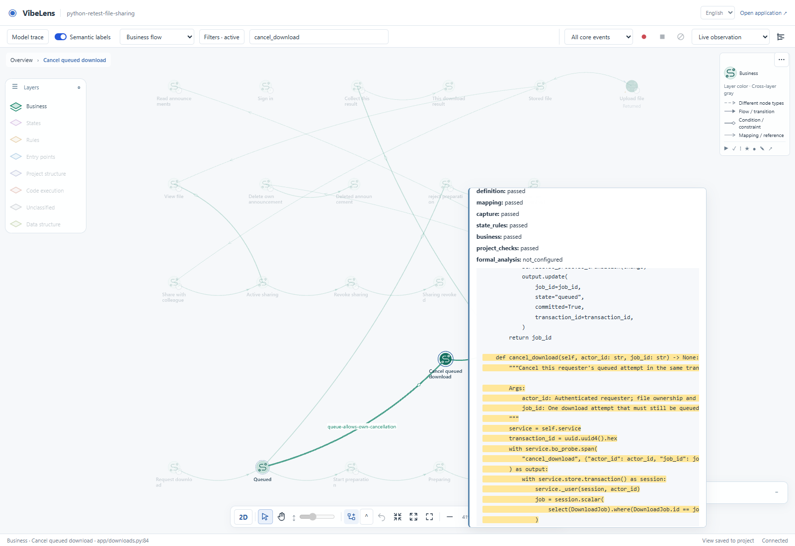
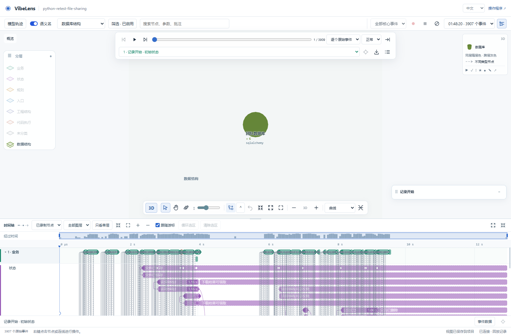

# Python drive: repair-27 acceptance

The existing Python trial passed canonical `accept` and `check` on provider
`66efb5e24ae4b702bfa8f0515c90a3f2c2e637c4`. This closes its pending provider
maintenance after the already accepted download-module refactor. P7 remains open
for the Node refactor, product scenes and consolidated review.

Candidate: `a50419c245e5e2690592f5101f0eecb9c096d1055a0c9cab274d49f289dd47ec`.
Build: `1d51d6993fac8fbe258714735ea36731c8142bea0c444827d181e45f2711a49b`.

| Check | Result |
|---|---|
| Final native verification | Mapping, state/rules, project, business and concepts passed; 162 business assertions |
| Controlled native recording | 866 events, 304 closed calls; exact state/context witnesses for all four models |
| Ordinary background-worker recording | 3,907 events, 676 closed calls; exact SQL transition order and instance frames |
| Recording completeness | Both stopped without gaps; original records remained unchanged during inspection |
| Desktop | Seven presets in 2D/3D, expansion, moving arrows, Timeline, custom views, drag, annotations, bilingual labels and current-file highlights |
| Timeline interval | A pointer-selected nonempty interval matched exactly 1,955 events; clearing restored the sequence |
| Upgrade continuity | 51 configured source inputs and the installed provider matched their frozen hashes; earlier acceptance and recordings remained intact |
| Personal settings | Revision 647 survived maintenance exactly; subsequent explicit UI tests produced revision 772, preserved by accept/check |
| Shutdown | Only four verified trial processes stopped; 112 protected files and all six native tables stayed identical |

## Reading the timing evidence

The ordinary run committed preparation before revocation, so the permitted result
became ready. Its denied-start branch is explicitly unexercised. The separate
controlled case orders real native methods with the automatic worker disabled and
verifies rejection after revocation. An inherited check label calls that controlled
worker automatic; the fixture and this interpretation identify its actual scope.
No recording was repeated to select a preferred scheduling outcome.

Stop settled the ordinary recording's fixed producer prefix at 4,049. Twelve
subsequently submitted events were outside that boundary. This is complete prefix
settlement, not a claim that the live queue was empty at that instant.

The negative control removed one cancellation return from a detached evidence
copy. Strict verification rejected missing native values and completion evidence;
the original valid record remained unchanged.

## Failures retained

The earlier missing-generation/build-admission failure remains in
[discovery round 27](../discovery-round-27/README.md). Standard generation, scan,
semantic names and technical review preceded these native checks.

The final reviewer initially treated a list-shaped frame report as an object.
That preflight stopped before canonical acceptance. `root-acceptance.zip` retains
the failure and the corrected reader's actual accept/check results. The native
workload was not rerun for this reviewer correction.

## Evidence

[Results and scope](results.json) links the exact records and archive digests.
Each ZIP has a same-named JSON member index. Native account databases remain local.
The archives contain native checks, original observations, desktop checks, current
source/models, standard maintenance preparation and root acceptance receipts.
The [workflow configuration](workflow-config.json) retains the actual gate commands
and native integration receipt alongside the immutable source archive.

[Visible Python dialogue](visible-dialogue.zip) preserves 357 public messages and
the available usage counters. The simulated customer's free-text correction,
four-model confirmation and cancellation request remain in their original order.
Framework coordination is also retained. These counters describe this trial,
including its repairs; they are not a controlled measure of token efficiency.

