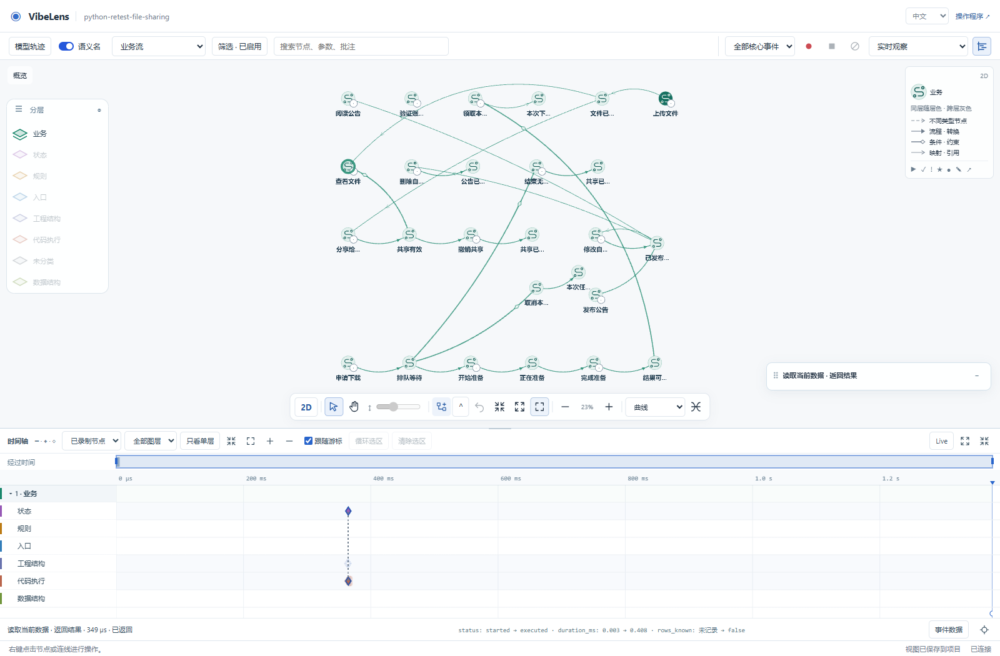
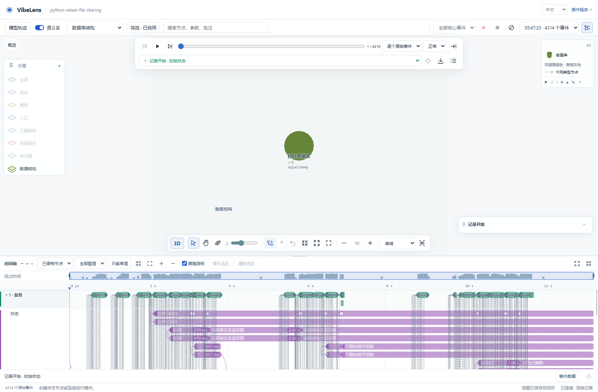
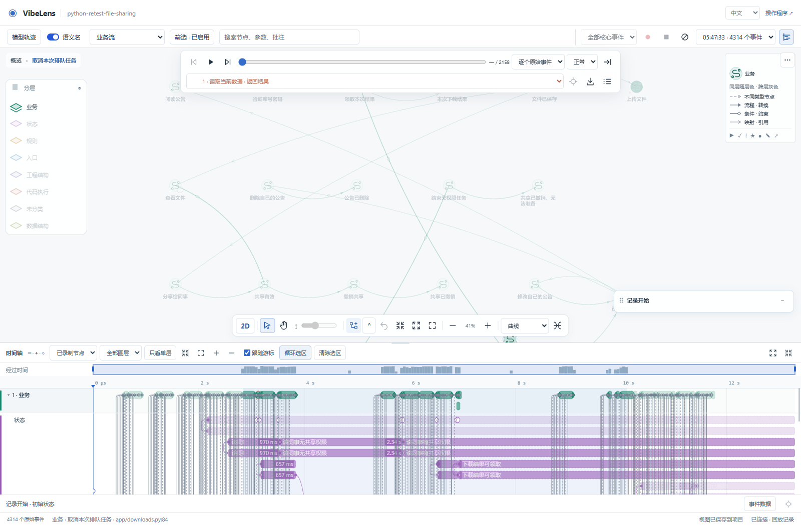

# Python drive: repair 29 acceptance

The existing Python trial passed maintenance and full native/desktop acceptance
on provider `0ac64bc0`. No new conversation was created. P7 remains open until the
Node batch and consolidated review finish.

| Identity | Value |
|---|---|
| Candidate | `3a4ce73b2eeeeae641c70841596cfc1de43a8fba50ef9fab93ba1d4740c9e14d` |
| Build | `04f67ee10658fb9d488b660c9aacb6e359975921ced45adac81f0a0fde824b05` |
| Provider | `0ac64bc0074abb4509def9b135a4fdfd1fc81c39` |
| Model | Four state models; 454 base nodes, 1,025 edges; 51 source inputs |

## Executed checks

- Both native verification passes retained all five report categories and all
  162 business assertions, including 21 business and six HTTP test methods.
- The detached missing-completion counterexample was rejected. The unchanged
  original observation passed before and after that negative check.
- The original browser cases and cancellation cases passed, with their actual
  responses, native rows and screenshots retained.
- The controlled recording contains 866 events and 24 native snapshots. It uses
  the existing explicitly ordered fixture, with its automatic worker disabled.
- The ordinary recording contains 4,314 events and 24 native snapshots. In this
  run revocation committed before preparation and the task was rejected. The
  expected outcome came from independent native SQL before the final response.
- Both stops drained their fixed producer prefixes with no errors or drops.
  Recording originals were not supplemented after stopping.
- Seven independent desktop groups passed: readiness, all layers in 2D/3D,
  Timeline lifetimes/routes, moving arrows, controls, captions/source lookup and
  a nonempty time range. Dragging selected exactly 2,158 original event identities.
- Canonical `change_sync.py accept` and `check` passed on this exact candidate.

## Maintenance and retained failures

Calling `begin` through the new provider first was rejected because the prior
candidate includes its original tool identity. The accepted source bytes were
unchanged. The original provider then established a new maintenance change;
standard generation and inspection bound the reviewed replacement.

The first generated inspection correctly required a candidate-specific review.
The review helper also initially rejected a `sync.json` change. Inspection showed
that the generator added only the new review folder as an artifact exclusion.
The helper now compares every other scope entry, command, limit and check against
the preserved original. These setup failures did not run acceptance or alter the
old receipts. The begin/inspection outputs are in the maintenance archive; the
helper assertion was observed in the root tool output and is described here.

All 467 maintained provider files match the clean installation. All 46 prior
acceptance/record files remain unchanged. Personal view revision 772 survived
maintenance; explicit desktop interactions advanced it to 895. After acceptance,
only the four verified trial processes were stopped. All 126 protected files and
all six native tables were unchanged by shutdown, and both ports were released.

## Review material

[Results](results.json) identify each record and archive. Each archive has a
matching JSON member manifest with SHA-256 digests. Native account databases and
collector tokens are excluded from the published evidence.

The screenshots show actual inspection states, including saved layout and zoom.
They are functional evidence rather than a redesigned promotional scene. These
checks do not establish finite exhaustive correctness of the application.
