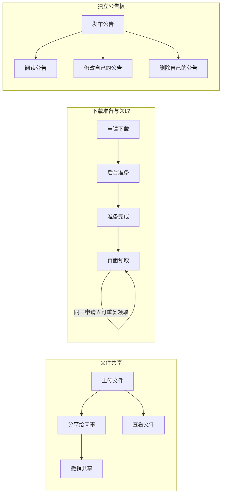
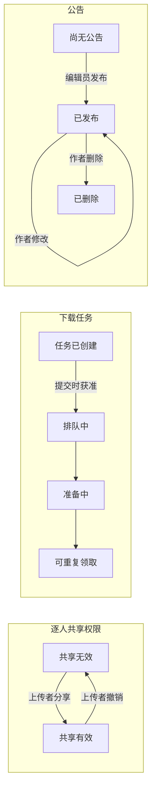
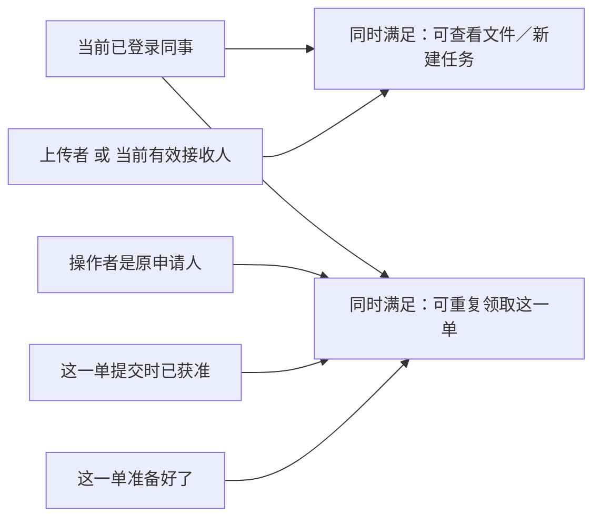
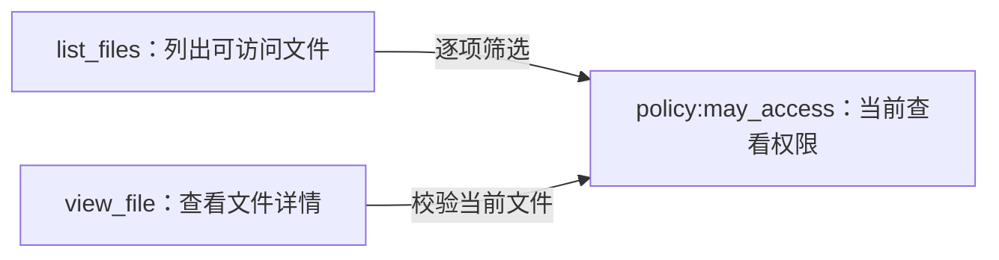

# Node observe trial — framework repair checkpoint

Trial prompts and follow-ups delivered by the coordinating AI are scripted-user records. They are not independent human usability evidence.

Local paths are normalized as listed in dialogue.json. Original trial answers and checks are archived separately.

## 01 · scripted-user · 2026-11-19T13:54:06.394Z

请使用这份 VibeLens Skill：C:/Users/Lvi_P/Documents/Work/CF/平台软著/SoftwareStatusObserverSkill/.validation/p7-trials/node-retest-skills/vibelens/SKILL.md。项目放在 WORKSPACE，其他工程保持原样。

我想用 Node.js 做一个小团队文件共享应用：上传文件，分享给同事，也能撤销共享；下载可以排队准备，准备好后在页面领取。另外有一个独立的公告板。我是开发者，希望看清权限和后台任务的实际运行。应用沿用自身的业务逻辑，VibeLens 用 observe 模式。我希望先确认业务、状态和规则图，再开始实现。不清楚的地方先问我。用中文交流，源码和注释用英文。

本机工具环境：运行外部 Skill 的 Python 脚本可使用 C:/Users/Lvi_P/Documents/Work/CF/平台软著/SoftwareStatusObserverSkill/.venv/Scripts/python.exe，相关 Python 依赖已安装。应用依赖仍在自己的项目中定义。

## 02 · assistant · 2026-11-19T13:54:09.762Z

我先阅读指定的 VibeLens Skill 和相关约定，梳理业务、状态与规则图；需要你决定的地方会先列出来，确认后再开始实现。

## 03 · assistant · 2026-11-19T13:55:03.500Z

已确认沿用应用自身逻辑，VibeLens 使用 observe 模式。图中会分别表达文件共享、下载准备任务和独立公告板，并标出尚未确定的权限与撤销规则。当前先整理设计，不编写应用功能。

## 04 · assistant-question · 2026-11-19T13:55:38.154Z

{"questions":[{"title":"文件权限是否按这个规则：上传者指定具体同事；只有上传者可以分享或撤销；接收人只能查看、申请下载，不能继续转分享？","options":["按这个规则","接收人也可以继续转分享"]},{"title":"同事申请下载后、领取前，共享被撤销时应怎样处理？","options":["领取时重新检查权限，无权限就拒绝","已获准的下载任务仍可领取"]},{"title":"独立公告板的权限是什么：谁可以发布、谁可以阅读？","options":["所有团队成员都能发布和阅读","只有管理员能发布，所有团队成员都能阅读"]}]}

## 05 · assistant · 2026-11-19T13:57:54.478Z

有个关键边界需要确认：下载任务“准备好了”和用户“仍有权领取”可能是两件事。我已把撤销后的领取规则列为待答问题；公告板也会保留独立入口。查看权限和后台任务时，图中会保留各自的对象身份。

## 06 · scripted-user · 2026-11-19T13:58:57.449Z

文件权限按这个规则。上传者自己和被指定的同事能查看、下载，其他同事看不到；接收人不能再转分享。

下载任务提交时已经获准，就让这一单继续准备并领取，后来撤销共享也不影响这一单。撤销以后不能再创建新的下载任务。

公告板只给登录同事看。指定一个公告编辑员可以发布、修改和删除自己的公告；这个角色不增加管理别人文件的权限。

## 07 · assistant · 2026-11-19T13:59:38.540Z

已记录你的规则：文件由上传者管理；下载任务在提交时获准后，这一单可继续准备和领取，撤销只阻止新建任务；公告编辑员只能管理自己的公告，角色不增加文件权限。

我会据此修改规则图，把提交下载时取得的授权和后续文件共享状态分开表达。

## 08 · assistant-question · 2026-11-19T13:59:41.623Z

{"questions":[{"title":"存储建议使用 SQLite 保存成员、文件元数据、共享关系、任务和公告，文件内容放项目本地目录，部署时无需另起数据库服务。你接受这个选择，还是使用 PostgreSQL 等已有数据库？","options":["使用 SQLite（推荐）","使用 PostgreSQL"]},{"title":"准备好的下载任务领取后，是否允许同一个申请人再次领取这一单？这会决定任务是否进入不可再次领取的终态。","options":["允许重复领取","每单只能领取一次"]}]}

## 09 · scripted-user · 2026-11-19T14:01:53.203Z

用 SQLite，文件就放在项目本地目录。准备好以后，同一个申请人可以重复领取这一单，不需要因为领取过一次就把它关掉。

## 10 · assistant · 2026-11-19T14:02:56.056Z

存储和领取规则也已确定：使用 SQLite 与项目本地文件目录；同一申请人可以重复领取准备好的任务，领取不会关闭任务。

接下来会展示合并后的业务、状态与规则图。当前仍是设计阶段，应用源码尚未开始编写。

## 11 · assistant · 2026-11-19T14:07:23.065Z

设计记录已通过结构校验，相关节点和关系的中英文名称也已检查通过。现在用 computer-use 检查图页能否打开；源码绑定和实际运行的验证要等图确认、应用实现后才能进行。

## 12 · assistant · 2026-11-19T14:08:48.515Z

图页的本机连接检查遇到超时，我正在处理这个项目的图服务访问问题。已确认的业务规则和原始答复都已保存在项目内，不影响设计记录。

## 13 · assistant · 2026-11-19T14:13:32.263Z

图页已能正常显示中文业务流，三个独立状态模型和规则网也已生成。设计中保留了关键区别：撤销共享会收回文件可见性并阻止新建下载任务；已获准的任务仍可由原申请人重复领取。

下面给你完整的设计概览，确认后才进入实现。

## 14 · assistant · 2026-11-19T14:14:21.054Z

设计已整理，**尚未开始实现**。使用 Node.js、SQLite、本地文件目录，VibeLens 采用 observe 模式。

[打开交互图](http://127.0.0.1:8926/graph)（已验证可访问，可切换业务流、状态机、规则网）。

业务流程如下，公告板保持独立：

三个对象分别维护状态：

权限的关键区别是：**新建任务检查当前文件权限；领取旧任务检查这一单的提交授权。**

其余规则为：

- 只有上传者能分享、撤销；接收人不能转分享，其他同事看不到文件。
- 撤销不影响已获准任务；领取后任务仍保持可领取。
- 登录同事可读公告；指定编辑员可发布、修改和删除自己的公告，该角色不增加文件权限。
- 应用负责权限判断和后台任务，VibeLens 观察实际结果。

完整设计记录 (`WORKSPACE/review/design-review.md`)已保存。

请确认这份业务、状态和规则图是否准确；确认后我再开始实现。

<oai-mem-citation>
<citation_entries>
MEMORY.md:848-849|note=[design confirmation before implementation and original answer preservation]
</citation_entries>
<rollout_ids>
01a1a757-9d29-7500-966c-db0e29a7651b
</rollout_ids>
</oai-mem-citation>

## 15 · scripted-user · 2026-11-19T14:14:48.286Z

这份业务、状态和规则图是我想要的，尤其是旧下载任务仍能领取、公告权限和文件权限分开的部分。可以按这份设计开始实现。

登录做真实的用户名、密码登录和退出，先提供三个测试账号，其中一个有公告编辑员身份。暂时不用注册和账号管理页面。

## 16 · assistant · 2026-11-19T14:14:51.729Z

确认已收到。我会按已确认的图实现应用，加入真实的用户名、密码登录和退出，以及三个测试账号，并同步维护 VibeLens 的源码映射和运行证据。

## 17 · assistant · 2026-11-19T14:16:44.205Z

登录将使用真实会话，三个测试账号中只有一个带公告编辑员身份；不增加注册或账号管理页面。我会用 frontend-design 整理中文界面，并用 planning-with-files-zh 保存实施进度，方便后续检查和接续。

## 18 · assistant · 2026-11-19T14:19:51.313Z

原设计的确认已写入记录。登录补充按你的明确要求处理：凭据校验成功后建立会话，退出后该会话失效；密码和会话令牌不会进入观察数据。

文件权限仍取决于上传者或当前共享关系，公告编辑员身份只影响公告操作。

## 19 · assistant · 2026-11-19T14:24:14.725Z

核心业务代码已写入：文件可见性按当前共享关系判断，下载任务在提交事务中保存独立授权，公告操作单独检查编辑员身份和作者身份。接下来会连接页面和后台队列，再验证撤销后旧任务能否继续领取。

## 20 · assistant · 2026-11-19T14:32:26.164Z

第一轮真实 HTTP 和 SQLite 业务测试已通过，13 项断言组全部通过。已验证的路径包括：提交任务后撤销共享、继续准备并重复领取、拒绝撤销后新建任务，以及公告编辑员不能因此获得文件权限。

界面已写好；现在继续接入 VibeLens，并检查观察开启、关闭或失败时，应用结果是否一致。

## 21 · assistant · 2026-11-19T14:47:03.298Z

应用已在本机启动，真实登录、文件列表、下载进度和公告页面均已接上后端。观察侧正在补齐源码入口、参数和各对象状态的对应关系；这部分尚未通过完整验收，我会保留具体检查结果。

## 22 · assistant · 2026-11-19T15:10:45.777Z

观察模式的对照测试已完成：开启、关闭和传输故障三种情况下，业务结果一致。正常采集得到 402 个真实事件，采集错误和丢弃均为 0。

队列受限测试也保留了真实的丢弃记录，文件业务结果仍一致；这组记录会明确标为采集不完整。接下来检查这些事件是否与源码、状态和规则准确对应。

## 23 · assistant · 2026-11-19T15:25:11.224Z

核心业务的接口、文件落盘和权限场景已通过测试。我会继续完成 VibeLens 的实现绑定与运行验收，再验证页面操作，最后交付可直接使用的版本。

## 24 · assistant · 2026-11-19T15:26:20.896Z

目前的缺口主要在观察绑定和说明：状态、规则与原生数据读取需要逐项对应，部分已映射的回调也缺少源码说明。我会补齐这些内容，并重新检查观察器开启、关闭和传输失败时的业务结果是否一致。

## 25 · assistant · 2026-11-19T15:32:09.952Z

VibeLens 检查发现一条需要明确记录的验收项：已确认图中有“保存已授权任务”，但现有验收项没有明确覆盖它的提交完成边界。Skill (`C:/Users/Lvi_P/Documents/Work/CF/平台软著/SoftwareStatusObserverSkill/.validation/p7-trials/node-retest-skills/vibelens/SKILL.md`) 要求：“For every declared transition effect, bind the actual operation and its completion witness”。我已整理好具体核对项 (`WORKSPACE/review/admission-expectation-review.md`)，其余验收会继续进行。

## 26 · assistant-question · 2026-11-19T15:32:11.476Z

{"questions":[{"title":"请确认这条验收项是否符合原意：下载任务提交获准后，任务、原申请人和“提交时已授权”在同一事务中保存；提交成功后才返回任务已受理。","options":["符合原意，按此验收","需要调整这条验收项"]}]}

## 27 · scripted-user · 2026-11-19T15:34:25.273Z

符合我的意思。只有任务和原申请人、提交时已经获准的结果都保存好了，才告诉我“任务已受理”。不能页面说受理了，后来却找不到任务。下载规则仍按之前确认的：已受理的任务可以继续完成，撤销共享后新申请的任务要拒绝；原申请人可以重复领取已完成的结果。继续完成这一版，并保留真实运行和检查记录。

## 28 · assistant · 2026-11-19T15:34:42.291Z

已记录：只有任务、原申请人和提交时的授权结果都成功保存，才返回“任务已受理”。已受理任务继续完成、撤销后拒绝新申请、原申请人可重复领取，这三条保持原确认规则。我会继续完成这一版，并保留真实运行和检查记录。

## 29 · assistant · 2026-11-19T15:36:55.237Z

新补的原生读取核对已通过。最新场景中，观察开启、关闭、传输故障三种情况下的业务结果一致；正常观察没有丢弃事件，队列受限时的丢弃也如实记录。接下来会检查这些证据在 VibeLens 图中的对应关系，并验证真实页面操作。

## 30 · assistant · 2026-11-19T15:45:24.344Z

我已把“事务提交失败时不能返回已受理”加入失败场景验收。同时正在补齐 SQLite 数据结构、实际读写和提交／回滚的观察记录，保留原生业务与观察器的分工。

## 31 · assistant · 2026-11-19T15:56:21.966Z

四个独立状态模型的概念绑定和原生行为核对已通过，共覆盖 10 个状态转换。现在正在完成源码说明、参数映射和项目验收；随后会用三个测试账号操作页面，检查图中是否能记录并回放这些真实操作。

## 32 · scripted-user · 2026-11-19T16:03:21.964Z

我又做了一次独立检查：一个跨来源的登录请求实际返回了 403，但 VibeLens 没记录到这次返回；同一组里的 400 和 401 有记录。请把这种在进入业务处理函数前就被拒绝的请求也观察到，同时别把它画成已经执行过的登录业务。先保留当前源码、图和检查结果，再修复并重新检查真实响应、采集字段和请求生命周期。

试用环境更新：共享框架已先完成修复和全量回归，新的独立 Skill 安装位于 C:/Users/Lvi_P/Documents/Work/CF/平台软著/SoftwareStatusObserverSkill/.validation/p7-trials/node-http-repair-skills/vibelens（对应主仓库特性分支 b0441540）。该安装的锁定 Node 依赖和图资源已准备好。请阅读这份 Skill 及相关 HTTP 接入说明，用它的受管更新流程继续当前项目；保留旧安装和先前失败证据，不要修改 Skill 本身或维护仓库。这属于观察接入修复，应用仍是 observe，文件共享、下载和公告板的既定业务规则保持当前确认内容。完成这一版的完整验收后，给出实际页面地址和证据位置。

## 33 · assistant · 2026-11-19T16:03:43.206Z

收到独立检查结果。我会先保存当前源码、图和检查记录，再阅读新安装的 VibeLens Skill，按受管流程更新接入。修复会让入口处被拒绝的 HTTP 请求留下完整返回记录，同时保留“登录业务未执行”的区别；既定业务规则保持不变。

## 34 · assistant · 2026-11-19T16:06:47.987Z

修复前的快照已保存。新 Skill 的图资源校验通过，但受管升级计划拒绝了现有项目的“两份适配器更新为三份”变更，错误是 `integration dependency set differs`。我会保留这份失败记录，并继续准备 HTTP 修复和复现检查。

## 35 · assistant-question · 2026-11-19T16:06:49.154Z

{"questions":[{"title":"新 Skill 的 bo_integrate plan 无法将本项目现有的两份受管 JS 适配器升级为包含 bo_http.mjs 的三份依赖，报错为“integration dependency set differs; retain and review the old receipt”。请提供支持这一升级的受管入口，或修正版 Skill 安装路径；我会继续完成应用侧 HTTP 修复和真实复现检查。"}]}

## 36 · scripted-user · 2026-11-19T16:21:02.466Z

Node 继续 observe，已经确认的业务规则保持不变。

受管升级入口已在 VibeLens 主工程修复，17 项迁移回归及源码、Skill 检查已通过；两个随包示例和完整回归仍在运行，本轮尚未最终验收。请改用这份新的独立安装：C:/Users/Lvi_P/Documents/Work/CF/平台软著/SoftwareStatusObserverSkill/.validation/p7-trials/node-migration-repair-skills/vibelens。此前安装和失败快照保留。

从新安装调用 bo_integrate.py plan / apply / check，正常升级即可；入口会保留原 integration.json，不要手工修改受管文件或清单。随后完成 HTTP 边界接入与原生复现，核对来源拒绝、解析失败、未登录等实际响应的采集，保留业务未进入时没有虚构业务事件的情况。继续完成这一版的源码映射、原生运行和桌面浏览器验收，不添加新业务，也先不做下一轮语义修改。请保留失败、修复、复测和图的证据，并在完成后给出各项实际结果。

## 37 · assistant · 2026-11-19T16:21:25.790Z

已收到新的迁移修复安装。我会从它执行 `plan → apply → check`，保留旧清单和前两次失败证据，再复测 403、400、401 及请求中断场景，继续完成浏览器验收。业务规则和语义定义保持不变。

## 38 · assistant · 2026-11-19T16:24:16.885Z

受管迁移已完成，三份适配器的完整性检查通过。真实复测中，403、400、401 都各有一个 API 请求区间；403 和 400 没有触发登录业务事件，401 记录了实际进入并被拒绝的登录业务。中断上传也记录为 `completed: false`，采集队列和跟踪区间均已关闭。

## 39 · scripted-user · 2026-11-19T16:50:35.089Z

主工程这一轮修复已完成完整回归和干净 Git 导出检查，并已提交为 9ddd6661。父会话再次独立请求本应用，403、400、401 均采集到唯一对应的 API 返回，源码前后未改变。

后续检查请统一使用最终独立安装：C:/Users/Lvi_P/Documents/Work/CF/平台软著/SoftwareStatusObserverSkill/.validation/p7-trials/node-migration-final-skills/vibelens。它比上一份补充了历史协议清单的兼容检查，当前项目使用的三份原生适配器字节保持一致；不要手工重写受管文件。请使用新提供者核对接入和剩余验收。

继续 observe，既定业务语义不变。先把这一版的映射、原生运行和桌面网页验收完成，保留对话、失败、修复、复测、录制及截图，再汇报结果；下一轮业务修改仍等这一版完成后再提出。

## 40 · assistant · 2026-11-19T16:51:50.823Z

后续检查会统一使用最终独立安装。我会核对三份适配器字节，并继续完成映射检查、三个观察模式下的真实网页操作、录制回放和截图留档。

## 41 · assistant · 2026-11-19T16:57:41.260Z

我继续完成这一版的验收，先确认最终 Skill 下的原生测试和模型检查，再完成三种运行模式的桌面网页、录制与回放验证。业务规则保持当前已确认的版本。

## 42 · assistant · 2026-11-19T16:59:07.749Z

最终 Skill 的源码说明、API 覆盖和中英文图名称检查已通过。HTTP 回归也已完成：来源校验提前返回 403 时，能够保留 API 返回记录，同时没有产生登录业务调用。接下来验证真实网页操作及其录制证据。

## 43 · assistant · 2026-11-19T17:03:04.785Z

启动联调发现一个项目接线问题：收集器配置使用 `build_id`，原生适配入口读取的是 `buildId`，导致实时事件被拒收。我会修正这个字段转换并重新生成、复测，再开始桌面录制。独立测试中，关闭或移除观察模块后的业务测试仍全部通过。

## 44 · assistant · 2026-11-19T17:07:33.474Z

字段接线和生成文件的排序问题已修复。当前原生三模式回归、存储失败反例、严格源码/API 检查、映射敏感性检查，以及移除观察模块后的独立业务测试均已通过。现在启动最终服务，继续网页与录制验收。

## 45 · assistant · 2026-11-19T17:10:26.492Z

真实网页已完成登录、提交任务并显示“可重复领取”。录制停止时发现 3 个状态值记录缺少对应快照，检查门禁因此仍未通过。我会保留这次失败录制，修正状态值记录与状态边界的接线，再用新版本重新录制。

## 46 · assistant · 2026-11-19T17:16:34.150Z

还定位到了浏览器回调缺失的原因：项目位于隐藏的 `.validation` 目录，观察脚本的绝对路径被 Express 静态文件规则拦截，实际返回了 404。已改为从明确的资源目录提供三个固定文件；应用业务逻辑和已安装 Skill 均未改动。

## 47 · assistant · 2026-11-19T17:23:36.265Z

状态快照已对齐，三类浏览器回调也都进入了真实录制。快速停止的一次试跑触发了队列未及时排空，系统保留了 `interrupted` 状态和缺口提示；这份失败证据已留存。接下来完成正常停止的录制，以及关闭、故障两种模式的网页对照。

## 48 · assistant · 2026-11-20T02:58:19.480Z

浏览器控制连接已过期，这次上传尚未确认完成。我会先恢复连接并核对页面、任务和录制的实际状态，再继续剩余验收。

## 49 · scripted-user · 2026-11-20T03:00:01.563Z

继续 Node observe 初版验收。浏览器连接已过期时，可以改用独立 Playwright 脚本操作真实本地页面、录制和截图；保留中断记录并核对真实数据，避免依赖旧浏览器会话。按照上一条消息使用最终独立安装，先完成这一版，再提出业务迭代。

## 50 · assistant · 2026-11-20T03:00:26.177Z

收到。后续改用独立 Playwright 浏览器完成真实页面操作、录制和截图，并保留已有中断记录。最终 Skill 和当前业务规则保持不变。

## 51 · assistant · 2026-11-20T03:02:14.555Z

我将使用 `webapp-testing` 技能，在全新的独立浏览器中完成三模式对照、上传共享与撤销、重复领取和公告操作，并把页面证据与 SQLite、文件哈希及原始录制逐项核对。

## 52 · assistant · 2026-11-20T03:09:15.057Z

独立浏览器已经正常运行。当前复测按服务真实返回的 `task_id` 定位每一单，保留同名文件的多次申请记录；这样重复领取和撤销后的证据能对应到原任务。

## 53 · scripted-user · 2026-11-20T03:11:26.646Z

已看到真实浏览器录制因 transport TimeoutError 被标为 interrupted。这份失败证据请完整保留，不要清掉 health 后直接把同一次录制算成功，也不要单纯放宽超时掩盖问题。请先定位实际哪个请求超时、当时 viewer 是否执行重扫描/阻塞以及采集客户端 timeout 配置。如果可归因于通用框架，请把精简复现路径和日志落在 review/runtime，告知我以便修复 canonical Skill；你继续不依赖该录制的原生业务检查。主仓库正在修复另一项通用问题：工程视图排除受管升级备份和已登记的定义 JSON，保留项目自身状态执行器、适配代码与全部覆盖检查；暂不切换你的已冻结候选包。

## 54 · assistant · 2026-11-20T03:12:23.369Z

已保留这次 `TimeoutError` 的原始录制和 health。它仍标记为 `interrupted`；后续试跑使用独立记录 ID，不会把这次失败改算成功，也不调整超时。候选包继续冻结。我会先定位超时请求与 viewer 当时的处理，再完成不依赖该录制的原生业务和网页检查。

## 55 · scripted-user · 2026-11-20T03:16:09.751Z

我刚检查到后续失败记录是 8925/8926 的连接拒绝，和第一次录制中的 transport TimeoutError 应分开归因。请确保 app/viewer/browser 由同一个独立 Playwright 验收父进程统一启动、等待 ready、运行、退出清理，避免临时 exec shell 退出把子服务终止或后台服务端口中途消失。保留已存失败。主仓库现开始完整回归，性能计时若同时负载较高请注明；不要把资源争用下的单次时延当作已定位产品缺陷。

## 56 · assistant · 2026-11-20T03:18:28.009Z

三种模式的真实网页业务检查已通过，准备文件哈希一致；上传共享、撤销后重复领取、公告发布/修改/删除也已验证。原生 HTTP/SQLite 测试仍为 13 项通过。录制门禁保持未通过。接下来用同一个父进程统一管理 app、viewer 和浏览器，分开诊断启动时连接拒绝与录制期间超时，并记录并发负载背景。

## 57 · assistant · 2026-11-20T03:29:00.961Z

统一父进程的网页功能复测已通过，服务在 ready 后才交给浏览器运行。另一次未启用性能跟踪的复现没有捕获到请求 `TimeoutError`，但停止时队列未排空，录制仍为 `interrupted`。这与首次超时、启动连接拒绝分别保留和归因，暂不据此认定通用框架缺陷。

## 58 · assistant · 2026-11-20T03:30:41.166Z

更正刚才的中途判断：完整请求日志中确有 3 次 `POST /api/bo/events` 超时，涉及 `list_tasks` 返回和 `policy:is_owner` 判断；后者连续两次约 1.01 秒超时，使生产者错误计数增加 1。请求 ID、事件序号和原始录制已保留；正在核对同一时段的扫描与锁等待。

## 59 · scripted-user · 2026-11-20T03:34:00.578Z

主仓库 434ff9d4 已推送，完整回归/干净导出通过，仅修复工程视图显示范围及迁移备份扫描。新包 .validation/p7-trials/node-scope-final-skills/vibelens 已就绪，但你当前超时复现请继续冻结原包，先完成现有追踪以便比较。刚才主仓库完整回归已结束，后续可以记录低负载复现。若已定位通用框架的锁等待/重扫描或停止排空问题，请把精简复现与结论写到 review/runtime；交给主仓库修复，不要直接改安装包或把失败录制改成成功。

## 60 · scripted-user · 2026-11-20T03:34:00.608Z

主仓库只读检查发现可测的候选瓶颈：GraphSession.view 已把工程/API扫描放在 session.lock 外，但锁内仍会执行 overlay_model/read_names（读取并验证全部语义名称）、BehaviorContext.view/last_verification（读取验收文件）和 binding（源码哈希）。请在你现有外置诊断中分别量测这些调用与 event/snapshot 等待，不改 installed 包。这里只是候选原因，不能据此断言已定位；请将实际超时与调用时间线对齐后反馈。当前 root 完整回归已结束。

## 61 · scripted-user · 2026-11-20T03:36:12.011Z

主仓库已有独立确定性复现：延迟 GraphSession.view 的 overlay_model 或 BehaviorContext.view 时，真实 HTTP 采集请求被 session.lock 阻塞；2 个场景均失败，未调整任何 producer timeout。正在把显示文件读取移出采集锁并补回归。这是框架并发问题已证实，尚不能代替你原始 TimeoutError 的实际根因结论。请继续保留当前包的外置请求/等待时间线；后续会提供新独立安装做相同场景对照。

## 62 · scripted-user · 2026-11-20T03:38:53.187Z

锁修复已通过 47 项相关回归（含真实 HTTP 采集并发、原始快照边界、API 与语义名称），全量回归正在准备。用于对照诊断的新独立安装：C:/Users/Lvi_P/Documents/Work/CF/平台软著/SoftwareStatusObserverSkill/.validation/p7-trials/node-viewlock-candidate-skills/vibelens，452 个 tracked 文件与当前修复源一致、依赖已安装，session.py SHA256 为 4e4f21952e083a2e1eab818de673d50cc065e314af8eb07ff6785db5735e51f3。请先封存当前旧包追踪，然后按受管流程使用它重复相同的真实浏览器录制；保留完整旧记录、超时/health/队列数据，保持默认 timeout，业务代码与已确认规则不变。这轮属于故障对照诊断，不能先标为最终验收通过。如果新包仍超时，继续记录而不要放宽门禁。

## 63 · assistant · 2026-11-20T03:39:55.914Z

收到。本轮先封存旧包追踪，再按受管流程使用新候选包做故障对照，保持业务代码、规则和默认采集超时不变；结果不会先算作最终验收通过。旧包的实际超时请求已定位，新增追踪会分别记录名称读取、行为验收读取、源码绑定和采集锁等待。

## 64 · scripted-user · 2026-11-20T03:51:50.961Z

技术协调：已读 unified-1795146438，候选包仍 interrupted/pending157/errors1，不能算成功。注意 load_context 写“Root regression finished”不准确：repair05 全量已结束，但 repair06 全量正在运行（目前~73+套），本次应记录并行修复回归负载，保留原始文件另补说明。无需重复盲跑同一流程；请先汇总本次实际 timeout 对应的 GraphSession.event/binding/锁持有，以及 sources.scan/CodeGraph.refresh 触发次数和原因，区分排队吞吐与单次请求超时。默认期限、业务源码、完整性要求都保持。主会话会继续定位通用实现耗时，不要改安装包。

## 65 · assistant · 2026-11-20T03:53:18.605Z

新候选包对照仍为 `interrupted`，未通过录制门禁。接下来停止重复试跑，汇总本次请求超时、锁等待和扫描调用时间线；也会另补负载说明：当时 repair06 全量回归仍在并行运行，原始日志不改写。

## 66 · scripted-user · 2026-11-20T03:58:54.716Z

主会话只读测量当前 Node app 的 check(root, model, baseline)：30 次耗时约 1.20 秒，每次约 40ms；保持真实文件字节/模型/意图完整校验。当前远程 JS 逐事件 HTTP，一次录制数百条时会积压；Python 本地 BOSessionSink 已有严格 preflight+前后源校验的64条批接收，但 HTTP/JS 尚未复用。我会在当前 repair06 全量结束并提交后，按证据考虑将既有批接收能力接到远程传输，保持单事件身份、快照屏障、原生执行、默认期限和失败记录，不通过降低校验解决。你先完成现有两次 profile 对比并保存，不需要再重复同样失败录制。

## 67 · assistant · 2026-11-20T04:05:05.624Z

对照报告已保存 (`WORKSPACE/review/runtime/TRANSPORT_DIAGNOSIS_20261120.md`)。候选包仍出现约 1 秒的请求超时，`binding` 调用最高约 1.40 秒，事件锁持有最高约 1.52 秒；停止排空也未通过。报告分别列出了实际请求、时间窗内的调用与锁持有、扫描触发和队列积压，并注明缺少服务端事件 ID 唯一关联及并行回归负载的限制。

## 68 · scripted-user · 2026-11-20T04:07:39.752Z

技术协调：repair06 已提交推送 093f70da。远程批量候选安装已准备好：C:/Users/Lvi_P/Documents/Work/CF/平台软著/SoftwareStatusObserverSkill/.validation/p7-trials/node-batch-candidate-skills/vibelens；原生 npm 依赖已安装，453 个自有文件逐字节一致。7项新增真实 HTTP 双语言测试通过（逐条身份、快照屏障、旧收集器回退、异常回执去重、源变更拒绝、持续请求下 flush 前缀）；另50项相关和31项录制桥检查通过。该包仍是诊断候选，完整回归待运行。请保留当前原始对照报告后，按受管流程接入候选，业务代码/规则/默认期限不变，用正常无 Python profiler 的实际录制流程验证吞吐和停止。可以记录网络请求批大小/时间，但不要再用行级 Python tracing 作为常态性能测量（它本身有显著开销）。现阶段只主仓库示例检查在运行，稍后会跑全量，会通知负载。原事件JSON协议不变，批量接口只包装transport，完整性门禁不变。

## 69 · assistant · 2026-11-20T04:09:46.302Z

收到远程批量候选包。我会先封存当前对照报告，再通过受管流程接入；随后运行不带 Python profiler 的真实录制，检查吞吐、批大小与停止排空。默认期限、业务源码和完整性门禁保持不变，这轮仍只作诊断。

## 70 · scripted-user · 2026-11-20T04:17:49.647Z

看到 unified-1795147982 在录制前报 Native queue did not settle，请保留现场健康值、HTTP 状态/回执/批次内容大小以及服务存活。先分析具体未排空原因，不重复盲跑。确认新协议实际发到了候选 viewer（schema 文件存在）以及生产者托管 SDK 都匹配。主会话同在读原始请求；根仓库两个托管示例 verify/accept/check 全通过，但鉴于该实际故障，先暂缓完整大回归以免干扰定位，当前不会有 root 全量压力。

## 71 · assistant · 2026-11-20T04:21:06.324Z

批量候选的第一段真实录制已正常停止：816 个事件、无缺口、队列清零，三模式文件哈希一致。后续完整业务操作也执行完了，但第二段录制前的队列等待未完成，因此整轮仍失败。我会保留该现场，继续分析请求状态、批大小与快照屏障，不重复试跑或放宽期限。

## 72 · assistant · 2026-11-20T04:24:08.170Z

我先核对这轮失败的健康值、HTTP 状态、批次大小和服务存活记录，定位队列卡在哪一步；暂不重复录制，原始记录全部保留。

## 73 · scripted-user · 2026-11-20T04:24:11.957Z

补充我刚读取的事实：本轮 browser-acceptance.json 已有第一条录制 80c79457da6d458e98f08ed95a8aeaf1 stopped，816events，gaps[]，settlement857/857/pending0；业务页面8组检查也已记成功。因此不是整轮从开始都没成功，应区分第一条录制完成与后续 native_idle 失败。原生网络本轮234个batch请求合计4213个event（含重试），全部响应为200，但10次请求尝试超时；生命周期约142秒。请保存失败处准确堆栈与最后health，标清是第几个 start/stop/native_idle、哪个具体item双次失败、还有哪些业务来源持续产生事件，别覆盖成功第一条记录或用此前旧build统计代替。

## 74 · scripted-user · 2026-11-20T04:24:11.997Z

主仓库协调补充两项实际源码证据，请针对性核对，不盲目重跑：public/app.js:186 在可见 tasks 页每 1800ms refreshTasks，会持续产生真实业务查询；后续 native_idle 若恰在该页，应区分有限 flush 前缀与永远等待全局 pending=0，并定位实际失败时页面/health/入队速率，不能隐藏这些业务查询。另 tooling/browser_trials.mjs 的 off/fault VIBELENS_SKILL 仍指 node-migration-final-skills，最终三模式对照应统一由当前候选的 provider 配置取得，不能 on 新版/off-fault 旧版。保留已有816事件成功记录及本轮失败现场；先报告准确原因再针对性复测。主仓库完整回归仍暂停，无此项并发负载。

## 75 · scripted-user · 2026-11-20T04:24:12.039Z

接下来我会执行批量传输修复的主仓库完整回归（组件与受管示例已通过），约数分钟。你当前先完成既有现场分析，暂不启动性能对照重跑；回归结束会通知。另 lifecycle 的 concurrent_framework_regression_reported_by_user=true 是协调消息来源而非人类用户报告，上一轮只有受管示例检查有短暂重叠，完整回归未运行；请在派生说明中准确记录，不改写原始证据。

## 76 · assistant · 2026-11-20T04:25:29.149Z

已确认：第一条录制完整结束，816 个事件、无缺口，队列为 857/857。失败发生在第二条录制的结束前等待；最终停录时仍有 148 项待处理，生产者错误为 1。候选 viewer 确实收到了批量请求；另已发现 off/fault 子进程仍使用旧 provider，后续对照需要统一配置。

## 77 · scripted-user · 2026-11-20T04:26:01.849Z

已读到准确堆栈：review/runtime/batch-candidate-real-recording-command.log 行205调用 stop_record，行74 native_idle 失败，所以是第二段结束前等待，不是第二段开始前；当时页面在团队文件页。failed-recording-2bfbcf27b8db42d490f3b19c5ac3abb8.json：3372事件、target4389/completed4241/pending148，两项缺口。请据此修正派生诊断并从最后35秒定位业务入队是否仍增加/吞吐停顿，原始证据不改。

## 78 · assistant · 2026-11-20T04:29:53.156Z

失败时已切到“团队文件”页，收到的事件集中产生于约 5 秒内，随后传输持续了四十多秒，因此这次没有证据指向任务页持续轮询。已定位到一项明确错误：会话初始状态的 572 字节快照连续两次超时。完整现场和诊断报告 (`WORKSPACE/review/runtime/BATCH_CANDIDATE_1795147982_DIAGNOSIS.md`)已封存；超时瞬间的 health 和实际回执正文未被原脚本保存，报告已注明这两个缺口。

## 79 · assistant · 2026-11-20T04:31:36.396Z

接下来补齐验收脚本的留证：逐次保存等待期间的 health、异常堆栈、批次成员和回执，并让三种模式继承同一个 provider。独立读取器的 provider 引用也需要修正，避免验证查询被当作业务事件采集。先完成这些接线修正，暂不启动性能复测。

## 80 · assistant · 2026-11-20T04:39:33.904Z

接线修正后的源映射已更新。我现在只跑原生正确性检查，验证独立 SQLite 读取是否仍会产生额外事件；这项检查使用本地测试 sink，不启动 viewer，也不作为吞吐性能结论。浏览器录制复测继续等待主仓库回归结束。

## 81 · assistant · 2026-11-20T04:41:13.412Z

原生检查已通过：独立读取额外入队为 0，workflow 事件数从 820 恢复为 634，生命周期案例从 341 恢复为 247；on/off/fault 的业务结果仍一致。新 build 的浏览器证据已明确标为过期，旧的 816 事件成功录制仍保留在原 build 下。这项修正解决了验证查询的额外采集，不能解释此前 live 页面上的传输积压。

## 82 · scripted-user · 2026-11-20T04:42:29.314Z

批量候选的主仓库完整回归已完成：96组 unittest、1115条测试记录通过；仅原Windows文件符号链接权限项跳过，TLC启用。正在做最后的干净导出检查（约1分钟，仍有短时CPU/文件IO），结束后通知正式录制复测。候选传输源码与已给你的安装包一致，没有调超时。请完成provider统一和读证据抑制的本地验证，下一轮保留health时间序列/具体batch成员/原始停止回执；不再加入Python行级profiling。

## 83 · assistant · 2026-11-20T04:44:47.016Z

八组项目检查也已通过，包括严格文档/API 检查、缺失证据敏感性检查，以及移除观察器后的 13 项原生业务测试。下一轮脚本已补充直接保存停止按钮那次 POST 的原始回执。当前仍未运行新的浏览器录制。

## 84 · scripted-user · 2026-11-20T04:44:50.704Z

完整回归和干净导出检查均已结束，现在没有主仓库全量测试负载。可以用统一provider的新接线进行一轮真实浏览器录制复测，使用已给你的 batch-candidate 安装包（源码未改变）。保留两段录制、实际health序列/批成员/精确失败栈；不使用行级Python profiler，不增加超时，不将失败改成通过。若仍失败，重点区分业务已停止后的有限队列消耗与持续产生新事件。

## 85 · assistant · 2026-11-20T04:45:27.242Z

协调主会话已确认完整回归和导出检查结束。我现在用统一 provider 的接线进行一轮真实浏览器复测，保留两段录制、逐次 health、批次成员和原始停止回执，沿用现有超时与通过条件。

## 86 · assistant · 2026-11-20T04:48:05.326Z

这轮在第一段录制就失败了：队列已排空，但原生生产者累计 3 项传输错误，viewer 因而将录制保留为 interrupted，未进入第二段。没有通过完整录制门槛；逐次 health、批次成员、停止回执和堆栈都已保存。我先分析这次明确失败，不继续重跑。

## 87 · scripted-user · 2026-11-20T04:50:18.033Z

本轮失败仍是实际超时，而非协议400；我看到 api_login seq34 同一ID两次超时，以及后续批和单事件。请先保存现有健康/回执关联结论。为了定位通用阻塞，可准备一次低开销诊断：仅在项目自有 viewer 启动 wrapper 中用 faulthandler.dump_traceback_later(1, repeat=True, file=...) 保存所有Python线程栈，然后runpy执行同一个安装入口；不改Skill、不启用逐行profiler、不改业务/超时。把超时时间对照线程栈，区分事件锁、录制锁、文件读、静态扫描、JSON处理等。当前只有root小范围单元/源码检查结束，没有全量回归；稍后我会做下一修复的受管示例和回归，请先分析已有结果，诊断启动前说一声。

## 88 · assistant · 2026-11-20T04:52:48.704Z

已确认：等待期间 enqueued 始终为 957，队列约 28 秒内排空。连续两次超时的三个事件是 seq 34、823、824；它们都已出现在 viewer 的接收记录中，客户端却未及时拿到回执，因此严格录制门槛仍失败。结论和原始现场已封存。我接下来按协调要求准备每秒一次的全线程栈采样，用于定位通用阻塞；它不会执行逐行追踪。

## 89 · assistant · 2026-11-20T04:54:43.112Z

现在启动这一轮栈采样诊断。viewer 将通过项目自有 wrapper 运行同一个候选安装入口，每秒保存全线程栈，并由独立父进程记录文件写入时间；业务、请求超时和录制通过条件保持现有设置。

## 90 · assistant · 2026-11-20T04:56:35.612Z

viewer 和应用均已就绪，线程栈及独立时间记录正在正常生成。本轮仍在执行真实页面流程；结束后会将每次超时的时间窗与线程栈对应，区分锁等待、文件读取、扫描和 JSON 处理。

## 91 · assistant · 2026-11-20T04:58:22.410Z

栈采样轮出现了另一类失败：viewer 在首段录制启动时提前退出，退出码为 `0xC0000005`，未进入正常业务录制。已保存 41 份栈，其中多处出现 `<invalid frame>`。这轮会单独作为诊断运行失败保留，不能用后续连接错误解释此前正常运行中的回执超时。

## 92 · assistant · 2026-11-20T05:00:51.953Z

崩溃前有一条有限线索：唯一一次已恢复的初始化事件超时，其时间窗内的栈显示 `event → binding → read_all` 正在等待四个文件读取线程，同时数据监视线程在做完整 project schema 校验。具体栈与边界说明 (`WORKSPACE/review/runtime/unified-1795150492/LIMITED_STACK_FINDING.md`)已保存；这些样本尚不能证明上一轮 seq 34 的具体阻塞来源。

## 93 · scripted-user · 2026-11-20T05:02:50.300Z

协调更新：已读取 unified-1795150492 的 DIAGNOSIS 与 LIMITED_STACK_FINDING，保留诊断进程0xC0000005和归因边界。不要继续 faulthandler 或盲目重录，也不要延长SDK截止时间。根仓库将检查 SourceFiles/binding 与数据监视更新的同步成本；目前 repair08 的原生示例验证仍在运行。请先完成这轮原始证据归档和无业务内容更改的代码审阅，保持录制未通过，等维护版本修复后再正常升级复测。先不要进行后续业务迭代或最终accept。

## 94 · assistant · 2026-11-20T05:05:17.656Z

我继续完成原始证据归档和本轮接线的代码审阅，保持“录制未通过”。接下来不再运行 faulthandler、录制复测或最终 accept，等待维护版本修复。

## 95 · assistant · 2026-11-20T05:07:07.392Z

三个新归档均已完成完整性校验。代码审阅确认业务源码、四个状态模型、权限规则和既有捕获字段保持一致；新增的两个静态节点来自读取器的模块加载代码，捕获字段为空。我会把变更审阅中的录制状态明确写为“未通过，等待维护修复”。

## 96 · scripted-user · 2026-11-20T05:07:20.883Z

进一步的诊断计划（先只准备，不启动）：使用项目自有启动wrapper，对安装版 GraphSession.binding、_view_model、view、snapshot、BOSessionSink.bo_accept_many、DataWatch.tick 和 protocol.validate_project 做简单起止时间记录，记录线程名/方法/耗时到独立队列；不使用faulthandler、sys.settrace或全函数profile，不改变返回值/异常/锁/SDK截止时间，不修改安装文件。需要将同一次请求的开始结束与HTTP客户端记录关联，能看出是排队还是源码/模型检查。根仓库只读组件测得28文件源码check约40–47ms，cProfile完整project校验1.51s（有profile开销，非基准），且每次数据库tick重复校验未变项目。请准备该轻量计时wrapper并保留原业务与录制断言，等根仓库结束full regression后再运行；不接受为成功、不重录多轮。

## 97 · assistant · 2026-11-20T05:11:15.962Z

我只准备这一版轻量计时 wrapper，等主仓库回归结束后再运行。先核对请求关联接口，尽量通过连接和请求序号对应客户端日志，保持 HTTP 头、请求正文及 SDK 参数原样。

## 98 · scripted-user · 2026-11-20T05:24:22.887Z

主仓库完整回归已于13:21结束，exit0，接下来只有冻结/干净导出检查与提交，无全量回归。可以启动刚准备的轻量计时诊断一次，保留原始HTTP正文、头、业务、SDK截止时间和断言。无需faulthandler。请聚焦第一次真实录制请求/回执的时间归属，结束后停下先分析，不自动重试。我已用确定性测试复现 recording_version_context 的静态模型复制持有事件锁；还复现 DataWatch 未变化tick重复完整project校验。这些是下一修复候选，仍需结合本次实际耗时判断。

## 99 · assistant · 2026-11-20T05:27:54.724Z

已收到回归结束通知。现在只启动一次第一段真实录制的计时诊断，保留原有断言和 SDK 截止时间，并保持 HTTP 头与正文原样；结束后立即分析，不进入第二段或自动重试。

## 100 · assistant · 2026-11-20T05:32:43.250Z

这一轮第一段诊断录制实际完成：1048 个事件、无缺口、队列排空，生产者最终错误为 0；期间仍有 4 次请求尝试超时后恢复。已按要求停在第一段，未进入后续流程，也未作最终验收。接下来只分析这 4 次超时的时间归属。

## 101 · assistant · 2026-11-20T05:39:12.064Z

4 次超时都已唯一关联到服务端请求：快照在进入 `binding` 前耗时约 1129 ms；另外三个批次的两次绑定校验合计约 860、1022、1133 ms。每个时间窗都与数据库监视线程的完整 project 校验重叠。这已定位到具体服务端阶段；尚未直接测量单一锁等待或 CPU 归属。

## 102 · scripted-user · 2026-11-20T05:39:19.533Z

技术协调：请先完成当前4次恢复超时的时间归因文件，然后正常升级到 repair09 诊断安装 C:/Users/Lvi_P/Documents/Work/CF/平台软著/SoftwareStatusObserverSkill/.validation/p7-trials/admission-candidate-skills/vibelens。455 个维护文件与 canonical 字节一致，npm ci 完成；84项相关回归/源码/数据库专项均通过，主仓库完整09回归待运行。改动为静态声明/录制目录复制移出采集锁，数据库 watcher 只复用完全相同 JSON 候选的纯校验。所有真实采集、源码检查及独立校验保留。统一应用、on/off/fault、只读工具 provider，禁止改安装包/业务/采集/超时。保留08/07原始失败与刚完成1048事件记录。重启后只复测一次相同实际录制诊断，报告停止排空/健康/重试和归因，不开始第二段或业务迭代，也不宣布总验收完成。请继续轻量计时，不用faulthandler或逐行分析。

## 103 · assistant · 2026-11-20T05:44:49.984Z

归因文件和 1048 事件原始记录已封存。接下来按通知使用 `admission-candidate-skills/vibelens` 做规范升级，先核对受管文件和 provider 一致性，再仅复测一次相同的第一段计时诊断。业务、采集字段和超时保持冻结。

## 104 · assistant · 2026-11-20T05:52:08.383Z

09 的规范 plan/apply/check 均通过；8 个 JavaScript 适配器字节一致，受管文件无需改动，独立数据库与严格 API 检查也通过。现在按要求仅运行一次第一段计时诊断。09 全量回归仍待维护主会话执行，本轮不代表总验收。

## 105 · assistant · 2026-11-20T05:55:55.791Z

09 这轮未通过录制门槛：队列已排空，但有一项传输在两次尝试后仍超时，生产者错误为 1，录制保留为 interrupted。已停止，没有再录一轮；现在只对齐这两次超时的服务端时间。

## 106 · scripted-user · 2026-11-20T05:56:04.737Z

主会话看到 unified-1795153948 的一次运行已结束并保存 browser-failure.json/stop receipt；请保留原件，只读归因即可，不再运行第二次。重点核对09 DataWatch内部validate_project实际次数，避免假定memo已命中；汇总失败类型、阶段时长、重试是否最终收齐。现在我会运行09主仓库完整回归（时间窗会登记），该诊断的运行已结束，不与其录制重叠。Python09也失败，正在准备只计时的同类wrapper，未启动。不要accept或业务迭代。

## 107 · scripted-user · 2026-11-20T06:03:36.873Z

补充只读核对：09 viewer-method-timing 中 protocol.validate_project 共7次完成，只有1次属于 bo-database-watch（其余4启动+2首次api/view）；因此watch完整校验memo确实命中，不能归因成仍逐tick完整校验。两次seq34超时窗口仍有 DataWatch.tick≈4757ms、录制view≈1348ms、绑定≈1446ms。请完成独立唯一请求对齐，注明尚未量到tick子阶段；主会话后续会进一步核对实际目录/数据投影与源码字节读取的成本，不放宽门槛。

## 108 · assistant · 2026-11-20T06:12:26.890Z

09 的实际计时确认了 memo 生效：23 次完成的 DataWatch tick 中，仅 1 次执行完整 project 校验，且发生在失败窗口之前。残留超时是 seq 34 的两次尝试：首次绑定校验约 1446 ms，重试在进入绑定校验前耗时约 1489 ms。两次客户端均未拿到回执，但事件最终已收齐；tick 和绑定校验内部子阶段仍未细分，已明确记为待定位。

## 109 · scripted-user · 2026-11-20T06:12:47.795Z

我已读到 repair09-failure-attribution.json 与 REPAIR09_DIAGNOSIS.md。请完成这一轮只读归因后暂停，不发起新录制。Python 正在做一次轻量计时诊断，主仓库因此暂不跑重型回归。请把确定的事实、尚未计时的空段和具体下一步最小计时建议汇总即可，不要修改安装副本、业务语义或门槛。

## 110 · scripted-user · 2026-11-20T06:12:47.815Z

补充一个待核对环境因素：主仓库同一批Node28个源码，在宿主require_escalated旧SourceFiles.read_all中位4.34ms，普通沙箱组件完整binding约40–47ms。不同量仍不能直接认定因果。请只读核对你07/09诊断launcher的启动sandbox_permissions以及子服务继承环境，写入诊断说明；不要新跑录制。Win32新reader无收益未实施。

## 111 · assistant · 2026-11-20T06:18:39.561Z

我会只读核对两轮的工具调用参数和归档启动代码，并用 openai-docs skill 核对 `sandbox_permissions` 的含义。不会启动服务、新录制或性能对照；历史子进程环境中未保存的部分会明确标出。

## 112 · assistant · 2026-11-20T06:24:54.257Z

已完成只读核对并暂停，未新录制、未执行 accept。

- 两轮启动均指定 `require_escalated`；子进程继承环境后合并参数。历史实际令牌、Job 和完整环境未保存，尚不能归因于沙箱。
- 09 的 memo 生效：23 次 tick 仅 1 次完整校验。残留耗时是首次 binding 约 1446 ms、重试进入 binding 前约 1489 ms。
- 建议下一步仅细分 `SourceFiles.read_all`、`synchronize`、`SessionHost.reload`；尚未实施。

归因与交接说明 (`WORKSPACE/review/runtime/NODE_DIAGNOSTIC_HANDOFF_20261120.md`) · 启动环境核对 (`WORKSPACE/review/runtime/LAUNCH_ENVIRONMENT_AUDIT_20261120.md`)

<oai-mem-citation>
<citation_entries>
MEMORY.md:848-849|note=[design confirmation before implementation and original answer preservation]
</citation_entries>
<rollout_ids>
01a1a757-9d29-7500-966c-db0e29a7651b
</rollout_ids>
</oai-mem-citation>

## 113 · scripted-user · 2026-11-20T10:47:24.015Z

主仓库修复已通过完整回归，当前维护提交 27893a4a，新的独立安装位于 C:/Users/Lvi_P/Documents/Work/CF/平台软著/SoftwareStatusObserverSkill/.validation/p7-trials/interactive-capture-skills/vibelens（459 个维护文件已逐字节核对，依赖已安装）。请继续 Node observe 试用，先保留现有证据，用正常升级入口切换到这个安装，执行 recall、集成迁移、scan、inspect、verify，保持原来已确认的业务规则和模型不变：排队被正式接收时授权成功的任务可以继续，撤销阻止新请求；这不是目前要改的业务问题。不要编辑安装副本，不降低采集或检查范围，不改保护性断言。此轮先完成升级和严格检查，暂不启动录制或进行业务迭代、源码重构、最终 accept；主会话正在检查 Python 页面，完成后再通知你进行一轮普通入口的真实录制。若升级或检查失败，保留原始失败并定位是框架还是项目的问题后报告，不通过修改预期绕过。

## 114 · assistant · 2026-11-20T10:47:33.106Z

我会先封存当前证据，再通过规范入口切换到新安装，执行 recall、集成迁移、scan、inspect 和 verify。本轮不启动录制、不改业务或保护性断言，也不执行最终 accept；检查失败会保留原件并定位原因。

## 115 · assistant · 2026-11-20T10:51:22.481Z

新安装的技能规范与上一轮一致。我会按原规范升级；旧录制仍保留原状态，不会因更换版本被视为通过。接下来先封存当前模型、检查结果和源码，再确认规范迁移实际改动了哪些文件。

## 116 · assistant · 2026-11-20T10:53:20.282Z

规范迁移只更新了 `bo_runtime.mjs`，集成完整性检查已通过。变更包括批量传输和回执校验。首次 scan 缺少项目原有的数据库环境变量，我已保留这次输出，接下来带上该配置重跑，再执行 inspect 和 verify。

## 117 · assistant · 2026-11-20T10:54:41.140Z

数据库元数据检查通过，570 个节点的采集契约、业务定义和初始基线均未改变。scan 同时发现一个项目映射缺口：`tests/http-boundary.mjs` 尚未完成源码登记和符号分类。我会保留原样，让严格检查报告它，不通过排除文件来消除错误。

## 118 · assistant · 2026-11-20T10:56:30.017Z

严格文档检查、API 检查和数据库检查均通过；16 个应用路由都已登记。inspect 未通过，报告了 HTTP 边界测试的源码登记缺口，以及旧候选版本的 review。verify 正在执行，结果出来后会区分前置检查失败与尚未运行的检查。

## 119 · assistant · 2026-11-20T10:57:59.630Z

verify 已返回未通过，停在前置映射检查，未启动运行用例。除源码登记和旧 review 外，还报告了 17 个文件节点缺少双语名称。当前证据表明这些是项目元数据缺口，尚不能判断新框架的录制修复效果；我会封存结果，保留全部业务语义和保护性断言。

## 120 · scripted-user · 2026-11-20T10:58:52.307Z

已看到升级后的前置失败。请在保留这轮原始失败的基础上继续完成正常维护：逐个核对新增文件属于应用实现还是验收脚本，按实际职责补齐源码登记/排除原因、双语名称和当前候选的 review；保留 tests/http-boundary.mjs 的执行与 watched-file 检查，不能靠移除测试或缩减用例通过。名称需解释当前层含义，不能把同一英文原值机械复制到中文项。若确实只是项目元数据遗漏，直接修正并复测 recall/scan/inspect/verify，无须再等我确认；如果发现框架错误则保留最小复现报告。仍不改业务规则、ID、保护性断言，不录制、不最终 accept。主仓库正在修复状态模型的通用折叠分组，之后会提供经过回归的安装，再安排真实录制。

## 121 · assistant · 2026-11-20T10:59:09.618Z

我会继续补齐项目元数据，逐个核对新增文件的实际职责，保留 HTTP 边界测试的执行和 watched-file 检查，再完成双语命名、候选 review 和严格复测。本轮仍不改业务规则或保护性断言，也不录制、不执行 accept。

## 122 · assistant · 2026-11-20T11:01:52.770Z

已核对：`tests/http-boundary.mjs` 是独立验收驱动，17 个缺名节点都是评审或诊断产物。测试文件已补上职责说明，执行命令和 watched-file 登记保持不变；scan 已不再报告未登记源码。接下来按每份产物的用途补齐中英文名称，并更新当前候选的 review。

## 123 · assistant · 2026-11-20T11:04:44.434Z

17 个节点已补上与用途对应的中英文名称，规范命名检查通过。scan 的源码登记和实现分类缺口也已清零，当前候选 review 已生成。inspect 正在复核；通过后会执行原有 verify，不会放宽当前构建的浏览器证据要求。

## 124 · scripted-user · 2026-11-20T11:05:17.451Z

补充核对这 17 个文件：如果只是生成的评审报告或诊断产物，它们不应为了满足名称检查而被包装成业务工程节点。请核对是否被运行代码实际使用；纯生成产物按已有 source_scope/产物声明机制从源码工程图中排除并注明原因，保留它们原有的测试用途、证据归档和 watched-file 校验。真正的应用文件、测试所用的原生读取器等继续如实登记。不要删文件，不改测试预期，也不要放宽扫描检查。

## 125 · assistant · 2026-11-20T11:05:49.313Z

我会按补充要求先查清这 17 份文件的实际引用。纯评审和诊断产物将通过现有产物声明从源码工程图中排除，文件及证据归档保留；应用源码、原生读取器和测试登记继续按实际职责维护。随后重新执行检查。

## 126 · assistant · 2026-11-20T11:08:18.831Z

引用核对未发现这 17 份产物被应用或验收代码直接读取。它们已按精确路径声明为产物，文件均保留，源码工程图已移除对应的 17 个文件节点。scan 仍能完整发现应用源码，登记缺口为零；测试命令和全部 watched-file 列表均未改变。

## 127 · assistant · 2026-11-20T11:11:22.378Z

调整后的 inspect 已通过。核对确认，19 份应用与测试源码、完整业务模型、570 个采集契约、测试命令和 watched-file 列表均未改变。现在执行原有严格 verify，运行配置中的原生与 HTTP 验收用例；浏览器录制仍不启动。

## 128 · assistant · 2026-11-20T11:13:45.185Z

复测的状态约束、业务断言和项目检查均通过，但完整 verify 仍报告了策略值映射不一致等错误。我会保留这轮原始结果，核对失败检查使用的图查询与独立原生值；如果属于框架问题，会整理最小复现，保持现有期望不变。

## 129 · scripted-user · 2026-11-20T11:15:25.628Z

请保持当前失败证据和所有原有断言，完成只读定位后报告最小复现：实际错误代码、涉及的节点/策略/参数、原生值与观测值、配置文件路径。暂不改预期或实现、不开启录制，也不直接修改安装的 VibeLens。主仓库正在完成共享状态模型分组及 HTTP 拒绝响应修复的回归，后续会提供新的独立安装按正常流程升级。

## 130 · assistant · 2026-11-20T11:17:45.458Z

已确认，233 个策略步骤的输入和结果值与观测事件全部一致；报错来自调用标识格式，以及 88 处依赖关系类型不符合检查器契约。另外，“列出文件”中的权限检查与声明目标不符，事务完成检查也存在字段位置问题。我会保持只读，把原始事件、配置和复现结果整理到报告中。

## 131 · assistant · 2026-11-20T11:23:28.908Z

离线复现得到了与原始回执完全相同的 331 项策略诊断和 3 项概念关联诊断，输入和检查器均未改动。报告已列出原始节点、参数值、事件标识、配置路径和待维护端判定的契约问题；最后会将报告、复现脚本和原始证据一起封存。

## 132 · assistant · 2026-11-20T11:23:56.047Z

已完成元数据维护与只读定位：17 份生成产物已从工程图排除，原有测试执行和 watched-file 校验保留。

`inspect`、业务断言、状态约束及项目检查通过；完整 `verify` 仍未通过。233 步策略输入输出一致，失败集中于调用标识、依赖类型、规则关联和事务见证；浏览器证据仍待录制。

诊断与最小复现报告 (`WORKSPACE/review/runtime/interactive-upgrade-20261120T105144Z/metadata-retest/READONLY_MAPPING_DIAGNOSIS.md`)

原始失败已封存。业务实现与断言保持不变，未录制、未执行 accept，等待新的独立安装。

<oai-mem-citation>
<citation_entries>
MEMORY.md:783-784|note=[Chinese conversation and original trial evidence conventions]
</citation_entries>
<rollout_ids>
01a1a757-9d29-7500-966c-db0e29a7651b
</rollout_ids>
</oai-mem-citation>

## 133 · scripted-user · 2026-11-20T11:32:02.804Z

只读诊断已收到。接下来先修试用工程中已经明确的两类观测问题：策略表达式事件按现有契约使用 check_id + ':' + step.node 作为 call_id，真实已使用的表达式结果用 data 依赖关联，保留真实业务父调用；不要重算权限或改原始证据。列表这一点，我的意思是：列表只显示当前同事有权查看的文件，查看详情也用同一套查看权限。请按这条既有行为补全业务图、规则适用范围和实现绑定，通过正常对话确认/迭代命令保存依据，不改应用权限逻辑。保持原有全部业务断言、570 个采集契约、独立原生用例、HTTP 和 watched-file 检查；这不是后续业务需求迭代。事务完成字段与回滚检查由主仓库修，不要绕过或自行改验证器。先完成这两类修正及对应原生回归，保存前后比较；暂不启动录制、服务、浏览器或最终 accept。新的独立安装和完整录制安排随后给出。

## 134 · assistant · 2026-11-20T11:32:19.224Z

我会修正策略事件的调用标识和数据依赖，并保存“列表与详情共用查看权限”的明确依据，补齐图和实现绑定。随后运行原有原生回归，核对 570 个采集契约及全部断言。事务检查保持原样；本轮不启动服务、浏览器、录制或 accept。

## 135 · assistant · 2026-11-20T11:37:30.145Z

本轮补齐的是两个入口与同一条权限规则的关系：

我会将你这条明确说明保存为确认依据。原有 HTTP 检查需要监听端口，本轮保留其登记与断言；对应回归直接调用原生业务对象，不开放监听端口。

## 136 · assistant · 2026-11-20T11:43:47.383Z

确认记录 `C_LIST_VIEW` 已保存。策略事件已改为契约要求的调用标识和 `data` 依赖，真实业务父调用保持不变；业务图和绑定也已补齐 `list_files` 的规则使用关系。静态比较确认：570 个节点 ID、全部采集契约、四套状态模型、事务声明和原有测试配置均未改变。

## 137 · assistant · 2026-11-20T11:48:02.881Z

首轮直接原生回归已通过：观察开启、关闭和故障三种模式各完成 15 项检查，业务结果一致。接下来会用同一场景分别运行封存的修正前代码和当前代码，对比事件关联、权限结果与父调用，保留两份原始输出。

## 138 · assistant · 2026-11-20T11:57:46.105Z

同场景前后对比已完成：275 个策略步骤中，调用标识错误从 275 降为 0，数据依赖错误从 121 降为 0，列表规则归属错误从 9 降为 0。三种模式各自的 44 次原生权限决定和业务结果前后一致，父调用关联也全部匹配。正在完成双语名称、源码扫描和候选 review。

## 139 · assistant · 2026-11-20T12:01:29.815Z

扫描已无未登记源码或实现分类缺口，命名检查、严格文档/API 检查和集成完整性检查均通过。四套状态模型与原有测试配置保持不变，当前候选 review 已更新。最后的 inspect 正在复核，随后封存前后对比和检查结果。

## 140 · assistant · 2026-11-20T12:11:35.254Z

最终 inspect 已通过。570 个节点 ID及采集契约、原有业务断言、状态模型、HTTP/原生测试配置和 watched-file 列表均保持，旧失败证据也已核对未变。正在封存本轮结果；事务完成与回滚检查仍由主仓库修复，后续完整验证等待新安装。

## 141 · assistant · 2026-11-20T12:12:01.923Z

两类修正已完成，并保存确认记录 `C_LIST_VIEW`。

同场景前后各跑三种观察模式，每模式 15 项原生检查通过：

- 调用标识错误：275 → 0
- 数据依赖错误：121 → 0
- 列表规则关联错误：9 → 0

权限决定与业务结果一致，570 个采集契约及原有断言、HTTP/watch 检查保持。`inspect`、文档、API 和集成检查通过。修正与回归报告 (`WORKSPACE/review/runtime/policy-listing-repair-20261120/REPAIR_REPORT.md`)

本轮未启动服务、浏览器或录制，未执行完整 `verify` 或 `accept`；事务检查保持原样，等待主仓库修复。

<oai-mem-citation>
<citation_entries>
MEMORY.md:783-784|note=[Chinese conversation and original trial evidence conventions]
</citation_entries>
<rollout_ids>
01a1a757-9d29-7500-966c-db0e29a7651b
</rollout_ids>
</oai-mem-citation>
