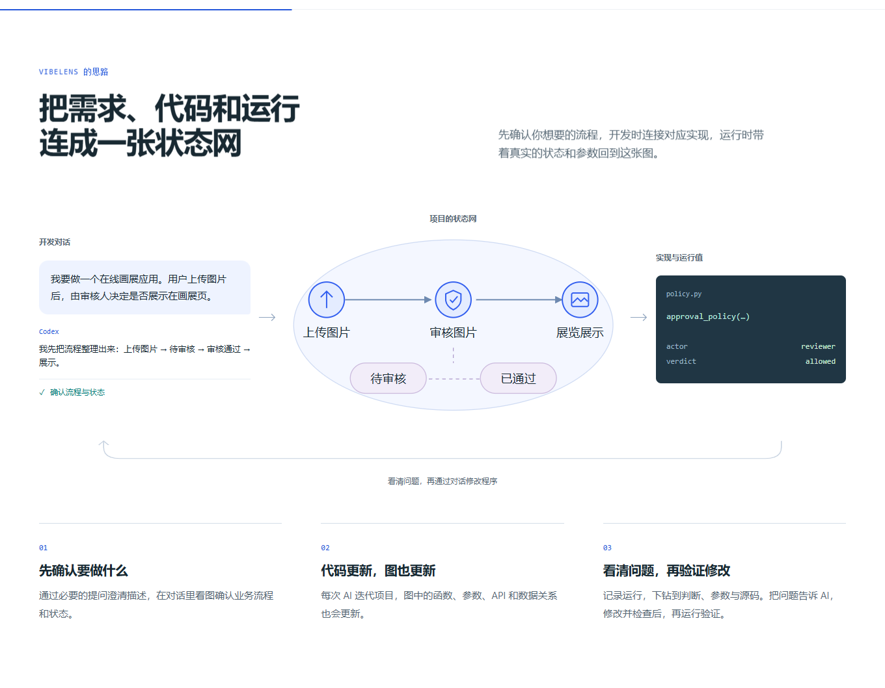

# Product copy and shared logo

Removed the screenshot qualifier, activation-scope paragraph, repeated mode note
and client-prefix fallback from the product pages. The usage documentation and
activation behavior are unchanged. Product copy describes what the developer can
see and do.

The illustrated request now starts with a complete first-person brief: an online
art gallery where people upload images and a reviewer chooses what is exhibited.
Both English and Chinese use the same scenario.

Navigation, preview headers and the favicon share `docs/site/favicon.svg`: a lens
surrounding connected state nodes. The former CSS-drawn mark and substitute dots
have been removed from those brand positions.

## Checks

- [Bilingual homepage and mobile browser result](browser.json), including shared
  logo loading, favicon identity, image switching and the recording walkthrough.
- [Detailed controls](controls.json): parameter expansion, native 2D/3D, exact
  recorded events, filtered replay, clipboard and mobile language switching.
- [Syntax, lint and formatting](source-quality.json): 101 Python and 68 JavaScript
  modules. SVG parsed successfully as XML; package and documentation checks passed.
- A CSS cleanup initially left a mobile media block unclosed. The strict parser
  rejected it; the closing brace was restored and the same checks passed. The
  [initial failure](source-quality-first.json) is retained.

## Publication

Merged into `main` at `f4c0bb48bf38eb2b5dc3ca473b81525de89b5056`.
[Pages deployment](https://github.com/li-bruce/VibeLens/actions/runs/40711108573)
completed successfully. The public site passed the same [homepage checks](public-browser.json)
and [control checks](public-controls.json). All 86 [published-resource checks](publication/pages.json)
passed, including the shared SVG and styles. The [workflow receipt](publication/ci.json)
records Pages success separately from repository-wide CI, which was still running
when captured.
