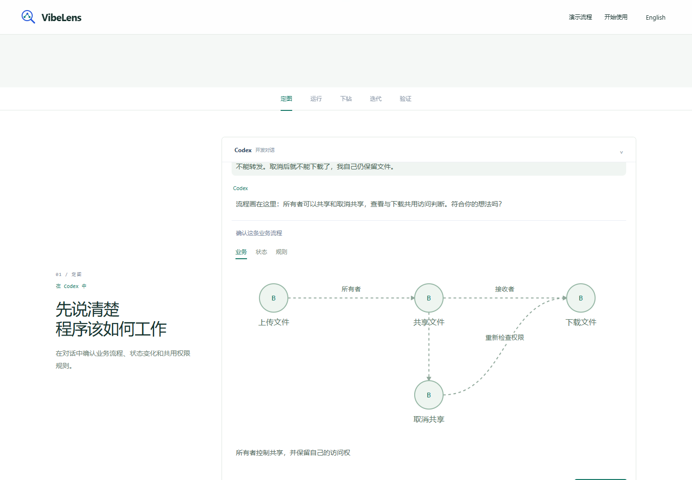
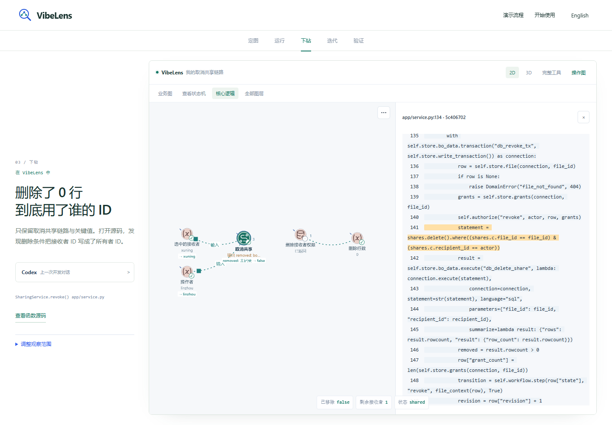

# Trial review and clearer implementation views

The completed independent chat is **not a complete acceptance pass**. Its configured business cases passed, while formal delivery, two state-frame associations and recording eligibility still failed. See the [assessment](TRIAL-ASSESSMENT.md), [public dialogue](dialogue/dialogue.md) and [original result](trial-evidence/RESULTS.md). No later business iteration was performed in that chat.

This change improves presentation and display classification. It does not claim to repair those three independent-trial failures.

## Changes

- Implementation detail has three display planes: **Entry points**, **Project structure** and **Code execution**. The existing semantic implementation classification, node IDs, bindings and recorded facts remain unchanged. API handler calls, captured values and database operations are execution detail; stored schemas retain their own plane.
- The default view remains business, states and rules. Old implementation selections expand into the three planes, preserving narrow facet exclusions. Timeline uses the same display classification.
- The home page explains one development loop: confirm the model, inspect actual behavior, then refine the implementation. It uses native screenshots and a seven-plane interactive explainer, with English and Chinese copy.
- The walkthrough follows a single revocation defect. Five stages separate Codex development from application operations and VibeLens investigation. The confirmation dialogue contains business, state and shared-rule views. A focused native graph keeps the actual relation between revocation and its database operation.
- Current changes use a movable panel with two preview rows. All rows and full before/after values remain available through disclosure. Minimizing the panel persists while new events arrive. Floating text no longer changes the graph's fitting area.

## Story and evidence

The story was presented in the coordinating conversation before screenshot capture. See the [five-stage script](STORY.md). The case uses the existing file-sharing execution artifacts: its deliberately seeded defect is disclosed in the linked provenance. It is separate from the completed independent trial above.

The published screenshot inputs are the original native viewer, preserved source and original recording. No screenshot or event was painted to manufacture a result. [Capture provenance](../../site/images/capture-proof.json) records the build, event, selected node IDs and image hashes.

## Checks

| Scope | Result and evidence |
| --- | --- |
| Display identity and filter migration | [49 JavaScript regression groups](checks/unit-results.json), including all 32 old implementation facet combinations |
| Python/JavaScript observation classification | 19 observation-continuity tests; semantic classification remains distinct from display planes |
| Native walkthrough | [Browser checks](checks/case-browser.json): both languages, five stages, actual moving edges, source, saved views across builds/reload, eight presets, seven occupied planes and mobile |
| Product home | [Home checks](checks/site-browser.json): keyboard image switch, language switch, seven layers, responsive layout, replay and reduced motion |
| Cold startup | [Six fresh contexts](checks/startup-browser.json): delayed child data, one localized navigation, same-viewer story handoff |
| Concurrent real execution | [Execution bands](checks/execution-bands.json): two users, real SQLite writes, closed calls, resource dependency curves, collapse and depth controls |
| 2D/3D interaction | [Layered viewer](checks/layered-browser.json): source ownership, hidden layers, multi-layer persistence, spatial drag, undo and replay |
| Concept-model runtime | [Concept checks](checks/concept-browser.json): actual app operations, independent concepts and cross-layer bindings |
| Timeline component load | [20,000 synthetic events](checks/timeline-performance.json): initial render 240 ms, seek p95 31 ms, draw p95 19 ms in this run; excludes complete graph reconstruction |
| Source quality | [Syntax, lint and formatting](checks/source-quality.json); normal package-copy and document checks |
| Maintained examples | [Two accepted changes](checks/example-maintenance.json): mapping, state rules, project checks and 96/189 business assertions passed; protected business source and requirements retain their previous hashes |
| Complete repository regression | `python tools/verify.py --database` passed in 480 seconds; [full output](checks/full-regression.txt) includes installation, multi-language checks, actual effects, observer-free exports and both maintained examples |
| Clean installation source | [Git export check](checks/clean-export.json): both examples pass using only the committed files and frozen approvals, without regeneration or reapproval |
| CI browser follow-up | [Graph geometry](checks/graph-quality-followup.json) and [API causality](checks/api-followup.json) pass with the split display planes; [seven further browser runs](checks/browser-followup.json) cover Timeline, naming, captions, native lifecycles, mid-span recording and concurrent execution |
| Published pages | [Live browser checks](checks/published-browser.json) passed in both languages, including all five story stages, camera drag, saved views, source comparison and mobile layout |
| Compact observation panel | [Recorded execution](checks/compact-changes.json): nine actual changes, two preview rows, all nine available on expansion; English/Chinese, 2D/3D, dragging, minimization, resize and graph location |
| Chapter editing boundary | [Native browser regression](checks/editor-boundary.json): editing stays in its chapter; scrolling controls out of view and explicit navigation release it |
| Final follow-up regression | [Six cold starts](checks/compact-startup.json), [full walkthrough](checks/compact-case-browser.json), [home and mobile layout](checks/compact-site-browser.json), [source quality](checks/compact-source-quality.json), [both maintained examples](checks/compact-example-maintenance.json) and [clean Git export](checks/compact-clean-export.json) passed |
| Mobile language-switch correction | [Full bilingual walkthrough](checks/locale-case-browser.json), [sticky-graph chapter selection](checks/locale-scroll-browser.json) and [source checks](checks/locale-source-quality.json) passed; both language switches preserve inspection without an extra test scroll |
| Isolated view settings | [Full bilingual walkthrough](checks/dialog-case-browser.json) passes with 2x CPU slowdown, focus retention, stable chapter height, Escape, two saves and later-build reuse; [home/mobile](checks/dialog-product-browser.json), [native preview checks](checks/dialog-preview.json) and [source quality](checks/dialog-source-quality.json) pass |
| Presentation focus | [Complete bilingual walkthrough](checks/presentation-focus-browser.json) retains the inspection chapter and parent focus after both language switches, and restores native interaction; [source quality](checks/presentation-focus-source.json) passes |
| Browser frame boundaries | [Compact panel](checks/frame-panel.json) and [10 chapter runs](checks/frame-scroll.json) pass after waiting for scheduled rendering; [home/mobile](checks/presentation-product.json) and [six cold starts](checks/presentation-startup.json) also pass on the published presentation code |
| Visible editor interaction | [10 pointer-and-typing runs](checks/visible-editor.json) pass with the field positioned before interaction; the exact ownership, Save and release assertions remain in place |

The [delivery record](checks/delivery.json) contains the tested base, source fingerprints, exported example trees and open trial gaps. The database scope includes adapter regression and local SQLite execution; external live database services were not rerun for this presentation change. This result is separate from the failed independent trial. The [file manifest](manifest.json) records the review artifacts and their hashes.

## Failures and corrections

1. The confirmation dialogue called document-level `scrollIntoView`, which advanced the story and hid its continuation button. It now scrolls only the conversation panel. Both language flows pass.
2. The focused graph excluded `contains`, separating the action from its observed database operation. Its original, typed relation is retained; the small inspection view uses the native directed layout. Broader views retain clustering.
3. A test dragged the graph center, which can hold a node. The camera test now uses empty canvas. Rotation remains independently checked by the native walkthrough regression, including zoom and pan.
4. A fixed test port attached to an unrelated local server and received 404. A shared test-host helper now owns an ephemeral port. Test semantics were retained.
5. Old browser assertions expected the former implementation row name and its alphabetic order. Assertions now explicitly check the new planes, their order and their saved visibility. Old-filter migration has independent regressions.
6. The restricted environment blocked Windows directory-link fixtures. The unchanged eight tests passed in the normal local environment; the full run was repeated there. The original failure log is retained.
7. Copied viewer assets changed the maintained examples' managed-file hashes. The full suite correctly refused their stale approval records. Each example was restored to its prior accepted files to begin the change, then received the pending assets again, followed by architecture sealing, inspection, review, verification and acceptance. New receipts are saved alongside the old ones. Business requirements and expectations were not changed. An intermediate parser-environment failure was retained and corrected by selecting the installed JavaScript adapter.
8. The additional GitHub browser job found a geometry test still clicking the former `implementation` layer. The adjacent API browser test also expected API and operation intervals on that same row. These tests now select `symbols` for captured execution, and explicitly check business → entry → execution calls and returns. Exact method/status values, measured durations, source identities, drag bounds and restoration assertions remain in place. The [decoded CI log](failures/github-graph-quality.log) is retained; both tests and all seven remaining browser variants passed locally after correction. No runtime code changed in this follow-up.
9. A subsequent Linux CI run found that editing a custom view could scroll into the next chapter and replace the viewer before Save was clicked. The [original failure](failures/github-editor.json), [screenshot](failures/github-editor.png) and [log excerpt](failures/github-editor-excerpt.log) are retained. The scroll controller now preserves the chapter while the interacted editor control is actually visible, including checks for sticky-header occlusion. The first correction held the chapter too long; its [failed navigation test](failures/editor-first-correction.json) is retained. The final [full walkthrough retest](checks/editor-case-retest.json) passes both languages and cross-build saved-view reuse. No click is forced and no timeout assertion is removed.
10. Parallel local browser runs encountered `net::ERR_ADDRESS_IN_USE` while loading a native module. The [cold-start failure](failures/local-port-collision.json) is retained. Subsequent browser runs are serialized to avoid contention between local preview hosts. No application error was suppressed or retried inside the assertions.
11. [Linux CI on `99c90292`](https://github.com/li-bruce/VibeLens/actions/runs/41985755209) passed the compact-panel tests but found a mobile language-switch failure in the full walkthrough. Chapter selection used a fixed viewport percentage, while CSS positioned the requested chapter below the sticky graph; the two reading positions disagreed. Translation also rebuilt sections without preserving the current chapter. The [original diagnostic](failures/github-mobile-language.json) and [screenshot](failures/github-mobile-language.png) are retained. Simply restoring the old pixel offset [failed](failures/locale-first-correction.json). Selection now reads the actual CSS scroll padding and chapter margins, and translation anchors the existing chapter after placing its conversation and application content. The regressions cover tablet-sized sticky insets and require inspection to remain active after both language switches, without a corrective scroll.
12. The inline editor remained timing-sensitive in [the next Linux run](https://github.com/li-bruce/VibeLens/actions/runs/41988444328): a preview could still move its Save button beneath the sticky navigation and advance the chapter. Its [diagnostic](failures/github-editor-recurrence.json) and [screenshot](failures/github-editor-recurrence.png) are retained. View settings now use a native dialog outside document layout. A [first dialog test](failures/dialog-first-correction.json) also found that an embedded document can take focus despite the parent's modal dialog; the Pages bridge now explicitly makes that background document inert during editing. Preview computation continues, and saving or Escape restores interaction. The complete regression checks unchanged chapter height, focus retention, two distinct saved views, later-build reuse and Escape, with 2x CPU slowdown during editing.

13. [Linux CI on `b3430043`](https://github.com/li-bruce/VibeLens/actions/runs/41991629724) passed the isolated editor but found a later mobile translation jump. The [diagnostic](failures/github-language-focus.json) records focus inside the iframe and the earlier chapter replacing inspection; the [screenshot](failures/github-language-focus.png) preserves that result. Native selection and toolbar actions can move focus during scripted scene setup, outside the editor as well. The Pages presentation bridge now makes its embedded document inert for the duration of those asynchronous requests, including overlapping requests, and restores native interaction when they finish. A [first correction](failures/presentation-focus-first-correction.json) kept focus outside the iframe but still jumped chapters. A focused diagnostic then found that root scroll padding excluded the visible header button from the browser's focus area: preparing a click moved the document upward by 439 pixels. The demo now clears the root inset and uses its existing chapter margins for navigation. Regression checks require header focus preparation to leave the document position unchanged, and both translation directions to retain the chapter, restore native input and leave keyboard focus outside the iframe. Recording and graph computation continue normally.

14. The next cloud run exposed two browser-test races before the full walkthrough: the [resize assertion](failures/github-resize-frame.json) read panel bounds before `ResizeObserver` ran, although the [failure screenshot](failures/github-resize-frame.png) already shows the corrected bounds; the [chapter assertion](failures/github-scroll-frame.log) read the prior chapter before its scheduled animation frame. Both tests now wait up to one second for their exact visible invariant before applying the original assertions. No coordinate tolerance was widened, no check was removed and no production code changed in this test follow-up.

15. The bounded chapter wait [still failed on Linux](failures/github-scroll-focus-setup.log), ruling out a render delay as the only explanation. The fixture focused its input before repositioning it across the fixed header; visibility-based ownership could correctly be released during that movement. The fixture now positions the field first, then performs an actual pointer click and typing in the visible editor. Ownership, Save, ordinary scroll release and explicit navigation retain their original assertions. The application already uses a native dialog and its complete bilingual interaction test remains separate.

Failed runs and screenshots remain under [failures](failures/). Historical evidence elsewhere in the repository was restored rather than overwritten by the new performance run.
