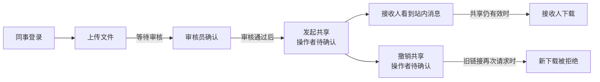
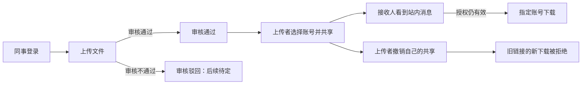
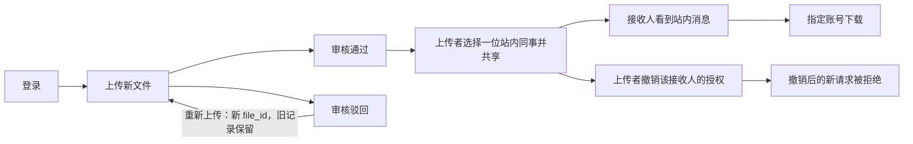
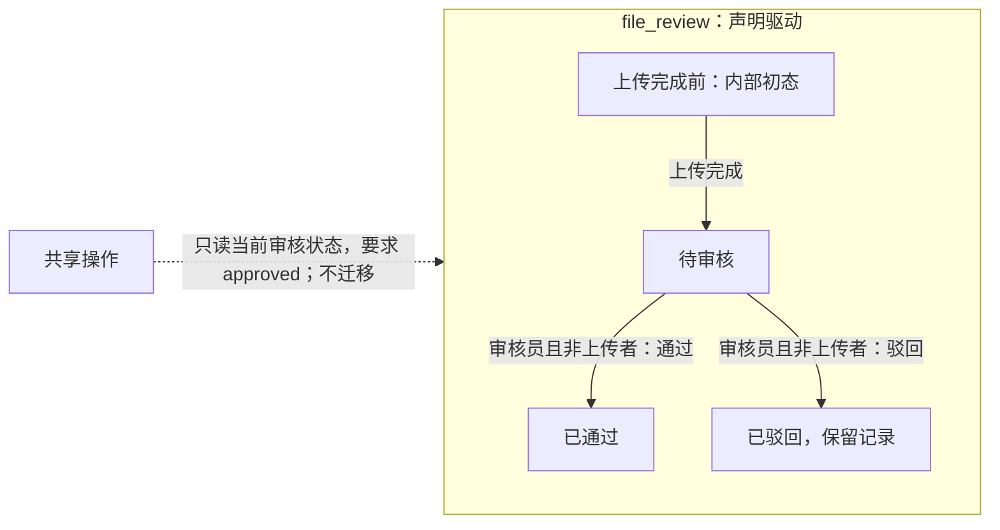
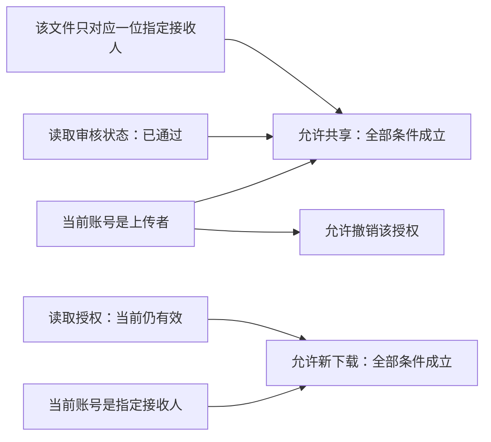

# Completed v0.12.1 independent trial

Trial prompts and follow-ups delivered by the coordinating AI are scripted-user records. They are not independent human usability evidence.

Local paths are normalized as listed in dialogue.json. Original trial answers and checks are archived separately.

## 01 · scripted-user · 2026-11-04T16:15:01.769Z

请在一个全新的独立工程中试用已发布的 VibeLens v0.12.0。工程目录为 WORKSPACE。请先从 https://github.com/li-bruce/VibeLens/releases/download/v0.12.0/vibelens-v0.12.0.zip 下载并核对 SHA-256：9955b650113c41e79c2039dc78ae52d2690f318de87b341bb9af9009869035da。将完整 Skill 放到本工程内的独立安装位置，读取其 SKILL.md 后使用；不要改动全局安装或 SoftwareStatusObserverSkill 维护仓库，也不要从旧示例复制一个完成项目。

下面是本次真实执行的试用需求。请正常提问、展示图、等待我的确认，然后实现。不要自行扮演需求方回答你的问题；后续消息会给出模拟用户的回答。中文交流，源码和注释采用英文。

$vibelens 我想给小团队做一个简单的资料共享网站。同事登录后上传文件，审核员确认后才能分享，收到分享的人在站内看到消息并能下载。撤销共享后，旧链接也不能再发起下载。界面简单一点。先把流程理清楚，不清楚的地方问我。

这次同时保留试用材料：原始问题与回答、确认时的图、每轮代码和图检查结果、实际操作记录及截图均放在工程的 review/ 中。需求侧后续回答是经用户授权的拟人模拟，证据应注明这一点。工具或框架自身报错时保留复现，不要修改已安装 Skill 的校验器来绕过。先完成正常的开始阶段，后续会继续提出迭代与观察需求。

## 02 · assistant · 2026-11-04T16:15:07.098Z

我会先下载并核对 v0.12.0 发布包，在独立工程内安装和读取 VibeLens Skill，按它的开始流程梳理需求，并把原始输入、后续问答和检查证据保存到 `review/`。

## 03 · assistant · 2026-11-04T16:16:16.405Z

发布包的 SHA-256 与指定值完全一致，349 个文件已完整安装并逐一核对。我现在开始使用本工程内的 VibeLens Skill，先整理待确认的流程、权限和状态；确认后再实现业务代码。安装记录和 Python 启动时的一条路径警告也已保留。

## 04 · assistant · 2026-11-04T16:17:32.914Z

当前需求明确了三条约束：审核通过后才能分享，接收人在站内收到消息，撤销后旧链接不能发起新下载。还需要确认分享和撤销由谁操作、接收人如何确定，以及项目采用“声明驱动”还是“代码运行、图负责观察”的方式。我会把这些未定项标在草图中。

## 05 · assistant · 2026-11-04T16:21:02.174Z

业务、状态和权限草案已经写入。首轮校验提示当前 Python 环境缺少 Skill 所需依赖，原始错误已保存；我正在工程内创建独立环境并安装发布包声明的依赖，随后继续检查图和网页。

## 06 · assistant · 2026-11-04T16:23:27.946Z

独立环境安装完成，草案结构校验已通过，确认状态仍是“未就绪”。后台启动的图服务曾返回 HTTP 200，但进程随后退出，浏览器连接失败；我正在调整启动方式，并保留这次失败记录。

## 07 · assistant · 2026-11-04T16:26:03.757Z

浏览器现在能打开页面，但发现了发布包查看器的报错：它读取 `subject` 时遇到缺失对象，画布未能显示。这属于图展示失败，不能算开始阶段通过。我会保存截图、响应和最小复现，保持安装包原样；对话中仍可展示从同一份草案导出的流程图，继续澄清需求。

## 08 · scripted-user · 2026-11-04T16:28:12.050Z

试用协调说明：已收到设计草案 Web 的 subject 报错，主会话正在独立修复框架。请保留安装包原样和最小复现，这一项暂记失败；你可以先把当前流程图和需要我决定的问题发出来，继续需求澄清，不必等待 Web 修复。

## 09 · assistant · 2026-11-04T16:28:44.925Z

收到。我会将 Web 渲染这一项保留为失败，不改动本工程的发布包。下面继续展示流程草案和第一轮需要决定的问题；业务实现仍等需求确认后再开始。

## 10 · assistant · 2026-11-04T16:30:39.167Z

已完成独立安装和 SHA-256 核对。当前是**待确认草案，尚未开始业务实现**。



先请决定这三项，也请指出图中需要调整的地方：

1. **审核通过后，由谁选择接收人并发起共享？谁可以撤销共享？**
2. **共享只允许指定的站内账号下载，还是任何拿到链接的已登录同事都能下载？**
3. **采用哪种方式：**`drive`（由状态声明驱动流程），还是 `observe`（业务代码自行运行，图负责观察）？两者都会维护图和监测。

等待确认遵循你的要求；本地 SKILL.md (`WORKSPACE/vendor/vibelens/SKILL.md`) 也要求 “continue once that scope is confirmed”。

Web 的 `subject` 报错已记为失败，发布包保持原样。完整图、检查结果和最小复现 (`WORKSPACE/review/README.md`)均已保存。

本轮查看器报错截图 (`WORKSPACE/review/browser/round-01-viewer-error.jpg`)

<oai-mem-citation>
<citation_entries>
MEMORY.md:225-226|note=[design-first dialogue and trial evidence boundaries]
MEMORY.md:484-484|note=[project-local temporary directory workaround]
</citation_entries>
<rollout_ids>
01a18332-cb51-7471-83f8-990d88886b9d
01a16c1c-e6cf-70a0-b59e-e6d73db1e295
</rollout_ids>
</oai-mem-citation>

## 11 · scripted-user · 2026-11-04T16:31:16.774Z

这个主流程和我的想法一致。审核员只负责通过或驳回，审核通过以后，由上传者选择接收人并发起共享，也只有上传者可以撤销自己发出的共享。接收人必须是我指定的站内账号，别人即使拿到链接也不能下载。

选 drive，让状态声明驱动流程。先按这个理解继续整理，有影响含义的地方再问我。

## 12 · assistant · 2026-11-04T16:31:21.964Z

这轮回答明确了共享权限和 `drive` 模式。我会保留回答原文并注明模拟来源，更新同一份草案，再确认驳回流程、撤销范围和存储选择。

## 13 · scripted-user · 2026-11-04T16:34:22.527Z

试用协调补充：独立复核发现，草案中的 session、file_review、sharing 是三个独立状态模型，而 v0.12.0 的完整概念绑定目前只支持一个主原生状态模型。请在进入实现前核实这个能力边界并明确告诉我影响，保存可复现的拒绝结果；不要把三个对象强行合成一个状态机，也不要悄悄删掉状态定义让检查通过。这条是试用检查要求，不是业务规则变更或确认。共享读取审核结果、改变接收者授权的含义保持不变。

## 14 · assistant · 2026-11-04T16:34:34.538Z

这条按能力检查记录，不作为业务规则变更。我会核对发布版的多状态模型绑定限制并保存拒绝复现；`session`、`file_review`、`sharing` 会继续独立保留，共享仍然读取审核结果、改变接收者授权。

## 15 · assistant · 2026-11-04T16:37:32.187Z

已复现这个限制：发布版检查器对三个独立模型返回 `unsupported_multiple_bound_state_models`。这说明草案可以表达三个模型，但当前版本无法完成它们的统一原生绑定和验收；仅修好 Web 还不够。

本轮业务修订也已通过结构校验：审核新增驳回分支，共享和撤销复用“当前账号是上传者”的条件，下载要求“指定接收账号且授权仍有效”。

## 16 · assistant · 2026-11-04T16:40:19.672Z

已记录：**采用 drive；上传者负责共享和撤销；只有指定站内账号能下载；审核员负责通过或驳回。**

能力边界也已复现：v0.12.0 返回 `unsupported_multiple_bound_state_models`，无法完成当前三个独立状态模型的统一原生绑定与完整验收。三个模型保持独立，业务实现尚未开始。拒绝结果与复现记录 (`WORKSPACE/review/round-02/README.md`)已保存。

更新后的业务主线：



还需要明确三项：

1. **审核员能否审核自己上传的文件？**被驳回后，是重新上传一份新文件，还是修改原记录后再次提交？
2. **撤销的范围是什么？**同一文件分享给多位同事时，撤销某一位接收人的授权，还是撤销该文件的全部共享？
3. **本轮先本机试用，还是直接多人部署？**本机建议 SQLite + SQLAlchemy，部署简单；直接多人使用可选 PostgreSQL，但需要单独运行数据库。

存储选择来自本地 Skill (`WORKSPACE/vendor/vibelens/SKILL.md`)的明确要求：“record the user's choice”。其余未定分支继续保留为待讨论。

## 17 · scripted-user · 2026-11-04T16:40:59.281Z

审核员不能审核自己上传的文件。驳回后重新上传，作为一份新文件，原来的审核记录保留。第一版一个文件先共享给一位同事，撤销就是撤掉这位同事的授权；已经开始传输的下载可以完成，撤销后的新请求必须拒绝。先本机试用，用 SQLite 和 SQLAlchemy 就可以。

三套状态模型的限制我明白了。这轮正向试用先把“文件审核”作为声明驱动的状态机；登录会话和共享授权仍保留各自的对象身份、规则、实际字段和变化记录，但不把它们声称为已经完整绑定的另外两套状态机。原来的三模型草案和拒绝结果单独保留，这个限制不能写成通过。业务功能仍按我们已说清的规则来。

请把这个范围下的业务、审核状态和共享规则更新给我看，明确哪些事实只是读取、哪些操作真的改变状态。我确认后就可以开始实现。

## 18 · assistant · 2026-11-04T16:41:03.719Z

我会按你明确调整的范围更新图：只有“文件审核”作为声明驱动的状态机；登录会话和共享授权保留对象、规则、实际字段及变化记录。原三模型草案和拒绝证据会单独保留，并在新图中标清读取事实与改变状态的区别，等你确认后再实现。

## 19 · assistant · 2026-11-04T16:45:48.593Z

这次范围调整会和旧结论分开记录：旧复现继续引用冻结的三模型快照，新草案只声明审核状态机。图中会明确，共享只读取审核结果、写入接收者授权和消息；撤销只改变授权，不改变文件的审核状态。

## 20 · assistant · 2026-11-04T16:51:28.663Z

更新后的设计已通过结构校验，目前只等你确认这版图；原三模型复现仍返回原来的拒绝结果。撤销边界也已写入：开始传输的下载可以完成，撤销后的新请求必须重新检查授权并拒绝。图中的字段和变化记录仍是待实现的要求，不是已发生的运行事实。

## 21 · scripted-user · 2026-11-04T16:52:41.960Z

我看了这版草案，有两处含义请再对齐：共享虽然不改变审核状态，但确实要读取“审核已通过”，图里应体现这层关系，不能写成状态完全不适用。另外，审核员身份检查既用于通过，也用于驳回，不能只写“批准前检查”。其他范围仍按前面说的，修正后给我看最终图即可。

## 22 · assistant · 2026-11-04T16:53:23.755Z

这两处确实需要修正：共享应标为“读取 `file_review`，不改变它”，授权写入仍属于原生共享对象；审核员身份的读取时点应覆盖“通过或驳回之前”。我会修改实际模型字段和连线，并保留修正前的草案。

## 23 · assistant · 2026-11-04T16:57:52.269Z

已修正实际模型：**共享读取 `file_review`，但不改变审核状态；通过和驳回都在操作前读取审核员身份，并复用同一资格规则。**

业务流程如下：



唯一声明驱动的状态机是文件审核。审核员不能通过或驳回自己上传的文件：



内部初态不增加“保存草稿”功能。重新上传创建新的审核实例，旧文件没有“驳回后重置为待审核”的迁移。

共享规则如下，三个操作均要求当前已登录：



读写边界明确为：

| 操作 | 读取 | 真正改变 |
|---|---|---|
| 登录 | 账号、角色 | 原生会话身份和登录字段 |
| 上传 | 登录账号、文件内容 | 新文件身份；审核状态进入待审核 |
| 通过／驳回 | 审核员身份、上传者、当前状态 | 审核状态及审核记录 |
| 共享 | 上传者、已通过的审核状态、指定账号 | 接收者授权和站内消息；审核状态不变 |
| 查看消息／下载 | 当前账号、消息、接收者及授权有效性 | 不改变审核状态或授权 |
| 撤销 | 上传者身份、目标授权 | 原生授权 `active: true → false`；审核状态不变 |

**已经开始传输的下载可以完成；撤销后的新请求必须拒绝。**

最终图与修正证据 (`WORKSPACE/review/round-03/revision-02/conversation-design.zh-CN.md`)已保存。设计结构校验通过；业务尚未实现，新范围的原生绑定尚未验证，原三模型限制仍保留为失败。

等你确认这版图后，再开始实现。

<oai-mem-citation>
<citation_entries>
MEMORY.md:225-225|note=[preserve original replies and await graph confirmation before implementation]
</citation_entries>
<rollout_ids>
01a18332-cb51-7471-83f8-990d88886b9d
</rollout_ids>
</oai-mem-citation>

## 24 · scripted-user · 2026-11-04T16:58:21.342Z

这版图和读写边界符合我的意思，确认按这个范围做。可以开始实现了：我希望能在浏览器里分别以上传者、审核员和接收人的身份走完一次流程，也能实际看到未通过审核、自审和撤销后下载被拒绝。界面简单清楚就行，完成后告诉我应用和 VibeLens 的地址，我再继续试用。

## 25 · assistant · 2026-11-04T16:58:26.298Z

我会按已确认的范围开始实现，并用真实浏览器操作验证上传、审核、共享、下载，以及未通过审核、自审、撤销后的拒绝路径。实现和检查证据继续保存在 `review/`；应用与 VibeLens 的运行、绑定和页面结果会分别报告。

## 26 · scripted-user · 2026-11-04T16:58:43.855Z

试用协调记录（不是新的业务需求）：维护仓库已修复源为空的设计页面报错、布局后 Fit 裁切，正在补丁版中处理同一审核效果被转换声明与显式关联重复绘制的问题，并补齐浏览器 CI 依赖。原 v0.12.0 安装和失败证据请保持不变；正常进行已确认业务的实现及现有检查，不要自行修改安装的 Skill 或放宽校验。补丁从 GitHub 发布后，会再给你版本与校验值，通过正常升级复测。

## 27 · assistant · 2026-11-04T16:59:17.273Z

收到协调说明。本轮继续使用原 v0.12.0，不替换发布包。应用会提供本机试用账号，分别用于上传、审核和接收；原有框架失败与本轮业务、绑定、浏览器检查结果会分开保留，待补丁正式发布后再升级复测。

## 28 · assistant · 2026-11-04T17:02:18.488Z

范围已经明确：只有文件审核由声明驱动，登录和共享保留为原生对象。接下来我会冻结这次确认，先把上传、审核、共享和撤销做成可运行流程，再用真实请求和浏览器核对拒绝路径与观测记录。


## 29 · assistant · 2026-11-04T17:04:05.713Z

本轮确认已通过 VibeLens 的概念检查（`valid=true、ready=true`），原 v0.12.0 核心和页面也已按正式安装流程复制到试用工程。应用会保留每次上传的独立文件编号和审核记录，撤销只关闭接收人的下载授权。


## 30 · assistant · 2026-11-04T17:07:38.180Z

核心业务代码已落地：审核状态和审核记录在同一事务提交；共享与撤销各自保留真实对象变更；下载在每次新请求开始时读取当前授权。接下来连接页面和运行检查，重点核对“旧链接仍存在，但撤销后新下载被拒绝”的行为。


## 31 · assistant · 2026-11-04T17:13:50.544Z

页面已接上四个本机账号，审核员也可以上传文件，方便直接验证禁止自审。未审核共享和撤销后的旧链接会显示实际的 HTTP 拒绝结果；现在开始跑完整流程，同时检查规则、状态和数据库记录是否一致。


## 32 · assistant · 2026-11-04T17:20:43.722Z

第一轮原生业务检查通过：在关闭观测的情况下，14 个业务场景和 24 个真实 HTTP 响应都符合预期，包括自审拒绝、未审核共享拒绝、撤销后拒绝，以及已开始的传输继续完成。VibeLens 映射检查发现了项目侧的声明字段使用问题，我正在修正这些绑定，原发布包保持不变。


## 33 · assistant · 2026-11-04T17:25:20.439Z

观测开启和故意制造传输故障时，业务结果也保持一致。正常观测已收到 320 条事件和 16 个真实状态快照，传输错误为 0。概念到原生代码的绑定检查已通过；当前在补齐数据库访问、提交/回滚和页面检查的证据。


## 34 · scripted-user · 2026-11-04T17:31:32.740Z

验收时请再替我核对三个容易误读的地方：普通样式文件加载成功，不能在图里算成“框架错误”；上传者打开首页且没有收到消息，不能算“接收人看到消息”；某次权限检查被拒绝，也不能一概算成“撤销后旧链接被拒绝”，要看这次请求真实的对象和原因。审核记录的开始、完成和事务提交也要能够对应起来。这些都还是原来功能的如实观察要求，请用实际操作的正反结果核对，不需要增加新的业务流程。

## 35 · assistant · 2026-11-04T17:32:23.154Z

收到。这三个区分都需要落实到具体观测条件：静态资源不归入框架错误；只有当前接收人的实际消息才关联“看到消息”；只有对应授权已撤销的新下载请求才关联“旧链接被拒绝”。我会补上针对性的正反检查，并核对审核记录开始、完成和提交的同一事务标识。


## 36 · assistant · 2026-11-04T17:36:51.780Z

你补充的观测边界已改到具体条件上：样式请求已排除；消息节点只记录实际收件人和消息编号；撤销拒绝节点只记录“当前接收人请求已撤销授权”的情况。审核记录现在也使用固定的审核编号与事务编号连接开始、提交和完成，正在跑针对性的反例。


## 37 · scripted-user · 2026-11-05T02:34:00.099Z

补充试用安排：VibeLens v0.12.1 已在 GitHub 正式发布，公开安装包的 SHA-256 已核对为 8f2304403c91a6b6934ac9c168f06350c9115cf29b616a443f6d836bb38ea80e。待当前 Codex 审批正常处理后，请先保留目前 v0.12.0 的源码、模型、安装信息、失败与复测记录，再从 https://github.com/li-bruce/VibeLens/releases/download/v0.12.1/vibelens-v0.12.1.zip 安装这份公开补丁，按 Skill 自带的 managed upgrade plan/apply 流程升级本工程，并继续原来的验证和浏览器验收。请不要直接修改已安装 Skill 文件，不要绕过待审批动作，也不要将正式业务或确认范围改变。完成后请给我应用和图的地址、已停止的完整记录 ID、当前构建 ID，以及各项检查的真实结果。先保留好第一版，后面我还会提一轮业务调整。

## 38 · assistant · 2026-11-05T02:34:49.539Z

收到补丁版安排。我会先冻结 v0.12.0 的工程、模型、安装信息和全部检查记录，再核对公开补丁的校验值，按 `plan/apply` 升级。业务范围保持不变；最终会分别给出构建 ID、已停止的录制 ID，以及通过、失败和未完成的检查。


## 39 · assistant · 2026-11-05T02:40:13.013Z

上传操作已正常完成，v0.12.0 的浏览器截图和运行数据已保存。我现在归档这一版，并核验补丁包；升级后会重点复测消息归属、撤销拒绝原因和审核事务的对应关系。

## 40 · assistant · 2026-11-05T02:42:55.576Z

第一版已归档并逐文件回读校验，共保留 980 个文件；原安装的 349 个文件均未改动。补丁 SHA-256 与你提供的一致，升级计划涉及 23 个受管文件，没有本地修改冲突。

## 41 · assistant · 2026-11-05T02:45:29.642Z

补丁已完成受管升级，业务确认和单一审核状态机的绑定检查通过。正式验收仍有一处门槛：第一版把“认证结果布尔值”的采集类型误标为 `redacted`，修正为 `derived` 后触发了不可削弱基线检查。我会保留这个失败，并单独运行真实业务和观察检查，明确区分两类结果。

## 42 · assistant · 2026-11-05T02:49:36.635Z

升级后的 93 项业务断言通过，运行时映射、规则求值、调用闭合和数据库观察检查也通过。移除状态转移证据、遗漏实例、改错原生版本号这三项反向测试都被检查器识别；接下来继续浏览器完整流程和录制验收。

## 43 · assistant · 2026-11-05T02:54:31.197Z

浏览器已完成上传、审核通过、指定接收人和实际下载；未审核共享、自审通过、自审驳回均返回了真实的 403。接收人的消息已核对到具体文件和共享编号，接下来验证其他账号访问与撤销后的旧链接。

## 44 · assistant · 2026-11-05T02:58:01.413Z

完整浏览器流程已经录下并正常停止，队列已排空、没有丢事件。但回放检查发现两次“审核前读取”的状态帧缺失：采集器将相同版本的快照认作重复，未为这两个读取事件保留帧。因此这条记录不能称为无缺口完整记录；我会保留原始记录和复现证据，不修改补丁源码来消除提示。

## 45 · assistant · 2026-11-05T03:06:22.597Z

无源码设计图在补丁版中已能正常渲染；2D、3D、时间轴播放暂停和录制源码查看也已实测。图控件操作没有新增业务事件，也没有改写业务数据库。现在整理交付记录，重点保留正式验收失败和两处回放状态帧缺口。

## 46 · assistant · 2026-11-05T03:17:26.368Z

又发现一个回放版本问题：最终校验刷新源码索引后，旧记录仍出现在列表中，但浏览器因索引版本不同拒绝打开。我会保留这条浏览器记录，并在最终索引稳定后补录一条当前版本的真实 HTTP 操作记录，供你直接回放。

## 47 · assistant · 2026-11-05T03:21:53.628Z

当前索引对应的补充录制已停止，并已在浏览器中成功打开回放；撤销拒绝事件显示了实际的 `revoked_grant` 原因。它也复现了两处状态帧缺口。我正在保存最终工程检查点，原始 v0.12.0 归档、浏览器记录和全部失败证据都会保留。

## 48 · assistant · 2026-11-05T03:26:03.374Z

首版检查点已保存：1491 个文件逐项回读通过，数据库也已做一致性备份。应用业务测试通过，但正式验收仍有基线元数据冲突、两处录制状态帧缺口和旧记录版本匹配问题；这些结果已如实保留在报告中。

## 49 · assistant · 2026-11-05T03:27:34.631Z

已完成 **v0.12.1 公开补丁升级并保存首版**。应用可以试用，正式验收仍未全部通过。

- [打开业务应用](http://127.0.0.1:8897/)
- [打开业务图与回放](http://127.0.0.1:8898/graph)
- 测试账号：`uploader`、`reviewer`、`recipient`、`outsider`；密码均为 `Trial2026!`。

| 检查 | 实际结果 |
|---|---|
| 发布包校验、受管升级 | 通过；23 项变更，0 冲突 |
| 业务测试 | 93/93 断言通过；浏览器完成上传、审核、分享、下载及撤销拒绝 |
| 映射、数据库、架构与独立业务包 | 独立检查通过 |
| 正式 verify / accept / check | 未通过：登录采集策略纠正被原始覆盖基线拒绝 |
| 录制状态帧 | 两条记录各缺少 2 个审核前状态帧 |
| 旧录制版本匹配 | 存在目录与查看器判断不一致；当前记录已成功打开回放 |

当前 build ID：

```text
81adf90426f8377a755ae057109e35911cda01c416eb89c6cb04d6167e5b09b9
```

已停止的完整记录 ID：

- 当前索引下的真实 HTTP 补充录制：`b476da792d4d4026a501500eda6a8472`
- 实际浏览器业务操作录制：`19e46d43c79a49cf8e8805fc51751872`

两条均已停止并排空队列，但不能称为无缺口录制。原始基线、验证器和发布包均保留，未通过修改它们消除失败。

完整检查报告 (`WORKSPACE/review/upgrades/RESULTS.md`) · v0.12.0 原始归档 (`WORKSPACE/review/upgrades/v0.12.0-before-v0.12.1/v0.12.0-project.zip`) · 首版工程检查点 (`WORKSPACE/review/upgrades/v0.12.1-delivery-checkpoint/project.zip`)

首版检查点包含 1491 个文件及一致性数据库备份，已逐项回读验证，可作为后续业务修改的起点。

当前录制回放 (`WORKSPACE/review/browser/implementation-01/v0121-current-replay.jpg`)

<oai-mem-citation>
<citation_entries>
MEMORY.md:125-125|note=[managed upgrade and preservation workflow]
MEMORY.md:256-257|note=[design confirmation and bilingual trial evidence]
</citation_entries>
<rollout_ids>
01a195c0-6ad5-72d1-9f55-44d6d379d649
01a18332-cb51-7471-83f8-990d88886b9d
</rollout_ids>
</oai-mem-citation>
