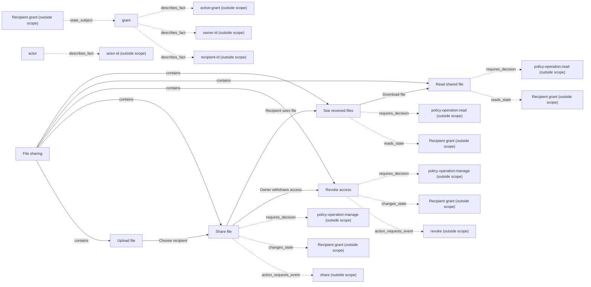
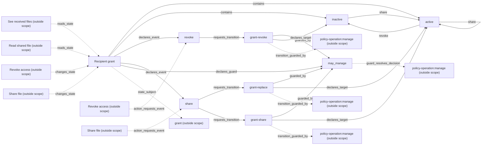
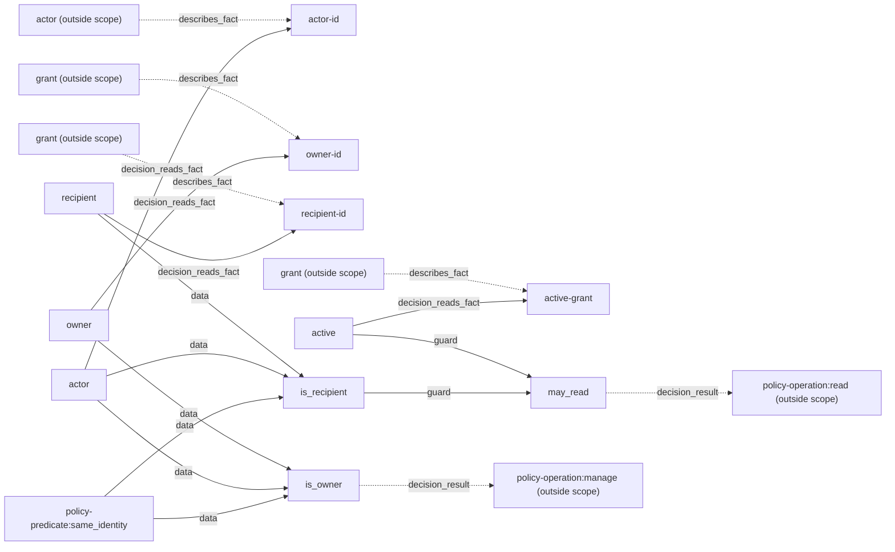
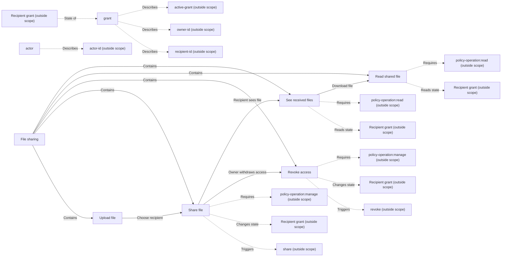
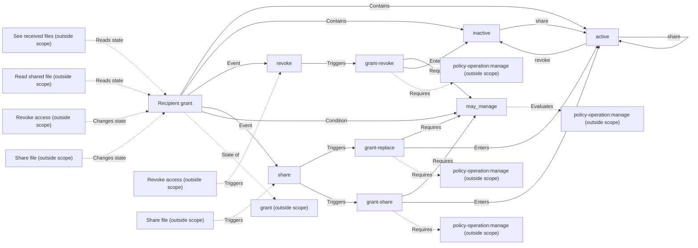

# Independent Skill trial — synthetic conversation

The developer is an independent AI agent. User replies are AI-simulated for this
acceptance and do not represent a human accepting these application rules.

## 1. Request and clarification

**User:** $vibelens 我要做一个同事之间共享文件的小应用。我上传文件后能共享给指定同事，也能撤销共享；同事可以查看别人共享给自己的文件并下载。先做本地简洁网页。

**Developer:** 可以。先确认三件影响实现的事：
1. 要让程序按状态声明运行，还是保留普通代码、用图观察？两种方式都有图和运行记录。
2. 本地文件配 SQLite 足够这个小应用。人员先用固定测试账号切换，可以吗？
3. 第一版一个文件可以同时共享给多人吗？撤回后，已经拿到下载链接的人还能再次下载吗？

**User (simulated):** 保留我自己的代码组织，只用图观察。文件就放本地，信息用SQLite吧。先固定Alice、Bob、Carol三个测试用户，用下拉框切换。第一版一个文件给一个人，换人共享就替换原来的。只有上传者能共享和撤回，撤回后旧链接的下一次下载必须拒绝。

**Developer:** 第一版按“上传—指定接收者—看到文件—下载”组织。上传者可以撤回或替换接收者；每次下载读取当前授权。文件存储和运行记录放在 var/，不作为源码扫描；app.py、service.py、bo_integration.py、bo_stategraph/ 中的声明属于项目源码。

The next entries include the three actual generated previews, followed by the
simulated confirmation, before application implementation.

## business preview

# Business network draft

[Open the live graph](http://127.0.0.1:8916/graph)

This is a focused view. Dashed boundaries retain original relations; open Web for the complete graph.

Confirm this understanding in the conversation, or describe a correction. Viewing the graph is not confirmation.

## state preview

# State model draft

[Open the live graph](http://127.0.0.1:8916/graph)

This is a focused view. Dashed boundaries retain original relations; open Web for the complete graph.

Confirm this understanding in the conversation, or describe a correction. Viewing the graph is not confirmation.

## rules preview

# Rule network draft

[Open the live graph](http://127.0.0.1:8916/graph)

This is a focused view. Dashed boundaries retain original relations; open Web for the complete graph.

Confirm this understanding in the conversation, or describe a correction. Viewing the graph is not confirmation.

**Developer:** 业务流程、授权的两个状态，以及共享和下载各自的判断已经画出来了。下载只读授权状态；共享和撤回会改变它。可以在 http://127.0.0.1:8916/graph 查看。这样与你想做的一致吗？

**User (simulated):** 对，就是这样。先按这个做。

## Iteration 2 — synthetic conversation

**User U4:** 共享给多个人后，我只想撤回其中一个人的权限，其他人的继续有效。

**Developer:** 我理解为：Alice 同时共享给 Bob 和 Carol；撤回 Bob 后，Bob 的旧下载地址失效，Carol 仍能下载。每一份“文件与接收者”的授权各自有启用、撤回状态。是这样吗？

**Synthetic user:** 对，只撤回我选中的那个人，其他人的别动。

**Developer:** 业务步骤保持上传、共享、查看、下载和撤回；这轮改变共享与撤回的对象范围。下面是本轮确认图，状态以“文件 + 接收者”区分，所有者规则仍然共用。

# Business network draft

[Open the live graph](http://127.0.0.1:8916/graph)

This is a focused view. Dashed boundaries retain original relations; open Web for the complete graph.

Confirm this understanding in the conversation, or describe a correction. Viewing the graph is not confirmation.

# State model draft

[Open the live graph](http://127.0.0.1:8916/graph)

This is a focused view. Dashed boundaries retain original relations; open Web for the complete graph.

Confirm this understanding in the conversation, or describe a correction. Viewing the graph is not confirmation.

**Synthetic user U5:** 图里的步骤没变，每个人的授权单独算，这样对。开始改吧。

Implementation follows this confirmation. C1 remains unchanged; C2 records the new identity and selected-recipient meaning.

## Execution notes after the confirmed iteration

These are the testing agent's observations, not additional user answers.

- The actual v2 application shared one file with Bob and Carol. Revoking Bob
  returned 200; Bob's old download URL returned 403, while Carol still received
  the original bytes. The complete on/off/fault gate passed.
- Browser recording exposed a shared probe defect: a filtered read still
  submitted a snapshot with no evidence ID. The adapters were repaired first;
  a real repeat recorded nine events with zero producer errors.
- A second test hid a new grant's events and then restored full capture. The
  local adapter had marked its initial state as already captured. A separately
  begun maintenance change now marks initialization only after queuing actual
  evidence. The same native grant's active state and revision were then observed;
  no business rule or synthetic confirmation changed.
- Failed receipts, each strict acceptance round and the final portable sources
  are linked from the trial README. The final viewer and browser evidence use
  the repaired application; historical receipts remain unchanged in the archive.
