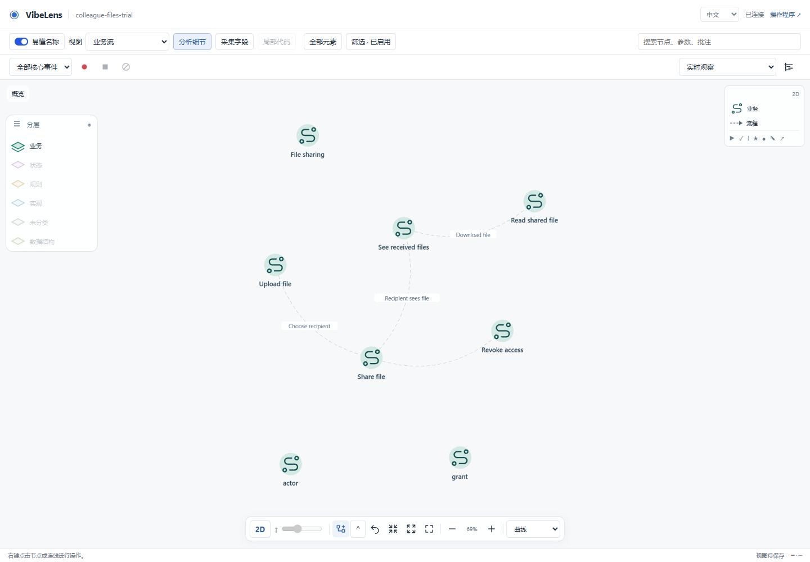
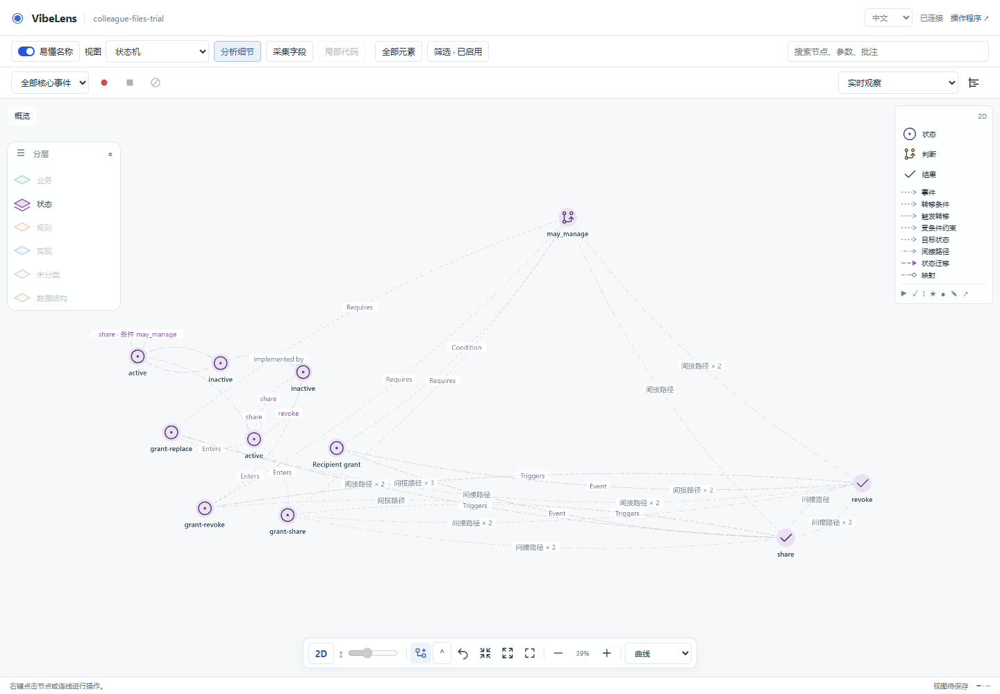
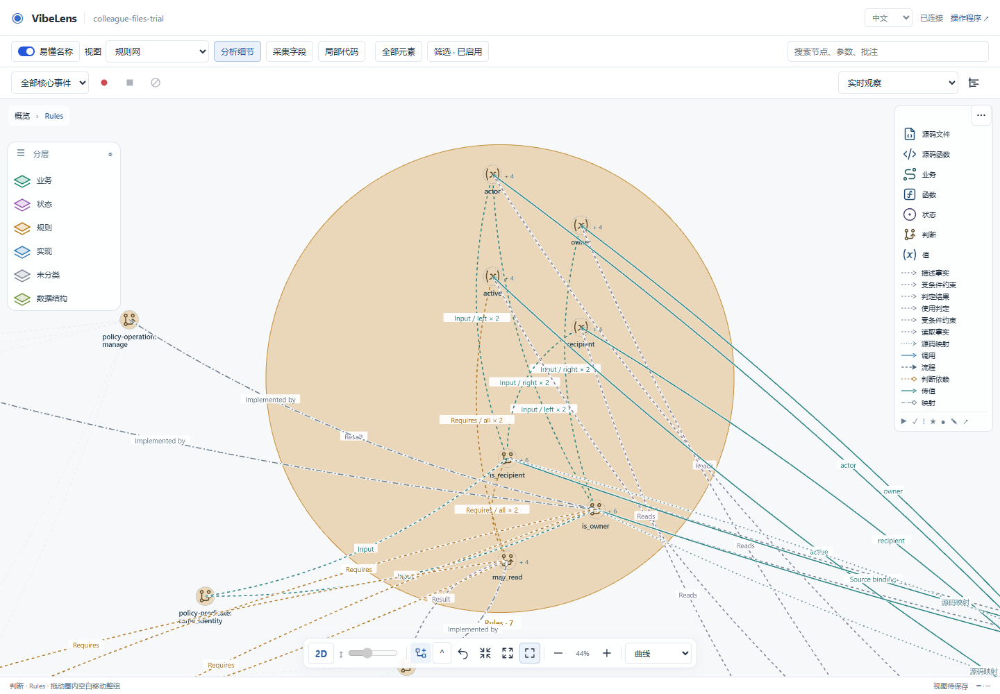
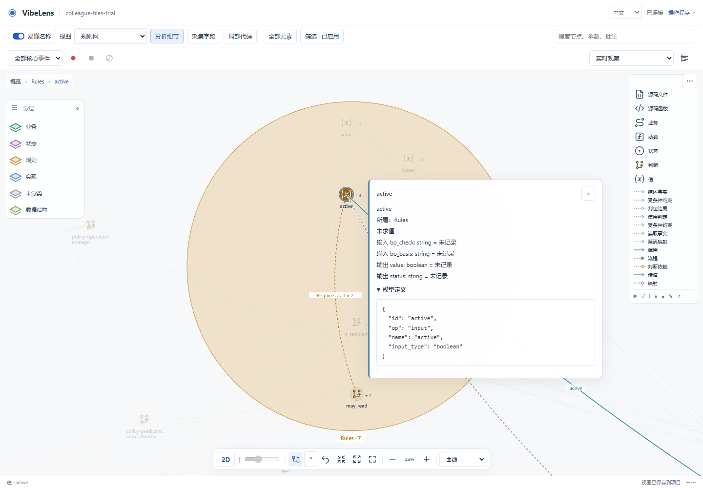
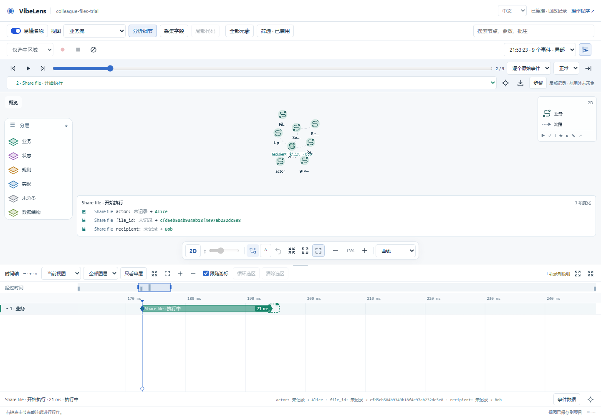
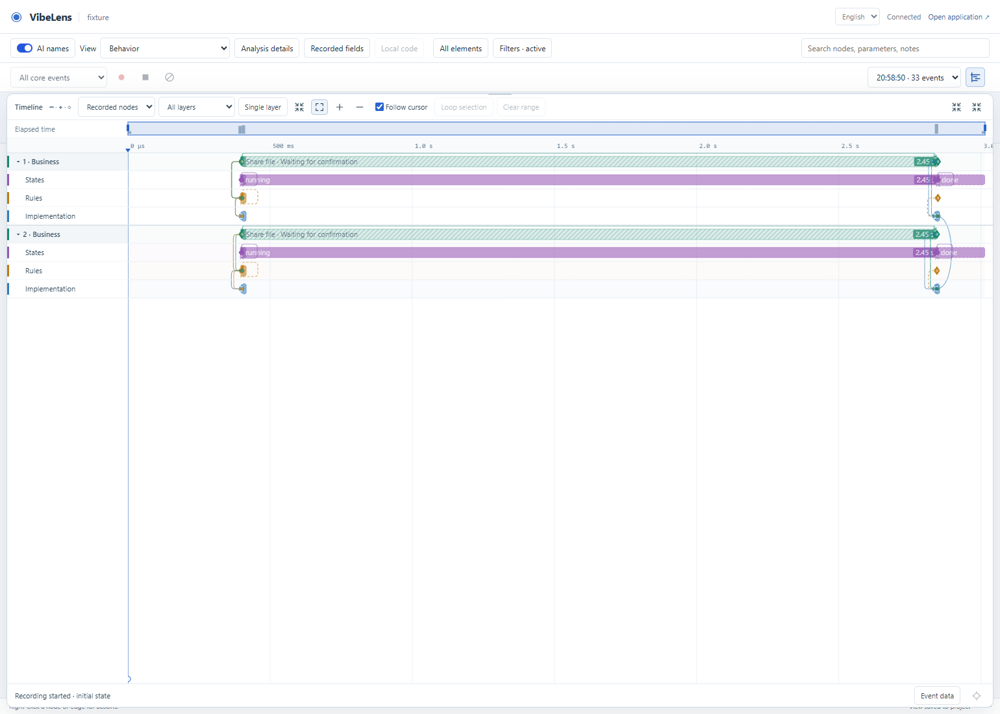
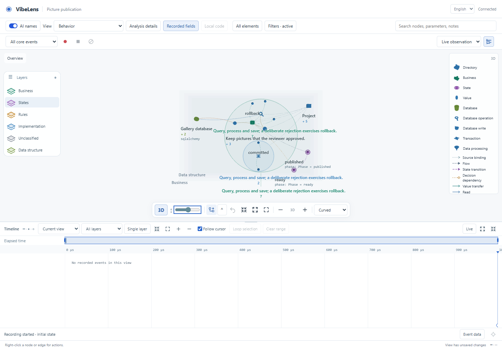
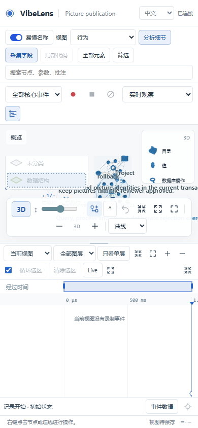
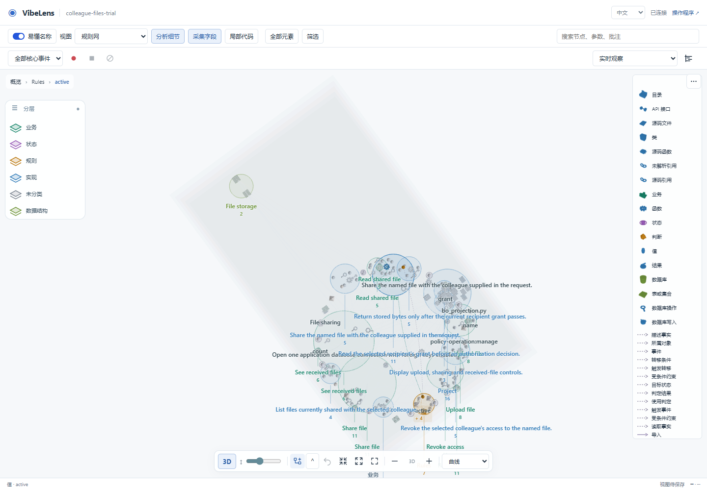

# Viewer verification — 2026-11-04

The viewer uses five main concerns: business, state, rules, implementation and data structure. The implementation concern retains separate API, project, source, observed-call and data-access facets. An additional unclassified plane makes missing classification visible. Definitions, source references, capture anchors and event identities remain distinct.

## Results

| Check | Result | Evidence |
| --- | --- | --- |
| Node release checks and concept observation regression | 47 passed; final naming change also passed its three targeted regressions | [Complete outputs](viewer-evidence/verify-node.json) |
| Additional viewer regression batch, 43 tests | Passed | [Complete outputs](viewer-evidence/pure-js.json) |
| All 512 legacy layer selections | Passed; narrow facet exclusions and custom order survive migration | `test_concern_projection.mjs`, `test_layer_order.mjs` in the Node reports |
| Real concurrent workers and SQLite operations | Passed; 33 events, two execution groups, eight rows for four occupied concerns | [Result](viewer-evidence/concurrent-result.json), [unchanged recording](viewer-evidence/concurrent-recording.json) |
| Real 2D/3D interaction | Passed; layer reorder, spacing, visibility, camera orbit, node/group drag, four routing styles, persistence and mobile controls | [Result](viewer-evidence/layered-result.json) |
| Existing real recording replay | Passed; 63 events, exact state and cursor, data transfers, range selection, zoom, keyboard and touch | [Result](viewer-evidence/replay-result.json) |
| Independently built v2 project | Seven browser checks passed: 34 projected nodes, 14 explicit implementation bindings, real focused capture and business Timeline | [Result](viewer-evidence/concept-result.json), [actual scoped recording](trial/browser/focused-recording.json) |
| 20,000-event Canvas benchmark | Passed; 9,999 causal links, five concern rows | [Measurements](viewer-evidence/performance-result.json) |
| Python/JavaScript role classification | Passed; 330 combinations, including concepts, resources, events, effects and unknown roles | [Comparison](viewer-evidence/classification-parity.json) |

The concurrent test checks real lifecycle closure, horizontal and cross-layer links, cross-execution resource dependency, independent group collapse, layer depth, single-layer mode and exact icon-centred routing in both renderers. Viewing and replaying the recording do not change its bytes or create business events.

The v2 browser test opens business, state and rule views through the actual UI, resets each view, expands its contents and uses normal pan, zoom and focus controls. It verifies that conceptual and physical IDs coexist, that each conceptual view has relationships, and that switching to 3D preserves the displayed IDs. It inspects the complete event, transition, fact and rule-expression definitions in the DOM. The test operates a running project rather than injecting a synthetic graph.

The same browser saves a custom view, selects `event:grant:share`, starts focused recording and issues real upload/share HTTP requests. Capture resolves to the verified native `share` owner. Nine original events are retained, the recording stops without gaps, and the event concept receives no invented call duration. The business view retains the actual closed `share` interval. The separate project trial covers the broader permission scenarios and source-update gates.

Confirmed node definitions remain available in a compact disclosure beside the selected node. The detail renderer preserves the complete typed payload, including event fields, transition endpoints and guards, rule parameters and fact read timing. It uses text content so authored definitions cannot become executable HTML. These details do not add labels to the canvas or assign runtime status to a definition.

## Failures and repairs

| Finding | Repair and retest |
| --- | --- |
| Concept facts and transitions used fallback classifications; explicit conceptual relationships became `other`. | Added shared concept role classification and typed relationship metadata. Peer-view and compound-edge assertions pass in `test_concept_view.mjs`. |
| Changing the confirmed conceptual projection did not participate in viewer redraw or saved-recording version checks. | Included the conceptual revision in both keys. Tests verify that an older recording retains its own conceptual graph. |
| `indirect` connectors were reclassified as `other` during compound projection. | Preserved their type through `relationType`; a filter containing only indirect paths now retains the generated path and its witnesses. |
| The new unclassified 3D marker had identical full/detail geometry. | Added a genuinely cheaper LOD; all object volume and bounded-geometry checks pass. |
| Function/parameter views inherited the default hidden-field policy. | Their explicit preset now includes recorded fields; normal overview keeps fields in owner details. Full inventory and explicit field visibility remain tested. |
| Old API/source tests expected separate physical planes. | Updated expected concern rows and added facet/member assertions. HTTP registration, capture owner, source selection range, invocation identity and causal-link checks remain in place. |
| Concurrent browser test expected ten rows from the previous taxonomy. | The same actual observations occupy four concerns per execution. It now asserts eight rows and preserves lifecycle, resource-link and route checks. [Original failure](viewer-evidence/failure-concurrent.json) |
| The load fixture expected nine planes and used an unsupported `method` code role. | Changed it to the actual function role; nine node roles occupy five concerns. Performance limits are unchanged. [Original failure](viewer-evidence/failure-performance.json) |
| Browser reload tested a bare `graphDebug` identifier before the page initialized it. | Waits now guard `window.graphDebug`; full layered browser retest passed. |
| Browser test reruns reused saved 3D/filter settings. | The concept test explicitly returns to 2D and resets the selected preset through visible controls before taking screenshots. |
| Semantic definitions reached the graph but their detailed fields were not inspectable. | Added a shared read-only definition disclosure. Unit checks retain exact payload types, ordered guards, read timing, safe rendering and node identity. |
| A concept whose ID differs from its native implementation could not start focused capture. | Capture now resolves only a validated, canonical one-hop implementation binding. Exact source ownership is required for source targets. Drafts and ordinary map edges cannot supply capture owners. |
| Separate concept IDs showed no native activity, leaving the business Timeline empty. | Bound actions display each real native interval with its source identity. Two concurrent owners remain two intervals; no aggregate conceptual duration is assigned. Rules use observed decisions, states use actual snapshots, and logical facts show activity marks without borrowed call durations. |
| Custom view selection could lose a conceptual parent after a display projection detached it. | Control selection now restores ancestry from the combined canonical declarations while keeping conceptual and native IDs separate. |
| Inventory acceptance required a nonempty unclassified plane. | Five main concerns still require nodes, relationships and cross-concern links. Unknown declarations may be absent; when present their nodes and original relationships must survive. Both actual v1 and v2 inventory outputs passed. |
| A conceptual rule sharing its native ID lost its inspectable definition. | Shared identities retain conceptual kind, definition and display name while native source, capture, kind and lifecycle remain authoritative. Conflicting metadata regression checks pass. |
| Source docstrings replaced confirmed business labels with long implementation descriptions. | Explicit user display names remain first, followed by confirmed conceptual names and authored business names. Function/API comments retain their existing role. Source-name mode, annotations, IDs and observation contracts remain unchanged. |
| Focused capture filtered an initialization witness but still sent its dependent snapshot. | The Python/JavaScript probes now skip snapshots without a retained witness; strict receiver validation remains. The trial also commits its initialized marker only after the snapshot is queued. Actual failure and recovery are preserved in [focused capture](trial/focused-capture-before.json), [retest](trial/focused-capture-after.json), [initialization failure](trial/scope-initialization-before.json) and [initialization retest](trial/scope-initialization-after.json). Final browser recording has no gaps. |
| Two CI browser tests still selected old `execution`/`api` planes. | The geometry test validates the retained execution facet before hiding its implementation plane. API replay checks retain exact GET/POST durations, HTTP 403, source registrations and original event-route identities; API-to-function causality is now horizontal within implementation, and business-to-API remains cross-concern. Detailed inspection explicitly opens All elements. |

The first browser attempt also exposed an environment issue: Playwright was absent and the sandbox could not launch Chromium. The CI-pinned Playwright package was installed in ignored `node_modules`; browser execution then used the installed Chromium executable through the approved test tool invocation. A failed worker fixture left its SQLite file behind, so subsequent attempts used fresh isolated directories.

## Performance boundary

On this Windows host with Chromium 151, the 20,000-event component load initialized in 187.6 ms. Across 41 pointer seeks, seek p95 was 40.7 ms and paint p95 was 22.9 ms. The visible window drew 727 causal links and 1,131 primitives. These are synthetic Canvas measurements, excluding graph reconstruction and application collection overhead; they are not a universal performance guarantee.

The hidden-path test also exercises a 10,000-node chain. Depth/work limits report incomplete search explicitly; they do not assert that every possible path was enumerated. Original edges and source event IDs are unchanged, and a derived structural path never supplies runtime transfer evidence.

## Screenshots

Business, state and rule views of the independent file-sharing project:

Confirmed rule definition and a recorded business call at its actual time scale:

Concurrent execution and 3D controls:

The all-elements 3D view and expanded rule-to-source view remain dense. Focused presets and field controls reduce the visible content. Confirmed business names are now concise, while long source comments and many cross-concern bindings still need deliberate view selection. These screenshots preserve that limitation.

## Integration review

Read-only review of the workflow and recording integration found an output-path bug: `bo_design preview --out discovery.json` returned success while replacing the discovery contract with preview data. A sibling output such as `discovery.md` also collided through the generated `.json` sidecar. `bo_concepts` protected explicit CLI inputs but did not protect configured contracts when the corresponding CLI flag was absent. The root implementation now owns a shared artifact-path guard and regression checks for these cases.

The reviewed runtime context validates bound declarations with independent acceptance assertions, freezes the conceptual projection, checks source bytes and configured input locations for drift, and retains that projection in recording context. No additional reproducible cross-version replay pollution was found in this review. The fresh project trial and root verification report cover the remaining system-wide acceptance.

## CI browser coverage

Every browser scenario currently listed in `.github/workflows/check.yml` was exercised on this Windows host. This is a local run of those scenarios, not a claim that the remote Ubuntu job has run.

| Scenario | Result |
| --- | --- |
| Nested geometry, group drag, captions, layer hide/restore and exact endpoint ports | [Passed](viewer-evidence/ci-graph-quality.json) |
| API registration, response values and causal replay | [Passed](viewer-evidence/ci-api-observation.json) |
| Six localized demo startup cases | [Passed](viewer-evidence/ci-demo-startup.json) |
| Timeline replay and 20,000-event performance | [Passed](viewer-evidence/replay-result.json), [measurements](viewer-evidence/performance-result.json) |
| Source/explained names, persistence and 2D/3D state names | [Passed after the naming fix](viewer-evidence/ci-names.json) |
| Caption bounds over saved discovery layout | [Passed](viewer-evidence/ci-caption.json) |
| Real live lifecycle, mid-span recording and registered lifecycle | [Passed](viewer-evidence/ci-lifecycle.json), [mid-span](viewer-evidence/ci-lifecycle-midspan.json), [registered](viewer-evidence/ci-lifecycle-registered.json) |
| Concurrent execution groups, complete and mid-span recordings | [Passed](viewer-evidence/concurrent-result.json), [mid-span](viewer-evidence/ci-execution-midspan.json) |

The original stale-plane failures remain available for [geometry](viewer-evidence/failure-ci-graph-quality.json) and [API replay](viewer-evidence/failure-ci-api-observation.json). No lifecycle, identity, routing or performance assertion was removed to pass the new taxonomy.

## Reproduce

Run the Node entry points from the repository root. Browser tests accept `BO_BROWSER_EXECUTABLE` when Chromium is installed outside Playwright's default location. Evidence output is selected with `BO_BROWSER_EVIDENCE`, `BO_EXECUTION_EVIDENCE` or `BO_TIMELINE_EVIDENCE`.

For the independently built project, set `BO_CONCEPT_URL` to its running `/graph` URL and run `node tools/test_concept_browser.mjs`. Set `BO_CONCEPT_APP_URL` to the trial application and `BO_CONCEPT_CAPTURE_ID=event:grant:share` to include actual upload/share requests and scoped recording. This optional portion creates synthetic trial data through the application's public HTTP routes. The script requires an accepted `bo-concept-projection/v1` and never modifies requirements, source files or original event identities.
