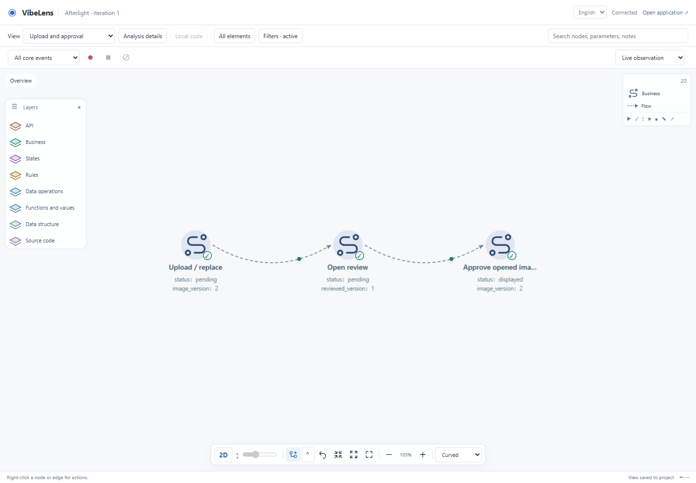
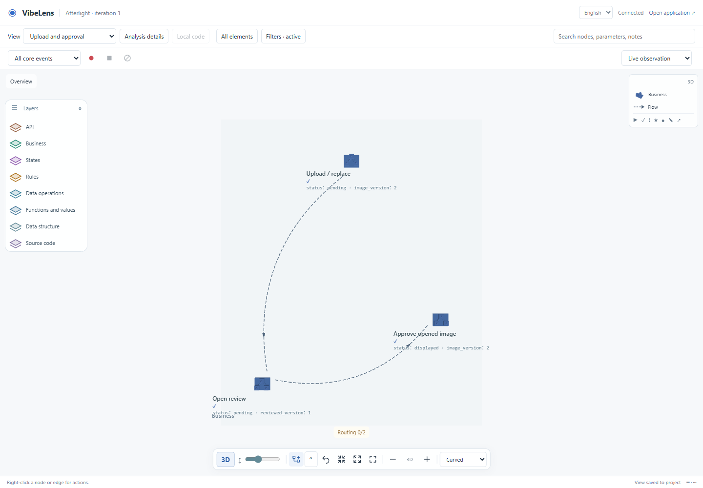
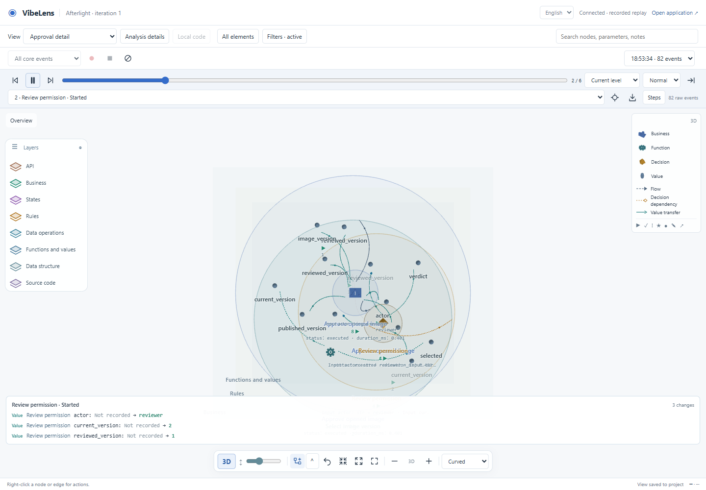
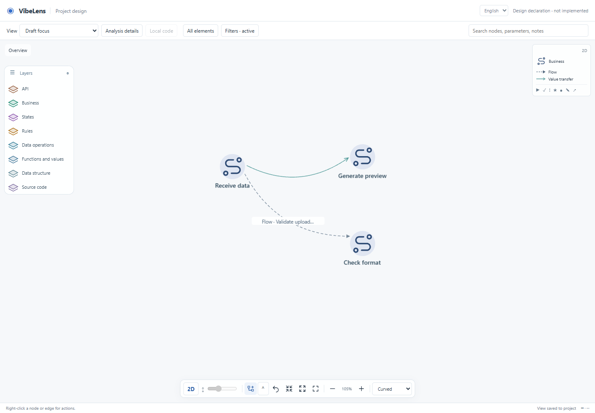

# Conversation-scoped VibeLens controls

Branch: `feature/conversation-controls`, based on `2652f9f`. This feature is separate from the planned graph-to-AI context export. It does not change the main release or publish Pages.

## What changes

Installation makes the skill discoverable. `agents/openai.yaml` now sets `policy.allow_implicit_invocation: false`: users explicitly invoke `$vibelens` in each conversation that should use it. Activation binds the actual host conversation ID, canonical project directory and declared project identity. Project validation remains a project requirement; it does not start skill dialogue or grant viewer-control authority in another conversation. The local installed metadata received the same policy setting; the new implementation lives on this branch.

After activation:

```text
/vibelens Focus the upload-to-approval chain, showing business actions and decisions
/vibelens Show the approval rule and its parameters two relationships deep
/vibelens In recording RECORDING_ID, replay only the approval path and loop it
```

The coding agent interprets the request against the current inventory, resolves real identities, and asks about ambiguous names or recordings. Python validates a bounded view/replay specification; the scoped browser applies it through existing custom views, layouts and replay selection. Status distinguishes queued, applied and rejected. Clients that intercept slash input can use `$vibelens /vibelens …`; this is a text prefix rather than a registered native Codex command.

The entrypoint rejects missing/quoted prefixes, other conversation IDs, unsupported source-edit operations, invented relations/events, and stale graph or recording evidence. Ordinary business coding in an activated conversation still maintains graph mappings and probes. Private control metadata and views live under `bo_stategraph/config/`, remain out of Git and core exports, and preserve the project's default view file. Ending controls preserves source, declarations, probes and raw recordings.

## Implementation map

| Module | Responsibility |
|---|---|
| `bo_observer/control/scope.py` | Explicit activation, project/conversation binding, guarded publication and receipts |
| `bo_observer/control/selection.py` | Exact name resolution, actual paths, bounded neighbors, boundary relations and recorded-event selection |
| `bo_observer/control/cli.py` / `bo_control.py` | Inspect, plan, apply, status and end; verified local observer identity |
| `web/bo_web.py`, `web/view_preferences.py` | Private preference namespaces and read-only evidence bindings |
| `conversation-controls.js`, `viewer.js` | Opt-in polling, native custom views, layout and 2D/3D replay selection |

Instructions: [conversation controls](../../../skills/vibelens/references/conversation-controls.md). [English usage](../../../README.md#control-a-view-from-the-conversation).

## Browser evidence

[Scripted dialogue and actual CLI receipts](dialogue.json) distinguish successful and rejected user requests. This is a deterministic control/browser test over the existing gallery capture, not a new autonomous Codex conversation or a new live gallery backend run. The test server exposes canonical control/preference services and the existing immutable recording.

- Upload-to-approval focus: three business nodes, two original flow relations; another window stays unchanged, and reload preserves the saved view.
- The same selection works in 2D and 3D.
- Approval replay: six of 82 original events are selected, with actual rule values projected in the viewer. Native skipped steps and loop settings change; the original event list is unchanged.
- End revokes subsequent control publication.
- [Final browser result](result.json): pass, zero browser/resource errors.







## Before implementation

[The actual design-server browser test](design/result.json) activates and inspects a declaration-only project, applies a private view in 2D/3D, and verifies that discovery bytes remain unchanged, no behavior/source file is created, runtime events remain empty and replay is rejected explicitly. [Its scripted control dialogue](design/dialogue.json) includes the actual CLI responses. A configured future model path may be absent at this stage.



## Failures, repairs and retests

1. The initial unit test used the system temporary directory, which this host denied. Fixtures now use the repository validation directory; assertions remain unchanged.
2. [The first browser run failed](browser-first.json) on a missing fixture favicon. [The diagnostic](browser-favicon-diagnostic.json) identifies `/favicon.ico`; the fixture now serves the actual project icon. Browser error checks remain enabled, and the final run passes.
3. [The first example inspection](example-maintenance.log) rejected a stale static projection after observer HTTP handlers changed. Regenerate it with the existing model builder, then inspect again.
4. [The next acceptance attempt](example-maintenance-retest.log) rejected inputs changed after verification when the conversation-scope instruction was updated. Re-inspect and re-verify the exact final inputs. No baseline or expectations are reset.
5. [The design-phase regression initially failed](design-before.log) because the draft model has no runtime revision. Controls now identify it using the verified declaration digest, avoid querying an absent recordings API, and reject draft replay. [The same regression passes](design-after.log). The canonical viewer now supplies a self-contained favicon for standalone design serving. [The final draft and runtime browser checks](result.json) pass with zero resource errors.

[Initial baselines](baseline-begin.json) were captured before example source edits. [Confirmed business declarations](business-contracts.json) remain unchanged. New approvals are retained separately from all previous frozen records. [Strict example checks](example-maintenance.json) pass for both examples. [The clean Git export](clean-export.json) passes using only frozen approvals, without regenerating or accepting content. Retained log files use LF newlines; original command outputs remain under the local validation directory.

The [bilingual demo regression](demo-browser.json) passes flow confirmation, actual replay, source inspection, saved custom views, 3D gestures, mobile layout and reduced motion. [Transition frames](transitions.json) cover 40 forward/backward switches across both languages and both dimensions, with zero black frames. The measurement applies to the tested Chromium/SwiftShader host. [Source checks](source-quality.json) cover maintained syntax, lint and formatting.

## Final checks and trial installation

[Final verification summary](verification.json): the complete default repository suite passes on the final sources; [its full output](verify.log) retains mapping, state, business, project, runtime HTTP, installation and observer-free export checks. The optional external database matrix was not rerun for this presentation-control change.

[Sixteen control tests](unit-final.log), [native JS controls](js-final.log), [eleven Web continuity tests](web-continuity-final.log), [Skill validation](skill-validation.log), real design/runtime browsers and final strict checks in [delivery](final-delivery.json) and [team archive](final-team-archive.json) pass. The final example round retains the two preceding accepted rounds separately; no accepted baseline was replaced to bypass a failure.

```bash
git clone --branch feature/conversation-controls https://github.com/li-bruce/VibeLens.git VibeLens-controls
cd VibeLens-controls
python tools/install_skill.py --project /path/to/your-project
```

Use a fresh test project or review an existing installation before replacement; the installer preserves existing files by refusing an overwrite. Open a new conversation, invoke `$vibelens`, and use the prefixed examples above. Existing applications need the matching observer runtime/viewer; custom HTTP integrations must bind their existing view/recording queries as described in the control reference. A rejected control never patches application or skill source to bypass a missing integration.

## Limits

Natural-language interpretation belongs to the coding agent; the CLI accepts resolved specifications. Missing runtime evidence remains missing, and a static relationship does not establish that a call executed. Selection is bounded to the current served graph and recorded facts; omitted boundary relations and limit indicators remain in the plan. A skill and guarded scripts are not an operating-system sandbox, and cannot prevent a separate shell or agent from editing files outside these entrypoints.
