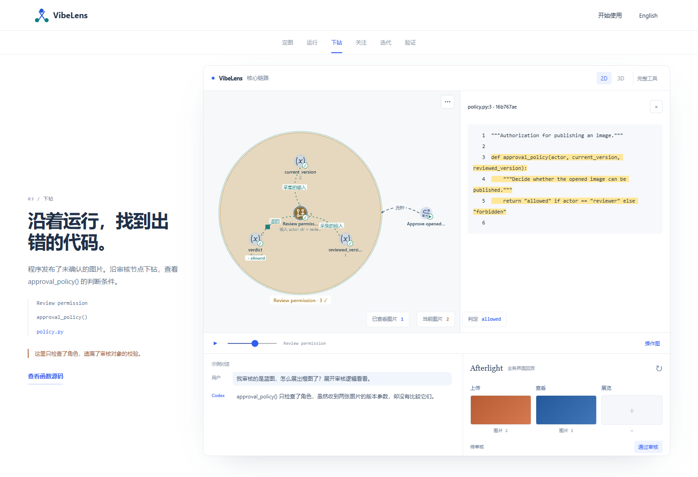
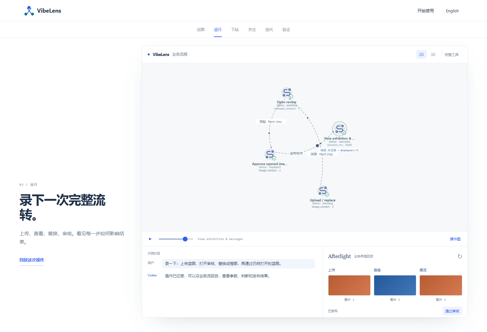
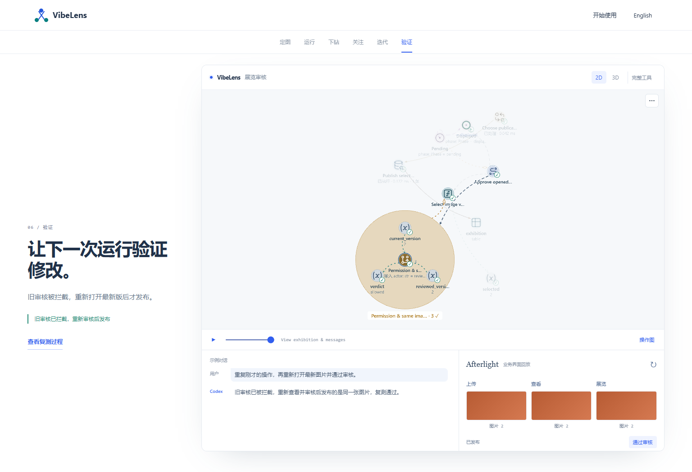
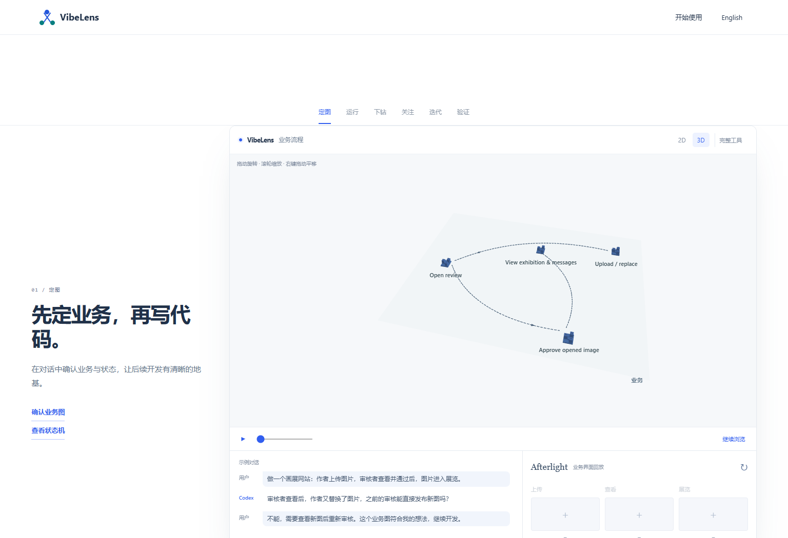
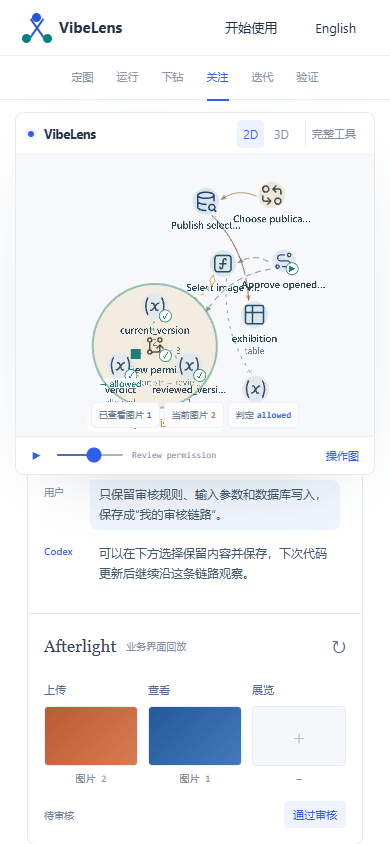

# Conversation, application and graph

Each of the six demo stages now pairs a short, authored user–Codex exchange with the actual graph. The opening exchange asks about image replacement and confirms the intended flow. Later exchanges cover recording, finding the missing source condition, saving a view, changing the code and checking the repair.



The Afterlight window follows completed responses from the same recording as the graph. Its three areas show the uploaded image, the reviewer's open image and the exhibition result. Buttons seek the next captured action; the replay button restarts the operation. Scrubbing backward reconstructs the application display without later results. The window is labeled **Application replay**: the static site replays the executed example rather than hosting its Python backend.




Switching to 3D immediately enables native Three.js controls: left-drag rotates, the wheel zooms and right-drag pans. A new story stage retains interactive 3D. Returning to 2D restores ordinary page scrolling; the existing Explore graph control remains available. The conversation and application move into the active narrative on mobile.




## Implementation

- `docs/site/case-companion.mjs`: conversation display and event-bounded application projection.
- `docs/site/case-messages.mjs`: English and Chinese exchanges and labels.
- `docs/site/case.mjs`: stage, language and pointer-interaction coordination.
- `docs/site/case-scene-player.mjs`: native recording transport and completed-action navigation.

The maintained viewer renderer, layout, runtime protocol and business sources are unchanged. The static adapter publishes the exact native replay event ID to synchronize the application window. No parallel policy implementation or additional business events are introduced.

## Validation

[Browser results](browser.json) cover both languages and all six conversations, completed-action navigation, rejected and successful approvals, backward seeking, real camera rotation/zoom/pan, native scroll, saved views across builds, source highlighting, eight presets and eight 3D layers, mobile language switching and reduced motion. Browser errors: zero.

[Source checks](source-quality.json) pass syntax, lint and formatting for 96 maintained Python modules and 66 JavaScript modules. The artifact test verifies the existing real recordings and source bindings; six documentation-link tests pass. The recordings retain 82 and 138 events. These are presentation checks over the previously executed cases; this update does not claim another backend or database acceptance run.

Run locally:

```sh
python tools/build_site_viewer.py
node tools/test_case_browser.mjs
node tools/test_case_artifacts.mjs
python tools/check_source.py --format
```

The previous [source-led demo review](../source-led-demo/README.md) retains the runtime execution and earlier presentation evidence.

## Published check

The [published demo](https://liblog.vip/VibeLens/demo.html?lang=zh-CN&rev=story-4) passes the same bilingual browser suite. [Deployment results](deployed.json) bind the tests and seven matching published assets to commit `1a23224` and successful [Pages run 40320853665](https://github.com/li-bruce/VibeLens/actions/runs/40320853665). [Published source and conversation](screens/deployed-source-and-conversation.png).
