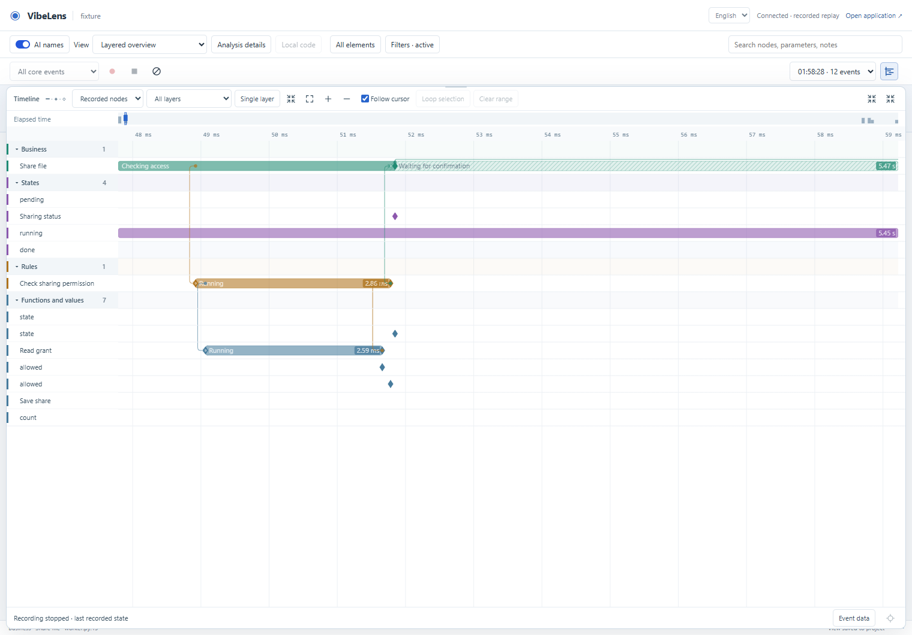
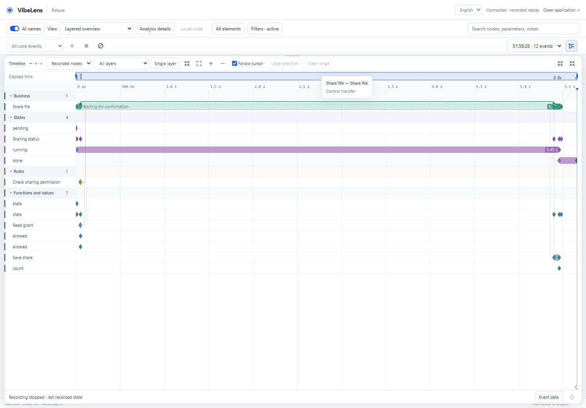

# Declared node lifecycles and directed timeline tracks

Review date: 2026-10-31. Branch: `feat/recording-timeline`.

Nodes can register lifecycle meanings that already exist in the application or
confirmed model. The declaration maps actual events and captured values to named
states. Generic execution observations distinguish entry, waiting, return and
exception; they do not determine business success or failure.

## Model and runtime behavior

| Case | Observation |
|---|---|
| No lifecycle declaration | Neutral execution boundaries and observed waits. |
| Registered return with `allowed=false` | The explicitly registered label, such as `Rejected`; termination remains a normal return. |
| Exception | The observed exception exit; recovery and overall business outcome remain separate. |
| Semantic parameter subject | Its explicit registered value bindings establish its interval under its own ID. Owner entry does not invent a parameter call. |
| Native state/activity | Residency and activity frames continue to supply their actual intervals and project-defined states. |
| Missing boundary or ambiguous identity | Retained as incomplete or ambiguous evidence, with no fabricated result. |

The [shared JSON definition](../../../skills/vibelens/scripts/bo_observer/schemas/model.schema.json)
and [construction guidance](../../../skills/vibelens/references/lifecycles-and-representations.md)
describe `lifecycle.states`, `bindings`, exact scalar selectors and timing roles.
Validation rejects unknown states, uncollected fields, type errors and overlapping
selectors. This is observation metadata; it adds no business execution engine.

## Timeline interaction

Fresh preferences expand node tracks. Existing saved scopes and expansion choices
remain intact; a toolbar action expands or collapses all tracks. Expanded layer
headers no longer duplicate the individual node bars.

Rounded duration segments, waiting hatching and endpoint markers expose each
interval. Same-track transfers and cross-track handoffs/returns use rounded
orthogonal routes. Endpoint times and original identities remain unchanged.
Hover shows the actual node pair, relationship or lifecycle segment. Clicking
seeks the shared graph event; the enlarged view supports inspecting the full chain.
Existing ruler drag, range selection, depth filters, zoom, speed and replay remain
owned by the same graph cursor.

The complete recording spans seconds; its actual check and SQL calls can last
milliseconds. The local view uses the existing wheel zoom to inspect those exact
intervals, then fits the whole chain again. Their durations are not inflated.

The attached 9.450567-second MP4 was decoded locally and inspected at six times.
It supplied the segment, hatch, rounded-connector, moving-cursor and hover patterns.
VibeLens retains its existing visual system and application meanings. The supplied
video and extracted frames are not included in this repository.

## Evidence

- [Definition tests](definition-python.log): shared schema, graph integration,
  selector types, malformed definitions and neutral fallback.
- [Projection tests](definition-unit.log): registered and generic meanings,
  semantic parameter identity, original-event integrity, same-layer/cross-layer
  relationships, route hits and time-axis boundary handling.
- [Lifecycle regression](lifecycle-unit.log) and [context regression](context-unit.log).
- [Actual registered runtime and browser](browser-local-zoom/result.json): a separate
  Python application reads a real SQLite grant, waits, writes exactly one share
  and supplies native state frames. Registered labels match actual values.
  Viewer controls add zero business events.
- [Mid-operation capture](browser-midspan-03/result.json): context carries an
  already-started parent and its registered waiting state; the actual return is
  selected against its original captured event ID.
- [Motion frame A](browser-local-zoom/connector-motion-a.png) and
  [frame B](browser-local-zoom/connector-motion-b.png): native event selection followed
  by two different connector frames while its original event ID remains fixed.
- [Historical browser regression](compatibility-browser/result.json): existing
  2D/3D, cursor/state/transfer, loop/skip, zoom, mobile/touch and byte-integrity checks.
- [Managed examples](examples-final.json): both original inspect/verify/accept/check
  flows pass. Application source and protected business expectations are unchanged.
- [Source quality](source-check.json): 113 Python and 88 JavaScript modules.
- [Skill validation](skill-validation.log), [package validation](package-validation.log)
  and [clean staged export](clean-export.json): both managed examples pass from
  a fresh Git export using their frozen approvals, without regenerating or reapproving.
- [Full verification](full-verification.log): repository-wide completion is
  recorded at the end of this log.

## Failures and fixes

| Evidence | Correction |
|---|---|
| [Previous status vocabulary](failures/old-status-vocabulary.log) | Update generic return/exception expectations, retaining their exact execution boundaries and original exceptions. Project-defined outcome states remain supported. |
| [Browser 01](browser-01/result.json) | An early handoff's orthogonal channel fell outside the plot. Keep the channel visible without shifting its timestamp endpoints. Subsequent native hover and seek pass. |
| [Source lint](failures/source-check-before.json) | Remove a duplicate translation key; the original pinned lint and formatting checks pass. |
| [Adapter discovery](failures/adapter-discovery-before.log) | Archive initialization correctly rejected an incomplete source scan. Configure the existing JavaScript adapter, then begin against the unchanged installed baseline. |
| [Large-record regression](performance/result.json) | Drawing every rounded subpixel interval exceeded the existing latency and pixel budgets. Aggregate dense short intervals as counts, retain selected intervals and original index entries, and cull coincident connector pixels. The unchanged thresholds pass in [retest 02](performance-02/result.json). |
| [Mid-operation interaction](browser-midspan/result.json), [resize timing](browser-midspan-02/result.json), [unzoomed call selection](browser-verified/result.json) | Tests initially sampled old Canvas geometry after enlargement or selected coincident call/return points at the full-recording scale. Await the actual resized plot, inspect short calls at their real time scale, and assert the clicked boundary against the original saved event ID. Exact event assertions remain. |

The [final 20,000-event component run](performance-final/result.json) keeps nine
layers and 9,999 dependencies. It measured 407.9 ms initial index/draw, 70.3 ms
seek p95 and 20.9 ms draw p95 on Windows/Chromium 151 at 1440x960. Earlier retest
02 measured 28.5 ms and 8.1 ms. Both retain the original thresholds; all runs are
preserved. This is timeline component performance, excluding full-graph reconstruction.
Density marks count observations; they do not merge them into invented durations.
Registered captions also follow source/explained mode without changing their IDs.

The initial unit fixture omitted its final native snapshot; it was corrected
without weakening the production snapshot contract. Intermittent development
file-open errors were handled through the pinned formatter's standard-input output
and atomic file replacement. No validator or acceptance requirement was disabled.
