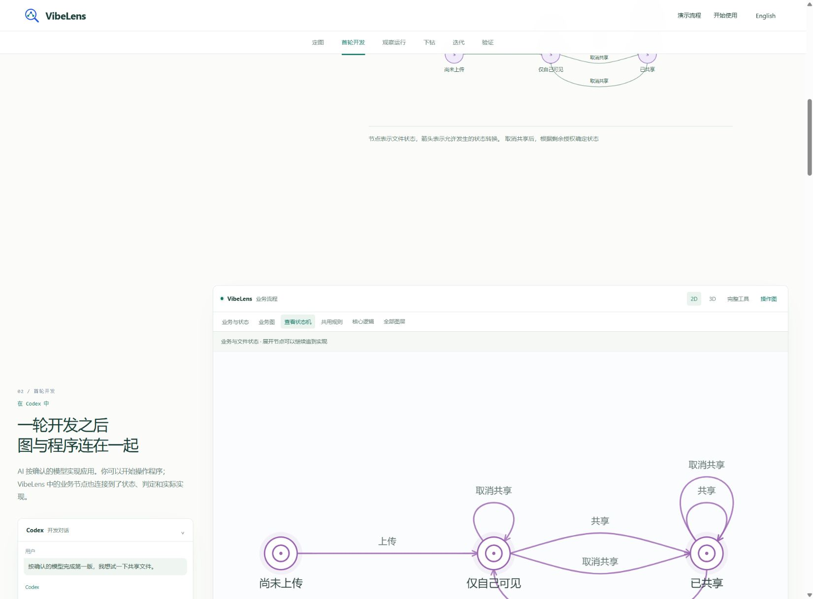
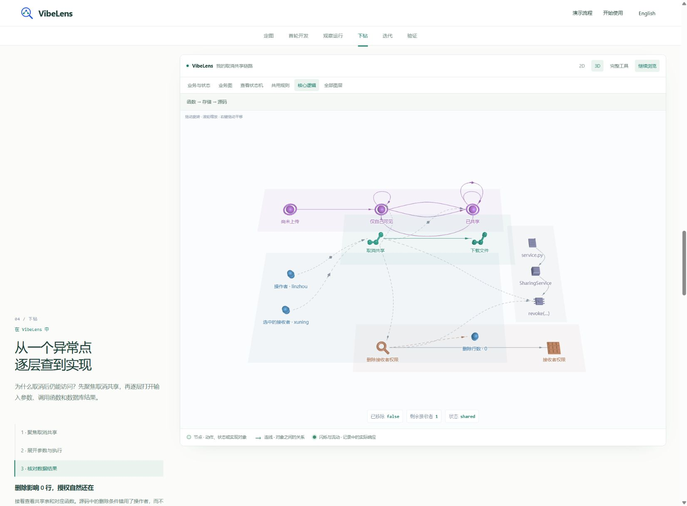

# Prepared demo scenes

The walkthrough now loads small, prearranged scene graphs. The complete native
viewer and its recordings load only when the visitor selects **Full tools**.

## Findings and changes

| Finding | Change | Verification |
| --- | --- | --- |
| Each chapter invoked full-inventory filtering, expansion and layout | Compile nine focused scopes for each recorded build; render the selected scope directly | No full inventory or layout-worker requests in the default local journey |
| The confirmation diagram had `empty`, `private`, `shared`, while the later story filter retained only two states | Generate both presentations from the same declared model, using original node IDs | 12 exact concept comparisons: three models, two builds, two languages |
| Alternative transitions between the same states overlapped | Share deterministic parallel routes across confirmation, SVG and WebGL | Distinct paths for each transition; screenshots of both state views |
| Query values disappeared when playback reached the containing operation's return | Carry the last observed value together with its original event ID | Zero deleted rows before the fix; one row after it; no future samples |
| A preliminary prepared renderer accessed a missing event during design-only chapters | Keep confirmation and first-build chapters free of runtime activity | Fresh load, all six chapters, and no browser errors |
| Initial 3D transfer markers were oversized and faced sideways | Reuse the tool's arrow geometry with its actual axis and fit the selected graph | Data view, combined layers, rotation and 2D/3D switching inspected |

The omitted state exists in the original recording. No application re-recording,
source edits, event renumbering or archive replacement was required.

## Modules

- `tools/build_demo_scenes.mjs`: deterministic scene compilation, original edge
  witnesses, event snapshots and deferred source-file exports.
- `case-confirmation-model.mjs`: shared business, state and rule projections.
- `case-graph-geometry.mjs`: parallel curves and labels shared by all presentations.
- `case-prepared-player.mjs`: scene selection, recorded playback, saved filters and
  source loading.
- `case-prepared-graph.mjs` / `case-prepared-spatial.mjs`: lightweight SVG and lazy
  WebGL rendering using the viewer's existing icons and 3D objects.
- `case-viewer.mjs`: existing full-tool adapter, entered explicitly.

The graph still uses original node and event identities. Presentation edges retain
their declared transition or original-path witnesses. The original recording and
source archives remain byte-for-byte unchanged.

## Checks

Local checks passed:

```text
python tools/build_site_viewer.py
node tools/test_product_demo.mjs
node tools/test_case_transport.mjs
node tools/test_confirmation_story.mjs
ESLint on changed JavaScript modules
Ruff on changed Python modules
git diff --check
```

These include 18 prepared scopes, 58 selected original events, all three declared
states, 64 original source files, actual transfer evidence and independent
pre-fix/post-fix assertions. Removing a declared state now fails the compilation
test instead of silently changing the presentation.

Browser controls were exercised through the Codex browser: confirmation tabs,
later model tabs, chapter navigation, recording controls, playback, parameter and
data inspection, full source, saved filters, the repaired result, language change,
3D camera movement and explicit full-tool entry. The complete tool loaded the
second build's 494 code nodes and 711 code relations.

The seven recorded local 2D chapter handlers took 0.6–1.7 ms. These are handler
durations, not end-to-end page-load or public-network benchmarks. The prepared
JSON is 145,908 bytes; the separate story summary is 177,730 bytes. The full
recording transports (2,073,025 and 4,171,617 bytes) are deferred. Images, scripts
and optional WebGL assets are additional downloads.

Automated browser regressions run in the `public-demo` CI job: bilingual journey,
deferred/failed HTTP responses and retry, startup ordering, full presets, source,
original recordings and 3D layers. Local browser evidence does not stand in for
those automated results; their CI outcome is recorded separately after execution.

The [first CI run](https://github.com/li-bruce/VibeLens/actions/runs/43234450125/job/131237966504)
passed the complete-tool checks, but failed the guided journey, loading test and
startup transition. Its [failure log](ci-first.log) is retained. The guided journey
found continually moving buttons at a shorter viewport: reparenting the shared
application/conversation changed chapter geometry and could select the preceding
chapter again. Explicit navigation now activates and holds its selected chapter
until intentional scrolling resumes; browser scroll anchoring no longer competes
with that transition. Tests enter chapters through the real navigation controls.

The clean-checkout core jobs also found that `tools/verify.py` invoked the new
product assertions before generating their scene fixtures (`ENOENT` for
`case-preview/prepared.json`). The verification runner now builds those exports
explicitly before the assertions; no checks were removed.

The [second browser run](https://github.com/li-bruce/VibeLens/actions/runs/43236717624/job/131245912608)
passed both desktop languages, delayed/failed loading, six fresh startups and the
complete native-tool checks. Its remaining failure was the existing narrow-page
overflow assertion: the confirmation section's two minimum-width columns exceeded
the viewport. Those introductory columns now stack at the existing page breakpoint;
the desktop tool's interaction scope is unchanged.

## Evidence

- [Browser observations and measured handlers](browser.json)
- [Default-journey request summary](requests.json)
- [Initial confirmation](01-confirmed-states.png)
- [Later state view](02-later-states.png)
- [Focused data inspection](03-focused-data.png)
- [Prepared 3D view](04-focused-3d.png)
- [Repaired data result](05-corrected-result.png)




