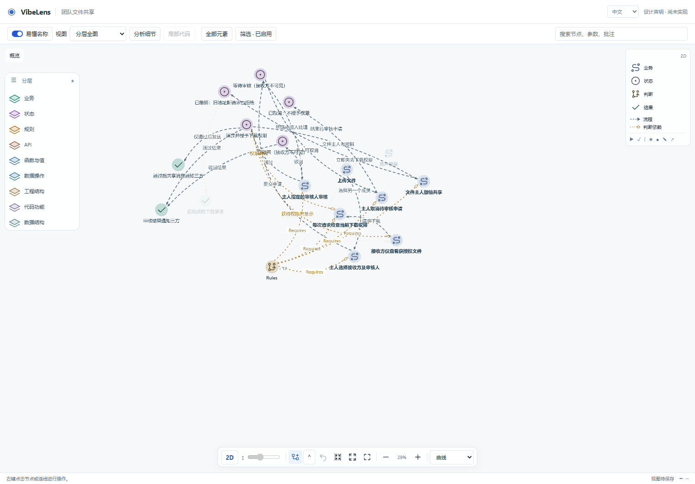
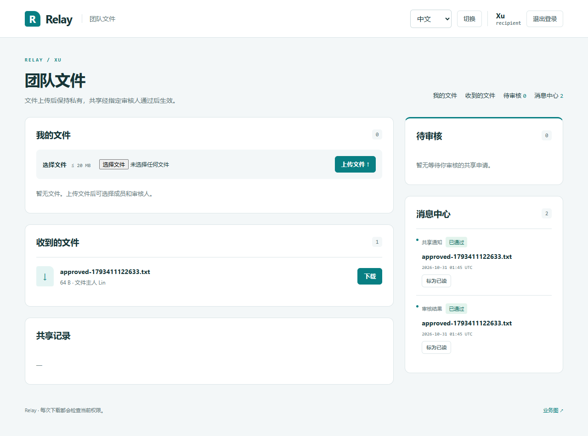
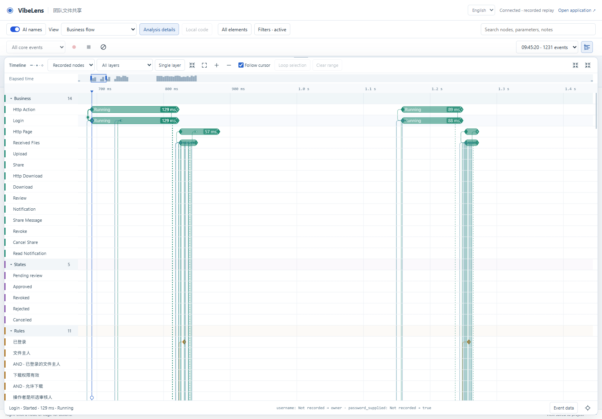
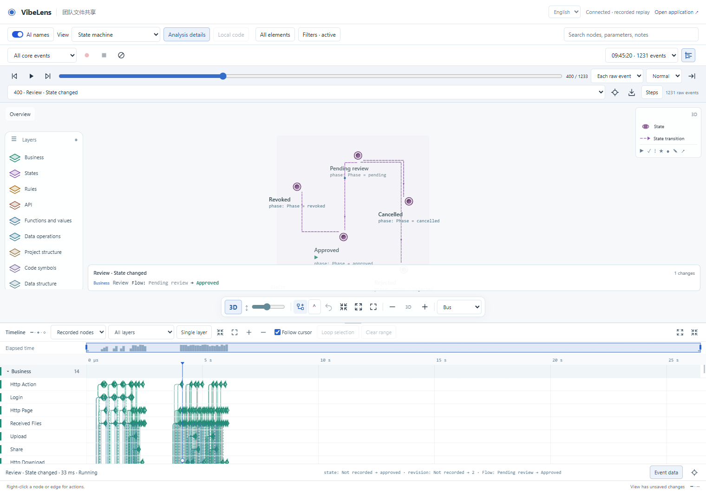

# Independent dialogue and viewer acceptance

Status: **partial**. Real application operations and the repaired observer passed
the checks below. The independent development conversation is waiting for Codex
approval; its final mapping gate and an ordinary business iteration remain open.

The trial started from `a2d9563` on `feat/recording-timeline`, using a frozen local
Skill in a separate project. It built a Python/Flask/SQLite team file-sharing
application. Accounts and uploaded files are synthetic.

## Dialogue and implementation

Read the [actual visible dialogue](dialogue/dialogue.md), including the questions,
changed answers, inline Mermaid graphs, graph confirmation and coding updates.
The conversation is `01a18f4d-11b3-7553-bbeb-6410929a9146`, titled
**VibeLens 生命周期全流程试用**. The original local project is
`VibeLensTrials/lifecycle-dialogue-20261031` relative to this repository's parent.

The coordinator initially supplied explicitly marked simulated answers. Later
human answers changed the reviewer to a person selected by the owner and widened
notifications to the owner, reviewer and recipient. The developer recognized the
newer answers and asked what “all related people” meant. A coordinator reminder
requested the inline graph after the design server became reachable. These
interventions are in the transcript; this is not unassisted human usability evidence.

The confirmed flow covers login, upload, selected review, approval/rejection,
three-party notifications, authorized download, pending cancellation and immediate
revocation of new downloads from an unchanged recipient page or old URL.
Registration and public sharing were outside this trial.



The [first connected project gate](original-project-gate/verify-001.json) correctly rejected missing implementation mapping
witnesses. Its independent business, state and project checks passed. A successful
browser flow does **not** turn that unfinished candidate into an accepted project.
The [custom-source snapshot](trial-source-v1/snapshot.json) preserves 52 original
files for review; managed runtime/assets are recreated from the named Skill revision.

## Findings and repairs

| Finding | Repair and retained evidence |
| --- | --- |
| Stop returned before the asynchronous producer queue drained. The original record saved 149 events; the collector later held 1,256, including 31 earlier context events. | Added bounded producer settlement before start/stop, outside observer locks. Timeouts and new capture errors retain interrupted evidence. [Original failure](operations-v1-initial/results.json), [settled capture audit](layer-and-capture-audit-v1.json). |
| Two deferred HTTP return builders referenced Python's cleared `except ... as error` variable. Business responses were correct, but six return observations were missing. | Preserved the original source. A separately marked copy fixes only those builders and records the POST redirect's actual HTTP 303. [Exact patch](patches/http-capture.diff), [copy provenance](patches/provenance.json). New gate checks reject producer/data errors separately from business results. |
| Selected-region recording had no connected native scope controller. | Added `GraphSession.bo_bind_capture` and Python/Node producer scope/health APIs. Real approval captured four scoped events and its state frame; stopping restored full HTTP/data capture. [Actual focused test](focused-actual-retest/results.json). |
| Data wrappers still evaluated observer-only summaries outside the selected scope. | Both language adapters now skip extraction for excluded/disabled observation while executing native callbacks unchanged. [Failing regression](data-scope-before.log), [retest](data-scope-after.log). |
| The default global 400-node slice omitted both HTTP routes before the API view applied its filter. | Added an API neighborhood before display limits. The real API view and a source regression exceeding 400 nodes retain endpoints, handlers and parameters. [Failed browser assertion](application-v1-api-failure/viewer-results.json), [real retest](application-v1-api-repaired/viewer-results.json), [source regression](code-api-regression.log). |
| Ingress repeatedly resolved complete Windows source paths. | Reused relative ancestor paths, reread current attributes and every source byte, and retained same-stat edit/link rejection. A parent replaced by an external junction within the same pass is rejected too. [Final profile](ingress-final/results.json). |

The failed capture with queue settlement retained all 1,225 received interval events
and reported six capture errors. The two-builder repair adds those six actual
HTTP returns: the clean repeat saved **1,231 events, zero gaps, zero producer/data
errors and zero drops**. No missing event was synthesized.



## Browser coverage

| Area | Actual trial result | Evidence |
| --- | --- | --- |
| Four authenticated users, selected reviewer, approval/rejection/cancel, messages, exact file bytes, stale-link revocation | Passed | [Operation checks](operations-v1-repaired-boundaries/results.json) |
| Business, state, permission, function/value, API, project/code, database and data-operation views | Passed for the implemented trial; source index limits remain visible | [Preset inventory](application-v1-api-repaired/preset-observations.json) |
| Stable source/explained identities, node notes, aliases, core marks, hide/show, expand/collapse, custom views, full source, 2D/3D and language switch | Passed | [Actual viewer checks](application-v1-api-repaired/viewer-results.json) |
| Observer-only UI/source/layout actions | Added zero application events | Same viewer report |
| Timeline lifetimes and connections | 521 intervals, 323 directed routes; same-layer and cross-layer handoffs present | [Actual timeline tests](timeline-actual-01/results.json) |
| Timeline and graph state/value/transfer synchronization | Passed in 2D and 3D at the exact original event ID | Same timeline report |
| Zoom, ruler/keyboard seek, drag range, loop selection, depth cutoff, single layer, skip/restore, play/pause, Chinese/mobile, live return | Passed; saved recording bytes unchanged | Same timeline report |
| Actual focused capture and return to full capture | Passed | [Focused/full records](focused-actual-retest/results.json) |
| Resource concurrency, joins and shared membership | Not configured in this simple trial; exercised by existing repository examples/fixtures | Full repository and browser regressions |
| Ordinary business iteration with autonomous graph/probe maintenance | **Pending** independent conversation approval | No passing claim |
| Final independent application's complete mapping acceptance | **Pending** repair of missing witnesses and HTTP capture | Original failed gate retained |

The actual timeline shows about 1.8 seconds of pending-review residency. Short
function calls keep their measured durations; zoom reveals them without inflating
time to make them look long.





## Verification and limits

Repository checks cover contracts, source inventories, protected expectations,
on/off/fault behavior, real databases, observer-free exports, and shipped examples.
Browser suites exercise lifecycle/timeline, names, conversation/design controls,
native recording/clear/load-error handling, engineering/code/data views, 3D,
routing, clustering, layers and replay. Final receipts are indexed in
`acceptance-summary.json`; original failed runs remain alongside their retests.

Large raw JSON is stored losslessly as `.json.gz`; `compressed-evidence.json`
records each original SHA-256 and byte count. This includes complete event records
and repeated source/view snapshots, rather than replacing them with summaries.
Intermediate browser runs and superseded generated checkpoint copies are retained
in [checkpoint-history/index.json](checkpoint-history/index.json), with a hash for
every archived file. Current shipped examples retain their final frozen approval;
earlier approvals and all failed/retested evidence remain recoverable from these ZIPs.

Some initial browser assertions assumed old layer positions, icon counts or
source expansion behavior. Their replacements retain the original checks and
require actual current IDs, native controls and exact saved values. The layer
reload check now waits for the **stored order**, not merely a custom-mode flag.
Localhost/junction tests use host execution on this Windows installation.

The isolated 100-event ingress profile improved from about **28.64 ms/event** to
**17.70 ms/event**, with 35 source files and byte hashing retained. The real burst
still created a backlog: stop took **19.379 seconds** to drain. Completeness is
verified here; this is not a low-latency performance guarantee. Batch ingestion and
larger-workload latency remain future optimization work.

The trial is Python. Node scope/data adapters and JS/TS/React/Vue parsing are
covered by repository regressions; this run does not claim a second independent
Node/React/Vue application conversation. Unresolved static references remain
unresolved, and static source links do not become executed calls.

## Review and reproduction

The [archived harnesses](scripts/manifest.json) are the exact final test sources.
Restore them under `.validation/` to retain their relative imports, and run from
the repository root with the Python environment and Playwright browser installed.
The isolated candidate launcher copies the original trial into a fresh directory;
`BO_DIALOGUE_PATCH_HTTP=1` applies the explicitly documented two-line capture repair.
It does not modify the original conversation project or create an acceptance record.

Useful commands after restoring the scripts:

```powershell
.venv/Scripts/python.exe -B -X utf8 tools/verify.py --database
.venv/Scripts/python.exe -B -X utf8 tools/check_source.py --format
.venv/Scripts/python.exe -B -X utf8 .validation/run_dialogue_browser_regressions.py
```

To inspect the complete real recording without launching the business application:

```powershell
node docs/review/dialogue-acceptance-20261031/scripts/replay_actual_recording.mjs
```

Open the printed local URL and select the saved recording. This separate utility
serves retained facts only; it does not repeat business operations.

The conversation's original failed gate and its earlier questions must be retained
when testing the next business iteration. Do not replace its baseline to obtain a
passing result. Continue it after Codex approval, apply the local Skill/runtime
upgrade, complete HTTP/error witnesses, then request an ordinary business change
without mentioning graph maintenance and verify automatic updates independently.
