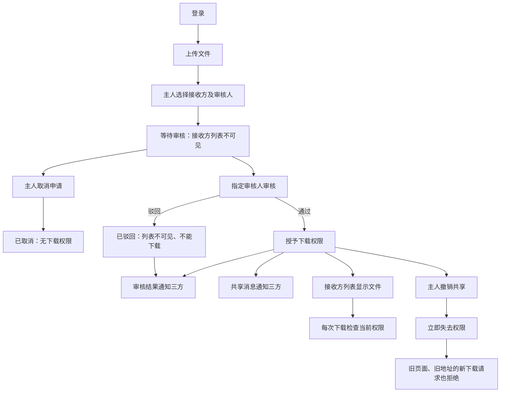
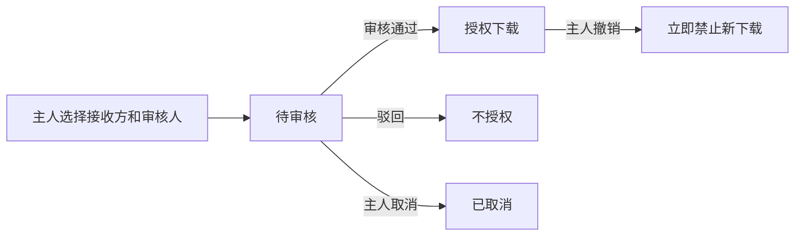
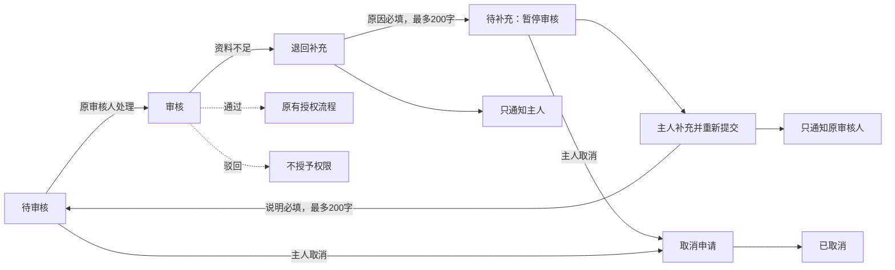

# Original-project acceptance and ordinary business iteration

Trial prompts and follow-ups delivered by the coordinating AI are scripted-user records. They are not independent human usability evidence.

Local paths are normalized as listed in dialogue.json. Original trial answers and checks are archived separately.

## 01 · scripted-user · 2026-10-31T00:12:36.820Z

$vibelens

我要做一个简单的团队文件共享应用：用户登录后上传文件，可以把文件共享给另一个成员；共享需要审核，审核结果和共享消息在站内通知对方，获得权限的人可以下载，文件主人可以撤销共享。先和我确认必要的业务细节，给我看业务网，我确认后再开发。

本轮只在 WORKSPACE 中工作。先读该目录的 AGENTS.md，并使用其中 .agents/skills/vibelens/SKILL.md 的当前项目版本。源代码和注释用英文，对话用中文，保留 review 下的实际对话与验收材料。不要修改维护仓库和其他项目，不要发布。这里是独立试用，后续回复由测试协调者模拟用户提供，收到答案之前不要自行确认。

可用的基础 Python 是 C:/Users/Lvi_P/Documents/Work/CF/平台软著/SoftwareStatusObserverSkill/.venv/Scripts/python.exe；使用时加 -B -X utf8。优先使用空闲端口，启动服务时记录可访问的应用和 graph 地址。

## 02 · assistant · 2026-10-31T00:12:39.440Z

我会先读取试用目录的约束和当前项目版 VibeLens 技能，梳理需要你确认的业务细节；业务网确认前先不开发。

## 03 · assistant · 2026-10-31T00:12:54.425Z

我已启用本目录的 VibeLens 技能。当前要确认的关键点是：谁审核、何时获得下载权限、通知发给谁，以及撤销如何生效。技能还要求确认运行模式和数据库选择；我会把这些待定项标在业务网中。

## 04 · assistant-question · 2026-10-31T00:13:51.646Z

{"questions":[{"title":"谁负责审核共享申请：固定管理员，还是由文件主人指定审核人？","options":["固定管理员审核","文件主人指定审核人"]},{"title":"审核通过、驳回的结果和共享消息分别通知谁？例如：结果通知文件主人，通过后再向接收方发送共享消息。"},{"title":"VibeLens 运行模式选哪一种？drive：由状态声明驱动业务流转；observe：应用自行执行，图负责观察。两种都会维护业务网和监控。","options":["drive：声明驱动","observe：应用执行、图观察"]}]}

## 05 · assistant · 2026-10-31T00:14:38.019Z

业务网草稿已记录登录、上传、申请共享、审核、通知、下载和撤销流程，审核人与通知对象仍标为待确认。当前只准备设计图；撤销的生效规则和存储选择会在收到首轮回答后继续确认。

## 06 · assistant · 2026-10-31T00:15:57.671Z

设计记录和权限规则草稿已通过结构校验；这不代表业务已确认。设计服务首次后台启动后未持续运行，我正在修正启动方式并检查网页可访问性。当前没有业务应用或运行记录。

## 07 · scripted-user · 2026-10-31T00:16:22.676Z

【模拟用户回答，供本轮独立试用】
用固定管理员审核。文件主人向指定的成员发起共享；审核结果通知文件主人，通过后再给接收方发一条共享消息。审核通过前和驳回后，接收方都不能下载，也不用在他的列表里显示待审核申请。
运行模式选 drive，由确认后的状态声明驱动。

## 08 · assistant · 2026-10-31T00:16:41.609Z

已记录这次模拟用户回答：固定管理员审核；结果通知文件主人，通过后才通知接收方；待审核和驳回的申请对接收方不可见、不可下载；运行模式选择 drive。我会更新同一张业务网，保留“模拟回答”的证据标记。

## 09 · assistant-question · 2026-10-31T00:16:42.842Z

{"questions":[{"title":"文件主人能否取消待审核的共享，还是只能撤销已通过的共享？撤销后，接收方在未刷新页面再次点击下载时，是否应立即拒绝？"},{"title":"本地试用建议用 SQLite + SQLAlchemy 保存成员、文件记录、共享申请和站内通知，文件内容保存在项目目录；这样无需另启数据库服务。是否采用？","options":["采用 SQLite + SQLAlchemy","另有数据库要求"]}]}

## 10 · scripted-user · 2026-10-31T00:17:18.937Z

【模拟用户回答】
待审核的共享也可以由文件主人取消；已通过的共享可以撤销。撤销后立即失去下载权限，即使接收方没刷新页面、还拿着旧下载地址，再次请求下载也要拒绝。已经下载到本地的文件不追回。
采用 SQLite + SQLAlchemy，文件放在本项目自己的数据目录。

## 11 · assistant · 2026-10-31T00:17:36.284Z

已记录第二次模拟回答：待审核申请可取消，已通过共享可撤销；撤销后每次下载请求都立即检查当前权限，旧页面和旧地址也会被拒绝；本地副本不追回。存储采用 SQLite + SQLAlchemy，文件放在本项目数据目录。接下来展示更新后的业务网，等待你的确认。

## 12 · user · 2026-10-31T00:17:49.711Z

<send_user_message_question_reply>
[{"questionItemId":"[\"request_user_input_async\",\"call_677d152efb2741b6a9791738d79a20aa\",0]","question":"谁负责审核共享申请：固定管理员，还是由文件主人指定审核人？","answer":"文件主人指定审核人"},{"questionItemId":"[\"request_user_input_async\",\"call_677d152efb2741b6a9791738d79a20aa\",1]","question":"审核通过、驳回的结果和共享消息分别通知谁？例如：结果通知文件主人，通过后再向接收方发送共享消息。","answer":"相关的所有人"},{"questionItemId":"[\"request_user_input_async\",\"call_677d152efb2741b6a9791738d79a20aa\",2]","question":"VibeLens 运行模式选哪一种？drive：由状态声明驱动业务流转；observe：应用自行执行，图负责观察。两种都会维护业务网和监控。","answer":"drive：声明驱动"},{"questionItemId":"[\"request_user_input_async\",\"call_e390e1620f194103aa5ba54cc4669122\",0]","question":"文件主人能否取消待审核的共享，还是只能撤销已通过的共享？撤销后，接收方在未刷新页面再次点击下载时，是否应立即拒绝？","answer":"可以，是的"},{"questionItemId":"[\"request_user_input_async\",\"call_e390e1620f194103aa5ba54cc4669122\",1]","question":"本地试用建议用 SQLite + SQLAlchemy 保存成员、文件记录、共享申请和站内通知，文件内容保存在项目目录；这样无需另启数据库服务。是否采用？","answer":"采用 SQLite + SQLAlchemy"}]
</send_user_message_question_reply>

## 13 · assistant · 2026-10-31T00:18:09.457Z

收到这组较新的回答。我会将审核人改为“文件主人指定”，保留此前固定管理员方案的变更记录；drive、取消待审核、撤销立即阻止新下载和 SQLite 的选择保持已确认。“相关的所有人”还需明确对应哪些通知对象。

## 14 · assistant-question · 2026-10-31T00:18:10.623Z

{"questions":[{"title":"“相关的所有人”是否指文件主人、指定审核人、接收成员三方，都收到通过／驳回结果和通过后的共享通知？接收方的文件列表仍只显示已获授权的文件。","options":["是，三方都通知，列表规则不变","通知对象或列表规则需要调整"]}]}

## 15 · user · 2026-10-31T00:18:24.708Z

<send_user_message_question_reply>
[{"questionItemId":"[\"request_user_input_async\",\"call_213ca0e344c34ea8bde062e68042c512\",0]","question":"“相关的所有人”是否指文件主人、指定审核人、接收成员三方，都收到通过／驳回结果和通过后的共享通知？接收方的文件列表仍只显示已获授权的文件。","answer":"是，三方都通知，列表规则不变"}]
</send_user_message_question_reply>

## 16 · assistant · 2026-10-31T00:20:44.581Z

三方通知的范围已确认，业务细节已补齐。我正在处理设计页的本地访问问题；只启动设计查看器，业务开发仍等待业务网确认。

## 17 · scripted-user · 2026-10-31T00:22:50.693Z

【测试协调信息，不是业务答案】
我已用独立 Chromium 实际打开 http://127.0.0.1:60296/graph?lang=zh-CN，确认 stage=design、108 个完整图节点、132 条关系、0 条运行事件，页面无 JS 报错；截图和实际设计 JSON 已留在维护仓库 docs/review/dialogue-acceptance-20261031/design/。默认沙箱里的 localhost 请求与主机网络可能不同，主机权限下的浏览器检查已成功。请继续按最新真实用户问答更新同一张图，展示到对话中并请求业务网确认。优先采用真实用户最新的“主人指定审核人、三方通知”等回答，不要回退到我之前的模拟答案。
后续业务实现完成后请保留应用和观测服务可用，方便我独立逐项检查。

## 18 · assistant · 2026-10-31T00:23:46.165Z

已按最新回答更新：**文件主人指定审核人；审核结果和通过后的共享消息通知三方**。三方指文件主人、指定审核人和接收成员。

[打开完整业务网及权限规则](http://127.0.0.1:60296/graph)

采用 **drive、SQLite + SQLAlchemy**，文件放在本项目数据目录。已经下载的本地副本不追回。目前只有设计查看器，尚未开发业务应用。

**请确认：这张业务网是否正确，可以按它开始开发？**

<oai-mem-citation>
<citation_entries>
MEMORY.md:76-83|note=[Prior trial dialogue boundaries and schema cautions checked against the current local Skill]
</citation_entries>
<rollout_ids>
01a18332-cb51-7471-83f8-990d88886b9d
</rollout_ids>
</oai-mem-citation>

## 19 · scripted-user · 2026-10-31T00:23:46.189Z

【模拟用户确认】
我打开当前业务图看过了，按最新的这一版继续：主人指定审核人，审核结果通知三方，通过后接收方才出现在文件列表里并能下载；待审核能取消，通过后能撤销，撤销后旧地址也不能再下载。这张业务网符合当前意图，可以开始开发。
登录先用本地预置测试账号即可，暂时不做注册。请把确认后的简图也保留在对话里，方便回顾。

## 20 · assistant · 2026-10-31T00:23:50.292Z

已记录这次模拟确认：按最新版业务网开始开发，登录使用本地预置测试账号，暂不做注册。我会保留确认后的简图，并把状态流转、权限检查、数据库操作和实际运行证据接到同一张图中。

## 21 · assistant · 2026-10-31T00:24:10.930Z

前端会用清晰的文件列表、待审核列表和消息中心呈现业务，采用 `frontend-design` 技能整理界面。Sites 技能按本地模式使用，不注册或发布站点。

## 22 · assistant · 2026-10-31T00:26:24.596Z

确认后的核心流程保留如下：

审核结果通知三方，通过后再发送共享消息。实现会在每次下载请求时读取当前权限，确保旧页面和旧地址不能绕过撤销。

## 23 · assistant · 2026-10-31T00:29:05.138Z

业务层已写入登录、上传、指定审核、三方消息、取消和撤销逻辑。状态与通知放在同一个 SQLite 事务中，避免出现“已通过但消息未保存”的中间结果。接下来接入图和观测，并用独立案例检查权限与业务结果；目前还没有通过运行验收。

## 24 · assistant · 2026-10-31T00:36:46.552Z

界面已写入“我的文件、收到的文件、待审核、消息中心”。验证案例会覆盖指定审核人、三方消息、取消后迟到的审批，以及撤销后的旧地址下载；接下来运行这些案例，并核对图中记录的值是否与数据库一致。

## 25 · scripted-user · 2026-10-31T00:38:34.726Z

【验收记录要求，不是业务变更】
请给失败、修复、复测日志使用不同的尝试编号，避免后一次运行覆盖同名 unit-test、change-inspect、verify 日志。已经发生的失败请从本会话实际工具输出如实补存，保留原因和修复位置；不能只剩最后的通过文件。继续完成当前实现和既有严格检查即可。

## 26 · assistant · 2026-10-31T00:38:45.935Z

会为后续失败、修复和复测使用独立尝试编号，并补存已经发生的失败。当前发现两类问题：测试读取器没有及时关闭 SQLite 连接，影响 Windows 清理测试目录；图检查还缺少部分来源和规则映射。我会修复后按原有检查复测。

## 27 · assistant · 2026-10-31T00:41:11.152Z

12 项独立业务测试已通过，包括撤销后旧地址拒绝下载、取消与审批竞争、通知隔离和事务回滚。已通过场景还捕获了 199 条真实事件和 9 次权限判定，未发现丢弃或采集错误。静态映射检查目前也无错误，接下来运行完整验证。

## 28 · assistant · 2026-10-31T00:44:49.027Z

应用与观测服务均已启动，两个地址都返回正常：

- [团队文件应用](http://127.0.0.1:50643/)
- [运行图](http://127.0.0.1:50642/graph)

架构隔离检查已通过。完整的开、关、故障三种观测模式验证仍在运行，我会继续检查浏览器中的实际操作。

## 29 · scripted-user · 2026-10-31T03:37:02.602Z

【独立实际浏览器验收发现，保留当前失败证据】
我已经用四个真实浏览器会话完成了登录、上传、指定审核、三方消息、原字节下载、旧地址撤权、驳回和取消，业务结果通过；但录制停止时仅保存149条事件，之后收集器实际收到了1256条。录制漏掉了后半段实际操作（包括不存在文件的404下载）。原因是异步探针队列仍有积压，Recordings.stop没有生产者排空接口。证据在维护仓库 docs/review/dialogue-acceptance-20261031/operations-v1-initial/。我正在维护仓库修复录制边界和真实focused capture接口，并保留源文件字节校验；你不要通过手工flush测试、删断言或伪造事件掩盖这个问题。
请继续补齐你当前verify报出的“no implementation mapping witnesses”。浏览器仍由我独立逐项验收，修复完成后我会给你明确的观察器升级接口，在原变更上正常重跑各项检查。不要重置初始baseline。

## 30 · scripted-user · 2026-10-31T03:37:02.610Z

独立验收发现了一个真实的采集缺陷，请在当前试用中修复并保留失败、修复和复测证据：app/web.py 的 except BusinessError as error 分支把 error.status 放进延迟执行的 operation.result(lambda: ...)；退出 except 后 Python 会清除 error，外层 span 关闭时发生 NameError。业务响应仍正常，但 http_download return 等事件丢失。主会话实际浏览器操作检测到 6 次此类捕获错误。请固定需要的真实标量后再给 deferred builder，确保输出确实表达对应的 HTTP/业务字段，并补充真实 HTTP 拒绝、404、错误路径的返回边界测试。当前最新版核心已在维护仓库 skills/vibelens 增加 GraphSession.bo_bind_capture(scope_setter=probe.bo_set_scope, flush_capture=lambda:probe.flush(30), health=...)；新 launcher 必须绑定真实控制，并在 health 中合并 data_errors。请用正式 upgrade/runtime 同步方式应用最新本地 Skill，保留原始设计和代码基线，不要重置已通过的断言；配置 require_probe_health:true，并使 observe.py 实际的 probe_health 参与 mapping 检查。先完成首版完整检查与这些修复，暂不扩展业务范围。独立会话仍由用户处理待审批项；本消息是后续修复要求。

## 31 · scripted-user · 2026-10-31T03:37:02.621Z

主会话的核心修复及独立浏览器复测已经稳定，补充两点供你恢复后完成原试用工程：1. 现有 app/web.py POST 错误分支实际返回 303 重定向，其 HTTP status 埋点也应记录 303；下载错误分支需要把 error.status 绑定成延迟 lambda 的默认标量参数。原始源文件和失败证据须保留。2. 最新 Skill/core 的 API 视图已改为 projection=api，避免全局400节点上限漏掉路由；Python/Node 数据适配器已接通局部采集过滤，范围外的摘要不会执行。主会话在独立修复副本上完成了1231事件的真实流转和timeline检查、4事件的局部审批录制以及恢复全量15事件的下载，零采集错误。它们不是你的原工程最终通过记录，不能拿来代替原工程的完整 gate。请按之前消息正式升级本地 Skill/runtime，接真实 scope/flush/health、require_probe_health:true，补齐逐特性参数/返回/错误的 mapping witnesses，并重新完整验收。继续保留 .stategraph/initial-app 基线、原失败输出和每次修复复测，暂不新增业务功能。

## 32 · assistant · 2026-10-31T03:37:29.353Z

已收到这些缺陷和修复要求。业务响应正常并不能证明采集完整：错误分支的延迟取值会丢失返回事件，录制停止时队列积压也会漏掉后半段操作。我会保留原工程的失败证据，修正真实 HTTP 状态和延迟取值，正式升级本地 Skill/runtime，并在原始基线上重新完成全部检查；独立修复副本的结果不作为本工程通过记录。

## 33 · scripted-user · 2026-10-31T03:43:54.931Z

补充原工程验收注意项：实际 /download/missing-file 返回 404，download 生命周期不能仅凭异常类型 BusinessError 显示 Denied（该类型还包含 not_found）。只有采集到对应的明确业务结果才使用领域状态名，否则保留通用 exception 生命周期并展示真实异常字段。请把 HTTP 401/403/404/303 返回值、生命周期关闭与实际 probe_health 一并加入原工程的真实场景检查。已完成的 5 个 HTTP 错误分支基线失败可保留；这不是新增业务需求。先完成当前初版的原基线验收，后续业务迭代等我另发普通需求。

## 34 · assistant · 2026-10-31T03:47:51.426Z

已在原工程复现：5 个 HTTP 错误场景的响应都正确，但产生了 5 次采集错误，返回边界不完整。原源码和失败结果已单独保存。项目本地 Skill/runtime 已通过正式安装器与升级器更新，初始基线保持原标识；现在补齐参数、返回值和错误边界的独立映射见证，并接入真实录制范围、排空和健康接口。

## 35 · assistant · 2026-10-31T03:52:52.268Z

修复后的 5 个 HTTP 错误场景已复测通过：401、403、404 和 303 都有对应返回事件，HTTP 状态与业务状态分开记录，采集错误为 0。“文件不存在”下载保留通用异常语义，不标成权限拒绝。另一个真实场景新增了 356 项参数、返回值和判定映射见证，当前未发现不一致。

## 36 · assistant · 2026-10-31T04:00:23.602Z

升级后的原工程已有 18 项测试通过，包含“停止录制时由真实接口排空队列”、局部审批录制、恢复全量采集，以及缺失状态帧和返回字段的负向检查。完整验证已生成新的独立观测文件，正在汇总四类检查结果；初始基线的 SHA-256 保持不变。

## 37 · scripted-user · 2026-10-31T04:03:07.126Z

测试协调：我已只读确认原工程 verify-002 四类检查通过（9086 witnesses、744 projection checks），初始失败保留。请完成原基线的 accept → check，重启该工程应用和 graph 到本次 build，并保留 runtime-process.json/URL 和服务运行。随后先停止业务操作和录制操作，让主会话独立跑真实浏览器及 timeline 验收，避免并发录制互相干扰；后续普通业务迭代需求我会另发。本条不改变任何业务需求或验收规则。

## 38 · assistant · 2026-10-31T04:03:26.555Z

原工程的完整验证已通过：映射、状态约束、业务规则、项目检查四类均通过，包含 9,086 项见证和 744 项投影比较。接下来执行原变更的 `accept → check`，重启到本次构建并核对地址；随后停止业务与录制操作，交给你独立进行浏览器和时间线验收。

## 39 · scripted-user · 2026-10-31T04:12:34.152Z

主会话独立浏览器结果：四用户业务检查通过，首次完整录制在30秒停止排空后仍有90条未处理，1303/1393事件，系统正确保存 interrupted（零采集错误/零丢弃；后来1393均已收到）。失败材料保留在维护仓库 operations-original-v1-01。请暂时保持已验收工程与服务不变、不要追加业务/录制操作。主会话先只读分析真实接收开销，寻找不弱化当前源码校验的修复，完成后会通知是否需要正式升级。

## 40 · assistant · 2026-10-31T04:13:12.179Z

收到。保持当前工程和服务不变，不再执行业务或录制操作。

当前独立结果：四用户业务检查通过；完整录制未通过，保存了 1303/1393 条事件并正确标记为 `interrupted`，采集错误和丢弃均为 0。等待后续升级指令。

## 41 · scripted-user · 2026-10-31T04:21:54.952Z

原工程两次完整录制都在30秒排空边界保留 interrupted；业务正确、零采集错误/丢弃。主会话已修复接收端重复解析项目声明的开销：当前维护仓库 observation/session.py 逐次读取真实项目字节，仅对已验证相同字节跳过重复JSON规范化，保留格式等价比较、同大小同时间内容变化与物理路径检查；43源文件同样本23.75→18.82ms/event，新增4项定义绑定回归和9项队列回归通过。无改业务/协议/停止超时。未改业务源码的隔离副本已录全1231events、无缺口。
请现在只做正式技术升级，不做业务迭代：保留initial-app已接受基线和两次失败；以新的技术变更begin（例如capture-byte-identity）升级项目本地Skill和observer_runtime（源为当前维护仓库工作区；同时包含top-level mapping_checks的文档澄清），更新必要受管指纹和候选，inspect→review→verify→accept→check。不得减少既有case/字段/探针/模式，也不要延长flush30秒或等队列空后才停止。完成后重启本次服务、给出URL和新候选/构建，保留服务并停止业务/录制，让主会话再次跑独立原工程浏览器。原始源码业务语义和要求不变；源码检查允许格式化等价，不要重置旧基线。

## 42 · assistant · 2026-10-31T04:21:58.767Z

我会建立新的技术变更，保留已接受的 `initial-app` 基线和两次录制失败记录，通过正式流程升级本地 Skill/runtime。业务规则、既有检查范围和 30 秒排空限制保持不变；验收后重启服务，并停止业务与录制操作，交给你独立复测。

## 43 · assistant · 2026-10-31T04:24:44.984Z

当前仍是已接受的 `initial-app` 版本。我已核对本地 VibeLens 流程，接下来先建立技术变更基线，再升级本地副本；原基线和两次失败录制都会保留。

## 44 · scripted-user · 2026-10-31T04:26:04.600Z

技术升级补充：维护端现在已完成固定格式化，核心 session.py 与 source_files.py 的当前字节已稳定，源码质量检查也已通过。若你在这一条之前复制过 Skill/runtime，请在同一个 capture-byte-identity 变更内正式再同步一次当前工作区这两文件（不要新建/重置baseline），再生成候选和验收。其后主会话暂不修改这两文件；本次仅是已描述快路径和注释/格式，不改业务、协议、超时。维护端还修正了 Windows 源码检查工具子 Python 的 UTF-8 编码参数，属于仓库工具，不是应用业务改动。

## 45 · assistant · 2026-10-31T04:26:14.469Z

`capture-byte-identity` 已从原接受候选建立，原基线未改，两份 `interrupted` 录制也已备份并记录哈希。收到维护端的格式化补充后，我会在同一变更内重新同步当前 Skill/runtime，再生成候选和验收，不重建基线。

## 46 · assistant · 2026-10-31T04:27:59.214Z

正式升级只改了 runtime 的 `session.py` 和 `source_files.py`，两者均与维护端当前字节一致；本地 Skill 也已包含 `mapping_checks` 文档澄清。接下来运行扫描和验收，保留全部案例、字段、探针、模式及 `flush(30)`。

## 47 · assistant · 2026-10-31T04:29:16.811Z

哈希核对确认，业务源码、独立断言、映射案例和录制排空调用均未改动。扫描完成后会执行原有 31 个案例的三种模式验证和项目测试；原工程完整录制是否修复，仍需重启后由协调方独立复测。

## 48 · assistant · 2026-10-31T04:30:41.521Z

扫描通过，未发现未登记源码或实现映射缺口，数据模型和策略检查均通过。正在检查新候选并补齐该候选的技术评审；这些结果只说明升级集成状态，不代表完整录制已通过。

## 49 · assistant · 2026-10-31T04:32:06.692Z

旧录制原件已核实并保留：两次中断分别保存了 1,303 条和 1,129 条事件，排空失败标记也在。候选检查仍在运行，完成后会保留检查结果，再进入评审和验证。

## 50 · assistant · 2026-10-31T04:34:04.142Z

候选检查完成：结构错误为零，业务文件无变更；本地配置差异只有备份来源登记和两个 runtime 文件的指纹。当前只缺这轮新候选的评审记录，补齐后就运行完整验证。

## 51 · assistant · 2026-10-31T04:35:35.416Z

新候选的业务、状态机、抽象和探针四项评审已记录。完整验证正在运行，将保留三种模式的实际观测和 18 项项目测试结果；本次不会改动原 `initial-app` 的评审或验收记录。

## 52 · assistant · 2026-10-31T04:37:30.543Z

验证仍在运行。重启时会只停止进程记录中属于本工程的服务，再核对应用与业务图的构建标识；重启后只做健康读取，将业务和录制操作留给协调方复测。

## 53 · assistant · 2026-10-31T04:39:05.395Z

验证已进入实际运行检查。探针健康检查仍启用：正常观测模式中的采集错误或丢包会使映射验证失败，业务正确性也会按独立断言单独检查。

## 54 · assistant · 2026-10-31T04:40:32.635Z

已生成 93 组实际运行观测，覆盖 31 个案例和 `on/off/fault` 三种模式，保留了 9,086 条顶层映射见证。31 组正常观测的错误、丢包和数据适配错误均为零；整体验证收据仍在等待项目检查和一致性复核完成。

## 55 · assistant · 2026-10-31T04:41:23.850Z

完整验证已通过：映射、状态约束、业务规则和项目检查四类均通过，81 条业务断言全部执行。正在接受这个候选并检查接受状态，完成后会重启服务交接。

## 56 · assistant · 2026-10-31T04:42:38.214Z

18 项项目测试全部通过，219 个受管理文件的架构检查也通过。接受候选仍在复核源码和验证收据；完成后只剩 `check` 和服务重启。

## 57 · assistant · 2026-10-31T04:43:59.985Z

本轮验证收据、观测数据和命令日志均已保存到新变更及独立编号的文件中。接受步骤仍在运行，尚未重启服务。

## 58 · assistant · 2026-10-31T04:45:16.143Z

本轮验证使用的构建标识为 `22f404fa1a87c3da3dd442beadd03669ed3e3feff692be26948efd431ca8b7e9`。接受与检查完成后，我会核对重启后的应用和业务图都载入这一构建。

## 59 · assistant · 2026-10-31T04:46:20.759Z

接受记录已生成，候选和构建标识与验证结果一致。命令正在完成源码基线登记，随后会运行项目要求的最终 `check`。

## 60 · assistant · 2026-10-31T04:47:37.192Z

`accept` 已通过，最终 `check` 正在运行。业务源码、案例、字段、探针和三种模式均保持原样；检查通过后即可重启并交接新构建。

## 61 · assistant · 2026-10-31T04:49:03.604Z

最终 `check` 会重新核对完整源码图和接受收据，因此比单独运行测试耗时更长。通过后将复用现有两个服务地址，载入已接受的新构建。

## 62 · assistant · 2026-10-31T04:49:21.206Z

`check` 已通过，候选状态为 `current`。现在重启本工程记录的两个服务进程，并核对健康、构建标识和业务图绑定状态；之后交给协调方独立复测。

## 63 · assistant · 2026-10-31T04:50:43.969Z

新构建已重启：应用和业务图健康正常，绑定状态为 `current`。启动核对时，生产队列、采集错误、丢包、数据适配错误和收集端缺口均为零。服务会保持运行；我已停止业务与录制操作，正在保存最后的交接记录。

## 64 · assistant · 2026-10-31T04:51:20.604Z

技术升级已通过验证、接受和最终检查，服务已重启并保持运行。

- [应用](http://127.0.0.1:50643/) · [业务图](http://127.0.0.1:50642/graph)
- 候选：`ae9cedf4681ef270aeadba5e1800633d76e65ef0925c8dea25795ae2e7f32fe6`
- 构建：`22f404fa1a87c3da3dd442beadd03669ed3e3feff692be26948efd431ca8b7e9`

93 组运行、81 条业务断言、18 项测试及架构检查通过。原基线和失败录制完整保留，业务规则及 `flush(30)` 不变。

已停止业务与录制操作，原工程完整录制和时间线等待独立复测。交接记录 (`/WORKSPACE/review/handoff-capture-byte-identity.json`)

<oai-mem-citation>
<citation_entries>
MEMORY.md:76-77|note=[Trial evidence and language conventions]
</citation_entries>
<rollout_ids>
01a18332-cb51-7471-83f8-990d88886b9d
</rollout_ids>
</oai-mem-citation>

## 65 · scripted-user · 2026-10-31T05:06:05.272Z

【模拟用户，本轮业务迭代】
审核的时候有时资料不够。我想让审核人把共享申请退回给文件主人补充说明，主人补好后，再交回原来的审核人继续处理。

## 66 · assistant · 2026-10-31T05:06:09.143Z

收到这轮模拟业务需求。我会沿用现有共享规则，先梳理“退回补充 → 主人补充 → 原审核人继续审核”的状态和权限，只确认新增业务含义，再更新业务图供确认。

## 67 · assistant-question · 2026-10-31T05:07:13.077Z

{"questions":[{"title":"这轮“补充说明”按文字处理：审核人退回时的原因、主人重新提交时的补充说明，是否都必须填写？","options":["两者都必填","只要求补充说明必填","两者都可留空"]},{"title":"申请处于“待补充”时，主人是否仍可取消？审核人是否必须等主人重新提交后，才能再次通过或驳回？","options":["主人可取消；重新提交后才能审核","主人不可取消；重新提交后才能审核","主人可取消；待补充时也能审核"]},{"title":"是否允许多轮退回补充？退回／重新提交的通知，以及保留的各轮原因和说明，是否都给文件主人、原审核人、接收成员三方查看？"}]}

## 68 · assistant · 2026-10-31T05:08:08.636Z

现有实现从“待审核”流转到通过或驳回。本轮需要增加“待补充”，并在重新提交时沿用同一申请和原审核人。原有“通过后接收方才能查看、下载”的规则继续沿用，新增权限和通知范围等答复后再定。

## 69 · assistant · 2026-10-31T05:10:29.016Z

已记录为本轮模拟业务迭代，需要确认三点：

1. 退回原因和补充文字是否都必填？
2. 待补充时，主人能否取消？审核人是否必须等重新提交后才能审核？
3. 是否允许多轮往返？各轮说明及退回、重新提交的通知，是否都向三方开放？

新变更基线已建立，现有服务未改动。按本地 VibeLens Skill (`/WORKSPACE/.agents/skills/vibelens/SKILL.md`)的要求：“continue once that scope is confirmed.”，答复后会先更新业务图供确认，再实现。

<oai-mem-citation>
<citation_entries>
MEMORY.md:83-83|note=[Exact project-local Skill guidance checked]
</citation_entries>
<rollout_ids>
01a18332-cb51-7471-83f8-990d88886b9d
</rollout_ids>
</oai-mem-citation>

## 70 · scripted-user · 2026-10-31T05:10:29.483Z

【模拟用户答复】
两种文字都必填，各不超过200字。待补充时主人可以取消，审核人要等主人重新提交后才能继续审核。
可以多轮退回，但现在只保存最新一次的退回原因和补充说明，原来的状态变更记录照旧。
退回时只通知主人，重新提交时只通知原审核人；这些原因和补充说明也只给主人和该审核人看。接收成员仍只收到最终审核结果和通过后的共享消息，最终结果继续通知三方。
本轮只补文字，文件、接收成员和审核人都保持原样。

## 71 · assistant · 2026-10-31T05:10:33.639Z

已收到这轮模拟答复：两种文字都必填且各不超过 200 字；待补充时主人可取消，原审核人须等重新提交后继续审核；允许多轮，但只保存最新说明。退回只通知主人，重提只通知原审核人；说明仅双方可见，最终结果仍通知三方。我会据此更新业务图供确认。

## 72 · assistant · 2026-10-31T05:13:33.017Z

这次规则已与原有最终审核通知区分开：补充过程由主人和原审核人处理，接收成员仍等待最终结果。新图会显示返回、重提和取消分支，并保留原有节点标识及历史确认记录。

## 73 · assistant · 2026-10-31T05:18:46.498Z

业务草案和共享权限规则已通过结构校验，目前只剩新增业务图待确认。设计图服务已启动并核对可访问；这是新增流程草案，尚未改动业务源码或可执行状态声明。

## 74 · assistant · 2026-10-31T05:21:32.762Z

新增流程图已整理完成，图中保留了原有通过、驳回和取消分支，也标明了两种定向通知。核对确认：原业务源码、可执行状态声明、独立断言和各轮基线均未改动，本轮仍处于设计确认阶段。

## 75 · assistant · 2026-10-31T05:22:15.437Z

[查看完整业务图草案](http://127.0.0.1:59739/graph)。下面只展示本轮流转，虚线连接原有审核结果分支。

允许多轮往返，只保存最新原因和说明，仅主人与原审核人可见，状态历史照旧。文件、接收成员和审核人不变；最终结果仍通知三方，通过后另发共享消息。

**请确认：这张新增流程图是否正确，可以按此实现？**

按本地 VibeLens Skill (`/WORKSPACE/.agents/skills/vibelens/SKILL.md`)的要求：“continue once that scope is confirmed.”，图确认后进入业务实现。

<oai-mem-citation>
<citation_entries>
MEMORY.md:83-83|note=[Exact local Skill and stable graph identity guidance checked]
</citation_entries>
<rollout_ids>
01a18332-cb51-7471-83f8-990d88886b9d
</rollout_ids>
</oai-mem-citation>

## 76 · scripted-user · 2026-10-31T05:26:02.050Z

【模拟用户确认】
这张流程图是对的，可以按此实现。只保留最新的一组文字；退回和重提通知只提示需要处理哪份申请，具体原因和说明在申请中查看。原有最终结果和共享消息的范围照旧。

## 77 · assistant · 2026-10-31T05:26:06.000Z

已收到这轮模拟确认。我会开始实现退回补充、主人重提和待补充取消，并让退回／重提通知只指向申请。只保留最新一组文字，具体内容仅主人和原审核人在申请中查看；原有最终结果和共享消息范围照旧。

## 78 · assistant · 2026-10-31T05:26:51.522Z

本轮涉及状态流转、权限、SQLite 迁移和观测验证，我会同时使用 `planning-with-files-zh` 保存计划与检查记录。验证会重点覆盖“最新一组文字”和通知内容边界，并保留原有断言及失败证据。

## 79 · assistant · 2026-10-31T05:31:49.474Z

核心流转和申请页面已写入，正在接入业务图与实际观测。每次再次退回会替换原因并清空旧说明，重提后形成新的一组；通知仍只保存申请标识和文件信息，观测只记录长度等字段，避免把旧文字留进历史事件。

## 80 · assistant · 2026-10-31T05:33:49.617Z

界面已加入退回、补充重提和双方可读的申请页；待补充申请也从审核待办中分开显示。接下来验证空白及超长文字、越权查看、待补充期间审核、重复退回和取消后重提等路径，并核对现有数据的迁移结果。

## 81 · assistant · 2026-10-31T05:39:31.783Z

现有数据库迁移已执行，迁移前的数据库、14 个文件内容和 6 份录制都已备份。业务图已加入待补充及返回循环，测试与观测案例也已扩展；正在跑原有测试和新增回归，并逐表核对原数据是否保持一致。

## 82 · assistant · 2026-10-31T05:43:08.997Z

26 项测试全部通过。另有 15 组覆盖正常、关闭和故障观测模式的重点运行，业务结果与映射字段均匹配。迁移核对也确认，5 张表的原有行、14 个文件和 6 份录制均未改变；现在进入完整扫描与验收流程。

## 83 · assistant · 2026-10-31T05:44:57.829Z

架构检查已通过，完整源码扫描仍在运行。目前的回归结果已确认：无效或越权操作不会写入状态和消息，旧轮次文字不进入消息、状态日志或采集事件；测试也能检出故意改错的观测长度。

## 84 · assistant · 2026-10-31T05:46:57.829Z

目前没有发现业务或采集错误，正在等待完整源码扫描结束。原有案例、字段、探针和 `on/off/fault` 模式都已保留，新增功能也已进入同一套验证门槛。

## 85 · user · 2026-10-31T05:51:24.980Z

<send_user_message_question_reply>
[{"questionItemId":"[\"request_user_input_async\",\"call_bb609ae553fe4a7384e5645d9a40f42f\",0]","question":"这轮“补充说明”按文字处理：审核人退回时的原因、主人重新提交时的补充说明，是否都必须填写？","answer":"两者都必填"},{"questionItemId":"[\"request_user_input_async\",\"call_bb609ae553fe4a7384e5645d9a40f42f\",1]","question":"申请处于“待补充”时，主人是否仍可取消？审核人是否必须等主人重新提交后，才能再次通过或驳回？","answer":"主人可取消；重新提交后才能审核"},{"questionItemId":"[\"request_user_input_async\",\"call_bb609ae553fe4a7384e5645d9a40f42f\",2]","question":"是否允许多轮退回补充？退回／重新提交的通知，以及保留的各轮原因和说明，是否都给文件主人、原审核人、接收成员三方查看？","answer":"是"}]
</send_user_message_question_reply>

## 86 · assistant · 2026-10-31T05:52:05.502Z

前两项答复与当前规则一致。第三项“是”与随后已确认的细则有冲突：细则要求只留最新一组、仅主人和原审核人可见，退回和重提也分别只通知一方。我先核对这一处，其他技术检查继续。

## 87 · assistant-question · 2026-10-31T05:52:07.955Z

{"questions":[{"title":"第三项“是”是否要修改此前已确认的细则？此前是：只存最新一组文字，仅主人和原审核人可见；退回只通知主人，重提只通知原审核人；最终结果仍通知三方。请确认本轮采用哪套规则。","options":["沿用上述已确认细则","改为每轮保留，补充过程也通知并开放给三方"]}]}

## 88 · user · 2026-10-31T05:54:38.347Z

<send_user_message_question_reply>
[{"questionItemId":"[\"request_user_input_async\",\"call_a3db84b13c504570ab658ec65b865fc5\",0]","question":"第三项“是”是否要修改此前已确认的细则？此前是：只存最新一组文字，仅主人和原审核人可见；退回只通知主人，重提只通知原审核人；最终结果仍通知三方。请确认本轮采用哪套规则。","answer":"沿用上述已确认细则"}]
</send_user_message_question_reply>

## 89 · assistant · 2026-10-31T05:54:40.859Z

已确认沿用细则：只保留最新一组文字，仅主人和原审核人可见；退回通知主人，重提通知原审核人，最终结果仍通知三方。我会记录这次澄清，继续完成验证和本地运行检查。

