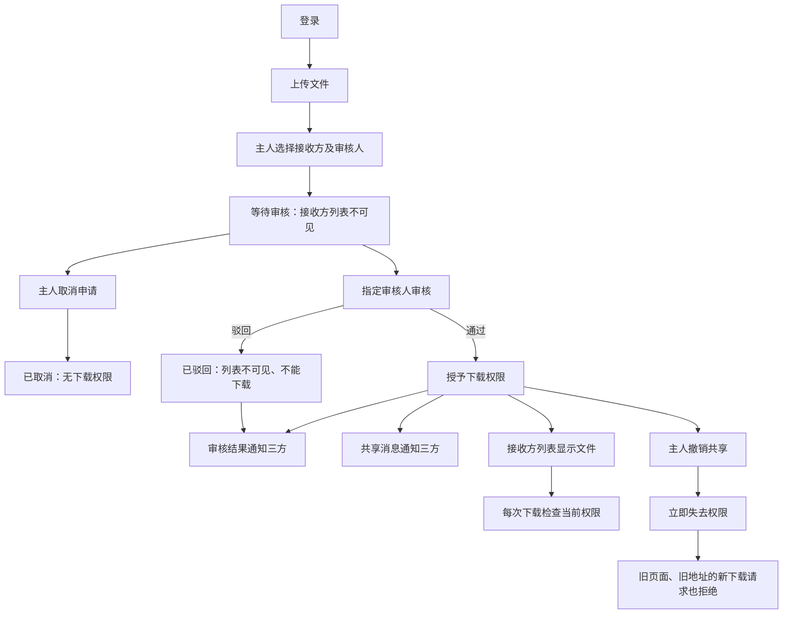
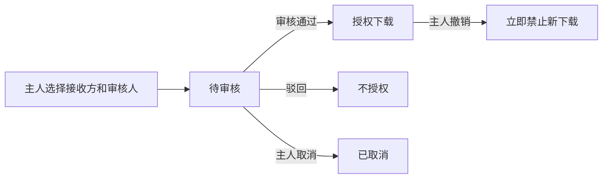

# Independent lifecycle trial: visible development dialogue

Trial prompts and follow-ups delivered by the coordinating AI are scripted-user records. They are not independent human usability evidence.

Local paths are normalized as listed in dialogue.json. Original trial answers and checks are archived separately.

## 01 · scripted-user · 2026-10-31T00:12:36.820Z

$vibelens

我要做一个简单的团队文件共享应用：用户登录后上传文件，可以把文件共享给另一个成员；共享需要审核，审核结果和共享消息在站内通知对方，获得权限的人可以下载，文件主人可以撤销共享。先和我确认必要的业务细节，给我看业务网，我确认后再开发。

本轮只在 WORKSPACE 中工作。先读该目录的 AGENTS.md，并使用其中 .agents/skills/vibelens/SKILL.md 的当前项目版本。源代码和注释用英文，对话用中文，保留 review 下的实际对话与验收材料。不要修改维护仓库和其他项目，不要发布。这里是独立试用，后续回复由测试协调者模拟用户提供，收到答案之前不要自行确认。

可用的基础 Python 是 C:/Users/Lvi_P/Documents/Work/CF/平台软著/SoftwareStatusObserverSkill/.venv/Scripts/python.exe；使用时加 -B -X utf8。优先使用空闲端口，启动服务时记录可访问的应用和 graph 地址。

## 02 · assistant · 2026-10-31T00:12:39.440Z

我会先读取试用目录的约束和当前项目版 VibeLens 技能，梳理需要你确认的业务细节；业务网确认前先不开发。

## 03 · assistant · 2026-10-31T00:12:54.425Z

我已启用本目录的 VibeLens 技能。当前要确认的关键点是：谁审核、何时获得下载权限、通知发给谁，以及撤销如何生效。技能还要求确认运行模式和数据库选择；我会把这些待定项标在业务网中。

## 04 · assistant-question · 2026-10-31T00:13:51.646Z

{"questions":[{"title":"谁负责审核共享申请：固定管理员，还是由文件主人指定审核人？","options":["固定管理员审核","文件主人指定审核人"]},{"title":"审核通过、驳回的结果和共享消息分别通知谁？例如：结果通知文件主人，通过后再向接收方发送共享消息。"},{"title":"VibeLens 运行模式选哪一种？drive：由状态声明驱动业务流转；observe：应用自行执行，图负责观察。两种都会维护业务网和监控。","options":["drive：声明驱动","observe：应用执行、图观察"]}]}

## 05 · assistant · 2026-10-31T00:14:38.019Z

业务网草稿已记录登录、上传、申请共享、审核、通知、下载和撤销流程，审核人与通知对象仍标为待确认。当前只准备设计图；撤销的生效规则和存储选择会在收到首轮回答后继续确认。

## 06 · assistant · 2026-10-31T00:15:57.671Z

设计记录和权限规则草稿已通过结构校验；这不代表业务已确认。设计服务首次后台启动后未持续运行，我正在修正启动方式并检查网页可访问性。当前没有业务应用或运行记录。

## 07 · scripted-user · 2026-10-31T00:16:22.676Z

【模拟用户回答，供本轮独立试用】
用固定管理员审核。文件主人向指定的成员发起共享；审核结果通知文件主人，通过后再给接收方发一条共享消息。审核通过前和驳回后，接收方都不能下载，也不用在他的列表里显示待审核申请。
运行模式选 drive，由确认后的状态声明驱动。

## 08 · assistant · 2026-10-31T00:16:41.609Z

已记录这次模拟用户回答：固定管理员审核；结果通知文件主人，通过后才通知接收方；待审核和驳回的申请对接收方不可见、不可下载；运行模式选择 drive。我会更新同一张业务网，保留“模拟回答”的证据标记。

## 09 · assistant-question · 2026-10-31T00:16:42.842Z

{"questions":[{"title":"文件主人能否取消待审核的共享，还是只能撤销已通过的共享？撤销后，接收方在未刷新页面再次点击下载时，是否应立即拒绝？"},{"title":"本地试用建议用 SQLite + SQLAlchemy 保存成员、文件记录、共享申请和站内通知，文件内容保存在项目目录；这样无需另启数据库服务。是否采用？","options":["采用 SQLite + SQLAlchemy","另有数据库要求"]}]}

## 10 · scripted-user · 2026-10-31T00:17:18.937Z

【模拟用户回答】
待审核的共享也可以由文件主人取消；已通过的共享可以撤销。撤销后立即失去下载权限，即使接收方没刷新页面、还拿着旧下载地址，再次请求下载也要拒绝。已经下载到本地的文件不追回。
采用 SQLite + SQLAlchemy，文件放在本项目自己的数据目录。

## 11 · assistant · 2026-10-31T00:17:36.284Z

已记录第二次模拟回答：待审核申请可取消，已通过共享可撤销；撤销后每次下载请求都立即检查当前权限，旧页面和旧地址也会被拒绝；本地副本不追回。存储采用 SQLite + SQLAlchemy，文件放在本项目数据目录。接下来展示更新后的业务网，等待你的确认。

## 12 · user · 2026-10-31T00:17:49.711Z

<send_user_message_question_reply>
[{"questionItemId":"[\"request_user_input_async\",\"call_677d152efb2741b6a9791738d79a20aa\",0]","question":"谁负责审核共享申请：固定管理员，还是由文件主人指定审核人？","answer":"文件主人指定审核人"},{"questionItemId":"[\"request_user_input_async\",\"call_677d152efb2741b6a9791738d79a20aa\",1]","question":"审核通过、驳回的结果和共享消息分别通知谁？例如：结果通知文件主人，通过后再向接收方发送共享消息。","answer":"相关的所有人"},{"questionItemId":"[\"request_user_input_async\",\"call_677d152efb2741b6a9791738d79a20aa\",2]","question":"VibeLens 运行模式选哪一种？drive：由状态声明驱动业务流转；observe：应用自行执行，图负责观察。两种都会维护业务网和监控。","answer":"drive：声明驱动"},{"questionItemId":"[\"request_user_input_async\",\"call_e390e1620f194103aa5ba54cc4669122\",0]","question":"文件主人能否取消待审核的共享，还是只能撤销已通过的共享？撤销后，接收方在未刷新页面再次点击下载时，是否应立即拒绝？","answer":"可以，是的"},{"questionItemId":"[\"request_user_input_async\",\"call_e390e1620f194103aa5ba54cc4669122\",1]","question":"本地试用建议用 SQLite + SQLAlchemy 保存成员、文件记录、共享申请和站内通知，文件内容保存在项目目录；这样无需另启数据库服务。是否采用？","answer":"采用 SQLite + SQLAlchemy"}]
</send_user_message_question_reply>

## 13 · assistant · 2026-10-31T00:18:09.457Z

收到这组较新的回答。我会将审核人改为“文件主人指定”，保留此前固定管理员方案的变更记录；drive、取消待审核、撤销立即阻止新下载和 SQLite 的选择保持已确认。“相关的所有人”还需明确对应哪些通知对象。

## 14 · assistant-question · 2026-10-31T00:18:10.623Z

{"questions":[{"title":"“相关的所有人”是否指文件主人、指定审核人、接收成员三方，都收到通过／驳回结果和通过后的共享通知？接收方的文件列表仍只显示已获授权的文件。","options":["是，三方都通知，列表规则不变","通知对象或列表规则需要调整"]}]}

## 15 · user · 2026-10-31T00:18:24.708Z

<send_user_message_question_reply>
[{"questionItemId":"[\"request_user_input_async\",\"call_213ca0e344c34ea8bde062e68042c512\",0]","question":"“相关的所有人”是否指文件主人、指定审核人、接收成员三方，都收到通过／驳回结果和通过后的共享通知？接收方的文件列表仍只显示已获授权的文件。","answer":"是，三方都通知，列表规则不变"}]
</send_user_message_question_reply>

## 16 · assistant · 2026-10-31T00:20:44.581Z

三方通知的范围已确认，业务细节已补齐。我正在处理设计页的本地访问问题；只启动设计查看器，业务开发仍等待业务网确认。

## 17 · scripted-user · 2026-10-31T00:22:50.693Z

【测试协调信息，不是业务答案】
我已用独立 Chromium 实际打开 http://127.0.0.1:60296/graph?lang=zh-CN，确认 stage=design、108 个完整图节点、132 条关系、0 条运行事件，页面无 JS 报错；截图和实际设计 JSON 已留在维护仓库 docs/review/dialogue-acceptance-20261031/design/。默认沙箱里的 localhost 请求与主机网络可能不同，主机权限下的浏览器检查已成功。请继续按最新真实用户问答更新同一张图，展示到对话中并请求业务网确认。优先采用真实用户最新的“主人指定审核人、三方通知”等回答，不要回退到我之前的模拟答案。
后续业务实现完成后请保留应用和观测服务可用，方便我独立逐项检查。

## 18 · assistant · 2026-10-31T00:23:46.165Z

已按最新回答更新：**文件主人指定审核人；审核结果和通过后的共享消息通知三方**。三方指文件主人、指定审核人和接收成员。

[打开完整业务网及权限规则](http://127.0.0.1:60296/graph)

采用 **drive、SQLite + SQLAlchemy**，文件放在本项目数据目录。已经下载的本地副本不追回。目前只有设计查看器，尚未开发业务应用。

**请确认：这张业务网是否正确，可以按它开始开发？**

<oai-mem-citation>
<citation_entries>
MEMORY.md:76-83|note=[Prior trial dialogue boundaries and schema cautions checked against the current local Skill]
</citation_entries>
<rollout_ids>
01a18332-cb51-7471-83f8-990d88886b9d
</rollout_ids>
</oai-mem-citation>

## 19 · scripted-user · 2026-10-31T00:23:46.189Z

【模拟用户确认】
我打开当前业务图看过了，按最新的这一版继续：主人指定审核人，审核结果通知三方，通过后接收方才出现在文件列表里并能下载；待审核能取消，通过后能撤销，撤销后旧地址也不能再下载。这张业务网符合当前意图，可以开始开发。
登录先用本地预置测试账号即可，暂时不做注册。请把确认后的简图也保留在对话里，方便回顾。

## 20 · assistant · 2026-10-31T00:23:50.292Z

已记录这次模拟确认：按最新版业务网开始开发，登录使用本地预置测试账号，暂不做注册。我会保留确认后的简图，并把状态流转、权限检查、数据库操作和实际运行证据接到同一张图中。

## 21 · assistant · 2026-10-31T00:24:10.930Z

前端会用清晰的文件列表、待审核列表和消息中心呈现业务，采用 `frontend-design` 技能整理界面。Sites 技能按本地模式使用，不注册或发布站点。

## 22 · assistant · 2026-10-31T00:26:24.596Z

确认后的核心流程保留如下：

审核结果通知三方，通过后再发送共享消息。实现会在每次下载请求时读取当前权限，确保旧页面和旧地址不能绕过撤销。

## 23 · assistant · 2026-10-31T00:29:05.138Z

业务层已写入登录、上传、指定审核、三方消息、取消和撤销逻辑。状态与通知放在同一个 SQLite 事务中，避免出现“已通过但消息未保存”的中间结果。接下来接入图和观测，并用独立案例检查权限与业务结果；目前还没有通过运行验收。

## 24 · assistant · 2026-10-31T00:36:46.552Z

界面已写入“我的文件、收到的文件、待审核、消息中心”。验证案例会覆盖指定审核人、三方消息、取消后迟到的审批，以及撤销后的旧地址下载；接下来运行这些案例，并核对图中记录的值是否与数据库一致。

## 25 · scripted-user · 2026-10-31T00:38:34.726Z

【验收记录要求，不是业务变更】
请给失败、修复、复测日志使用不同的尝试编号，避免后一次运行覆盖同名 unit-test、change-inspect、verify 日志。已经发生的失败请从本会话实际工具输出如实补存，保留原因和修复位置；不能只剩最后的通过文件。继续完成当前实现和既有严格检查即可。

## 26 · assistant · 2026-10-31T00:38:45.935Z

会为后续失败、修复和复测使用独立尝试编号，并补存已经发生的失败。当前发现两类问题：测试读取器没有及时关闭 SQLite 连接，影响 Windows 清理测试目录；图检查还缺少部分来源和规则映射。我会修复后按原有检查复测。

## 27 · assistant · 2026-10-31T00:41:11.152Z

12 项独立业务测试已通过，包括撤销后旧地址拒绝下载、取消与审批竞争、通知隔离和事务回滚。已通过场景还捕获了 199 条真实事件和 9 次权限判定，未发现丢弃或采集错误。静态映射检查目前也无错误，接下来运行完整验证。

## 28 · assistant · 2026-10-31T00:44:49.027Z

应用与观测服务均已启动，两个地址都返回正常：

- [团队文件应用](http://127.0.0.1:50643/)
- [运行图](http://127.0.0.1:50642/graph)

架构隔离检查已通过。完整的开、关、故障三种观测模式验证仍在运行，我会继续检查浏览器中的实际操作。

