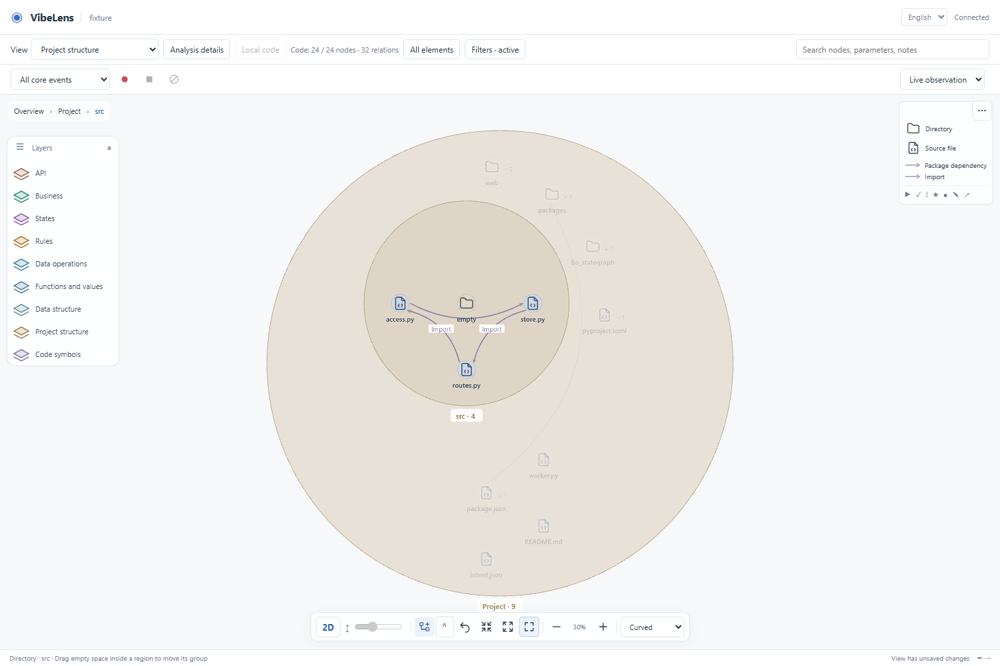
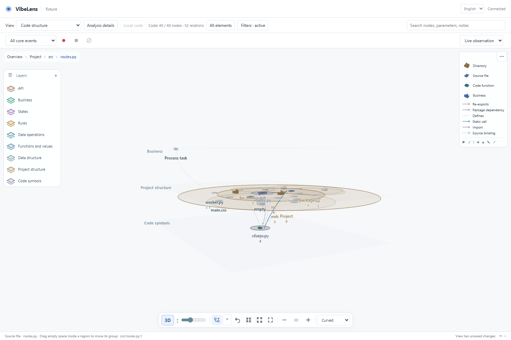

# Engineering structure acceptance

Date: 2026-10-29. Branch: `feat/engineering-structure`.

## Delivered scope

The optional source index now separates the physical project tree from code
symbols. Project structure contains directories, files, import/re-export edges,
direct package declarations and filesystem links. Files connect to existing
class/function/parameter declarations and authored source bindings in one graph.
The tree is scanned, not authored by the coding agent.

The same index serves CLI JSON export, maintenance refresh, focused queries and
the native 2D/3D viewer. File IDs remain stable across content edits. The new
directory role has a Tabler 2D icon, an instanced 3D folder and cheaper distant
geometry. Existing filters and layer order are migrated once; deliberate narrow
selections, positions, annotations and collapsed directories are retained.

## Source boundaries

| Module | Responsibility |
|---|---|
| `code_graph/filesystem.py` | Declared roots, physical entries, hashes, exclusions and non-traversed links. |
| `code_graph/manifests.py` | Direct npm/PEP 621 declarations; explicit local package targets. |
| `code_graph/structure.py` | Containment, distinct file-dependency counts and iterative cycle detection. |
| `code_graph/index.py` | Join engineering facts to existing source symbols and typed relations. |
| `code_graph/query.py` | Bounded projections, ancestor context and omission counts. |
| `code_graph/service.py` | Revision invalidation, saved-index checks and source-reading scope. |

Python syntax and the existing pinned TypeScript/Vue compilers provide dependency
facts. No application source is executed by scanning. Managed observer caches,
personal view files and recording data do not become application events or
invalidate the engineering revision.

## Browser acceptance

The isolated fixture contains actual Python, TypeScript, Vue, CSS, HTML and package
manifests, including a deliberate three-file Python import cycle. This is source
analysis acceptance, not a new file-sharing application acceptance.

The executable test is [test_engineering_browser.py](../../../tools/test_engineering_browser.py).
It exercises the actual viewer and HTTP service with Python Playwright:

- Project projection contains file/directory relations and excludes symbols.
- Directory expansion reveals files; source opens the complete current file.
- Native 3D shows separate business, project and code planes and accepts camera dragging.
- Adding source refreshes the displayed graph while keeping existing positions.
- Expanded and deliberately collapsed directories both survive reload.
- Chinese labels and the English default remain available.
- Observer requests create zero business events.

Final results and screenshots are in [browser](browser/).





## Failures and repairs

| Observed failure | Repair and regression |
|---|---|
| Extending the file inventory made ordinary JSON readable through the source endpoint. | Preserve the old allowlist boundary; structural entries and readable source are separate. Original 22 code-index tests pass unchanged. |
| The new folder object had no cheaper distant geometry. | Retain the folder shape with fewer parts in dense mode. Existing geometry regression and new engineering-view regression check the difference. |
| The layer-ruler test assumed exactly eight semantic layers. | Check `(layers.length - 1) * gap`; retain uniform spacing and hidden-plane assertions. Original failure: [full-verify-before.txt](full-verify-before.txt). |
| Updating managed example copies invalidated their old seals/receipts. | Restore the accepted baseline, open a checked iteration, regenerate/seal, verify and accept new records. Original failure: [full-verify-managed-before.txt](full-verify-managed-before.txt). Earlier frozen records remain unchanged. |
| A same-name package could be mistaken for a local dependency. | Resolve explicit local declarations only; add an ordinary-version-versus-file-reference counterexample. |
| Bounded node queries initially returned unbounded engineering metadata. | Return only loaded project entries and complete loaded cycles, with explicit omitted counts. Full scan/export retains the entire structure. |
| A browser reload cancelled a source response and produced a second write to the closed socket. | Treat connection aborts during response writes as cancellation; test both header and body interruption without emitting business events. |
| First opening the engineering view kept the prior overview's zoom, and raw containment edges kept redundant center glyphs. | Initialize layout once for new source-only views, preserve saved layouts, and recognize typed containment before circle rendering. Browser acceptance now checks automatic initial fit. |

Browser harness adjustments were separate: continuous polling prevents a generic
network-idle wait, so acceptance waits for actual graph/layout readiness. From a
top camera, dragging upward changes the polar angle. Browser launch required the
host execution context because the Windows sandbox rejected Chromium.

## Validation and limits

See `validation.json`, test logs and the performance receipt alongside this file
for final command outcomes. Mapping checks remain separate from business/state
correctness; existing example scenarios and capture requirements are preserved.

The 1500-file cycle benchmark checks that only the edited source unit is reparsed.
Full byte/inventory verification still runs, so its timings are not a low-latency
guarantee. The Windows file-symlink creation test may be skipped when the host lacks
that privilege; the report records the actual count.

HTML/CSS reference extraction, arbitrary build-tool configuration, TS aliases,
transitive lockfile dependencies and runtime-derived file dependencies are outside
this implementation. Literal relative CSS imports are supported as source edges.
Renaming/moving a file changes its path identity; explicit aliases remain the
existing mechanism for migrating personal layout.

## Use

Select **Project structure** (工程结构) in the running viewer. Expand a directory
to inspect files and imports; use **Code structure** (代码结构) or **Local code**
to continue to declarations and parameters. Once enabled, source maintenance and
viewer requests refresh the shared index.

```bash
python skills/vibelens/scripts/bo_code.py scan --root PROJECT --out review/source-graph.json
python skills/vibelens/scripts/bo_code.py query --root PROJECT --projection project --out review/project-tree.json
python skills/vibelens/scripts/bo_code.py check --root PROJECT
```
