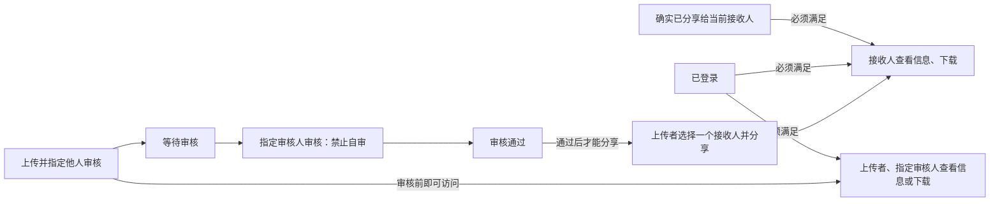

# Discovery-only trial 01: caption overlap

Trial prompts and follow-ups delivered by the coordinating AI are scripted-user records. They are not independent human usability evidence.

Local paths are normalized as listed in dialogue.json. Original trial answers and checks are archived separately.

## 01 · scripted-user · 2026-10-31T11:08:17.163Z

$vibelens

请使用当前本地的 Skill：C:/Users/Lvi_P/Documents/Work/CF/平台软著/SoftwareStatusObserverSkill/skills/vibelens/SKILL.md。

我要做一个小团队的文件共享网页。上传后交给同事审核，审核通过才能分享给指定的人，文件只能登录后访问。先在本机用 Python 和 SQLite 跑起来，我想用 VibeLens 看里面怎么运转。先把需要确认的需求跟我聊清楚，再开始实现。

请在 WORKSPACE 建立独立工程。和我用中文交流，源码、标识符和注释用英文，保留对话与实际测试材料在 review/ 下。请使用独立的本地服务和空闲端口，不修改已有工程。上面的 VibeLens 维护仓库仅供读取；如果发现 Skill、框架或 Web 的问题，记录实际问题与复现方法，先反馈，不要在维护仓库或安装副本中打补丁。

## 02 · assistant · 2026-10-31T11:08:19.794Z

我会先阅读指定的 VibeLens Skill，梳理需要确认的业务规则，并把对话与后续验证材料保留在独立工程的 `review/` 下。需求确认后再开始实现。

## 03 · assistant-question · 2026-10-31T11:08:50.929Z

{"questions":[{"title":"VibeLens 的两种接入方式都会维护流程图和运行记录：drive 让程序按状态声明执行；observe 让程序自己处理业务，VibeLens 观察实际执行。这个工程选哪一种？","options":["observe：程序自己执行业务，VibeLens 观察","drive：由状态声明驱动业务执行"]},{"title":"上传后，审核人由谁确定？审核人能否审核自己上传的文件？审核通过后，由谁选择接收人并发起分享？"},{"title":"你说的“访问文件”需要哪些能力：查看文件信息、下载、网页预览？另外，上传者和审核人在审核通过前是否可以读取文件内容？"}]}

## 04 · assistant · 2026-10-31T11:09:07.868Z

目前明确的流程是：上传文件 → 同事审核 → 审核通过后分享给指定人员 → 登录后访问。审核人、分享人的权限，以及“访问”具体包含哪些操作，仍待你确认；我会先在图中标出这些问题。

## 05 · assistant · 2026-10-31T11:11:09.057Z

独立工程和需求草图已建立，记录校验通过，三项问题都保持待回答。接下来启动只读图谱页，方便你对照流程确认；业务代码会等规则确认后再写。

## 06 · assistant · 2026-10-31T11:12:43.348Z

图谱服务打印了启动地址，但页面访问目前超时，还不能确认 Web 可用。我会保留启动和访问结果，区分本机环境问题与 VibeLens 问题；这不影响继续确认需求。

## 07 · assistant · 2026-10-31T11:15:33.049Z

需求图现在已能正常打开，页面和两个只读 API 都返回成功，界面显示“设计声明 · 尚未实现”。此前的访问问题已通过停止沙箱服务、改用宿主机服务解决，目前没有证据表明需要修改 VibeLens。

## 08 · scripted-user · 2026-10-31T11:15:39.215Z

就按状态图来驱动吧。上传时由上传者从已有用户里选审核人，不能自己审核自己上传的文件。审核通过后，还是由上传者选一个接收人并发起分享。

访问先做文件信息和下载，暂时不用网页预览。上传者和指定审核人在审核前可以下载，其他人不可以；接收人要等审核通过、并且确实分享给他以后才能下载。

先把按这些规则更新后的流程图给我看一下。

## 09 · assistant · 2026-10-31T11:15:58.342Z

我会按你的回答更新同一张图：采用状态图驱动，明确上传者、指定审核人和接收人的权限，并分别画出审核前可下载的路径，以及接收人获准下载的条件。

## 10 · user · 2026-10-31T11:16:58.706Z

<send_user_message_question_reply>
[{"questionItemId":"[\"request_user_input_async\",\"call_f008bc1c622e4c04a7144bb08eaf27bf\",0]","question":"VibeLens 的两种接入方式都会维护流程图和运行记录：drive 让程序按状态声明执行；observe 让程序自己处理业务，VibeLens 观察实际执行。这个工程选哪一种？","answer":"drive：由状态声明驱动业务执行"},{"questionItemId":"[\"request_user_input_async\",\"call_f008bc1c622e4c04a7144bb08eaf27bf\",1]","question":"上传后，审核人由谁确定？审核人能否审核自己上传的文件？审核通过后，由谁选择接收人并发起分享？","answer":"上传者决定，管理员，上传者"},{"questionItemId":"[\"request_user_input_async\",\"call_f008bc1c622e4c04a7144bb08eaf27bf\",2]","question":"你说的“访问文件”需要哪些能力：查看文件信息、下载、网页预览？另外，上传者和审核人在审核通过前是否可以读取文件内容？","answer":"最简单的查看和下载就行"}]
</send_user_message_question_reply>

## 11 · assistant · 2026-10-31T11:17:18.446Z

已确认采用 `drive`，由上传者指定审核人、发起分享，访问只做文件信息和下载。你在问答中补充的“管理员”含义还不明确，我会在图中保留待确认标记。

## 12 · assistant-question · 2026-10-31T11:17:19.030Z

{"questions":[{"title":"你在第二项回答中的“管理员”具体指什么？它是否修改了你前面“从已有用户中选审核人，不能审核自己上传的文件”的规则？"}]}

## 13 · scripted-user · 2026-10-31T11:17:19.107Z

补充一个运行环境的检查结果：我从宿主机访问 http://127.0.0.1:62428/api/design 返回了 200，实际进程也是刚才启动的 89976。你那边的超时应先按执行环境的本地网络隔离排查，别把它当作业务规则或框架缺陷。这条只是环境信息，前面回答的业务规则没有变化。

## 14 · assistant · 2026-10-31T11:20:38.116Z

更新后的流程和权限网络已同步到 Web，对话与浏览器材料也已保存。页面中有两处长标签重叠，我会记录复现，不修改查看器源码；回复中会附上更容易阅读的流程图。

## 15 · scripted-user · 2026-10-31T11:20:56.159Z

更准确一点：审核人只能从管理员账号中选，普通用户不能审核。管理员也不能审核自己上传的文件，要交给另一位管理员。分享接收人仍由上传者在审核通过后选择。

管理员没有查看所有文件的特权，只能读自己的文件，或者明确分给自己审核、接收的文件。这次先用预置账号，不做注册和账号管理页面。

## 16 · assistant · 2026-10-31T11:21:16.424Z

规则已明确：只能选管理员审核，管理员也不能自审；管理员身份本身不带来全局文件读取权。我会把这些限制更新进流程和权限图，并记录本轮只用预置账号、不做注册或账号管理页面。

## 17 · user · 2026-10-31T11:21:16.736Z

<send_user_message_question_reply>
[{"questionItemId":"[\"request_user_input_async\",\"call_ff17bf71ee0947938e0ee01d44a7fe21\",0]","question":"你在第二项回答中的“管理员”具体指什么？它是否修改了你前面“从已有用户中选审核人，不能审核自己上传的文件”的规则？","answer":"写错了，按照之前的原则来"}]
</send_user_message_question_reply>

## 18 · assistant · 2026-10-31T11:21:53.036Z

收到，按你最新的更正，以最初的规则为准：上传者从已有用户中选审核人，任何人都不能审核自己上传的文件。我会撤回“仅管理员可审核”的限制，其余分享和访问规则保持不变。

## 19 · assistant · 2026-10-31T11:24:06.174Z

已按你最新更正更新：**审核人从已有用户中选择，禁止自审，采用 `drive` 模式。**

[打开本机 VibeLens 图谱](http://127.0.0.1:62428/graph)。下面展示业务主线，完整权限网络可在 Web 中展开。

无关联人员不能读取文件，本轮不做网页预览。对话和检查材料已保存在工程的 `review/` 中。Web 部分标签存在重叠，已记录复现材料 (`WORKSPACE/review/viewer-layout-issue.md`)，未修改查看器源码。

指定的 VibeLens Skill (`C:/Users/Lvi_P/Documents/Work/CF/平台软著/SoftwareStatusObserverSkill/skills/vibelens/SKILL.md`) 要求“continue once that scope is confirmed”。请确认这张图是否符合你的意思，确认后开始业务实现。

<oai-mem-citation>
<citation_entries>
MEMORY.md:76-77|note=[preserve design-first dialogue and independent trial evidence]
MEMORY.md:83-85|note=[verify current local graph contracts and source isolation]
</citation_entries>
<rollout_ids>
01a18332-cb51-7471-83f8-990d88886b9d
</rollout_ids>
</oai-mem-citation>

## 20 · scripted-user · 2026-10-31T11:30:23.799Z

业务主线我看明白了，先保留当前确认过的规则。这次先停在需求阶段，不开始业务实现。页面上的标签重叠要先在 VibeLens 维护项目中处理，再用新的独立对话复测。请保留这次实际对话、图、校验失败及截图，写明还没有业务程序和运行验收；不要修改 Skill、框架或安装副本，也不用再为这次试用补造数据。

## 21 · assistant · 2026-10-31T11:30:29.360Z

我会把本次试用记录收束为“停在需求阶段”，保留实际对话、图、校验失败和截图，并明确标注尚无业务程序、尚未做运行验收。

## 22 · assistant · 2026-10-31T11:32:59.169Z

我会保留原始失败记录和后续通过结果，并注明它们只验证了需求记录与图谱展示。接下来关闭本次启动的临时图谱服务；标签重叠问题留给维护项目处理，本次不修补、不补造数据，也不进行复测。

## 23 · assistant · 2026-10-31T11:34:50.154Z

已停在需求阶段，保留当前规则。**尚无业务程序、业务数据库，也未进行运行验收。**

实际对话、流程图、校验失败和截图均已保留，并生成文件校验清单，见归档说明 (`WORKSPACE/review/closure.md`)。

临时图谱服务已关闭。未修改 Skill、框架或安装副本，未补造数据。标签重叠的复现材料已保存，修复和新独立对话复测留待后续进行。

<oai-mem-citation>
<citation_entries>
MEMORY.md:76-77|note=[preserve requirements-first scope and independent trial evidence]
</citation_entries>
<rollout_ids>
01a18332-cb51-7471-83f8-990d88886b9d
</rollout_ids>
</oai-mem-citation>
