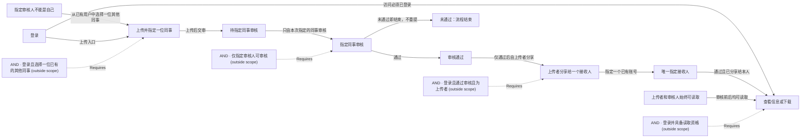

# Business network draft

[Open the live graph](http://127.0.0.1:8973/graph)

This is a focused view. Dashed boundaries retain original relations; open Web for the complete graph.

Still to confirm:

- 这版业务图是否符合你的意思？确认后我再开始实现。

Confirm this understanding in the conversation, or describe a correction. Viewing the graph is not confirmation.
