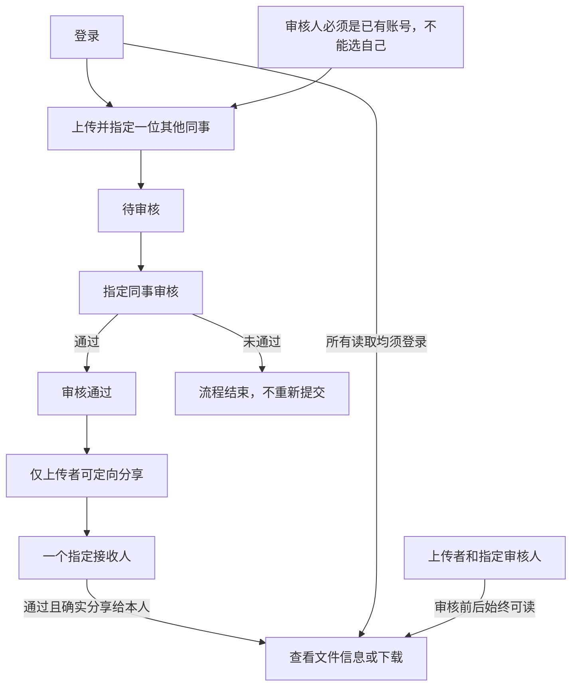

# Trial 03: confirmed design and frozen handoff

Trial prompts and follow-ups delivered by the coordinating AI are scripted-user records. They are not independent human usability evidence.

Local paths are normalized as listed in dialogue.json. Original trial answers and checks are archived separately.

## 01 · scripted-user · 2026-10-31T12:51:34.720Z

$vibelens
请使用当前本地 Skill：C:/Users/Lvi_P/Documents/Work/CF/平台软著/SoftwareStatusObserverSkill/skills/vibelens/SKILL.md。

我继续做那个小团队文件共享网页：上传者从已有账号里指定一位其他同事审核，审核通过以后，由上传者分享给一个接收人。查看只做文件信息和下载；上传者与指定审核人一直可以读取，接收人要等审核通过且确实分享给他以后才能读取，其他人没有权限，接收人不能再转发。审核未通过就结束，先不做重新提交。用几个固定测试账号就好，不做注册或账号管理。Python、SQLite，按状态图驱动开发。

上面这些需求已经确认。这次放到新的独立工程 WORKSPACE。可以复用之前冻结工程 C:/Users/Lvi_P/Documents/Work/CF/平台软著/VibeLensTrials/execution-bands-dialogue-20261031-02 中的业务源码、状态声明、需求和独立检查，先给我看复用后的业务图，我确认后再继续接入、运行和迭代。

在新目录重新安装当前 VibeLens，使用独立项目 ID、数据和端口。旧工程、维护仓库和安装副本只读；不要沿用旧观察器、运行记录、数据库、审批结果或旧观测基线，保留已有独立检查及严格要求。中文交流，源码和注释用英文，保留实际失败、修复、复测和截图到 review/。如果发现共享 Skill、框架或查看器的问题，记录并反馈，不要在示例中绕过，不发布。这次业务用户由协调 AI 模拟，请在审查材料中如实标明。

## 02 · assistant · 2026-10-31T12:51:38.060Z

我先读取当前 VibeLens Skill 和相关记录，核对冻结工程可复用的内容，再在新目录整理业务图供你确认。

## 03 · assistant · 2026-10-31T12:51:57.386Z

我会按你指定的当前本地 VibeLens Skill 执行。这一阶段只复用业务源码、声明和独立检查，安装本轮工具并展示设计图；业务接入、启动和测试等你确认图后再进行。审查材料会明确标注业务用户由协调 AI 模拟。

## 04 · assistant · 2026-10-31T12:52:31.207Z

冻结工程的业务规则与本次要求一致，但它因共享框架的运行映射检查失败而停止，未获验收。本轮会保留原有严格检查，重新建立安装、项目身份和证据目录；旧工程的通过记录、录制和观测基线不会带入。

## 05 · assistant · 2026-10-31T12:54:54.673Z

新工程已完成白名单复用：保留了业务源码、原生状态声明、需求和独立检查，排除了旧接入代码、数据库及证据。下面只验证本轮设计图能正常打开，图中仍会明确标注“待确认、无运行证据”。

## 06 · assistant · 2026-10-31T12:55:57.508Z

需求校验已通过，唯一待确认项是这次业务图的批准。安装时遇到本机沙箱临时目录权限问题；改用新工程自己的临时目录后，依赖安装工具已恢复，相关失败和复测日志已保留。

## 07 · assistant · 2026-10-31T12:59:41.399Z

共享工具和查看器已从当前 Skill 独立安装。设计图将使用 8983 端口；业务服务保留 8982 端口，尚未启动，业务数据库也尚未创建。当前仍在处理独立环境的依赖安装，随后核对图页、项目身份和空事件列表。

## 08 · assistant · 2026-10-31T13:02:42.642Z

设计图已在浏览器中正常显示，中文界面、独立项目 ID 和零运行事件均已核对。初始化声明中的格式错误也已修正并复测通过。接下来保存截图和同源业务图预览，然后停在你要求的确认点。

## 09 · assistant · 2026-10-31T13:06:48.434Z

已在新工程完成复用和独立安装，停在**业务图确认阶段**。业务尚未接入或运行，旧数据库、录制、审批结果和观测基线均未沿用。

[打开本轮交互业务图](http://127.0.0.1:8983/graph?vl_session=8f1c866f21c48d08afdc3ca919e49fc4)

接收人不能转发；其他人没有读取权限。固定测试账号、Python、SQLite 和状态图驱动方式保持不变。

审查材料已注明**业务用户由协调 AI 模拟**。独立检查及严格要求已保留，本轮业务、映射和录制验收尚未执行。查看审查记录 (`WORKSPACE/review/STATUS.md`)

查看器初始缩放偏小的问题已记录，未修改共享查看器或做示例绕过。实际截图如下：

本轮业务图截图 (`WORKSPACE/review/design-graph-001.png`)

**请确认这版业务图；确认后再继续接入、运行和迭代。**

<oai-mem-citation>
<citation_entries>
MEMORY.md:77-77|note=[language and isolated trial evidence conventions]
MEMORY.md:83-83|note=[discovery schema and exact local Skill routing]
</citation_entries>
<rollout_ids>
01a18332-cb51-7471-83f8-990d88886b9d
</rollout_ids>
</oai-mem-citation>

## 10 · scripted-user · 2026-10-31T13:14:37.674Z

业务图中的规则符合我的意思，按这版保留。先停在当前准备阶段，不开始业务接入和运行。26% 缩放时节点标题被裁掉的问题已在共享查看器中复现，会先修正。请保留这次图确认、零运行数据、安装和失败复测材料，保持工程不再变动；之后由新的对话在这个已准备的工程里继续，这样也能检查从项目文件恢复需求的情况。本次仍未通过业务或运行映射验收。

## 11 · assistant · 2026-10-31T13:14:42.947Z

我会记录这次业务图确认和暂停要求，核对零运行数据及已有材料，然后冻结工程，不开始业务接入或运行。

## 12 · assistant · 2026-10-31T13:16:11.375Z

业务图已确认，这次确认只批准图中的规则。本轮仍暂停在准备阶段，不开始接入、运行或迭代。设计服务已停止；我会补齐项目内的确认与交接记录，并保留原始截图、失败和复测材料。

## 13 · assistant · 2026-10-31T13:18:41.140Z

已通过主机进程和监听表确认：设计服务已退出，8982、8983 均未监听，业务数据库和运行接入仍未创建。交接记录已区分“业务图已确认”和“业务、运行映射尚未验收”；现在只完成最后的冻结清单。

## 14 · assistant · 2026-10-31T13:19:18.023Z

已记录业务图确认，并冻结当前工程。

- 未开始业务接入或运行；运行事件为零。
- 设计服务已停止，8982/8983 均无监听。
- 安装、截图、失败与复测材料完整保留，冻结清单已校验。
- 本次仍未通过业务或运行映射验收。

后续新对话可从 RESUME.md (`WORKSPACE/RESUME.md`) 恢复需求和边界。当前不再改动工程。

<oai-mem-citation>
<citation_entries>
MEMORY.md:58-58|note=[simulated dialogue kept distinct from runtime acceptance]
</citation_entries>
<rollout_ids>
01a18332-cb51-7471-83f8-990d88886b9d
</rollout_ids>
</oai-mem-citation>
