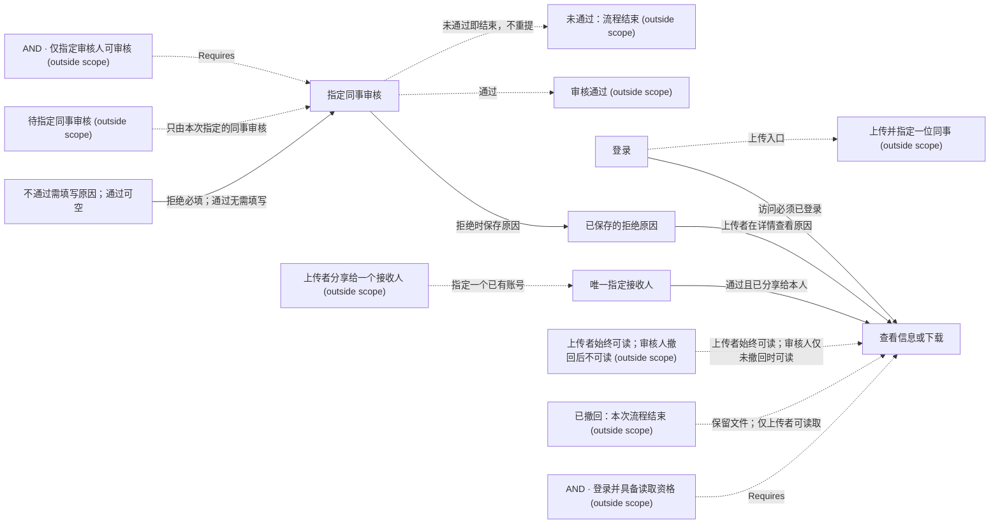

# Business network draft

[Open the live graph](http://127.0.0.1:8986/graph)

This is a focused view. Dashed boundaries retain original relations; open Web for the complete graph.

Still to confirm:

- 拒绝时原因必填并保存，上传者在详情看到原文；通过时无需填写，现有审核与读取权限保持。业务图将按这条分支更新，这样理解是否正确？

Confirm this understanding in the conversation, or describe a correction. Viewing the graph is not confirmation.
