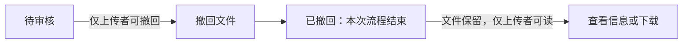
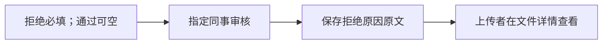

# VibeLens file sharing: accepted v1 and two ordinary business iterations

Trial prompts and follow-ups delivered by the coordinating AI are scripted-user records. They are not independent human usability evidence.

Local paths are normalized as listed in dialogue.json. Original trial answers and checks are archived separately.

## 01 · scripted-user · 2026-10-31T20:10:09.435Z

$vibelens /vibelens 聚焦上传、审核、分享和读取的业务链，只保留业务和权限判断，自动整理布局；再在本轮明确停止的录制中筛选这条链路。明确仅在这个会话和下面的项目中启用。请先阅读维护中的 Skill：C:/Users/Lvi_P/Documents/Work/CF/平台软著/SoftwareStatusObserverSkill/skills/vibelens/SKILL.md。

继续已有文件共享工程 WORKSPACE。先读项目 AGENTS.md、review/retest-20261101-04/RESUME.md 和 coverage.md。当前任务明确解除上一轮由协调测试代理发出的冻结，允许通过正常升级流程继续。保留 resume-first-integration-20261031 及 baseline SHA256 8544e5bd79f050e8ec314274b75d9e6aa903b2675a9a1f6ddb97bc6cca7d4e5b；不要新开替代基线。U001/U002、drive/Python/SQLite、既定用户角色及全部既有业务规则保持原意。业务回答来自协调 AI 的模拟，不能称为独立人类使用验收。

维护仓库已修复前三轮的共享控制缺陷。最新一处是类型筛选：规划器以前不看节点类型就扩展邻居，把 state_new 等不属于请求类型的邻居放入必需选择，页面正确拒绝了隐藏节点。现在普通邻居遵守与浏览器相同的多视图类型；原始业务路径上必要的跨类型状态/接收人以 context_node_ids 明确保留为现有一跳边界。保留同样的四个锚点、depth=2、direction=both、business/decision 和原关系筛选，不改成 depth=0，也不删掉原链路。精确失败数据的只读重算保留所有原业务链关键边，产生 16 个节点、3 个必要边界；未修改原模型或事实。22 项控制/类型/跨语言回归、10 项采集/会话/真实 HTTP 回归、现有运行和设计页浏览器回归均通过；可见节点准入检查未放宽。最新 canonical control/selection.py 的 SHA256 为 78277c1dfc22a0542e6b626be8d2e28818a3be296c8cb42894ee36809042e50f。

受管示例封存和完整仓库 gate 11 正在独立进行，你可以正常升级和复测。最终 accept 前必须读取 C:/Users/Lvi_P/Documents/Work/CF/平台软著/SoftwareStatusObserverSkill/docs/review/execution-lanes-20261031/repository-verification-11.json，确认 valid=true、exit_code=0，且上述 canonical 文件哈希未变。若文件尚未产生，继续保留证据并等待，不能提前 accept，也不要降低既有验证。定向通过不是全量通过，所有结果最终要分别报告。SDK 源码只通过正常升级获取，不手改受管模块。

本轮新证据放在 review/retest-20261101-05，临时隔离副本放该轮 .tmp。保留之前的源码、录制、截图、失败和测试期望；不要重写旧证据或放宽门禁。前两轮不受这次控制接口修复影响且已通过的 Web 测试沿用原证据，注明来源即可。需要重新核对升级/构建/源映射及当前四类正常门禁，并真实复测此前失败的对话控制：积累真实业务产生的大视图，实际执行激活、检索、视图计划/应用，在带 vl_session 的页面确认真正 applied、节点和边确实可见；使用当前构建的一条明确停止的记录验证二次筛选和回放，不清空事件或抬高预算。原始事件须保留，对观察器自身的访问不生成业务事件。注意 3D 正交/总线的两条自关系原有受阻限制要如实保留。

全部必要检查通过后，正常完成本版 verify/accept/check，并保留当前候选、实际记录、浏览器和权限/参数/状态映射证据。若暴露真实的共享 Skill/框架/Web 缺陷，保存最小失败与 RESUME，停在 accept 前，不在演示里绕过。通过后先等待下一条普通业务需求，不自行添加功能。不要向其他会话发消息，在本会话正常回复并保留交接即可。不要提交、推送或发布。

## 02 · assistant · 2026-10-31T20:10:11.932Z

我会先阅读维护中的 VibeLens Skill 和本项目的续接记录，按原基线升级、复测，并把本轮证据保存在 `review/retest-20261101-05`。最终验收前会核对 gate 11 和指定源码哈希。

## 03 · assistant · 2026-10-31T20:10:40.359Z

已确认上一轮停在视图规划与类型筛选不一致的问题，尚未 accept；原业务规则和基线仍在。指定的 `selection.py` 哈希吻合，gate 11 文件尚未出现。我会先完成升级和当前构建复测，保留上一轮的丢事件记录及两条 3D 自关系受阻限制。

## 04 · assistant · 2026-10-31T20:11:44.076Z

正常升级只替换了受管的 `control/selection.py`，没有冲突；业务源码和独立断言未改。接下来会用 `webapp-testing` 的浏览器验证流程，核对原四锚点、二跳范围的真实应用结果，以及停止录制后的筛选回放。

## 05 · assistant · 2026-10-31T20:13:43.199Z

当前构建的四类正常门禁均已通过：实现映射、状态约束、业务规则、项目检查；隔离反例检查也通过。真实登录、列表权限检查和上传—审核—分享—下载操作已形成 8.57 MB 视图，当前生产者与观察器均为零错误、零丢弃，预算未调整。现在开始验证私有会话视图和本轮停止录制。

## 06 · assistant · 2026-10-31T20:15:30.512Z

此前失败的权限视图这次已收到页面 `applied` 回执；刷新后，16 个选定节点和原业务链关系仍可见，三个跨类型节点作为必要边界保留。本轮录制已明确停止：153 个区间事件、38 个闭合调用，审核人、接收人和状态版本与 SQLite 一致。录制前上下文仍有 195 个历史归属缺口，会单独注明。

## 07 · assistant · 2026-10-31T20:18:14.206Z

筛选回放已通过：页面显示 39 个选定事件，逐项 ID 与原录制吻合，单步和自动播放都能推进，刷新后筛选仍保留。原始录制哈希和实时事件 ID 列表未变，观察器访问没有新增业务事件。gate 11 仍未生成，我会继续保存证据并等待，暂不 accept。

## 08 · assistant · 2026-10-31T20:21:24.281Z

最终 verify 也已通过，候选标识保持不变；2130 个本轮保护文件和最初 527 个保护文件均未改变。已保存原始日志、录制、SQLite 快照及浏览器证据。accept 前的正常项目入口仍按预期拒绝未接受状态；剩下只等待 gate 11。

## 09 · assistant · 2026-10-31T20:22:39.839Z

gate 11 已生成并核对通过：`valid=true`、`exit_code=0`，指定的 canonical 哈希未变。当前项目门禁、实际视图应用和录制回放也已通过；我会完成正常 accept/check，整理最终交接后等待下一条业务需求。

## 10 · assistant · 2026-10-31T20:24:35.284Z

accept 和 canonical check 均已通过，接受的候选与本轮实际构建一致。最后正在运行项目要求的 `tooling/verify.py`，随后会封存证据和交接文件；页面保持在本会话的筛选回放中。

## 11 · assistant · 2026-10-31T20:26:06.365Z

本轮已完成升级、verify/accept/check，原基线、业务规则和旧证据均保留。

- **项目门禁**：映射、状态、业务、项目检查全部通过，`tooling/verify.py` 通过。
- **实际视图**：原四锚点、depth=2 保持；16 个节点、3 个必要边界及20条原关系可见，回执为 `applied`。
- **实际回放**：从本轮停止录制的153个事件中筛选39个，单步、播放、刷新及2D/3D核对通过，原始录制未变。
- **仓库 gate 11**：确认 `valid=true`、`exit_code=0`，指定 canonical 哈希未变。

仍保留195个历史上下文缺口，以及3D正交/总线各两条自关系受阻限制。本次属于协调AI模拟试验，不是独立人类验收。

[打开筛选回放](http://127.0.0.1:8983/graph?vl_session=5f8cc8edd6d8c1b21b5764230c4a5371) · 交接与证据 (`WORKSPACE/review/retest-20261101-05/RESUME.md`)

当前筛选回放 (`WORKSPACE/review/retest-20261101-05/final-scoped-replay.png`)

未提交、推送、发布或向其他会话发消息。等待下一条普通业务需求。

<oai-mem-citation>
<citation_entries>
MEMORY.md:83-85|note=[canonical Skill and evidence preservation workflow]
</citation_entries>
<rollout_ids>
01a18332-cb51-7471-83f8-990d88886b9d
</rollout_ids>
</oai-mem-citation>

## 12 · scripted-user · 2026-10-31T20:27:47.046Z

我想把还没审核的文件撤回。

## 13 · assistant · 2026-10-31T20:27:50.149Z

我会先核对当前“待审核”状态、上传者权限和既有流程，确认撤回会影响哪些业务规则；尚未确定的部分会先标出来。

## 14 · assistant-question · 2026-10-31T20:28:24.544Z

{"questions":[{"title":"撤回后，这份文件的流程是直接结束，还是以后可以再次提交审核？","options":["撤回后结束流程","允许同一文件再次提交"]},{"title":"现有规则允许上传者和指定审核人在各阶段查看、下载。撤回后，指定审核人的读取权限怎么处理？","options":["保留查看、下载权限","撤回后停止其查看、下载权限"]}]}

## 15 · assistant · 2026-10-31T20:29:32.632Z

当前系统只有待审核、已通过、未通过三种持久状态，还没有撤回入口。我会把“上传者从待审核状态撤回”画成讨论草案；撤回后的流程走向和审核人的读取权限，等这两点回答后再修改业务实现。

## 16 · scripted-user · 2026-10-31T20:29:35.466Z

撤回后就结束这次流程，这一版先不做再次提交。文件保留，上传的人仍然可以查看和下载；指定审核人不再看到待审核任务，也不能查看或下载。只允许上传的人撤回，而且必须还是待审核状态。

## 17 · assistant · 2026-10-31T20:30:11.059Z

已明确：仅上传者能在待审核时撤回；撤回后本次流程结束，文件保留，上传者仍可查看和下载，审核人的待办及读取权限取消，本版不做再次提交。我会按这些规则更新业务图和实现，并验证旧审核页面、直接接口调用以及审核与撤回同时发生时的结果。

## 18 · assistant · 2026-10-31T20:32:07.714Z

已按你的回答更新同一份业务图，[撤回流程图](http://127.0.0.1:8985/graph)已可打开：

接下来会加入撤回入口和状态迁移，并保留原有审核、分享规则。

## 19 · assistant · 2026-10-31T20:34:54.526Z

撤回入口和权限规则已加入：后端会重新核对当前状态，审核人列表也会排除已撤回文件。SQLite 旧状态约束的迁移已在副本上验证，原有记录和文件字节保持一致，重复初始化也通过。接下来会备份并迁移本地试用库，再验证真实操作。

## 20 · scripted-user · 2026-10-31T20:35:11.712Z

对，撤回后就按这个流程处理。

## 21 · assistant · 2026-10-31T20:43:02.156Z

新增的权限场景和并发检查已通过，包括审核与撤回竞争时只能提交一个结果。首轮完整验证发现，新迭代的审查文件夹被纳入了工程结构索引；我已将这个仅存放验证记录的目录明确排除，业务源码仍全部保留在扫描范围内，正在重新生成索引并复测。

## 22 · assistant · 2026-10-31T20:46:00.471Z

实际页面已成功撤回文件；上传者仍可查看和下载，旧审核会话的审核请求、查看和下载请求都被拒绝。首次现场录制在队列排空前触发了停止超时，已保留为不完整证据。我会等待队列排空后补一条完整记录，不调整采集预算。

## 23 · assistant · 2026-10-31T20:51:14.030Z

撤回业务本身已通过场景检查；完整门禁还发现拒绝操作的错误字段未纳入采集声明，现已补齐并保留原断言重测。现场测试也确认：撤回后文件保留，审核人的待办列表不再返回该文件，旧会话仍无法查看或下载。

## 24 · assistant · 2026-10-31T20:52:14.500Z

当前构建的四类门禁已全部通过：893 个闭合调用、15/15 个业务断言，隔离反例检查也通过。补录得到一条明确停止的完整操作区间；首次超时录制仍保留。接下来核对运行图中的撤回记录和页面结果，然后完成接受检查。

## 25 · assistant · 2026-10-31T20:56:26.784Z

当前版本已 accept，正在完成最后的项目检查。当前构建的停止录制包含220个事件、60个闭合调用；页面回放中的上传者、文件ID、`pending → withdrawn` 和审核人权限为 false，均与原始事件及 SQLite 一致。旧基线、历史证据和原有152份文件均保持不变。

## 26 · assistant · 2026-10-31T20:58:52.326Z

已完成。[打开文件柜](http://127.0.0.1:8982/)后，上传者可在待审核文件上点击“撤回文件”。

- 撤回后本次流程结束，不提供再次提交。
- 文件保留，上传者仍可查看、下载。
- 审核人待办移除，旧会话也无法继续审核、查看或下载。

权限、状态、并发及正常门禁均通过，已完成 accept/check。未提交或发布。

验证证据与交接 (`WORKSPACE/review/withdrawal-20261101-01/RESUME.md`)（协调AI模拟试验）

撤回后仍保留上传者读取入口 (`WORKSPACE/review/withdrawal-20261101-01/uploader-current-build.png`)

## 27 · scripted-user · 2026-10-31T20:59:34.389Z

审核拒绝时填写原因，上传的人在详情里看得到；通过不用填。

## 28 · assistant · 2026-10-31T20:59:39.825Z

我会先核对现有审核和详情入口，再补上拒绝原因。拒绝时校验填写，通过时保持可直接提交；上传者能在详情中查看原因。

## 29 · assistant-question · 2026-10-31T21:03:13.526Z

{"questions":[{"title":"我把新分支理解为：拒绝时原因必填并保存，上传者在详情看到原文；通过时无需填写，现有审核与读取权限保持。业务图将按这条分支更新，这样理解是否正确？","options":["按这条分支实现","需要调整"]}]}

## 30 · scripted-user · 2026-10-31T21:04:33.768Z

对，就按这个理解做。拒绝原因保留原文，上传的人能在文件详情里看到，通过时不用填写。

## 31 · assistant · 2026-10-31T21:04:47.698Z

已确认，拒绝原因会保留原文，不改写内容；通过时不用填写。[对应业务图](http://127.0.0.1:8986/graph)中的新分支如下：

我会据此实现，并验证空原因拒绝不生效、通过可直接提交、原因保存后可在详情读取。

## 32 · assistant · 2026-10-31T21:10:28.123Z

六组业务场景的无观察器检查已通过。数据库迁移副本也确认：原有文件和账号字段保持原样；历史拒绝记录没有原因的，详情会如实提示未填写，不会补造原因。接下来会更新本地试用库，并运行完整映射检查和页面验证。

## 33 · assistant · 2026-10-31T21:16:30.875Z

18/18 个业务断言和并发检查已通过，包括原文中的空格、换行及特殊字符。首轮映射检查指出，拒绝操作的错误结果还缺对应的登记案例；我已补上真实的空原因拒绝案例，正在重跑完整门禁，原断言没有放宽。

## 34 · assistant · 2026-10-31T21:19:47.408Z

补充错误案例后，完整门禁已通过。接下来验证实际页面：拒绝原因必填、原文在上传者详情页显示，以及通过时无需填写；同时保存当前版本的运行证据。

## 35 · assistant · 2026-10-31T21:21:40.194Z

新版本已启动，旧数据迁移也已完成：原有文件和账号字段保持一致，4 条历史拒绝记录未补造原因。正在用实际登录会话核对页面与数据库，并录制本次审核流程。

## 36 · assistant · 2026-10-31T21:23:15.349Z

实际页面验证通过：空原因无法提交拒绝，填写后状态变为“未通过”；另一份文件未填原因也能正常通过。正在核对上传者详情页，并保存运行记录、检查历史证据是否完整保留。

## 37 · assistant · 2026-10-31T21:23:34.592Z

页面验证发现一个问题：当前浏览器点击“文件信息”后显示了 JSON，未进入详情页。我会让该链接明确打开 HTML 详情，同时保留原有 API 返回方式，修正后重新验证。

## 38 · assistant · 2026-10-31T21:25:33.132Z

详情链接已修正，并新增了直接访问该链接的回归检查。拒绝原因的空格、换行和特殊字符仍按原文保存；孤立副本中的“丢失原因”和“原因被替换”两种错误也都被映射检查检出。

## 39 · assistant · 2026-10-31T21:27:46.312Z

运行图已载入“拒绝原因”及其校验节点，原有撤回、分享和权限节点仍在。最后一轮会核对修正后的详情链接、实际状态变化与记录回放，确保它们对应同一个版本。

## 40 · assistant · 2026-10-31T21:29:32.805Z

修正后的详情链接已在实际浏览器中验证通过，上传者能看到完整原文，首尾空格和特殊字符均保留。当前版本的运行记录也已正常停止，审核返回值、状态变化与 SQLite 数据一致。

## 41 · assistant · 2026-10-31T21:31:41.334Z

18/18 个业务断言已通过，映射、状态约束和项目检查也全部通过。实际回放已逐步核对拒绝原因输入、校验结果、待审核到未通过的迁移及返回值；接下来完成正式接受检查和交接归档。

## 42 · assistant · 2026-10-31T21:32:41.553Z

归档检查发现，连续加载大量历史文件的页面操作使观察器队列丢弃了部分事件，计数已保留。文件状态和拒绝原因仍正确，已停止的审核记录区间也完整；我会保留这次捕获限制，再按正常请求节奏核对当前服务健康。

## 43 · assistant · 2026-10-31T21:35:00.892Z

正式接受和规范检查已通过，正在完成最后的项目检查与归档。同版本服务重启后，详情读取的观察器错误和丢弃计数均为零；先前快速操作造成的捕获缺口已单独记入交接记录。

## 44 · assistant · 2026-10-31T21:35:33.199Z

已完成：拒绝原因必填并保留原文；上传者点击“文件信息”即可查看；通过审核无需填写原因。

18/18 个业务断言及项目检查通过。[打开文件柜](http://127.0.0.1:8982/) · [运行图](http://127.0.0.1:8983/graph) · 交接记录 (`WORKSPACE/review/rejection-reason-20261101-01/RESUME.md`)

快速连续加载历史列表曾造成观察器丢事件，限制和原始证据已保留；业务数据校验正常。

上传者查看拒绝原因 (`WORKSPACE/review/rejection-reason-20261101-01/settled-uploader-reason-details.png`)

<oai-mem-citation>
<citation_entries>
MEMORY.md:83-85|note=[canonical Skill and evidence preservation workflow]
</citation_entries>
<rollout_ids>
01a18332-cb51-7471-83f8-990d88886b9d
</rollout_ids>
</oai-mem-citation>
