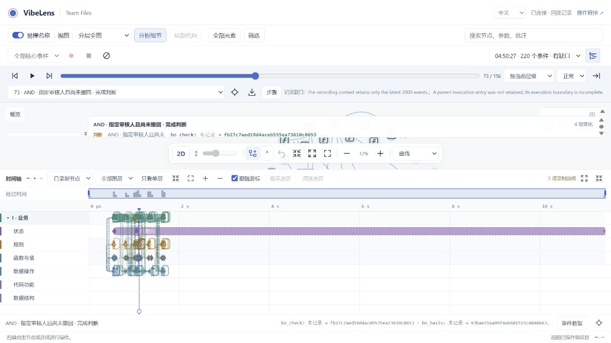
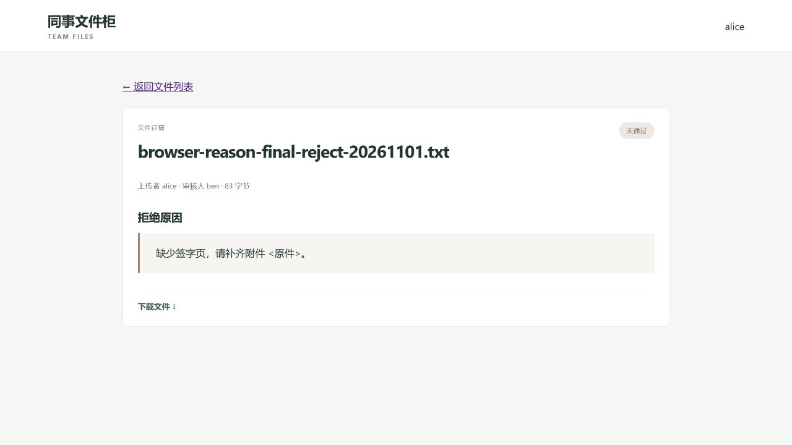

# Local acceptance: execution bands and observation continuity

## Result

The maintained Skill/runtime/viewer changes pass complete repository gate 11.
Both shipped examples are verified and frozen. Independent trial 11 accepted v1,
then two ordinary business iterations: withdrawal and rejection reasons. Mapping,
state rules, authored business cases and project checks have separate reports.

This result covers the declared cases and recorded intervals. Rapid large-list
requests also reproduced a real capture-capacity limit: **2,701 dropped events**
in an earlier process of the final build. That process is not complete observation
evidence. Its counters, raw logs and failed delivery guard remain in the archive.
A later same-build process/detail read is separately identified; it does not
repair the earlier loss. No queue budget or validator was relaxed.

Work remains local on `feat/recording-timeline`; no publication was performed.

## Accepted application builds

| Phase | Native states | Native routes projected | Closed calls in case suite | Business assertions | Stopped interval |
| --- | --- | --- | --- | --- | --- |
| V1 | 4 | 8 of 8 | 591 | 12 of 12 | 153 events, 38 closed calls |
| Withdrawal | 5 | 9 of 9 | 893 | 15 of 15 | 220 events, 60 closed calls |
| Rejection reason | 5 | 9 of 9 | 1,086 | 18 of 18 | 209 events, 61 closed calls |

All three pass the four report categories and normal project verification.
The stopped intervals have no missing internal owners or parent entries. Their
bounded pre-start contexts remain partial and are labelled separately; they are
not included in that completeness statement.

Exact accepted source and native route/state/event comparisons are retained in
[`dialogue-11-independent-v1`](dialogue-11-independent-v1/baseline-summary.json),
[`dialogue-11-independent-v2`](dialogue-11-independent-v2/summary.json) and
[`dialogue-11-independent-v3`](dialogue-11-independent-v3/summary.json).

The static code projection changes from 587 nodes/724 edges, to 621/774, then
635/795. Unresolved static references remain explicit. A static call edge is not
presented as proof that a call ran. No static edge has a missing endpoint in the
two independent iteration audits.

## Ordinary dialogue and automatic maintenance

The [public dialogue](dialogue-11/dialogue.md) retains 44 messages, including the
coordinator's actual prompts and the developer's visible questions and diagrams.
The coordinator simulates the user under the human's authorization. This is an
actual independent Codex conversation, not independent human usability evidence.
Private reasoning is excluded.

1. The ordinary request was: `我想把还没审核的文件撤回。`
   The developer asked whether withdrawal ends the flow and who retains access.
   The simulated user confirmed terminal withdrawal, uploader-only reading, and
   uploader-only withdrawal while pending. The developer displayed the changed
   flow and received explicit confirmation before implementation.
2. The next request was: `审核拒绝时填写原因，上传的人在详情里看得到；通过不用填。`
   The developer confirmed required/verbatim rejection reasons, showed the
   branch, and received confirmation. It did not add a new permission policy.

Neither request or answer reminded the developer to update probes, graphs or
observation cases. Normal recall/begin/scan/inspect/review/verify/accept/check
remained part of the implementation process.

Withdrawal adds its operation, permission conditions, native state/transition,
HTTP handler, source bindings, schema migration and real concurrency cases.
Rejection reasons add the actual input/validation/result fields, native database
column, graph condition/data nodes, source parameters and readable file details.
The independent comparison finds **no removed capture field, feature or existing
feature-case contract** between the two iteration builds. Migration evidence
preserves original rows and file bytes; old rejections receive no invented reason.

## Failures that remained visible

| Finding | Classification and correction | Evidence |
| --- | --- | --- |
| Ordinary rule/value records lacked their containing invocation | Shared adapter/checking defect. Python/Node propagate actual parent-entry IDs; complete mapping rejects missing owners. Old facts remain unchanged. | [Ownership explanation](observation-ownership-explanation.md), [historical replay](development-history.md) |
| Control activation read a growing event body and exceeded 8 MiB | Shared interface defect. A model-only query retains the same graph/build identity without reading runtime history. | [Context ledger](control-context-test-history.md) |
| The new context query returned 404 in the actual standard server | Shared routing omission. Shared GET dispatch now uses the same web handler after existing access checks. | [Route ledger](control-route-test-history.md) |
| Typed focus required nodes that its own filter hid | Shared selection defect. Preserve original paths with explicit necessary bridges; filter ordinary neighbors. An insufficient unit-green prototype is retained. | [Typed-focus ledger](control-types-test-history.md) |
| Withdrawal's first recording stop timed out before queue settlement | Incomplete recording retained. A subsequent stopped current-build interval is separately checked; budgets are unchanged. | [Withdrawal coverage](dialogue-11/artifacts/withdrawal/coverage.md) |
| Rejection business assertions passed but a declared error field lacked its case witness | The mapping gate correctly failed. Add the actual blank-rejection case to the feature contract; retain the original field and assertions. | [Failed mapping](dialogue-11/artifacts/rejection-reason/verify.result.json), [retest](dialogue-11/artifacts/rejection-reason/verify-final.result.json) |
| Browser file-details link displayed JSON | Application defect. An explicit HTML representation preserves the JSON API; a direct-link regression and actual browser retest pass. | [Failure image](dialogue-11/artifacts/rejection-reason/browser-details-before-link-fix.png), [final details](dialogue-11/artifacts/rejection-reason/final-uploader-reason-details.png) |
| Rapid history-list requests overflowed the final-build process queue | Retained capture limitation. Business effects remain correct, but that capture process is incomplete. A later run is separate evidence. | [Final handoff](dialogue-11/artifacts/rejection-reason/RESUME.md), [archive index](dialogue-11/artifacts/index.json) |

The two application defects were repaired inside the trial. Shared defects were
repaired in the maintained repository before a fresh continuation conversation.
Failures are not replaced by their later passing result.

## Graph, Timeline and Web checks

Each execution occupies one row per graph layer. Overlapping roots have separate
bands; sequential roots can reuse a completed band. Each band folds independently
to its business row. Actual lifetimes and horizontal, cross-layer and explicit
cross-band dependencies share the graph replay cursor. Historical point facts do
not receive fabricated duration or invocation membership.

Real two-worker SQLite/browser cases exercise separate actors and an explicit
release/acquire dependency. Both renderers use icon centres for ordinary edges
and region rims for expanded nodes. All four routing styles are measured in those
cases. Layer/depth controls retain selected empty axes and original event IDs.

The retained [15-suite browser matrix](browser-final-matrix.json) includes its
two failed synchronization checks and targeted retests. The broad application
[Web coverage](dialogue-08/artifacts/coverage.md) is supplemented by trial 11's
actual scoped controls, unchanged raw replay, 2D/3D/reload checks and both business
iterations. These are distinct phases, not one uninterrupted all-green run.

The [20,000-event benchmark](performance-04/result.json) uses nine rows: initial
paint about 149 ms, seek p95 about 19.3 ms and draw p95 about 11.8 ms on this host.
It measures Timeline presentation rather than whole-project analysis overhead.

Two blocked 3D self-relations in orthogonal/bus mode remain disclosed. Straight
and curved rendering remain available. See the [scope](acceptance-scope.md) for
all evidence boundaries.

## Review material

The [artifact index](dialogue-11/artifacts/index.json) records hashes for **766
immediate phase files**. Three compressed archives preserve them in full;
screenshots, prose, scripts and small receipts also have browsable copies. Scratch
subdirectories are explicitly excluded. Exact source/runtime snapshot archives
exclude private settings, session secrets, dependencies and scratch copies.

The [chronological history](development-history.md), [task list](plan.md) and
[requirements matrix](requirements-matrix.md) retain implementation and test order.
The complete gate is [`repository-verification-11.json`](repository-verification-11.json);
its canonical SDK selection hash remains unchanged during the application-only
iterations.

