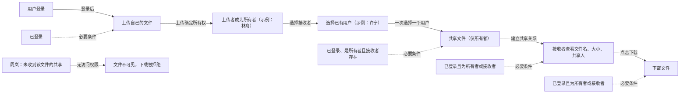
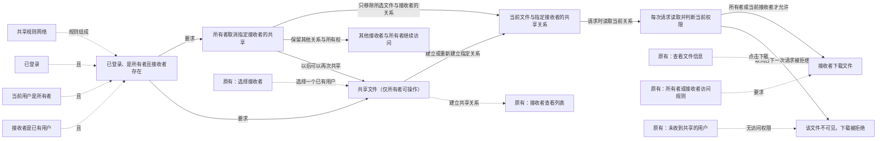

# File sharing: frozen-version repeat

Trial prompts and follow-ups delivered by the coordinating AI are scripted-user records. They are not independent human usability evidence.

Local paths are normalized as listed in dialogue.json. Original trial answers and checks are archived separately.

## 01 · scripted-user · 2026-10-29T00:32:20.011Z

$vibelens

我要做一个简单的文件共享应用：用户登录后上传自己的文件，共享给指定用户，收到共享的用户可以查看和下载。里面要能看清用户、文件所有者、接收者之间的权限。业务流程要简单，让我一眼看懂。

用 Python+SQLite 后端和轻量网页前端，创建独立项目 WORKSPACE/VibeLensTrials/file-sharing-stable-trial-20261029。先问必要的业务设计问题，等我回答后再开发；不用增加团队、公开链接、审批、订阅等业务。保留设计问答和测试结果到 review/。源码、标识、注释使用英文，对话中文。

本次显式启用的 Skill 是 WORKSPACE/VibeLensTrials/vibelens-policy-graph/skills/vibelens/SKILL.md。使用这份本地 Skill，当前规范源码已提交冻结为088514b；不使用已安装旧版。项目独立，不查看其他试验目录或原会话，不修改维护仓库，不联系其他对话，不推送GitHub。后续会给一次小迭代，再检查定位和修复。不要制造缺陷，不预设测试会失败。先完成首版与必要检查，再等迭代指令；产品页面素材导出是之后的独立阶段。浏览器验收优先使用可重复运行的headless Playwright脚本。

## 02 · assistant · 2026-10-29T00:32:23.119Z

我会先读取你指定的本地 VibeLens Skill，按它梳理必要的业务问题；等你回答后再开发，并将设计问答和测试结果保存在独立项目的 `review/` 中。

## 03 · assistant · 2026-10-29T00:33:33.438Z

已核实指定 Skill 的源码版本为 `088514b`，目前仅建立设计记录，尚未开发。

请确认 3 点：

1. **运行方式**：选 `drive`（应用按状态声明执行）还是 `observe`（应用自己执行，图观察实际结果）？两种都会维护图和运行监测。
2. **账号准备**：首版内置 3 个测试账号，还是需要用户自行注册？
3. **查看与权限**：“查看”只需文件名、大小、所有者等信息并支持下载，还是需要网页内预览内容？权限暂理解为：**所有者可查看、下载和共享；接收者可查看、下载，不能转分享**。请确认或修正。

第 1 项来自指定 VibeLens Skill (`WORKSPACE/VibeLensTrials/vibelens-policy-graph/skills/vibelens/SKILL.md`) 的要求：“At first adoption, explain and ask”。你的回答会保留到 `review/`，随后展示业务与权限图供确认。

## 04 · scripted-user · 2026-10-29T00:35:47.275Z

用 drive 模式。账号先内置三个：林舟上传文件，许宁接收，周岚没有收到共享，不做注册。
“查看”先简单一点，在收到共享的列表里看到文件名、大小和是谁共享的，点下载就能拿到文件，不做在线预览。上传的人就是所有者，只有所有者能共享，选择一个已有用户；接收者只能查看和下载，不能转发，也不能改文件。
我的主线就是登录、上传、指定接收者、查看和下载，先把这张图给我看看。先做这一版，不做删除；之后我还要取消共享，取消后对方即使没刷新页面也不能再下载，这条留到下一轮迭代。

## 05 · assistant · 2026-10-29T00:35:50.505Z

已确认：使用 drive 模式，内置林舟、许宁、周岚三个账号；只有所有者能共享，接收者只能查看信息和下载。取消共享留到下一轮。我现在生成业务与权限图，先供你确认，暂不开发应用行为。

## 06 · assistant · 2026-10-29T00:36:35.477Z

图中会保留两条清晰的关系：上传确定所有者，共享确定接收者；查看和下载共用“所有者或已收到共享”的权限条件。周岚未收到该文件的共享，因此不能查看或下载。当前图只表达设计，不包含运行结果。

## 07 · assistant · 2026-10-29T00:39:17.578Z

设计文件已通过结构校验，业务图和权限规则已关联；当前仍标记为“待确认”，没有实现或测试通过的含义。本地图服务显示已启动，但连接检查超时，我正在确认浏览器是否能打开。

## 08 · assistant · 2026-10-29T00:40:04.034Z

已确认本地图地址能返回设计数据：这是设计阶段的图，运行事件为零。我再用无头浏览器检查页面显示，并保存截图，之后把图贴在对话里供你确认。此次页面检查会使用 `webapp-testing` Skill。

## 09 · assistant · 2026-10-29T00:43:39.559Z

这是首版设计图，尚未开发应用。[打开交互图](http://127.0.0.1:8841/graph)

接收者不能转发或修改文件。本轮不做删除；**取消共享及未刷新页面时的下载拦截，留到下一轮**。

图已通过无头浏览器显示检查，问答与检查记录 (`WORKSPACE/VibeLensTrials/file-sharing-stable-trial-20261029/review/design-dialogue.md`)已保存。

**请确认这张图是否符合你的意思。** 指定 VibeLens Skill (`WORKSPACE/VibeLensTrials/vibelens-policy-graph/skills/vibelens/SKILL.md`) 要求 “continue once that scope is confirmed”，因此确认后再开始开发。

## 10 · scripted-user · 2026-10-29T00:48:43.126Z

试用编排说明：先完成并展示当前设计图，等我确认后再编码。我正在修复规范Skill的一个项目级协议枚举不一致问题；本体修复后会给你新的冻结提交。先不要用项目内兼容补丁绕过规范校验，也不要开始安装或开发运行时。业务需求保持刚才确认的内容。

## 11 · assistant · 2026-10-29T00:48:51.334Z

当前设计图已完成并展示。我会停在设计阶段，等待你确认图并提供新的冻结提交；期间不安装或开发运行时，不添加项目内兼容补丁。业务需求保持不变。

## 12 · scripted-user · 2026-10-29T01:29:55.596Z

这张流程和权限图符合我的意思：上传的人拥有文件，只有所有者能共享，接收者只能查看信息和下载；周岚没收到共享就访问不了。先按这版做，取消共享留到下一轮。

【试验版本记录】这是主会话的模拟用户确认，不是独立人类验收。新的规范版本已冻结并推送到 feat/shared-policy-graph，提交 e69ce09（路径仍为 WORKSPACE/VibeLensTrials/vibelens-policy-graph/skills/vibelens）。27项规则图测试、完整仓库验收、干净Git导出后的两个示例及独立去shim回归均通过。现在可以基于此提交开始首版开发和完整验收，不再等待。请保留本轮图确认/模拟来源与版本标识，原范围不变，不增加业务。若原生接口仍有问题，如实记录，不写替换canonical验证器/投影器的补丁。普通项目适配允许。完成首版和必要检查后等待下一轮迭代；当前不做产品宣传材料。

## 13 · assistant · 2026-10-29T01:30:01.960Z

我会基于新冻结提交 `e69ce09` 开始首版开发，先核对指定 Skill 的版本和集成要求。图确认会明确记录为主会话的模拟用户确认；取消共享仍留到下一轮，不增加业务范围，也不绕过规范校验。

## 14 · assistant · 2026-10-29T01:30:42.537Z

指定 Skill 已核实为 `e69ce09`，源码工作区没有改动。我也会使用文件规划 Skill，在本项目中记录实现阶段、协议问题和验收证据；先固定独立测试预期，再接入应用与观察服务。

## 15 · assistant · 2026-10-29T01:35:50.955Z

独立测试预期已记录，包括所有者共享、接收者下载、无权限用户拒绝和数据库回滚检查。初始化规范门禁时，设计稿的空状态声明和 `resource` 节点类型未通过运行时协议校验；我会补全项目声明并映射到协议支持的类型，不改规范工具。

## 16 · assistant · 2026-10-29T01:40:49.590Z

首版将用服务端表单网页完成操作：登录后分成“我的文件”和“收到的共享”，只有所有者的文件行提供共享入口。文件内容和共享关系都存入 SQLite；应用通过独立执行器和声明判断权限，观察服务只接收结果。

## 17 · assistant · 2026-10-29T01:56:20.225Z

应用主线和网页表单已写好，图已接入源码、共享规则和数据库结构。静态检查要求把实际参与执行的原生执行器也纳入源码清单，我已补齐；接下来运行登录、上传、共享和下载场景，核对文件字节与 SQLite 中的真实关系。

## 18 · assistant · 2026-10-29T01:59:57.896Z

24 项项目测试已通过，覆盖三种用户身份、空文件、非林舟用户上传后的所有权、接收者越权拒绝，以及观察关闭、传输失败和队列受限时的业务结果。首轮测试曾因受限环境的临时目录权限失败，改用项目内测试目录后通过，失败日志已保留。接下来核验规范门禁和浏览器录制回放。

## 19 · assistant · 2026-10-29T02:09:05.971Z

静态映射和技术审查已通过。上一轮 60 个场景运行（20 个场景 × 观察开启、关闭、失败）也满足了全部 78 条独立断言，开启观察时保留了 1,318 条真实事件。现在已切换到应用与图服务，开始用浏览器检查三个账号的操作和实际录制回放。

## 20 · assistant · 2026-10-29T02:11:22.535Z

浏览器已确认：林舟能上传并共享给许宁，许宁能看到信息并下载正确字节，周岚的直接访问和共享请求被拒绝。检查停在录制前的队列排空步骤：10 秒内尚未排完，但没有报告丢失或错误。我会确认它是否只是延迟，并在排空后再验证回放。

## 21 · assistant · 2026-10-29T02:16:40.098Z

队列最终完整排空，录制保留了 279 条事件和 `private → shared` 两个真实状态帧，错误、丢失和缺口均为零。规范门禁的映射、状态约束、业务规则、项目检查也已全部通过。我已将浏览器检查改为有上限地等待实际排空，现在对更新后的候选版本重跑录制和回放验收。

## 22 · assistant · 2026-10-29T02:20:17.407Z

回放已走到真实的 `private → shared` 状态，但浏览器检查发现日志形状不匹配：项目把平面文件状态日志放进了查看器的活动日志字段，导致控制台报错。我会修正项目适配器，保留并校验原始状态日志，不修改规范查看器，也不跳过控制台错误检查。

## 23 · assistant · 2026-10-29T02:28:34.240Z

项目适配已修正：活动日志保持为空，文件状态日志完整保留，并新增了执行前真实的 `pending` 采集点，用来核验两次迁移路径。也已实际确认启动器会随新构建重启应用和观察服务，旧版录制退出当前列表，原有布局设置得到保留。最终复测仍在进行。

## 24 · assistant · 2026-10-29T02:30:59.696Z

最终浏览器复测通过：录制保留了 428 条真实事件，以及 `pending → private → shared` 三个状态帧，回放和重载均通过，控制台没有错误。四类规范门禁也再次全部通过。隔离证据检查确认，缺字段、错值、缺实例、缺迁移见证、源码过期和数据库模式变化都会被识别；现在只剩核心导出复现和整理交付记录。

## 25 · assistant · 2026-10-29T02:37:02.564Z

核心包已实际解压运行，移除观察模块后，上传、共享、下载和越权拒绝仍通过。截图复核还发现验收脚本的回放索引漏算了录制起始边界；我会改用规范时间线按事件 ID 定位，并等待重载后的图真正渲染，再确认最后这项检查。

## 26 · assistant · 2026-10-29T02:44:52.430Z

最后的事件 ID 回放检查和完整渲染重载检查均已通过，当前构建也已通过 accept/check。问答、失败与修正记录、502 条浏览器录制事件及核心包复现结果都已保留；我正在保存最终验收索引，完成后停在首版。

## 27 · assistant · 2026-10-29T02:46:44.186Z

首版已完成，基于冻结 Skill `e69ce09`。

- [打开应用](http://127.0.0.1:8840) · [打开开发图](http://127.0.0.1:8841/graph)
- 账号：`linzhou`、`xuning`、`zhoulan`；密码为 `trial-账号ID`。
- 映射、状态、业务、项目检查均通过；24 项测试、60 次场景运行及浏览器录制回放通过。

问答、模拟来源、失败修正和测试证据已保存到 验收记录 (`WORKSPACE/VibeLensTrials/file-sharing-stable-trial-20261029/review/initial-acceptance.md`)。

本轮为模拟需求确认和自动化验收。现停在首版，取消共享留到下一轮。

## 28 · scripted-user · 2026-10-29T02:52:59.510Z

再加一个取消共享功能：我是文件所有者，可以取消给许宁的共享。许宁已经打开的旧页面，下一次下载也应当被拒绝；给其他接收者的共享，以及我自己的访问都保留。以后可以再次共享给许宁。先把变化后的业务图给我看一下，再按这个范围实现、同步图和采集，并完整复测。仍然用冻结版 e69ce09，不改框架的校验或测试。设计中的必要问题可以拟人化自行模拟我的回答，明确记录模拟来源，不扩展功能。另有一个框架回放的小问题正在独立处理：实际 Boolean 规则依赖的 data 事件与 guard 逻辑边匹配不完整，这不影响本轮业务实现和检查；这轮先保留现有框架，不自行修补它。

## 29 · assistant · 2026-10-29T02:53:10.798Z

这次会增加“所有者取消某一接收者的共享”：许宁旧页面上的下一次下载会重新检查数据库并被拒绝，其他接收者和所有者的权限保留，之后可再次共享给许宁。

我先更新并展示业务与权限图；设计确认会按你的授权明确记录为模拟回答，然后实现和复测。仍使用冻结版 `e69ce09`，你提到的回放匹配问题会作为框架已知限制保留。

## 30 · assistant · 2026-10-29T03:02:40.043Z

变化后的设计图已生成：[查看设计图](http://127.0.0.1:8843/graph)。当前仍是设计阶段，没有新增运行事件。

模拟确认已记录为“按这个范围做，不增加功能”，来源明确标为本轮授权下的模拟回答。接下来按图实现，并保留原有测试，重点复测旧页面下载、其他接收者、所有者访问和再次共享。

## 31 · assistant · 2026-10-29T03:09:56.731Z

实现会只删除 `(文件 ID, 接收者 ID)` 对应的共享关系，并在同一事务内更新文件状态；下载时继续实时查权限。只有最后一个接收者被取消时，文件状态才回到“仅自己可见”。接下来会把这两种状态路径、重复取消和再次共享加入独立测试预期。

## 32 · assistant · 2026-10-29T03:22:29.924Z

取消共享和旧页面下载拦截已实现。我接下来核对图谱映射，运行完整回归，并在浏览器中验证许宁未刷新的页面是否会在下一次下载时被拒绝。已知的框架回放匹配问题保持冻结，不计作本次修复。

## 33 · scripted-user · 2026-10-29T03:22:33.722Z

进度提醒：用户要求先完成核心功能和全部独立验收，再处理宣传/示例页面。我已暂停页面工作。你继续当前取消共享迭代及完整复测，不增加范围。上游工作树目前正在收尾两个 viewer 修复，尚未提供新的冻结提交；本轮仍使用原已安装 e69ce09 文件，不从上游当前工作树重新复制。记录精确框架来源，保留原有断言。完成本轮后再停下，等待我提供经过整体验收的新提交进行正常框架升级测试。

## 34 · assistant · 2026-10-29T03:23:06.443Z

静态映射检查已通过。取消操作只删除指定文件与接收者的共享关系；还有其他接收者时保持 `shared`，取消最后一位后转为 `private`。接下来验证下载拦截、其他人的权限保留和重新共享，并保留原有用例与基线。

## 35 · assistant · 2026-10-29T03:25:58.110Z

框架副本核对通过：196 个受管文件和原生执行器均与已安装的 `e69ce09` 记录一致。复测启动时遇到图谱保存中的短暂冲突，导致本地服务退出；已保留失败记录并重启本工程服务。浏览器复测正在进行。

## 36 · assistant · 2026-10-29T03:27:00.944Z

浏览器已验证核心行为：许宁未刷新的页面下一次下载返回 403，所有者和周岚仍能下载，重新共享后许宁也能恢复下载。该轮随后因采集传输超时未通过完整验收。我会调整项目适配器的公开超时参数，并让测试单独记录这次预期的 403 控制台消息，然后重跑；框架源码保持不变。

## 37 · assistant · 2026-10-29T03:32:53.786Z

原有 26 条业务断言、20 个场景和白盒规则已核对保留；本轮新增 8 个场景、68 条断言。完整回归已按扩展后的数量重新运行，浏览器也在重新采集并检查回放。核心包已导出，稍后会在不含观察器模块的目录中验证取消共享和再次共享。

## 38 · assistant · 2026-10-29T03:34:18.869Z

新核心包的 37 个文件已逐一比对，与当前工程内容一致，且不包含观察器模块。浏览器业务操作已完成，目前在等待本轮采集队列排空；通过条件仍是零采集错误、零丢弃、零录制缺口。旧基线和失败记录均已保留。

## 39 · assistant · 2026-10-29T03:38:32.649Z

核心包已在独立解压目录中通过取消共享、权限保留和再次共享检查，确认无需观察器模块。完整浏览器录制超过了 300 秒的排空预算，当时采集错误和丢弃均为 0；该轮仍保留为失败记录。我会延长等待预算，并用最终脚本重跑验收，不放宽业务或证据断言。

## 40 · scripted-user · 2026-10-29T03:39:59.989Z

看到队列排空超过 300 秒的结果。请保留失败，不要仅凭延长等待预算就结束：先记录 pending/accepted/发送数随时间的变化、最后响应和实际等待谓词，确认是在持续排空，还是错误的目标计数、未停止的采集源或锁/线程问题。若不下降，先定位原因。仍不放宽零错误、零丢弃、零缺口和原业务断言，不改框架或植入成功事件。我在主会话也分析相关代码。上游固定源码完整验收已通过，修复已提交 b78f03a89e1726f951ea76d4e0781efd2e869fe6；请先把当前 V2 的结果收尾/定性，不自动混入这次升级，之后分轮正常升级。

## 41 · assistant · 2026-10-29T03:41:38.597Z

我会补充排空过程的计数：已入队数、待发送数和观察端接收数，并记录实际等待条件与最后响应。这样能区分持续排空、计数目标错误或采集源仍在产生事件。当前 V2 仍使用冻结的 `e69ce09`；新上游提交留待下一轮升级测试。

## 42 · scripted-user · 2026-10-29T03:43:18.124Z

主会话的只读排查：当前 GraphSession.event/snapshot 对每个传输项都会做完整 binding()，包含 52 个源文件的路径/字节检查；在本工程测一次 behavior_model.check 约 0.327 秒。BOProbe 只有一个发送线程。因此数百条真实事件可能造成分钟级积压，这只是当前环境测量，尚不能归因为死锁。flush 蓝图没有业务采集调用，暂未发现自采集循环。请用 pending/accepted/seq 的实际时间序列确认持续下降；若能排空且零错误/丢弃/缺口，保留实际耗时和配置再验收，不能将这项等待报告成实时性能通过。若停滞则查线程/锁。先不改受保护框架，不削弱每事件校验；性能问题单列。根会话目前读 8841 被拒绝，可能正好处于你重启服务阶段，已停止额外轮询。

## 43 · assistant · 2026-10-29T03:46:14.314Z

计数显示队列在持续排空：约 10 秒时待发送 1,641 项，约 156 秒时降到 901 项；观察端接收事件从 102 增至 839。期间入队数固定为 1,731 个事件和 11 个状态快照，错误、丢弃均为 0，没有持续自采集的迹象。这里会记录实际耗时，不作为实时性能通过的结论。

## 44 · assistant · 2026-10-29T03:48:52.197Z

约 293 秒时，待发送数已降至 286，入队总数仍未增加，采集错误和丢弃仍为 0。这说明本轮确实存在较长的排空延迟，目前未见停滞。最终核心包也已通过独立解压运行检查；接下来完成录制回放和完整回归收尾。

## 45 · assistant · 2026-10-29T03:49:45.635Z

浏览器完整验收已通过：1,731 个事件和 11 个状态快照全部送达，实际排空耗时 363.125 秒，最终待发送数为 0，错误、丢弃和录制缺口均为 0。旧页面下载被拒绝、其他人权限保留、再次共享，以及两种取消结果的精确事件回放均通过。84 组场景观测已生成，项目测试仍在运行。

## 46 · assistant · 2026-10-29T03:52:15.258Z

完整回归已通过：35 项 pytest、84 组场景运行、282 条业务断言，映射、状态规则、业务和项目检查四类结果均通过。独立证据审计也通过了 10 项反例检查。现在保存当前构建的验收结果，并整理失败历史、采集耗时和已知框架问题。

## 47 · assistant · 2026-10-29T03:57:02.840Z

当前构建的 accept/check 已通过，验收报告、精确录制 ID、排空计数和核心包校验值已保存。已知的 Boolean 回放匹配问题和 363 秒采集延迟都单独列出，没有计作已修复。最后核对报告链接和服务状态后，本轮停在 `e69ce09`。

## 48 · assistant · 2026-10-29T03:57:49.128Z

取消共享 V2 已完成，自动复测通过：

- 旧页面下一次下载返回 403；所有者、其他接收者仍可访问，之后可再次共享。
- 35 项测试、84 组场景运行、282 条业务断言通过。
- 实际录制零错误、零丢弃、零缺口；排空耗时 363.125 秒，延迟已单列记录。

框架保持 `e69ce09`，已知 Boolean 回放匹配问题未修改。本轮到此停止。

[打开应用](http://127.0.0.1:8840) · [查看业务图](http://127.0.0.1:8841/graph) · 验收报告 (`WORKSPACE/VibeLensTrials/file-sharing-stable-trial-20261029/review/revocation-acceptance.md`)

## 49 · scripted-user · 2026-10-29T03:58:54.737Z

请开始独立的一轮框架升级验收，不增加业务：V2 已通过，先保留该轮原始验收、源包、录制和失败历史。新冻结 Skill 为 b78f03a89e1726f951ea76d4e0781efd2e869fe6，路径 WORKSPACE/VibeLensTrials/vibelens-policy-graph，HEAD 与工作树已核对为该提交且干净，已推到 feature 分支。它已通过 27 个策略测试、完整固定源码回归、两个内置示例严格四类检查、源码/包/Skill 校验和干净 Git 导出。

在本项目按正常 begin→bo_upgrade plan/apply→来源及受管文件核对→scan/inspect/review/verify/accept/check 流程升级，不可改框架验证器、投影器或原有业务期待。保存升级前后业务、状态声明、规则声明及原测试的字节核对。完整复跑原 35 项测试、84 组场景/282 条断言和证据审计；如相应正式命令本身包含这些，不重复额外运行。

本轮源变化主要是两个 viewer 文件：Boolean 子结果 data 依赖会匹配同次 check/basis 的 guard 逻辑边，授权预设会包含原生 policy 节点。实际浏览器重点检查原来的真实录制中规则依赖有动画、跳过条件没有虚构传递；权限节点及关系可见、源文件查看、2D/3D切换与回放仍可用。可复用保留下来的同构建停止录制，不必再为纯前端变化重录同一段 1,731 事件的全部业务；先核对构建/源码不变，变化则严格重新采集。额外新采集只做本轮有必要的短链路，用原生采集验证，仍须零错误、零丢弃、零缺口，观察器自身操作不算业务事件。不要改写旧录制。

采集 363.125 秒的排空事实和当前 Windows 路径检查诊断单列为性能限制，不报告实时性能通过；不要为通过而放宽断言。本轮框架维护的时间/token 与业务迭代分开记录。完成后保存清晰英文 review/index 与原中文对话，说明是否完成原生升级且无 shim，然后停止，不发布仓库或调整页面。

## 50 · assistant · 2026-10-29T03:59:15.319Z

我会把框架升级作为独立一轮处理，先封存 V2 证据，再按 `b78f03a` 的 VibeLens Skill 流程升级。业务与原有期待保持不变；浏览器重点验证规则边动画、权限预设和回放，采集延迟继续单列为性能限制。

## 51 · assistant · 2026-10-29T04:03:48.759Z

升级计划确认只会替换 `analysis.js` 和 `recording.js`，没有冲突或退役文件。V2 的源码、验收、录制和失败历史已归档。接下来应用升级，并逐字节核对业务代码、状态与规则声明及原测试。

## 52 · assistant · 2026-10-29T04:10:13.390Z

196 个受管文件已核对一致，50 个受保护文件及完整项目、状态、规则声明均未变化。首次架构门禁要求对升级后的文件重新封存校验值，已在核对原生来源后按正式命令完成。版本清单更新使构建 ID 改变，因此旧录制保留为历史证据，本轮会重新采集必要的短链路。

## 53 · assistant · 2026-10-29T04:16:29.122Z

正式门禁已完整通过，原 35 项测试、84 组场景和 282 条断言只运行了一遍。新构建的短链路已原生采集 429 个事件、11 个快照，53.775 秒排空，错误、丢弃和缺口均为 0。现在检查实际规则边动画、短路条件、权限预设及 2D/3D 回放。

## 54 · assistant · 2026-10-29T04:21:02.823Z

真实回放中，正常授权会动画显示三个被使用的条件；匿名请求只显示 `signed_in`，两个未执行条件没有虚构传递。权限节点、关系及 2D/3D 动画检查也已通过。源码面板测试停在“正在读取源码”，目前在对照实时与回放模式定位，暂不将这一项记为通过。

## 55 · assistant · 2026-10-29T04:25:18.326Z

源码通过原生可见操作菜单在实时和回放模式下均能正常显示；最终浏览器检查已通过，个人视图也已恢复。早先键盘菜单路径的失败记录会保留，原因尚未定性。现在运行原样保留的证据审计，并核对旧录制和归档未被改写。

## 56 · scripted-user · 2026-10-29T04:25:28.237Z

源码面板排查发现一个确实存在的上游问题，供你定位，不要改受保护文件：service.py 的 GET /api/source?recording=... 从指定录制取 sources，但响应 build_id 始终写 session.manifest.build_id（当前构建）。如果浏览旧录制，detail-panel.js 会按旧录制 manifest 校验并丢弃这个错误标记的响应，留下 Loading source。请报告你卡住时的 recording ID、视图 build_id 和该源码响应 build_id（不含凭证），判断是否命中此情形。若命中，把它作为上游失败保留，不放宽前端校验或重写录制；我会修 canonical 后给新冻结提交。若是新录制/实时也卡住，请保留其实际响应和 UI ready 状态，继续区分原因。

## 57 · assistant · 2026-10-29T04:26:15.043Z

卡住时使用的是新录制 `538215624de546279299d1c0a1cdf5b3`，构建为 `d8c85373…`；独立请求该录制的源码接口返回 200，响应构建也是 `d8c85373…`。目前证据不支持“旧录制被标记为当前构建”这一解释。我会补存浏览器实际响应及面板状态，继续区分键盘菜单路径的原因。

## 58 · scripted-user · 2026-10-29T04:30:23.016Z

更正主会话刚才的源码推断：补查并实际 HTTP 回归后，Recordings.get 在读取旧构建录制时会先拒绝（400: earlier graph version），因此服务代码中取当前 build_id 的分支在这条跨构建路径上不可达。当前证据不构成这个上游缺陷，更不能据此改服务或放宽前端。已保留这个被否定的假设，并补测旧录制源码被拒绝、当前源码返回当前构建，canonical b78f03a 保持干净不变。你发现的新录制/同构建 source panel Loading 是另一问题，请继续以实际浏览器请求、返回和选中节点/菜单路径为准定位，仍不修改框架。

## 59 · assistant · 2026-10-29T04:33:40.263Z

源码问题已进一步定位：键盘菜单关闭并把焦点还给节点后，面板会随重复选择被关闭；先通过原生界面重渲染一次，同一路径即可正常显示。两种情况的源码响应均为 200、构建一致。已保留焦点与可见性轨迹及相关代码位置，不修改框架；该问题会作为单独的验收发现交付。

## 60 · scripted-user · 2026-10-29T04:35:29.135Z

这个键盘焦点问题需要在上游修复后复测，不能只作为已知问题带过。请继续完成其余不受影响的 b78 验收并保留当前失败；提供最小复现步骤、原生 UI 测试/轨迹文件路径、实际相关代码位置和是否为 semantic-view.js onfocus 捕获了旧 selected 导致重复 onSelect。不要自己修改框架或削弱测试，不将重渲染绕过算作同路径通过。完成当前报告后停下等新冻结版本；主会话会修 canonical 并给新提交，再按相同键盘路径复测。

## 61 · assistant · 2026-10-29T04:36:59.953Z

明白，这一项会保留为未通过的验收要求，重渲染后的成功不会算作原键盘路径通过。证据强支持 `onfocus` 捕获旧 `selected` 后重复调用 `onSelect`，继而关闭源码面板。我会补上可直接复测的严格测试、最小步骤和代码位置，然后停止，等待新的冻结版本。

## 62 · assistant · 2026-10-29T04:40:09.441Z

`b78f03a` 已原生安装，无 shim，**整体升级验收未通过**。

35 项测试、84 组场景、282 条断言及原证据审计通过；业务、声明和原测试字节未变。

键盘源码路径严格测试仍退出 1。证据指向 `onfocus` 捕获旧 `selected`，恢复焦点时重复触发 `onSelect`，关闭源码面板。未修改框架，也未把重渲染后的成功算作通过。

英文验收报告 (`WORKSPACE/VibeLensTrials/file-sharing-stable-trial-20261029/review/framework-upgrade-b78f03a/index.md`) · 最小复现、测试及轨迹 (`WORKSPACE/VibeLensTrials/file-sharing-stable-trial-20261029/review/framework-upgrade-b78f03a/source-focus-finding.md`)

已停止，等待新冻结版本后按相同键盘路径复测。

## 63 · scripted-user · 2026-10-29T04:59:22.562Z

继续独立验收。新的冻结候选为 3458366（完整 SHA 请在源目录 git rev-parse HEAD 核对），源目录 WORKSPACE/VibeLensTrials/vibelens-focus-fix，当前干净。修复只有 SemanticView 的 onfocus 使用 this.selected 而不是 render 时闭包中的旧 selected；新增回归在 b78 上失败、修复后通过；旧详情面板及源码版本检查保持。源仓完整 verify 正在跑，先把它视为待完整验收的候选。请正常 begin/升级/维护登记/scan/review/verify/accept/check；保持业务、状态机、规则、原测试和保护文件不变；保留 b78 的失败记录。最重要：必须复测原来的“选择尚未选中的 revoke 节点→Shift+F10→Source→焦点返回”的同一路径，不能先显式 rerender 绕开。打开后应保留完整源码及高亮、版本检查。新构建用一段真实业务操作产生新记录，再检查规则的真实依赖动画、2D/3D、授权视图，以及原 35 tests/84 scenarios/282 assertions 和证据审计。观察器自身操作不产生业务事件。不要修改冻结框架、削弱测试或伪造事件。完整验收后单独记录失败—修复—复测过程；吞吐限制仍如实记录，维护成本和业务迭代成本分别统计。当前用户要求核心全部完成前不继续宣传/演示页。

## 64 · assistant · 2026-10-29T04:59:46.645Z

我会把 `3458366` 作为新的候选轮验收，先保留 b78 的失败证据，再核对来源并按原生流程升级。重点原样重跑键盘路径，确认源码、高亮和版本检查均保留；业务回归与新构建录制也会完整核验。

## 65 · assistant · 2026-10-29T05:05:54.867Z

来源已核对为干净提交 `3458366f72563b35749a9f7bcf799c2b7e22da00`。原生升级计划只替换 `semantic-view.js`；50 个受保护文件及状态、规则声明保持一致。原键盘测试已逐字节复制到新证据目录，现在直接运行，原 b78 失败文件保留不动。

## 66 · assistant · 2026-10-29T05:08:28.456Z

原样键盘测试已通过：同样的“选择未选中的 revoke → Shift+F10 → Source → 焦点返回”路径，现在源码面板保持可见，退出码为 0；没有加入重渲染或替代菜单。b78 的退出码 1、轨迹和截图均保留。接下来补查完整源码、高亮、版本身份，以及新录制的回放回归。

## 67 · assistant · 2026-10-29T05:14:18.356Z

扩展键盘检查也已通过：实时与回放模式均从未选中的 revoke 节点开始，焦点返回后面板保持可见；299 行源码完整一致，第 250–288 行函数高亮保留。源码响应与视图构建一致，旧录制源码请求被原生拒绝。新录制的 429 个事件、11 个快照已排空，错误、丢弃和缺口均为 0；完整业务门禁仍在运行。

## 68 · scripted-user · 2026-10-29T05:14:32.762Z

补充验收状态：3458366 冻结来源的完整 tools/verify.py 已全部通过（包含原状态/规则/映射/HTTP/录制/安装/多语言/两个独立核心导出等检查），完整日志 .validation/focus-final-full.log。已在相同干净 HEAD 上生成 .validation/focus-final-result.json，绑定全部 Skill 文件哈希和两个示例已接受候选。来源 worktree 仍保持干净、HEAD 不变；继续你的独立回归，不因源仓通过而替代原生浏览器及业务检查。

## 69 · assistant · 2026-10-29T05:15:43.211Z

本工程的四类正式检查、35 项测试、84 组场景／282 条断言，以及原证据审计均已通过。规则依赖动画、短路条件、授权视图和 2D/3D 回放也通过了新录制验证。已收到上游完整 verify 通过的状态；接下来核对其冻结哈希与日志绑定，并整理“b78 失败—原生修复—同路径通过”的证据链。

## 70 · assistant · 2026-10-29T05:23:16.887Z

“失败—修复—复测”记录已整理：b78 原失败仍保持原样，新版本用字节相同的严格测试通过，完整源码与高亮检查也通过。维护耗时和 token 已按本轮单列，吞吐限制继续保留。最后核对当前构建和报告链接后，本轮结束，不继续宣传或演示页。

## 71 · assistant · 2026-10-29T05:23:52.380Z

`3458366` 本工程独立验收通过。

- 原键盘路径通过，无重渲染绕过；完整源码、高亮和版本检查保留。
- 35 项测试、84 组场景／282 条断言、10 项证据审计通过。
- 新录制 429 个事件、11 个快照，零错误、丢弃和缺口；排空 121.584 秒，吞吐限制仍单列。

业务与原测试未改，无 shim。b78 失败及分轮维护成本已保存。

验收报告 (`WORKSPACE/VibeLensTrials/file-sharing-stable-trial-20261029/review/framework-upgrade-3458366/index.md`) · [当前开发图](http://127.0.0.1:8841/graph)

本轮已停止，未继续宣传或演示页。

## 72 · scripted-user · 2026-10-29T06:17:46.436Z

需要再做一轮框架原生集成验收。先保留 3458366 的完整通过证据。后续 Pages 控制演示发现新的真实工具缺陷：在简化业务视图中，policy:read_allowed 作为边界节点省略了父节点；随后 /vibelens 细节控制复用当前 graph.all 的投影父子关系，错误隐藏 canonical policy:network，但返回 applied。新冻结候选 3052e03c32e9bbfcdc19961cad36085415795433，来源 WORKSPACE/VibeLensTrials/vibelens-control-fix，当前干净。修复只涉及 conversation-controls.js、viewer.js 及 Skill 指引：从 canonical model 恢复祖先，保留采集字段，展开明确选择的嵌套路径；显式选源码时允许高级细节；任何请求节点仍隐藏则拒绝成功回执。新最终测试对旧 Git 模块先失败、对修复通过，原控制单元和中英文真实浏览器控制测试均通过；两个示例正常新审查、源码/安装包和干净 Git 导出通过。完整 tools/verify.py 正在跑，不把候选当作已经完成完整回归。
请正常 begin/升级/登记/scan/inspect/review/verify/accept/check；保护业务、状态、规则和所有原测试，保留所有历轮，不用 shim。除原 35 tests/84 scenarios/282 assertions、证据审计和必要新构建的真实短录制之外，重点通过本工程原生 bo_control.py 与实际当前对话/项目作用域做控制测试（可把以下内容作为已经授权的模拟用户控制需求并注明模拟来源）：先“/vibelens 只看主要业务流程”，再“/vibelens 查看下载权限的业务动作、规则和参数”。从 inspect 得到本工程真实节点 ID 和关系构造原生 plan/apply；检查状态实际 applied、plan.node_ids 全部可见、必要规则父节点正确展开、真实关联边仍在、保存后重载还在。不要通过改计划去掉难显示的已请求节点，也不要直接改工具源码/图声明绕过。检查一次原生录制筛选控制及 2D/3D，继续保留原键盘源码路径、完整文件/高亮/版本拒绝、零观察器业务事件。控制输入缺前缀不得触发手动视图写入；原测试保护和先前性能限制不变。若任何步骤失败，如实保留并定位，不削弱检查。维护成本按新框架轮次单独记录。用户要求核心全部完成前再次暂停宣传/演示页；你不需编辑这些页面。

## 73 · assistant · 2026-10-29T06:18:05.308Z

我会把 `3052e03` 作为新一轮候选验收，先封存 `3458366` 的通过证据，再按原生流程升级。控制测试会使用本工程真实节点和当前对话作用域，核对请求节点、关联边、重载、录制筛选及 2D/3D；业务、原测试和既有性能限制保持不变，不编辑宣传或演示页。

## 74 · scripted-user · 2026-10-29T06:21:54.660Z

补充证据整理约束：旧轮 b78/345 的原始来源与证据已完整封存并复制到维护仓库。请保留它们原文件，当前轮可用哈希与相对索引引用既有不可变包，避免再把所有历史 ZIP 递归装进新 ZIP 导致材料指数增长。若本轮保全已经完成，原封存不改写，后续发布索引可引用先前包；不要因此删除原证据或减少本轮失败、修复、真实浏览器和正式检查的记录。

## 75 · assistant · 2026-10-29T06:32:48.515Z

已确认候选来源是干净的 `3052e03`。按补充约束，这轮会用哈希和相对索引引用既有历史包；只另存上一轮可能被后续命令覆盖的非 ZIP 回执，不再递归打包历史 ZIP。原生控制测试将在本工程、当前对话作用域内执行，模拟输入的授权来源会单独注明。

## 76 · scripted-user · 2026-10-29T06:37:09.465Z

执行顺序补充：先完成既定的保全与原生升级、原有正式检查，再针对安装后的实际 inventory 编写控制用例即可，不必先规划一套新业务。业务、模式和授权范围已确认，无需重新设计或提问。控制输入是用户授权的隔离项目仿真，材料标为 scripted user，不得称为真实人确认；若某一步确有阻断，记录具体拒绝即可。请把长源码和完整 JSON 留在文件中，终端只取相关片段、哈希和检查摘要，继续实际执行。

## 77 · scripted-user · 2026-10-29T06:37:09.476Z

本轮真实控制会创建私有会话 token。原始证据保留在本地；准备可公开的报告/ZIP 时，请排除 bo_stategraph/config/control 与 config/views/conversations 的私有配置，遮盖实际 vl_session/session token（保留指纹和原件哈希），不要把它们作为普通公开验收素材。业务值、节点/事件/构建身份保持原样。可提供 public 导出目录和“原件→公开副本”哈希索引；若仅本地原始材料未做公开导出，请在最终索引明确指出，主仓归档时会处理。

## 78 · scripted-user · 2026-10-29T06:37:09.487Z

来源状态更新：3052e03 的完整 tools/verify.py 已全部通过，冻结 worktree 仍干净且 HEAD 不变。完整日志 .validation/control-final-full.log；.validation/control-final-result.json 已绑定日志哈希、全部 240 个 Skill 文件哈希及两个新示例接受候选。仅作为来源仓回归收据，不替代你的业务/原生控制/浏览器验收。

## 79 · assistant · 2026-10-29T06:37:16.554Z

上一轮材料已保留为哈希引用和不含历史 ZIP 的收据包。接下来先完成原生升级与原有正式检查，再根据安装后的实际节点编写控制用例；控制输入会明确标为 scripted user，私有会话 token 仅留在本地原始证据中。

## 80 · assistant · 2026-10-29T06:39:20.797Z

原生升级已完成：只更新了计划中的两个前端文件，196 个受管文件哈希一致，50 个保护文件及状态、策略声明未变。完整正式检查正在运行；新构建身份已变化，本轮会另录一段真实业务操作，保留旧录制作为历史证据。

## 81 · assistant · 2026-10-29T06:40:51.250Z

严格键盘源码路径已通过：原测试未改动，选择节点后没有重渲染。来源仓的完整回归收据也已核对到干净的冻结提交、240 个 Skill 文件和日志哈希；这份收据与本工程正在执行的正式检查分别记录。

## 82 · assistant · 2026-10-29T06:42:40.360Z

正式检查已全部通过：35 项测试、84 组场景／模式、282 条断言；新录制为 429 个事件，排空用时 75.747 秒。原生回放、2D/3D、完整源码与高亮检查也已通过。现在开始本轮关键验证：先读取安装后的实际 inventory，再执行两个已授权的 scripted user 控制输入。

## 83 · assistant · 2026-10-29T06:46:18.848Z

实际 inventory 中，下载权限对应 `policy:access_allowed`，其父容器是 `policy:network`。主流程计划保留了原生生成的全部 13 个节点，包括相邻规则和数据边界节点；后续会逐个核对它们是否可见，并验证切换到权限详情后的规则祖先、参数和关系。

## 84 · assistant · 2026-10-29T06:50:22.427Z

两个控制输入已收到浏览器的实际 applied 回执，主流程 13/13、权限详情 14/14 个请求节点均在 DOM 中可见。第一次测试在这两步之后因我写错了检查脚本的模块 URL 而中断；该次记录已保留，修正 URL 后继续执行原有断言，没有改框架或删减计划节点。

## 85 · assistant · 2026-10-29T06:52:29.313Z

原生控制检查已通过：权限详情保留 14/14 个请求节点、13 条实际关系和 38 个采集字段，`policy:network` 已展开，重载后仍成立。录制过滤选中真实记录中的 124/429 个事件，循环、下一步和 2D/3D 均通过；缺少 `/vibelens` 前缀的 apply 被拒绝，私有视图未写入，观察器操作新增业务事件为 0。

## 86 · assistant · 2026-10-29T06:56:33.930Z

验收已完成，证据和英文索引已整理。补充的实际源码节点控制也通过了高级详情启用和父节点展开检查，随后已恢复权限回放。旧成功包、失败记录和录制均未改动；本轮原始控制材料仅留本地，最终索引已注明公开归档前需排除私有配置并遮盖 token。

## 87 · assistant · 2026-10-29T06:57:11.880Z

3052e03 独立验收通过。

- 原有 35 项测试、84 组场景、282 条断言及 10 项证据审计全部通过。
- 两条 scripted user 控制均实际 applied，13/13、14/14 个请求节点可见；规则祖先、参数、关系、过滤回放、2D/3D、重载及无前缀拒绝均通过。
- 严格源码路径保持通过；观察器新增业务事件为 0。
- 历史证据未改，维护成本已单独登记。私有 token 原件仅留本地，未制作公开导出。

完整验收与成本索引 (`WORKSPACE/VibeLensTrials/file-sharing-stable-trial-20261029/review/framework-upgrade-3052e03/index.md`)
