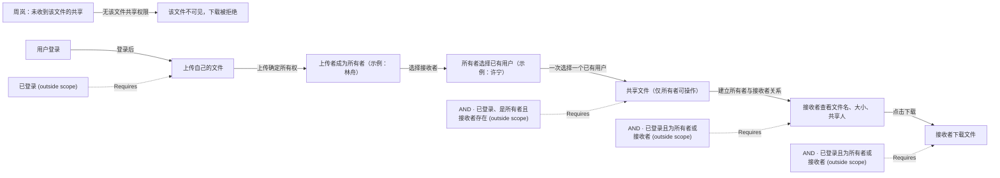

# Business network draft

[Open the live graph](http://127.0.0.1:8841/graph)

This is a focused view. Dashed boundaries retain original relations; open Web for the complete graph.

Still to confirm:

- 请确认这张首版业务与权限图是否符合你的意思；若需调整，指出相应节点或关系。

Confirm this understanding in the conversation, or describe a correction. Viewing the graph is not confirmation.
