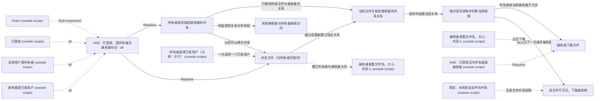

# Business network draft

[Open the live graph](http://127.0.0.1:8843/graph)

This is a focused view. Dashed boundaries retain original relations; open Web for the complete graph.

Confirm this understanding in the conversation, or describe a correction. Viewing the graph is not confirmation.
