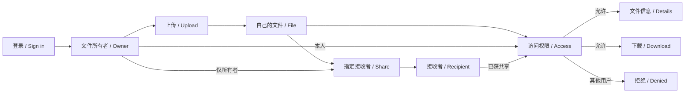
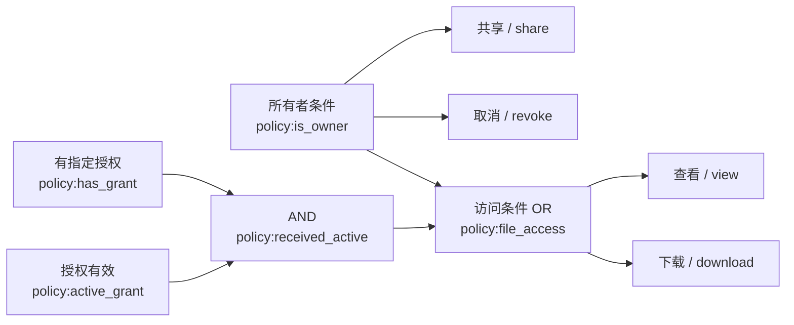

# File sharing: original pilot

Trial prompts and follow-ups delivered by the coordinating AI are scripted-user records. They are not independent human usability evidence.

Local paths are normalized as listed in dialogue.json. Original trial answers and checks are archived separately.

## 01 · scripted-user · 2026-10-28T15:09:40.975Z

$vibelens

我要做一个简单的文件共享应用：用户登录后上传自己的文件，共享给指定用户，收到共享的用户可以查看和下载。里面要能看清用户、文件所有者、接收者之间的权限。业务网要简单，让我一眼看懂。

本会话是用户授权的新独立试用，供 VibeLens 产品演示素材使用。请先按 Skill 进行必要的澄清、展示对话内业务图和真实可访问的图地址，等待后续模拟用户确认再开发。不要主动增加团队、公开链接、审批、订阅等业务。后续会追加一次小迭代并进行真实操作观察、问题分析、修复和复测。

实施约束：严格使用 WORKSPACE/SoftwareStatusObserverSkill/skills/vibelens/SKILL.md 这份本地 Skill。项目只写入 WORKSPACE/VibeLensTrials/file-sharing-demo-20261028，新建目录可自建。不得修改 VibeLens 维护仓库和已安装 Skill，不发布 GitHub。用简单可运行的 Python+SQLite 后端和轻量前端，主要源码注释使用英文，对话中文，图标签双语优先，统一图覆盖业务、状态、规则、API、函数、数据和可选静态代码。核心业务代码保持简洁，观测接线独立。

证据：保存每轮提问、模拟用户答案、确认图、测试结果、真实运行记录、截图（系统界面及2D/3D图）到项目 review/；严格区分真实用户输入、脚本模拟和测试故障注入。不要人为制造错误后声称是自然发现的bug。若正常实现没有发现业务bug，可通过明确隔离的故障注入验证‘记录→下钻定位→描述问题→AI修复→复测’能力，并如实记录。不得伪造运行事件、对话确认或通过结果。用于主页的素材最终由原会话整理。

当前只进行初始必要提问、设计草图和模式确认；原会话稍后会根据明确脚本模拟用户回复。请保持开发服务可恢复，并在后续完成时给出实际端口、启动命令、产物和证据路径。

## 02 · assistant · 2026-10-28T15:09:46.190Z

我会先读取指定的本地 VibeLens Skill，核对演示边界，再整理必要问题和业务草图；这一轮先不开发应用。

## 03 · assistant · 2026-10-28T15:10:26.569Z

我已读取并按指定的本地 VibeLens Skill 准备设计稿。会先把文件所有者、接收者和访问规则放进同一张简图，并标出待确认项。运行模式也需要先选择：`drive` 由状态声明驱动业务执行，`observe` 由应用自身逻辑执行、图负责观测；两者都保留图和监控。

## 04 · assistant · 2026-10-28T15:11:51.918Z

草图会围绕“登录 → 上传成为文件所有者 → 指定接收者 → 查看、下载”展开。目前还需确认“查看”的具体含义，以及接收者是否仅能查看、下载。Python + SQLite 已在本次约束中明确，我会沿用；接下来启动只读设计图服务，验证地址后给出待确认草图。

## 05 · scripted-user · 2026-10-28T15:13:29.476Z

素材整理补充（先保留当前提问阶段，勿提前实现）：请使用稳定、清晰的业务节点 ID，建议 login/upload/share/download/revoke，下载判定用 download-policy，采集如 actor_id、owner_id、grant_exists、grant_active、allowed。可按实现合理调整，但输出一份明确映射。后续需为 Pages 导出实际 /api/view、停止后的 recording/catalog、可选 code graph 及每个关键录制事件对应的真实应用截图，保存两次不同 build 的失败/修复记录与源码快照。请不要复制或修改当前主页的旧画展案例，演示文件共享项目需独立。模拟用户回答稍后单独发送。

## 06 · assistant · 2026-10-28T15:13:49.898Z

已收到素材补充要求。我会保留清晰的节点 ID，并记录后续事件字段和导出映射；`revoke` 先作为待用名称，不把撤销共享提前加入当前范围。

设计图进程在命令结束后未能持续运行，浏览器连接失败。我会先解决服务持续运行的问题；这只是设计服务的启动问题，不是应用业务缺陷。

## 07 · assistant · 2026-10-28T15:16:26.269Z

设计图已在浏览器中实际打开，`/graph`、`/api/view` 和 `/api/design` 均返回 200。页面标明“设计声明 · 尚未实现”，当前没有业务运行事件。

原始要求、草图、节点映射计划和检查结果已存入项目的 `review/`。记录校验通过；开发就绪检查因三个待确认问题而未通过，这与当前只做设计的阶段一致。

## 08 · assistant-question · 2026-10-28T15:17:56.104Z

{"questions":[{"title":"运行模式选哪一种？drive 由状态声明驱动业务执行；observe 由应用自身逻辑执行、图负责观测。两者都维护图和监控。","options":["drive：状态声明驱动","observe：应用执行，图观测"]},{"title":"你说的“查看”指什么？","options":["在网页内预览文件内容","查看文件名、大小、所有者等信息，再下载打开"]},{"title":"请确认 http://127.0.0.1:64120/graph 中的待确认草图：仅文件所有者能指定接收者；所有者和指定接收者可查看、下载；接收者不能转共享，其他用户不能访问。是否符合你的意思？","options":["确认当前草图","需要修改规则"]}]}

## 09 · user · 2026-10-28T15:18:19.399Z

<send_user_message_question_reply>
[{"questionItemId":"[\"request_user_input_async\",\"call_0ccce081a2704a249e16416dd590d4ae\",0]","question":"运行模式选哪一种？drive 由状态声明驱动业务执行；observe 由应用自身逻辑执行、图负责观测。两者都维护图和监控。","answer":"drive：状态声明驱动"},{"questionItemId":"[\"request_user_input_async\",\"call_0ccce081a2704a249e16416dd590d4ae\",1]","question":"你说的“查看”指什么？","answer":"查看文件名、大小、所有者等信息，再下载打开"},{"questionItemId":"[\"request_user_input_async\",\"call_0ccce081a2704a249e16416dd590d4ae\",2]","question":"请确认 http://127.0.0.1:64120/graph 中的待确认草图：仅文件所有者能指定接收者；所有者和指定接收者可查看、下载；接收者不能转共享，其他用户不能访问。是否符合你的意思？","answer":"确认当前草图"}]
</send_user_message_question_reply>

## 10 · assistant · 2026-10-28T15:18:46.021Z

已收到你的确认：选择 **drive**；“查看”只展示文件信息，下载后打开；所有者和接收者的权限按当前草图执行。我会将这条回复保存为本次真实用户输入，并用同一组节点 ID 更新确认图。

本轮仍按最初要求停留在设计确认阶段，暂不开发应用。

## 11 · scripted-user · 2026-10-28T15:19:59.545Z

【模拟用户回答；由原会话按用户授权代答】
查看先简单一点：在收到共享的列表里看到文件名、大小和是谁共享的，点下载就能拿到文件；不用在线预览。接收者只能查看和下载，不能转发共享，也不能改文件。上传的人就是所有者，选择一个已有用户共享给他。使用 drive 模式，Python 和 SQLite 可以。演示账号用三个：林舟上传，许宁接收，周岚没有收到共享。

你展示的登录→上传→指定接收者→查看和下载这条主线符合我的想法，按这个来。先把这一版做出来。之后我还要能取消共享，取消后对方即使页面没刷新也不能再下载；请将这作为下一轮迭代，保留前后图的变化。

【试用记录要求】此条是模拟答案，不能标为人类实际业务确认。原用户补充：本例同时用于规则图研发。请观察当前 Skill 是否主动构建了可以共享子条件的总权限图；若只有文字或独立的局部判定节点，记录为能力缺口，勿自行改维护仓库。新的共享规则图功能正在另一分支研发，后续会升级后再复测。现在可继续搭建基础应用和保存初版证据。

## 12 · assistant · 2026-10-28T15:20:46.210Z

已收到原会话转来的**模拟答案和开发授权**。我会保留其模拟来源，按三个演示账号实现初版；“取消共享并立即阻止下载”留作下一轮迭代。

当前确认的业务主线如下，节点 ID 与网页图一致：

我也会检查当前 Skill 对共享子条件的总权限图支持，将缺口单独记录，不修改维护仓库。

## 13 · assistant · 2026-10-28T15:24:37.746Z

初版范围已记录并冻结，撤销共享尚未纳入本轮。当前本地 Skill 的权限图说明和初始草图都未展示自动复用子条件的总权限图；我已记录为本次能力缺口，后续会用实际实现再次核对。

完整校验工具缺少 `jsonschema` 等依赖。我会把所需依赖放在试用项目内，再继续初始化开发检查。

## 14 · assistant · 2026-10-28T15:30:14.117Z

核心业务代码已写入：三个账号、文件归属、指定接收者、信息列表和下载接口。下载接口会从当前数据库读取授权关系；文件共享状态由项目内执行器读取同一份状态声明处理。

接下来连接真实事件和数据库观测，再验证所有者、接收者、未获共享用户三条路径；页面能打开还不算业务验证通过。

## 15 · assistant · 2026-10-28T15:39:05.968Z

应用和观测图已持续运行，地址分别是 [文件共享应用](http://127.0.0.1:8866) 和 [VibeLens 图](http://127.0.0.1:8867/graph)。声明、源码覆盖和数据库静态校验目前通过。

自动场景正在使用隔离的 SQLite 数据库验证权限，以及观测关闭、传输故障时的业务结果。接下来会在浏览器实际完成上传、共享和下载，并保存与录制事件对应的截图。

## 16 · assistant · 2026-10-28T15:42:03.705Z

首轮 15 个自动场景的业务断言全部通过，观测开启时未报告事件丢失或采集错误。

浏览器中发现了一个真实的集成问题：运行图提示“视图未保存”，对应 `/api/preferences` 返回 400。原因是设计图和运行图使用了不同的布局身份。我已保存故障截图、真实登录录制和源码快照；现在修复项目内适配器并复测。这个问题归类为图界面集成问题，不算文件权限业务 bug。

## 17 · scripted-user · 2026-10-28T23:32:45.721Z

刚才会话中断了，请继续文件共享第一版试用的布局身份适配修复、真实浏览器和回放复测。使用headless Playwright脚本，保留已通过15业务场景及实际集成故障。请完成首版验收后停下，报告真实检查和URL，保留源码快照及导出素材，等待后续取消共享迭代。仍不修改Skill仓库或发布。

## 18 · assistant · 2026-10-28T23:33:09.276Z

我会接着完成首版验收：保留已通过的 15 个业务场景和真实布局故障，用 headless Playwright 复测浏览器操作、录制和回放。完成后停在首版，等待取消共享迭代。

## 19 · assistant · 2026-10-28T23:42:41.897Z

Headless Playwright 已完成真实上传、共享、接收者下载、未获授权用户直连拒绝，以及 2D/3D 录制回放；119 个录制事件已保存，10 个关键步骤有对应界面截图。布局保存接口也已恢复为 200。

完整验收还剩一处测试编排问题：未授权场景的准备步骤先执行了接收者的合法下载，导致“该场景所有下载判定都应拒绝”的断言误匹配。我会移除这一步无关准备操作，保留原断言和期望值不变，再跑验收。

## 20 · assistant · 2026-10-28T23:46:35.878Z

首版完整检查已通过：实现映射、状态约束、业务规则和项目检查四类结果均为通过。

交付前我会补齐两项观测信息：在共享事件中保存执行器实际返回的迁移前状态和 guard 结果，并把已有 HTTP 入口明确标为 API 类型。业务规则不变；这些信息会让回放中的状态变化更容易核对。随后只复测这一版并保存最终素材。

## 21 · assistant · 2026-10-28T23:58:29.575Z

最终 build 的四类验收已通过，新增的迁移 guard 和 API 类型也完成了浏览器复测。最终录制包含 135 个真实事件，无采集缺口；回放和视图操作未产生业务事件。

我正在整理失败与修复源码快照、导出素材和启动说明，并检查同一 build 重启后录制仍可读取。之后停止开发，保留服务等待下一轮。

## 22 · scripted-user · 2026-10-28T23:58:41.534Z

在当前首版最终验收和素材归档完成后，请继续下一轮（不要跳过V1收尾）：现在加上取消共享。只有文件所有者能取消给指定接收者的共享，取消后对方即使还开着旧页面，再点下载也应被拒绝；文件仍归所有者，所有者仍能下载。保持之前上传、共享和下载功能，保留前后图、源码、实际记录和测试。模拟用户的业务要求只有这些，不新增其他业务。

本轮试用编排补充：首版使用旧Skill的缺口和所有环境开销单独记录，不能作为公平token比较；你这个pilot主要提供产品素材。V2请显式改用当前研发后已冻结的Skill WORKSPACE/VibeLensTrials/vibelens-policy-graph/skills/vibelens/SKILL.md，通过标准升级接入共享规则网，实际source绑定与事件，重点把查看/下载共用访问条件、共享/取消共用所有者条件连到同一张网。不要修改维护仓库。先正常完成V2，发现自然缺陷如实记录，没有就不制造；后续会另给隔离教学样本与素材导出的任务。

## 23 · assistant · 2026-10-29T00:01:14.071Z

V1 已完成验收和归档：15 个业务场景、42 项断言、135 个真实录制事件，以及同一 build 重启保留录制的检查均通过。V1 素材包 (`WORKSPACE/VibeLensTrials/file-sharing-demo-20261028/review/exports/file-sharing-initial-v1-materials.zip`)和前后源码快照已保存，环境开销已单独标记为不可用于公平 token 比较。

按追加授权，接下来开始 V2，并切换到你指定的冻结版 VibeLens Skill (`WORKSPACE/VibeLensTrials/vibelens-policy-graph/skills/vibelens/SKILL.md`)。业务变化仅为所有者取消指定接收者的共享；同时接入共享规则网，复用访问条件与所有者条件。

## 24 · assistant · 2026-10-29T00:13:18.053Z

V2 的共享规则草图已通过校验，并可在[设计图地址](http://127.0.0.1:64120/graph)查看。下面简化展示同一规则区域；完整图还保留了实参和事实节点：

这些规则与你明确给出的 V2 范围一致，无需重复确认。接下来将绑定实际函数，并验证取消提交后，旧页面发出的新下载请求会被拒绝。

## 25 · assistant · 2026-10-29T00:22:17.714Z

V2 接入时发现了一个真实的冻结包兼容问题：共享规则投影生成 `maps` 关系，但同一包的项目 JSON schema 仍拒绝该类型，模型因此未能加载。

我会保留失败记录，只在本试用项目的运行时副本中补齐这一枚举，并继续校验精确投影、源码绑定和真实事件。冻结 Skill、维护仓库和已安装 Skill 都不修改；这项兼容补丁会明确记入交付记录。

## 26 · assistant · 2026-10-29T00:30:46.888Z

取消共享、旧页面下载时重查授权，以及共享规则的实际执行接线已写入；源码绑定检查已通过。

接下来补齐实现清单中共享规则节点的归属，并让每次权限请求明确关联到实际求值的规则根节点。然后会一起验证：只取消指定接收者、其他接收者不受影响、所有者仍能下载，以及原有功能保持正常。

## 27 · assistant · 2026-10-29T00:33:45.972Z

已确认采用 drive 模式：“查看”是先看文件信息，再下载打开；权限按你确认的草图执行。我继续检查现有实现和验证记录，接着完成撤销共享及旧页面下载拦截的验收。

## 28 · assistant · 2026-10-29T00:34:17.748Z

撤销共享和共用权限规则已写入，当前验收卡在“生成图与源码投影不一致”的检查。我先定位这处差异，保留原有断言，再跑完整业务回归和旧页面下载测试。

## 29 · assistant · 2026-10-29T00:35:58.147Z

差异来自本次冻结 SDK 的维护流程：规则投影和源码投影反复调整元素顺序，导致内容一致的图被判为过期。我已在本项目副本中补上兼容处理，并记录为第二个 SDK 问题；冻结仓库保持原样。完整回归正在运行。

## 30 · assistant · 2026-10-29T00:39:16.696Z

V2 服务已启动，正在做真实浏览器验证：同时打开所有者和接收者页面，撤销后不刷新接收者页面，直接点击原来的下载按钮。测试会记录 HTTP 结果、权限规则的前后变化，以及文件所有者是否仍能下载。

## 31 · assistant · 2026-10-29T00:41:57.249Z

旧页面测试通过：接收者未刷新页面，撤销后点击原下载按钮返回 403，未获得文件；所有者仍能下载相同字节。记录中同一访问条件从 true 变为 false，共 248 个真实事件，无记录缺口。其余权限边界和观察器开关、故障模式回归仍在进行。

## 32 · assistant · 2026-10-29T00:45:04.049Z

业务场景已跑到最后一组，包含“只撤销许宁、周岚仍可下载”和“接收者无权撤销共享”。图的补充检查中还发现了权限视图为空和搜索结果选中同名字段的问题；失败截图已保留，正在分别核对图标记和脚本定位。

## 33 · assistant · 2026-10-29T00:46:24.262Z

第一轮完整验收已通过：24 个 HTTP 场景、96 项业务断言，以及映射、状态约束、项目检查四类报告均通过。39 次真实权限检查也已对应到规则根事件。我补正了本项目权限视图的标记，并针对更新后的图重新验证；此前结果保留归档。

## 34 · assistant · 2026-10-29T00:49:08.355Z

更新后的浏览器检查通过：权限视图已能显示相关节点，旧页面下载仍被拒绝，规则节点可跳到真实 Python 源码。新版录制包含 274 个事件，无缺口。接下来检查同一构建重启后录制是否保留，并完成最终归档。

## 35 · assistant · 2026-10-29T00:51:34.247Z

同一构建重启检查通过，274 个事件的已停止录制完整保留，内容未变。受管理文件的哈希检查也确认，差异仅限已记录的两处项目内 SDK 兼容补丁；最终源码、验证报告和归档包正在整理。

## 36 · scripted-user · 2026-10-29T00:53:03.950Z

框架研发同步：已确认规范中的 project.schema.json 重复了旧模型枚举，不能接收原生 maps；policy/data 投影顺序也需要在本体保持稳定。我正在规范仓库修复并补未经适配的原生项目测试。请不要为这两项再加项目内 monkeypatch 或放宽校验；若当前卡在这里，可继续不依赖框架修复的业务实现/独立测试准备，等我给新冻结提交后标准升级。此消息是试用编排，不改变本轮业务要求。

## 37 · assistant · 2026-10-29T00:53:25.285Z

更新后的构建也已通过全部 96 项断言。刚收到框架研发同步：上游正在修复这两处 SDK 问题并准备新冻结版。我会保留当前兼容补丁和验证结果，先完成独立证据归档；新冻结版到达后，再标准升级复验。

## 38 · assistant · 2026-10-29T00:58:41.959Z

当前兼容版的源码、录制、截图和验证结果已归档。最终验收还差上游新冻结版：收到后将撤下本地兼容补丁，标准升级并复验；当前记录明确标为“兼容版验证通过”。应用和图页面仍可访问。

## 39 · assistant · 2026-10-29T00:59:09.981Z

已按确认的 drive 和权限规则实现。V2 的 24 个场景、96 项断言通过：撤销后旧页面下载返回 403，所有者仍可下载；回放、源码跳转和重启保留录制均通过。

[打开应用](http://127.0.0.1:8866) · [查看业务图](http://127.0.0.1:8867/graph)

**最终 V2 验收尚未关闭**：等待上游新冻结版，撤下两处项目内兼容补丁后标准升级复验。当前验证记录 (`WORKSPACE/VibeLensTrials/file-sharing-demo-20261028/review/delivery-v2-compatibility.json`)

<oai-mem-citation>
<citation_entries>
MEMORY.md:403-415|note=[drive mode and accepted build verification workflow]
</citation_entries>
<rollout_ids>
01a16d11-00eb-7cb2-9ec3-f6d2d7633211
</rollout_ids>
</oai-mem-citation>

## 40 · scripted-user · 2026-10-29T01:29:57.864Z

上游新冻结版本已完成并推送：feat/shared-policy-graph 提交 e69ce09，路径 WORKSPACE/VibeLensTrials/vibelens-policy-graph/skills/vibelens。已通过27项规则图回归、完整仓库验收及干净导出的两个示例。请按你上次留下的收尾事项继续：正常begin/升级到该冻结版本，撤下项目内替换规范校验/投影的兼容补丁，保留真实项目数据或引擎适配，保持24场景/96断言及录制回放/源码跳转/重启保留等原有验收全部通过。不要修改规范仓库或降低检查，旧失败和适配验收单独保留，框架升级费用单列。完成V2无shim验收后停下；下一步才是独立教学故障素材，本轮不植入业务缺陷。

## 41 · assistant · 2026-10-29T01:30:02.119Z

收到新冻结提交 `e69ce09`。我会核对提交身份，保留现有兼容版证据，撤下两处本地补丁并标准升级，再复验原有 24 场景、96 项断言和浏览器证据；本轮不植入业务缺陷。

## 42 · assistant · 2026-10-29T01:31:40.290Z

已标准升级到 `e69ce09`，两处本地补丁已撤下，升级计划无冲突。撤补丁前，哈希保护发现我此前重生成的历史报告误读了上游正在编辑的文件；已按旧 Git 提交校正来源并保留失败记录，未放宽检查。接下来从保留的 V2 基线继续复验。

## 43 · assistant · 2026-10-29T01:33:53.335Z

原生升级后的 196 个受管理文件均与冻结版本一致，未发现本地差异；规范校验器和投影器已恢复为原版。应用已加载新构建，正在重新验证旧页面下载拦截、规则事件、源码跳转和回放。旧兼容版证据保持独立。

## 44 · assistant · 2026-10-29T01:36:29.494Z

原生版本的浏览器检查通过：旧页面下载返回 403，共用规则从允许变为拒绝，所有者仍能下载原文件。302 个真实事件无缺口，源码跳转和 2D/3D 回放也通过；同一构建重启后，录制内容完全保留。完整回归仍在执行。

## 45 · assistant · 2026-10-29T01:38:19.593Z

核对了 11 份业务源码和独立预期文件，均与升级前一致，V2 原基线也未重建。当前原生验证仍在执行源码、投影和图索引核对；框架升级过程已单独记账，旧兼容版结果保留为独立证据。

## 46 · assistant · 2026-10-29T01:40:29.784Z

原生回归已进入业务场景，正在逐项核对正常共享、越权拒绝和撤销后的访问边界。此前 V1 归档和兼容版归档的 ZIP 哈希均未变化。剩余工作是等待完整报告，再执行 accept/check 和原生版归档。

## 47 · assistant · 2026-10-29T01:42:32.500Z

24 个原生业务场景已运行完，结果正在汇总；独立的 `bo_policy check` 也通过，投影未发生变化。接下来将核对四类验收报告，通过后执行正式接受和归档。

## 48 · assistant · 2026-10-29T01:43:46.958Z

完整原生验收报告已通过：映射、状态约束、业务规则、项目检查四类均通过，96 项断言全部执行。39 次权限检查与实际图根事件逐一对应，11 次所有者短路也保留了真实证据。正在执行最后的 accept/check。

## 49 · assistant · 2026-10-29T01:45:51.108Z

框架升级费用记录已单列，包含更新文件、复验步骤和环境问题；其中明确注明未获得可归因的 token 计量。当前正在完成原基线上的正式接受检查，随后会冻结源码并生成原生版证据包。

## 50 · assistant · 2026-10-29T01:47:21.918Z

`accept` 已通过，原生构建已正式接受；最后的 `check` 正在确认当前源码仍与该验收候选一致。历史兼容补丁报告已标为旧构建证据，原生验收记录将明确列出冻结提交和零受管理文件差异。

## 51 · assistant · 2026-10-29T01:49:25.861Z

原生 V2 的 accept/check 均已通过，源码快照和素材包已生成。我再核对归档哈希、包内文件及当前服务身份，完成后停在 V2；本轮不进入教学故障素材阶段。

## 52 · assistant · 2026-10-29T01:50:16.656Z

V2 已完成**无 shim 自动验收**，采用冻结版 `e69ce09`：

- 196 个受管理文件零差异。
- 24 场景、96 项断言全部通过。
- 302 个真实事件无缺口；旧页面下载拒绝、源码跳转、2D/3D 回放及重启保留录制均通过。

[打开应用](http://127.0.0.1:8866) · [业务图](http://127.0.0.1:8867/graph) · 验收记录 (`WORKSPACE/VibeLensTrials/file-sharing-demo-20261028/review/delivery-v2.json`) · 素材包 (`WORKSPACE/VibeLensTrials/file-sharing-demo-20261028/review/exports/file-sharing-v2-materials.zip`)

旧失败、兼容版证据和升级费用已单独保留。本轮止于 V2，未植入业务缺陷。

<oai-mem-citation>
<citation_entries>
MEMORY.md:403-415|note=[drive mode and accepted build verification workflow]
</citation_entries>
<rollout_ids>
01a16d11-00eb-7cb2-9ec3-f6d2d7633211
</rollout_ids>
</oai-mem-citation>
