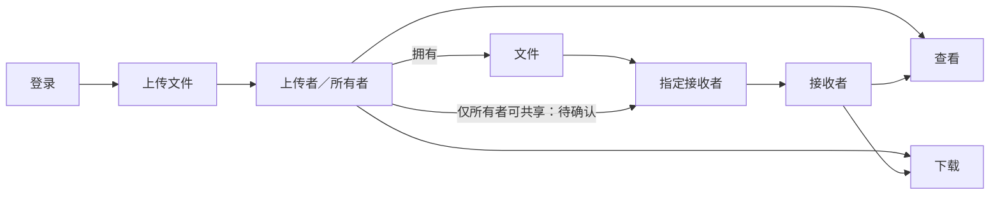
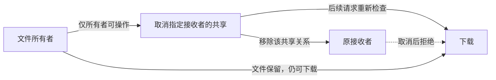

# File sharing: shared-policy trial

Trial prompts and follow-ups delivered by the coordinating AI are scripted-user records. They are not independent human usability evidence.

Local paths are normalized as listed in dialogue.json. Original trial answers and checks are archived separately.

## 01 · scripted-user · 2026-10-28T15:48:30.393Z

$vibelens

我要做一个简单的文件共享应用：用户登录后上传自己的文件，共享给指定用户，收到共享的用户可以查看和下载。里面要能看清用户、文件所有者、接收者之间的权限。业务流程要简单，让我一眼看懂。

用 Python+SQLite 后端和轻量网页前端，创建独立项目 WORKSPACE/VibeLensTrials/file-sharing-policy-trial-20261028。先问必要的业务设计问题，等我回答后再开发；不用增加团队、公开链接、审批、订阅等业务。保留设计问答和测试结果到 review/。源码、标识、注释使用英文，对话中文。

本次显式启用的 Skill 是 WORKSPACE/VibeLensTrials/vibelens-policy-graph/skills/vibelens/SKILL.md。请使用这份新分支的本地 Skill 和脚本，勿使用已安装旧版本。项目独立，不查看其他试验目录或原会话，不修改维护仓库，不联系其他对话，不推送 GitHub。后续会给一次小迭代任务，再检查定位和修复。不要制造缺陷，不预设测试会失败。先完成初版与必要检查，再等迭代指令；页面素材导出是之后的独立阶段。

## 02 · assistant · 2026-10-28T15:48:33.819Z

我会先读取你指定的新分支 VibeLens Skill，只检查这份 Skill 和目标项目路径；先确认必要的业务规则，收到你的回答后再开发。

## 03 · assistant · 2026-10-28T15:49:44.626Z

初版范围可以收敛为“登录 → 上传 → 指定接收者 → 查看/下载”。我会先保存设计草图并打开对应的权限图，图中的未确认规则会保持待讨论；现在只做设计准备。

## 04 · assistant · 2026-10-28T15:51:43.117Z

业务草图和共享权限声明已通过结构校验，三个设计选择仍待你确认。设计图服务打印了地址，但浏览器和本机 HTTP 检查暂时都未连通；我正在核对启动状态，不会把它记作已验证可用。

## 05 · assistant · 2026-10-28T15:53:09.785Z

设计草图已保存，**尚未开始开发**。[权限设计图](http://127.0.0.1:8847/graph) 已通过 HTTP 和浏览器访问检查。

请确认三点：

1. **执行方式**：选 `drive`（状态声明驱动执行），还是 `observe`（应用自己执行，图观察实际运行）？两者都维护图和监测。
2. **账号来源**：初版使用几个预置测试账号，还是提供自行注册？
3. **权限与查看**：是否按图理解——仅所有者能共享，所有者和指定接收者能查看、下载，其他人无权访问？“查看”只需文件信息，还是需要在线预览内容？

问答和设计检查已记录在 review (`WORKSPACE/VibeLensTrials/file-sharing-policy-trial-20261028/review/design-dialogue.md`)，应用测试尚未运行。

第 1 项来自你指定的 VibeLens Skill (`WORKSPACE/VibeLensTrials/vibelens-policy-graph/skills/vibelens/SKILL.md`)，其要求是：“Until answered, continue only mode-independent preparation.” 收到回答后再开发。

## 06 · scripted-user · 2026-10-28T15:56:59.158Z

【模拟用户回答】
查看先简单一点：在收到共享的列表里看到文件名、大小和是谁共享的，点下载就能拿到文件；不用在线预览。接收者只能查看和下载，不能转发共享，也不能改文件。上传的人就是所有者，选择一个已有用户共享给他。使用 drive 模式，Python 和 SQLite 可以。演示账号用三个：林舟上传，许宁接收，周岚没有收到共享。

你展示的登录→上传→指定接收者→查看和下载这条主线符合我的想法，按这个来。先把这一版做出来，不做删除。之后我还要能取消共享，取消后对方即使页面没刷新也不能再下载；请将这作为下一轮迭代，保留前后图的变化。先完成初版并运行测试，给我访问地址，再等待我发迭代任务。保留此条模拟答案的原文。

## 07 · assistant · 2026-10-28T15:57:03.071Z

我会按这条**模拟答案**完成初版：使用 drive 模式，预置林舟、许宁、周岚三个账号；所有者可共享，接收者只能查看文件信息和下载。初版不做删除或取消共享，取消共享保留为下一轮迭代。我会保存模拟答案原文，完成必要检查后给出访问地址。

## 08 · assistant · 2026-10-28T15:59:34.202Z

初版会用两个列表呈现主线：“我的文件”和“收到的共享”，每条文件显示所有者及当前可操作权限。权限会在服务器每次请求时检查；取消共享按钮和状态留到下一轮。依赖正在安装到项目自己的虚拟环境，接下来冻结初版需求与检查基线。

## 09 · assistant · 2026-10-28T16:03:20.127Z

上传、定向共享和下载的代码已写好，正在接入声明执行与运行证据。文件内容直接存入 SQLite，共享失败会回滚事务；接收者页面只提供下载操作，服务器也会拒绝接收者或未获共享用户发起的共享请求。

## 10 · assistant · 2026-10-28T16:08:08.929Z

第一轮测试被 Windows 沙箱的临时目录权限挡住，尚未验证到业务规则。我已把测试临时数据库移到项目内的 `review/tmp/`，正在重跑；原错误和后续修复会保留在检查记录中。

## 11 · assistant · 2026-10-28T16:09:03.111Z

业务检查已验证了私有文件访问、越权拒绝和重复共享等行为，另发现两处检查集成问题：测试读取 SQLite 后没有显式关闭连接，以及新分支的项目封装 schema 不接受权限图生成的 `maps` 关系。我会修复测试资源释放，并在项目内加一个严格校验该关系的兼容适配，保持本地 Skill 和维护仓库文件不变。

## 12 · scripted-user · 2026-10-28T16:10:44.520Z

验收与记录方式补充：请优先用项目内可复现的无头 Playwright 脚本完成实际浏览器操作并保存截图，以便记录用户操作顺序与源码/测试构建的一致性；不要依赖需要人工接续的桌面窗口。业务需求与验收标准不变。

当前分支已修正一个框架打包问题：没有规则图的项目不再附带未使用的原生策略包；有规则图的项目仅附带必要的五个纯 Python 核心模块。源码扫描只将同时匹配管理清单及本工具当前规范源码的副本识别为框架依赖，修改过的副本仍会进入应用检查。若你此前已复制过运行模块，请通过 bo_upgrade.py 的正常机制升级到当前指定 Skill 路径，然后重新生成并检查；不要靠放宽排除范围掩盖缺口。请将该次框架升级记录为研发期环境变更，初次构建成本中单列这部分额外处理。

## 13 · assistant · 2026-10-28T16:11:01.654Z

收到补充。我会改用项目内可复现的无头 Playwright 脚本，保存实际操作顺序和验收截图。同时按 `bo_upgrade.py` 正常机制升级已复制的运行模块，将本次框架升级作为研发期环境变更单独记录；业务范围保持初版约定。

## 14 · assistant · 2026-10-28T16:14:08.260Z

12 项应用检查已通过，覆盖主流程、越权拒绝、重复及并发共享、失败回滚，以及观察模块关闭、故障和队列拥塞时的业务执行。框架升级已完成，初始基线保持原字节；正在复核更新后的图映射，再运行无头浏览器验收。

## 15 · assistant · 2026-10-28T16:19:30.800Z

无头浏览器已实际完成登录、上传、共享和接收者登录，当前停在一个文字定位断言：所有者姓名与单元格内的说明文字连在一起，原来的“完全匹配”没有命中。该定位已修正。独立业务断言全部通过；图映射检查还发现了采集摘要格式和证据案例登记的缺项，正在补齐后重跑，原检查标准保持不变。

## 16 · assistant · 2026-10-28T16:21:56.715Z

浏览器验收已通过，保存了 10 个操作步骤和 5 张截图；图映射、状态约束、业务断言及项目检查也均已通过。但接受该构建时，门禁检测到框架输入又发生变化，因此没有接受旧构建。我会保留这次结果，再按正常机制升级、重新生成并复核。

## 17 · assistant · 2026-10-28T16:25:57.568Z

我已暂时停止后台刷新服务，固定源码和图文件进行最终接受，避免生成过程改动正在核验的构建。最终构建通过后会重新启动，再复测截图对应的源码版本，以及录制、回放是否保留了真实的上传和共享状态证据。

## 18 · assistant · 2026-10-28T16:27:42.646Z

最终浏览器复测发现，图地址仍由一个旧进程提供服务，构建号与已接受源码不一致。原因是 Windows 虚拟环境还有子进程残留；我会修正启动器对自有进程树的清理，重新核对两个地址的构建身份后再交付。

## 19 · assistant · 2026-10-28T16:29:55.968Z

最终构建的 `scan → inspect → verify → accept → check` 已全部通过。原始基线未改动，五个原生策略核心模块也都与管理清单、当前 Skill 源码一致。现在重新启动已接受的构建，完成最后一轮浏览器操作和录制回放检查。

## 20 · assistant · 2026-10-28T16:33:31.723Z

主业务操作和录制已通过：本轮捕获了 342 个真实事件，包含上传、共享状态和下载证据，没有丢失。回放检查又定位到设计阶段与运行阶段的布局标识不兼容，页面因此无法读取原有视图设置。我会为同一项目加上明确的布局迁移别名，保留原布局，再复测回放。

## 21 · scripted-user · 2026-10-28T23:32:40.900Z

刚才会话中断了，请从本项目保存的状态继续，先完成第一版的最终验收和回放复测，保留先前342事件和布局迁移故障及修复证据。请使用可重现的headless Playwright脚本，不依赖手动桌面操作。第一版结束后停下，明确最后构建、通过的检查、未通过项和URL；之后我会给取消共享迭代需求。只修改当前独立试用，不修改Skill仓库，不发布。设计问题继续由我模拟回答。

## 22 · assistant · 2026-10-28T23:32:55.136Z

我会继续当前项目的验收，不重建基线。先前的 342 事件录制、布局迁移故障及修复记录都保留在本项目中；最终构建的无头 Playwright 复测正在运行。完成后我会明确报告构建号、通过项、未通过项和访问地址，然后停下等待取消共享的迭代指令。

## 23 · assistant · 2026-10-28T23:35:17.889Z

最终无头复测已通过：11 个操作步骤、5 张截图，源码、服务及截图记录的构建号均为 `fa390db0b5de…`。录制已停止，并在新页面中成功回放；布局迁移后的偏好接口返回 200，原视图记录已保留。现在只归档最终报告和初版图快照，不再改业务源码。

## 24 · assistant · 2026-10-28T23:36:11.016Z

复测后的源码一致性检查发现，指定 Skill 的规范策略投影文件又有更新，当前副本因此被门禁判为过期。已通过的构建和 482 事件回放证据会完整归档。我会再做一次标准框架升级和复核，将这部分额外处理单列到环境变更记录。

## 25 · scripted-user · 2026-10-28T23:36:35.216Z

规范Skill的本轮实现现在已冻结，我不会再并行修改运行时；刚才变化仅来自最后的格式化和受管副本同步。请完成这一次正常升级和收尾即可。所有框架升级成本、失败与重复执行都按实际记录，不能混入业务新增成本。

## 26 · assistant · 2026-10-28T23:36:37.896Z

收到，按现在冻结的 Skill 完成这一次收尾。框架升级、格式化同步及相关失败重跑会单列记录，不计入业务新增；初版业务范围保持不变。

## 27 · assistant · 2026-10-28T23:42:06.960Z

已定位到剩余差异只有 `bo_policy.py` 命令入口的格式化同步；应用绑定源码没有差异，浏览器和回放复测仍对应同一构建。我会用标准升级机制补齐这一处，再接受当前工具环境，并将这次重复校验继续单列为框架处理成本。

## 28 · assistant · 2026-10-28T23:47:25.265Z

初版已完成，服务保持运行，开发停在迭代前。

- [应用](http://127.0.0.1:8850/) · [权限图](http://127.0.0.1:8847/graph)
- 最后构建：`fa390db0b5de`；验收候选：`739a82501fe7`
- 通过：12 项应用测试、39 条业务断言、8 项证据检查，以及映射、状态和项目检查。
- Headless Playwright：11 步、5 张截图、552 事件录制与回放通过。**未通过项：无。**

账号：`linzhou`、`xuning`、`zhoulan`；统一演示密码：`file-demo-2026`。

最终验收报告 (`WORKSPACE/VibeLensTrials/file-sharing-policy-trial-20261028/review/final-review.md`) 已保留 342 事件、布局迁移故障及修复证据。框架升级与重跑成本 (`WORKSPACE/VibeLensTrials/file-sharing-policy-trial-20261028/review/development-costs.md`) 已单列。

取消共享尚未实现，等待你的迭代指令。

## 29 · scripted-user · 2026-10-28T23:49:31.490Z

现在加上取消共享。只有文件所有者能取消给某个接收者的共享；取消后，对方即使还开着旧页面，再点下载也应被拒绝。文件仍留在所有者那里，我自己仍能下载。先按这条改，图也同步更新，保持原先上传、共享、下载的行为。保留第一版源码基线、这一轮对话、测试和截图，完成后停下。

## 30 · assistant · 2026-10-28T23:49:35.096Z

我会先冻结第一版源码和图的基线，再增加“所有者取消某个接收者的共享”。本轮会重点验证旧页面的下载被服务器拒绝、所有者仍能下载，以及原有上传、共享和下载流程保持正常。

## 31 · assistant · 2026-10-28T23:55:12.898Z

第一版已冻结为包含 250 个文件的源码包，并保存了验收、测试、截图和数据备份。新一轮基线也已建立。取消共享会复用现有的“已登录且为所有者”规则，并在同一事务中移除指定关系、更新文件状态。

## 32 · assistant · 2026-10-28T23:55:39.503Z

[更新后的设计图](http://127.0.0.1:8847/graph) 已验证可访问；当前是设计视图。按你本轮明确的规则实施：

接下来会在页面上为每个已共享接收者增加“取消共享”按钮，并用无头浏览器保留接收者旧页面后实际点击下载。

## 33 · assistant · 2026-10-28T23:58:48.916Z

后端和页面的取消入口已加入。原有下载入口继续在每次请求时读取共享关系；新增状态分支会在最后一个接收者被取消时回到“私有”，还有其他接收者时保持“已共享”。我正在补充原流程回归、越权取消和旧页面下载的验收用例。

## 34 · assistant · 2026-10-29T00:06:55.211Z

15 项应用检查已通过，包括原流程、旧下载地址被拒绝、所有者仍能下载、其他文件和接收者不受影响，以及重复和并发取消。接下来会运行图映射、状态证据和观察开关检查，再做实际浏览器复测。

## 35 · assistant · 2026-10-29T00:12:23.901Z

取消共享的代码、业务图和正式校验已通过。接下来用无头浏览器验证旧页面再次下载会被拒绝、所有者仍能下载，并回归原来的上传和共享流程；截图和记录会保存在第二轮目录。

## 36 · assistant · 2026-10-29T00:13:23.071Z

原来的上传、共享、下载浏览器流程已通过。取消共享已执行成功，但新脚本在“旧页面内容完全未变”的检查处停下；我先定位页面或浏览器状态的变化，再继续验证旧链接返回 403。

## 37 · assistant · 2026-10-29T00:14:20.268Z

原因已定位：Playwright 截图会给输入框留下空的 `style` 属性，导致截图前后的 HTML 哈希不同。页面地址和业务内容没有变化。已将哈希采样移到截图之后，保留严格比较；两次失败记录均已归档，应用权限逻辑未改动。

## 38 · assistant · 2026-10-29T00:16:14.133Z

旧页面下载验证已通过：接收者页面保持未刷新，点击原下载链接返回 403；所有者随后下载的文件内容一致。真实记录也捕获了“未共享 → 已共享 → 未共享”的状态变化并完成回放。现在收尾归档第一版基线、本轮测试和截图。

## 39 · assistant · 2026-10-29T00:18:24.123Z

截图复核发现了一个图页面问题：接口和回放数据正常，但页面把本项目的平面状态日志当成活动日志读取，触发控制台错误并显示连接失败。我会在本项目的展示适配层修复日志格式，保留原始日志和真实事件，不改动已冻结的 Skill 源码；随后重跑浏览器验收。

## 40 · assistant · 2026-10-29T00:22:08.265Z

展示适配已放在项目自己的 `integrations/` 中，原始状态日志继续保留，未生成虚构的活动执行记录。已补上日志投影和图页面控制台检查，正在运行最终校验。

## 41 · assistant · 2026-10-29T00:24:42.776Z

最终浏览器验收已通过：原有流程 11 步、取消共享流程 12 步，图页面无控制台错误，取消共享的真实步骤也已回放。共保留 12 张截图；正在完成源码、原始回放和校验记录的归档。

## 42 · assistant · 2026-10-29T00:25:35.982Z

已完成取消共享，并按要求停在本轮。

只有所有者能取消指定接收者；接收者从旧页面再次下载返回 **403**，所有者仍能下载。原有上传、共享、下载已回归通过。

- [打开应用](http://127.0.0.1:8850/) · [查看更新后的图](http://127.0.0.1:8847/graph)
- 映射、状态、业务和项目检查通过：16 项测试、84 项业务断言、10 项证据检查；浏览器验证保留 12 张截图。当前未通过项：无。
- 第一版源码基线 (`WORKSPACE/VibeLensTrials/file-sharing-policy-trial-20261028/review/baselines/initial-v1/source.zip`) · 本轮验收报告 (`WORKSPACE/VibeLensTrials/file-sharing-policy-trial-20261028/review/iteration-02-revoke/final-review.md`) · 本轮对话 (`WORKSPACE/VibeLensTrials/file-sharing-policy-trial-20261028/review/iteration-02-revoke/dialogue.md`) · 旧页面拒绝下载截图 (`WORKSPACE/VibeLensTrials/file-sharing-policy-trial-20261028/review/iteration-02-revoke/browser/05-stale-download-denied.png`)

## 43 · scripted-user · 2026-10-29T01:10:14.899Z

本轮业务V2已经完成，请先做一个独立的框架兼容回归，不新增业务，也不计入V2业务迭代成本。
我在你记录的 integrations/bo_schema_compat.py 中确认了真实规范缺陷：项目schema重复旧枚举，以及policy/data投影顺序不稳定。规范仓库当前工作树已修复：项目schema引用统一模型并离线注册，原生协议严格核对policy映射，投影保持已有顺序。当前26项规则测试（含未经适配的安装副本）通过；你的实际V2 project.json也已直接通过规范 validate_project，未导入本地shim。规范路径仍是 WORKSPACE/VibeLensTrials/vibelens-policy-graph/skills/vibelens ，这是待完成仓库整体验收的候选修复，先不要把它称为已发布版本。
请通过正常升级流程更新项目，完整移除只为修改规范schema/投影行为而存在的 bo_schema_compat.py 及其安装调用，CLI直接运行规范接口；真正转换项目原生状态日志形状的bo_view适配器保留。保持所有原业务断言和采集要求，重新验证业务、映射、录制/回放和旧页面取消后拒绝下载。保存此前适配通过的版本及失败/修复/新复测，明确区分原生框架通过和适配通过。不要修改规范仓库，完成后停下，尚不做故障植入或产品素材导出。

## 44 · assistant · 2026-10-29T01:10:33.710Z

我会将这次工作单独记录为框架兼容回归：先保存 V2 适配通过的版本，再按正常流程升级候选框架，移除 schema/投影 shim，保留原生状态日志的展示适配器。原业务断言和采集要求保持不变，费用记录与 V2 分开，完成后停下。

## 45 · assistant · 2026-10-29T01:13:02.496Z

V2 源码、验收记录和成本文件已冻结，正常升级已更新 5 个框架文件。新接口在升级前拒绝为旧安装副本建立基线；确认项目源码与已接受的 V2 完全一致后，我使用旧安装接口建立了基线，保留了这次拒绝记录。现在 shim 和 CLI 包装器已移除，后续验证直接调用规范接口。

## 46 · assistant · 2026-10-29T01:14:49.036Z

规范源码和升级后的安装副本都已在未加载 shim 的独立进程中，直接验证了原 V2 图。原生投影的重复生成结果一致，业务声明、断言、采集要求及 V2 记录共 176 个受保护文件的哈希未变。第一轮完整检查已通过；日志归档标签修正后，正在校验最终构建。

## 47 · assistant · 2026-10-29T01:17:59.470Z

无 shim 构建的原有上传、共享、下载浏览器流程已通过，图页面控制台正常。取消共享的浏览器复测正在完成真实事件收集和回放；本轮截图、原始记录和成本将归档到独立的兼容回归目录。

## 48 · assistant · 2026-10-29T01:18:59.936Z

无 shim 构建的取消共享复测也已通过：接收者从未刷新的旧页面点击原链接得到 403，所有者仍能下载相同内容，真实状态变化已录制并回放。正在完成归档和最后的哈希核对；本项目通过回归，框架仍标为未发布候选修复。

## 49 · assistant · 2026-10-29T01:19:20.624Z

独立框架兼容回归已完成，现已停下。

- schema/投影 shim 及 CLI 包装器已移除，`bo_view` 原样保留；规范接口和安装副本均原生通过。
- 16 项应用测试、84 项业务断言、10 项证据检查通过；旧页面下载返回 403、所有者下载及真实录制回放均通过。
- V2 的 176 个受保护文件哈希未变，本次成本单独记录。

框架仍标为**未发布候选修复**。本项目当前未通过项：无。

回归报告 (`WORKSPACE/VibeLensTrials/file-sharing-policy-trial-20261028/review/framework-compat-01/final-review.md`) · 独立成本记录 (`WORKSPACE/VibeLensTrials/file-sharing-policy-trial-20261028/review/framework-compat-01/development-costs.json`) · [应用](http://127.0.0.1:8850/) · [图](http://127.0.0.1:8847/graph)

## 50 · scripted-user · 2026-10-29T01:25:34.592Z

$vibelens

继续一轮隔离的受控定位测试，业务需求不变。这次只操作副本 WORKSPACE/VibeLensTrials/diagnosis-with-skill-native-20261029，原交付项目保持不变；不要访问其他试验、维护仓库或其他对话，不推送。明确在此副本使用同一份已通过27项测试的候选 Skill（tooling/skill-path.txt 已保留），不添加校验/投影兼容补丁。

取消共享看起来成功，但许宁还开着的旧页面仍能下载。请重现、定位并修复，保持其他行为，保留失败、定位依据、源码修改和复测。副本从已通过的无shim原生源码归档建立，原有16项应用测试和canonical change_sync check均先通过；已在 .stategraph/diagnosis-03 正常begin，然后才出现故障。当前原测试的失败记录在 review/diagnosis-red-tests.json。这是受控故障测试，不应写成自然发现的业务缺陷；具体原因请自行定位。保持原有独立断言，不删测试、不改预期来通过。用独立端口8852/图8853、独立临时数据，验证旧页、所有者访问、其他接收者、重新共享及原有回归。

请实际使用状态网/规则网/运行事实进行检查，记录它实际提供了哪些定位依据；若某一步只能靠源码定位，也如实区分。按正常scan/模型映射/inspect/verify/accept/check闭合，不得仅修代码而漏图，禁止修改观测器来掩盖失败。保持真实字段/状态/数据库证据及原录制回放检查。项目依赖可使用原项目 .venv/Scripts/python.exe，但cwd、业务数据、服务、产物均属于副本。缺少的普通运行依赖可正常安装，不能读取原项目的新调查产物。

请将完整记录保存到副本 review/diagnosis/，完成后停止。无需制作产品宣传素材，无需扩展功能。回复用中文，源码标识和注释英文。

## 51 · assistant · 2026-10-29T01:25:53.053Z

本轮会在指定副本中使用 VibeLens 做受控定位，保留原断言和失败记录。先重现旧页面下载问题，再检查状态网、规则网和运行事实，区分图提供的线索与源码确认的原因。服务、数据和产物均使用副本，端口为 8852/8853。

## 52 · assistant · 2026-10-29T01:28:05.994Z

已重现原来的 5 项测试失败。运行事实显示：界面提示取消成功，但数据库删除影响行数为 0，许宁的共享关系仍在；状态网记录的是 `shared → shared`，后续读取规则因此仍允许下载。这些事实将问题缩小到取消共享的持久化环节，尚不能确定具体原因；接下来核对实际 SQL 绑定和该处源码。

## 53 · assistant · 2026-10-29T01:30:58.525Z

已确认原因：删除条件把接收者与操作人 `linzhou` 比较，而应与目标接收者 `xuning` 比较。图中的 `recipient_id=xuning` 是采集的请求字段，不能证明 SQL 实际绑定正确；独立数据库执行监听捕获了 `linzhou`，源码核对也确认了这一处变量错误。观测器保持不变，我会先保留故障页和真实回放，再修复。

## 54 · assistant · 2026-10-29T01:35:12.853Z

旧页面再次下载的 200 响应已在浏览器中重现，原生 `verify` 也未通过。完整校验中的观测命令被原断言中断，因此状态约束和业务规则报告为“未运行”，不能称为通过。故障事件和数据库证据已单独保留；回放脚本还需补上异步步骤选项的等待。

## 55 · assistant · 2026-10-29T01:36:56.712Z

已只修正删除条件中的这一处变量：`actor` 改为 `recipient_id`。独立 SQL 监听确认实际绑定已变成 `xuning`，共享关系被删除，文件状态回到 `private`。原有 16 项测试及业务、映射断言均未修改；正在做完整复测，并补验其他接收者仍可下载、重新共享后许宁恢复访问。

## 56 · assistant · 2026-10-29T01:40:34.999Z

完整检查已通过：映射、状态约束、业务规则和项目检查均通过，原有 16 项测试、84 项业务断言、10 项证据检查保持原样。旧页面浏览器复测也已返回 403，所有者仍能下载；最后正在完成其他接收者和重新共享场景的真实规则决策与回放核对。

## 57 · assistant · 2026-10-29T01:42:31.331Z

复测已完成：取消许宁后，许宁的旧页面下载被拒绝，周岚和所有者仍可下载；重新共享后，许宁恢复访问。真实规则事件与文件版本、数据库关系一致，故障及修复后的录制均已回放。全部记录已归档，206 个受保护的断言、测试和观测文件哈希未变，接下来停在本轮。

## 58 · assistant · 2026-10-29T01:43:02.362Z

已在指定副本完成受控故障修复，并停下。原交付项目未改。

根因是删除条件将接收者与 `actor` 比较，已改为 `recipient_id`。图帮助定位到“删除 0 行、共享关系仍在”；具体变量错误由源码和实际 SQL 绑定确认，定位边界已如实记录。

- 原有 16 项测试、84 项业务断言、10 项证据检查全部通过。
- 旧页面下载返回 403；所有者、其他接收者及重新共享均验证通过。
- 原断言和观测器未改，scan→inspect→verify→accept→check 已闭合。

完整记录 (`WORKSPACE/VibeLensTrials/diagnosis-with-skill-native-20261029/review/diagnosis/final-review.md`) · 源码差异 (`WORKSPACE/VibeLensTrials/diagnosis-with-skill-native-20261029/review/diagnosis/app-service.diff`) · [应用](http://127.0.0.1:8852/) · [图](http://127.0.0.1:8853/graph)

## 59 · scripted-user · 2026-10-29T01:47:45.762Z

诊断验收已记录，进入单独的产品素材导出阶段，费用与刚才的定位修复分开。这次仍只操作 diagnosis-with-skill-native-20261029；保持已修好的源码、业务和保护断言不变，不重新植入缺陷，不修改规范仓库或发布。

请从刚才实际保留的 red-browser 与 green-revocation（单一接收者、取消后private）整理两份自足素材包 review/product-materials/red/ 和 green/。每包包含：原始完整录制JSON（含context/final/sources/runtime_frames，无缺口）、对应模型/manifest的api-view.json（可从原录制原样重建，明确为归档回放）、recording-catalog.json、原生完整code-graph-status.json查询结果（errors空、omitted_nodes=0，包含边、bindings、代码角色）、实际业务结果passed=false/true及断言证据、event-screenshot-map.json和应用截图。红包必须使用故障源归档与红录制的模型，不能把当前绿色源码/AST标成红版本；需要时在同副本review/tmp内还原红源离线调用原生分析器，不启动/接受故障版本。图事件与SQL实际绑定的独立证据、源码差异也保留。

应用截图应是业务界面，不是graph截图；逐个标明对应的实际事件ID、业务阶段、build_id和文件。希望能包含登录/上传/指定接收者/接收方页面/取消后状态/旧页下载结果/所有者仍可下载。仅使用真实已执行过的操作和原始截图；不画假界面、不合成不存在的事件。如果个别阶段原先没截图，可在绿色版本另行运行真实序列补图并记录新的真实录制，整包统一该录制与build；红色优先沿用已保存素材，缺项如实列出，不假补。

另外，请提供一个简短 material-index.json，列明红绿build、源码归档hash、录制名、每阶段事件/图中节点、关键query db_delete_share的 rows 值、revoke的 removed/grant_count、shared→shared与shared→private、对应源码符号、业务结果文件。标注这是一轮受控植入后定位修复的素材，不能称为AI初版自然产生了这个bug。不要继续扩展功能或重写测试。完成导出核对后停下。

## 60 · assistant · 2026-10-29T01:48:02.227Z

我会将这次导出单独记录成本，保持已修源码、业务和断言不变。先核对红绿录制、归档源码和截图，再整理自足素材包；红色缺少的阶段会明确列出，绿色如需补图则执行新的真实序列，并统一使用该次录制和构建。

## 61 · assistant · 2026-10-29T01:52:04.602Z

红色现有素材包含 3 张应用截图，登录、上传等阶段缺图会如实标注。绿色将另跑一条完整真实序列补图，整包统一到新录制。红色代码图会从红录制及故障源码归档离线生成，不使用当前绿色源码，也不启动故障版本。

## 62 · assistant · 2026-10-29T02:01:50.997Z

两包已生成。原生完整源码图查询均为 494 个节点、711 条边、208 个绑定，`errors=[]`、`omitted_nodes=0`。红色保留 3 张原应用截图并列出缺项；绿色使用新录制补齐了 8 张应用截图。正在交叉核对构建、源码哈希、事件编号和包内引用。

## 63 · assistant · 2026-10-29T02:04:19.052Z

包内交叉核对已通过：红绿录制、源码、事件、截图和业务结果分别一致，两个压缩包已生成。最后还在等待原生已接受构建检查返回；已修源码和断言未变。新增绿色操作产生的服务日志以追加方式保留，原诊断日志前缀也已按原哈希单独保存。

## 64 · assistant · 2026-10-29T02:05:54.949Z

最后检查拦住了仍留在 `review/tmp` 的离线源码副本：其中的路由被识别为额外入口。两份副本已逐文件归档并校验哈希；我会清理这两个临时目录，再运行原生检查。已接受源码和现有排除规则都保持不变。

## 65 · assistant · 2026-10-29T02:07:31.527Z

素材已导出并核对，现已停下。

- 红色素材包 (`WORKSPACE/VibeLensTrials/diagnosis-with-skill-native-20261029/review/product-materials/red.zip`)：`passed=false`，326 个事件、3 张原应用截图，缺图阶段已明确列出。
- 绿色素材包 (`WORKSPACE/VibeLensTrials/diagnosis-with-skill-native-20261029/review/product-materials/green.zip`)：`passed=true`，654 个事件、8 张真实补拍截图，统一使用同一录制和构建。

两包原生代码图均为 `errors=[]`、`omitted_nodes=0`。已标注受控故障来源，源码和保护断言未改，导出费用单列。

素材索引 (`WORKSPACE/VibeLensTrials/diagnosis-with-skill-native-20261029/review/product-materials/material-index.json`) · 核对结果 (`WORKSPACE/VibeLensTrials/diagnosis-with-skill-native-20261029/review/product-materials/export-verification.json`)
