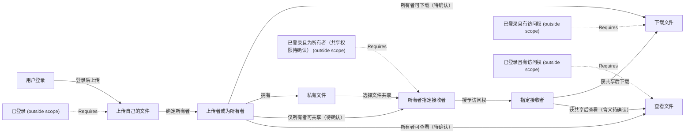

# Business network draft

[Open the live graph](http://127.0.0.1:8847/graph)

This is a focused view. Dashed boundaries retain original relations; open Web for the complete graph.

Still to confirm:

- 项目采用 drive（状态声明驱动执行）还是 observe（应用自己执行，图负责观察）？
- 初版账号使用预置测试账号，还是提供自行注册？
- 请确认：仅所有者能共享；所有者和指定接收者能查看、下载；其他人无权访问。“查看”是文件信息还是也需要在线预览内容？

Confirm this understanding in the conversation, or describe a correction. Viewing the graph is not confirmation.
