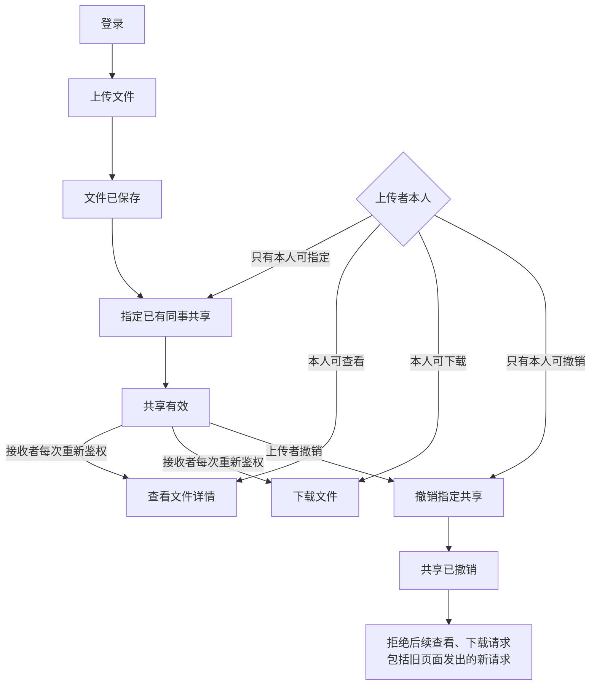

# GitHub-installed VibeLens · Team file sharing · v1

Trial prompts and follow-ups delivered by the coordinating AI are scripted-user records. They are not independent human usability evidence.

Local paths are normalized as listed in dialogue.json. Original trial answers and checks are archived separately.

## 01 · scripted-user · 2026-11-04T05:38:53.261Z

使用 $vibelens 帮我做一个小型团队文件共享网站。用户登录后可以上传文件，指定已有同事共享，对方能查看和下载；上传者可以撤销共享。先跟我确认必要的细节，确认后再开发，做完给我程序和 VibeLens 的访问地址。

工程放在 WORKSPACE。这里已经从 GitHub 的 v0.11.0 安装好了 Skill，请使用这个工程内 .agents/skills/vibelens/SKILL.md 的版本。源码、标识符和注释用英文，网页用中文。只在这个独立目录里工作，遵守目录里的 AGENTS.md。

## 02 · assistant · 2026-11-04T05:38:56.376Z

我会先阅读工程里的 `AGENTS.md` 和指定版本的 VibeLens Skill，再确认影响业务规则的必要细节；确认前先不开发。

## 03 · assistant · 2026-11-04T05:39:32.661Z

我会使用工程内的 VibeLens v0.11.0 Skill，先把登录、上传、指定同事共享、查看下载和撤销画成草图。需要确认的重点是账号来源、“查看”的含义，以及运行方式和存储选择；这些未确认前只准备设计图。

## 04 · assistant-question · 2026-11-04T05:39:56.008Z

{"questions":[{"title":"VibeLens 运行方式和存储怎么选？drive 让程序按状态声明执行；observe 保留程序自己的业务逻辑，由图观察执行，两种都维护图和监测。这个小型版本建议用 SQLite + SQLAlchemy，无需额外数据库服务；如已有数据库请写明。","options":["observe + SQLite + SQLAlchemy","drive + SQLite + SQLAlchemy"]},{"title":"“已有同事”的账号从哪里来？是由这个独立工程预置几个可登录的演示账号，还是接入你已有的账号系统？","options":["预置 3 个演示账号","接入已有账号系统（请说明来源）"]},{"title":"“查看”是仅看文件详情（名称、大小、上传者），还是需要在线预览内容（请说明文件类型）？撤销暂理解为上传者撤销指定同事的权限，撤销成功后旧页面再次查看或下载也会被拒绝；已下载的副本无法收回。请确认或纠正。"}]}

## 05 · scripted-user · 2026-11-04T05:40:28.304Z

这个版本用 drive，让程序按状态声明执行，数据库就用 SQLite + SQLAlchemy。先预置 3 个演示账号，不接外部账号系统。“查看”先做文件详情，不用在线预览；上传者本人也能查看和下载自己的文件。共享只允许上传者指定或撤销，接收者不能再转给别人，其他同事看不到。撤销后，旧页面再次查看、下载都要重新检查权限并拒绝。按这个范围做即可。

## 06 · assistant · 2026-11-04T05:40:38.216Z

范围已确认：使用 drive 和 SQLite + SQLAlchemy，预置 3 个演示账号；查看只做文件详情。只有上传者能维护共享，本人和仍获共享的同事可以查看、下载；撤销后，旧页面发出的请求也重新检查权限。我会把这些规则保存到同一张图里，然后开始开发。

## 07 · scripted-user · 2026-11-04T05:43:11.007Z

先把这轮停在设计确认阶段，保留目前的文件和对话，不继续写应用代码。请把当前理解的业务流程图直接发在对话里，并给我可查看草图的 VibeLens 地址。我先审查这个范围，之后再继续。

## 08 · assistant · 2026-11-04T05:43:16.955Z

已停在设计确认阶段，尚未编写应用代码。现有设计文件和对话记录会保留。我只继续检查草图访问地址；刚才本地浏览器连接超时，确认可访问后就把流程图和地址发给你审查。

## 09 · assistant · 2026-11-04T05:44:43.804Z

草图已可访问：HTTP 返回 200，浏览器也显示了中文业务图和“设计声明 · 尚未实现”标记。设计与对话记录已保留在工程的 `review/` 中，开发保持暂停。

## 10 · assistant · 2026-11-04T05:45:23.786Z

已停在设计确认阶段，尚未编写应用代码；现有文件和对话记录已保留。

[VibeLens 草图地址](http://127.0.0.1:8841/graph)已通过 HTTP 和浏览器访问验证。当前方案是 **drive + SQLite + SQLAlchemy、3 个演示账号、仅查看文件详情**。

接收者不能转共享，其他同事看不到文件。网页中可展开共享的权限规则；目前展示的是设计声明。

设计与暂停记录 (`WORKSPACE/review/design-hold.md`)已保存，等待你审查后继续。

<oai-mem-citation>
<citation_entries>
MEMORY.md:232-232|note=[discovery record schema and local Skill usage]
</citation_entries>
<rollout_ids>
01a18332-cb51-7471-83f8-990d88886b9d
</rollout_ids>
</oai-mem-citation>

## 11 · scripted-user · 2026-11-04T05:50:36.909Z

草图里的理解是对的，就按这个范围继续实现吧。先把这几条流程做成简单、可运行的网站，其他功能暂时不用加。做完给我程序、VibeLens 的访问地址，以及你实际验证过的结果。

## 12 · assistant · 2026-11-04T05:50:40.228Z

我会按已确认的草图继续实现，保持范围不变。先做可运行的网站，再用实际请求验证共享、越权拒绝和撤销后旧页面访问，同时保留 VibeLens 的映射与运行证据。

## 13 · user · 2026-11-04T05:50:51.500Z

<send_user_message_question_reply>
[{"questionItemId":"[\"request_user_input_async\",\"call_39c3bb02783b49d6b599bb47087849c2\",0]","question":"VibeLens 运行方式和存储怎么选？drive 让程序按状态声明执行；observe 保留程序自己的业务逻辑，由图观察执行，两种都维护图和监测。这个小型版本建议用 SQLite + SQLAlchemy，无需额外数据库服务；如已有数据库请写明。","answer":"drive + SQLite + SQLAlchemy"},{"questionItemId":"[\"request_user_input_async\",\"call_39c3bb02783b49d6b599bb47087849c2\",1]","question":"“已有同事”的账号从哪里来？是由这个独立工程预置几个可登录的演示账号，还是接入你已有的账号系统？","answer":"预置 3 个演示账号"},{"questionItemId":"[\"request_user_input_async\",\"call_39c3bb02783b49d6b599bb47087849c2\",2]","question":"“查看”是仅看文件详情（名称、大小、上传者），还是需要在线预览内容（请说明文件类型）？撤销暂理解为上传者撤销指定同事的权限，撤销成功后旧页面再次查看或下载也会被拒绝；已下载的副本无法收回。请确认或纠正。","answer":"仅查看基本信息即可，其他确认"}]
</send_user_message_question_reply>

## 14 · assistant · 2026-11-04T05:50:55.069Z

收到，与你之前确认的范围一致：drive、SQLite + SQLAlchemy、3 个演示账号，查看只展示基本信息。我会继续按这套规则实现。

## 15 · assistant · 2026-11-04T05:53:35.127Z

网站会保持简单：登录后展示“我的文件”和“共享给我”，上传者在文件详情中指定或撤销同事权限。权限会在每次服务端请求时检查，撤销后即使对方还停留在旧页面，也不能继续查看或下载。

## 16 · assistant · 2026-11-04T05:58:17.906Z

上传、共享和撤销的服务端逻辑已写好，共享状态从声明执行，并与权限变更一起保存到 SQLite。接下来会接上中文页面和 VibeLens 采集；界面会按 `frontend-design` 技能做简洁的文件列表与共享管理页。

## 17 · assistant · 2026-11-04T06:07:52.425Z

第一轮业务测试已通过：本人和有效接收者可访问，其他同事不可见、不能下载；接收者不能转共享或撤销；撤销后再次查看、下载都被拒绝。还验证了撤销一人不影响其他接收者，以及写入中途失败会回滚。接下来检查 VibeLens 是否如实记录这些结果。

## 18 · assistant · 2026-11-04T06:10:48.805Z

VibeLens 已采到实际执行事件。开启观察时，正常流程和边界流程的采集错误、丢失事件、数据库适配错误均为 0；关闭观察或注入观察服务故障后，业务结果仍一致。正在运行完整校验，随后验证浏览器操作、录制停止和回放。

## 19 · assistant · 2026-11-04T06:14:27.718Z

网站已在本机运行。完整校验发现了采集配置中的两处遗漏：部分输入只在函数入口记录，校验用例却只选了出口；上传长度断言也缺少对应的出口值。我已补齐记录和入口用例，保留首次失败报告，正在重跑原校验。浏览器验收将使用 `webapp-testing` 技能和独立会话完成。

## 20 · assistant · 2026-11-04T06:18:49.543Z

完整校验现已通过：实现映射、状态约束、业务规则和项目检查四项均通过。浏览器首轮也确认了旧页面下载返回实际的 403，并生成了无缺口的录制。负向测试确认：源码不同步、缺少权限事件或导出实例时会被拒绝；聚焦采集、停止排空失败和队列丢失也按预期报告。

## 21 · scripted-user · 2026-11-04T06:19:03.434Z

先把网站和业务、源码映射的原生检查完成。VibeLens v0.11.0 已定位到一处旧数据状态的回放显示问题，官方补丁正在验收；如果浏览器遇到“已提交/已转换”相关报错，请保留原始失败记录，等更新工具后再复测。业务规则保持我们确认的范围。

## 22 · assistant · 2026-11-04T06:19:23.039Z

明白，业务规则保持不变。网站业务、状态执行、源码映射和 API 采集的原生检查已经通过，正在保存最终验收记录。浏览器回放会单独报告；若出现“已提交/已转换”相关报错，我会保留原始失败，等官方工具更新后复测，不修改 Skill 或绕过检查。

## 23 · assistant · 2026-11-04T06:28:19.852Z

当前构建的原生检查已接受，最终检查返回 `current`。浏览器完整流程也已复测通过，录制保留了 340 个事件且无缺口；该录制能打开、跳到末步并返回实时视图，本轮未出现“已提交/已转换”报错。这个结果不代表官方提到的旧数据回放问题已修复。现在整理程序包和验收报告。

## 24 · assistant · 2026-11-04T06:30:33.699Z

网站已完成，两个服务都在运行：

- [文件共享网站](http://127.0.0.1:8041/)
- [VibeLens](http://127.0.0.1:8841/graph)
- 程序源码包 ZIP (`WORKSPACE/dist/team-file-share-v1.zip`)
- 实际验收报告 (`WORKSPACE/review/acceptance-report.md`)

演示账号：`alice`、`bob`、`carol`，密码均为 `Demo123!`。

已验证：69 项业务断言全部通过；原生源码映射、状态约束和项目检查通过；撤销后旧页面查看、下载均返回实际的 **403**。录制包含 **340 个事件、无缺口**，程序包也已解压运行验证。

本轮新录制的回放检查通过；官方提到的旧数据回放补丁尚未纳入验收。

<oai-mem-citation>
<citation_entries>
MEMORY.md:232-232|note=[project-local Skill workflow and discovery record structure]
</citation_entries>
<rollout_ids>
01a18332-cb51-7471-83f8-990d88886b9d
</rollout_ids>
</oai-mem-citation>

## 25 · scripted-user · 2026-11-04T06:31:48.858Z

这版先保留好，接着加一个小改动：分享文件时可以写一句备注，接收者在共享列表里能看到，其他用户看不到。备注可以不填，最多 200 个字符。原来的权限和撤销行为保持一致。先让我看看这次改到哪段业务流，确认后再继续开发。

## 26 · assistant · 2026-11-04T06:31:53.318Z

我会先保留当前已验收版本，再展示“填写共享备注 → 接收者在共享列表看到备注”影响的业务片段。本轮先做设计确认，不改应用代码。
